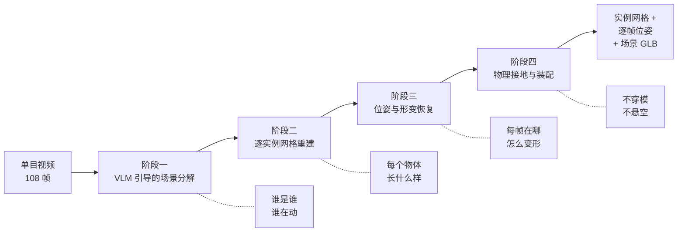
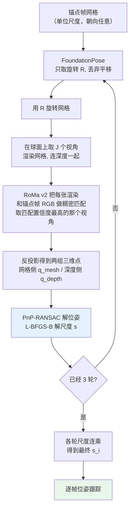

# OVOW：从单目视频重建可仿真的 4D 场景

> **论文**：OVOW: One Video, One World — Instance-Level 4D Scene Reconstruction for Simulation（arXiv 2606.31388，ECCV 2026）
> **代码**：https://github.com/yisuanwang/OVOW
> **关键词**：训练自由 / 实例级网格 / 逐顶点形变 / 物理接地 / 资产导出

**知识链接**：
- [SimFoundry 精读](/论文综述/132_SimFoundry_单视频重建可交互仿真场景) — 同样从单视频造仿真场景，但走的是铰接物体+物理参数估计路线
- [Splatting Physical Scenes 精读](/论文综述/140_SplattingPhysicalScenes_端到端可微Real2Sim) — 端到端可微的 Real2Sim，可微渲染 vs 本文的几何投影
- [real2sim eval 精读](/论文综述/151_real2sim_eval_高斯泼溅软体仿真评估) — 重建结果怎么评估才反映"能不能仿真"
- [相机模型与针孔投影](/前置知识/014a_前置知识_相机模型与针孔投影) — 本文所有反投影与 PnP 的基础
- [RANSAC 鲁棒估计](/前置知识/014d_前置知识_RANSAC鲁棒估计) — 地面拟合、PnP、尺度求解都靠它抗离群点
- [Chamfer 距离](/前置知识/011b_前置知识_Chamfer距离_点云形状相似性度量) — 点集间"最近点距离"的度量，尺度求解的目标函数用的就是它
- [6DoF 位姿估计与 ADD-S 评测指标](/前置知识/015f_前置知识_6DoF位姿估计与ADD-S评测指标) — 逐帧刚体位姿的估计与评测标准
- [RecGen 精读](/论文综述/162_RecGen_生成式联合形状位姿重建) — 同样把真实场景重建成可仿真资产，但走"联合生成形状与位姿"的生成式路线

---

## 一、问题背景：好看的 4D 重建，和能跑的仿真资产，是两件事

单目视频重建这几年进展很快。从一张手机视频里恢复出逐帧的三维几何和外观，已经能做到视觉上相当可信。但只要把目标从"看起来对"换成"能塞进仿真器里跑起来"，绝大多数方法立刻失效。

原因在于，**仿真器需要的是一份带语义清单的资产，而三维重建方法输出的是像素或点的集合**。

具体差在四个地方：

**第一，仿真器需要"物体"，重建器给的是"场景"。** 物理引擎的最小操作单元是刚体、碰撞体、关节。一份整场景的点云或高斯泼溅没有物体边界，仿真器不知道该把哪团东西当作一个刚体来处理，也无从分配质量、摩擦系数。把整个场景当成一个碰撞体，那所有东西都焊死在一起了。

**第二，尺度是任意的。** 单目重建本质上只能恢复到相差一个未知比例因子的几何。对渲染任务来说无所谓——缩放画布就行；对物理任务来说这是致命的，因为在 1/10 尺度下重力加速度 9.8 m/s² 会把一个杯子以十倍的加速度砸到地上。

**第三，运动被混淆了。** 一个在画面里从左边移到右边的汽车，和一只原地扭动的毛绒玩具，在某些表示里都是"像素在动"。仿真器必须把两者彻底分开：前者的全部顶点相对物体本身不变、只有物体坐标系在动；后者必须每个顶点独立记录轨迹。

**第四，平放的物体在几何上是不接地（ungrounded）的。** 重建出来的桌面和杯子，两者之间通常有几毫米的穿模或悬空。渲染看不出来，但物理引擎的第一帧就会让杯子弹起来或者陷进桌面。

OVOW（One Video, One World）针对的就是这四条。它的目标不是把重建质量再提一个点，而是**换一个输出格式**：从"一帧帧的几何"换成"一组可以逐帧施加载荷的实例网格"。


> 左图纵轴是 Object-IoU（实例分离与几何正确性的综合指标），右图是单帧耗时（对数轴）。图中红色是 OVOW：不算同一批方法里最小的模型，却在两个维度上同时领先——精度最高（0.210），单帧耗时最低（3.35 秒，比第二名快 30 倍）。分开看任一张都会漏掉一半结论。

---

## 二、方法总览：四个阶段，一条不训练的组合链

OVOW 的完整方法叫 **training-free**：不训练任何新网络，也不微调任何已有网络，全部由现成的基础模型按固定协议串起来。论文里把输出定义成一个集合：

$$
\mathcal{S} = \{(M_i, \{T_i^t\}_{t=1}^{T})\}_{i=1}^{N}
$$

**这个公式在做什么**：定义整个方法的输出格式——一份场景不是一个网格，而是 $N$ 个实例，每个实例自带一个静态网格和一条逐帧的刚体位姿轨迹。

::: details 📐 公式详解（点击展开）

| 子表达式 | 它是谁 | 它在干嘛 |
|---------|--------|---------|
| $N$ | **实例个数** | 场景被切分成几个物体，由第一阶段的视觉语言模型决定，典型 3-5 个 |
| $M_i = (V_i, F_i)$ | **第 $i$ 个实例的网格** | $V_i$ 是顶点坐标，$F_i$ 是三角面索引。这是物体的"标准姿态"，与时间无关 |
| $T_i^t \in SE(3)$ | **第 $t$ 帧的刚体位姿** | 一个 4×4 矩阵，把 $M_i$ 搬到它在第 $t$ 帧世界坐标系里的位置和朝向 |
| $T$ | **总帧数** | 视频帧数。论文基准统一用 108 帧 |
| $\{\cdot\}_{t=1}^{T}$ | **一条轨迹** | 下标是实例、上标是时间——这个记号是全文的骨架，几乎所有公式都在填这两个位置 |

**用人话读**："第 $i$ 个物体长什么样用 $M_i$ 描述，它每一刻在哪、朝哪用 $T_i^t$ 描述；把所有物体和它们的轨迹打包，就是重建结果。"

**为什么是这个形式而不是一帧帧存网格**：最朴素的做法是把每一帧的网格都存下来，$T$ 帧就是 $T$ 份顶点数据。但一个场景里大部分物体根本没变过形状（桌子、地板、静止的盆栽），逐帧存纯属浪费；更重要的是，逐帧顶点数据里**刚体运动和非刚体形变是完全混在一起的**——你无法判断某个顶点的位移是这个物体整体平移了，还是它自己变形了。把 $T_i^t$ 单独抽出来，等于强制要求方法把这两者解耦，而解耦之后刚体运动才能交给物理引擎按刚体解算。这个公式不是为了省存储，是为了**让输出具备可解算性**。
:::

整条流水线分四段，每段解决上面四个问题中的一个：



> 四个阶段各自对应问题背景里的一个缺口：阶段一解决"没有物体概念"，阶段二解决"没有完整几何"，阶段三解决"运动和尺度混在一起"，阶段四解决"几何不接地"。注意这四段是**串行**的，前一阶段的输出是后一阶段的输入，这一点决定了误差的传播方式——后面的实验分析会用到。

---

## 三、阶段一：VLM 引导的场景分解

### 3.1 采样关键帧，一次性问清所有物体

阶段一的目标是产出一份清单：画面里有哪些物体、每个物体在每一帧的像素范围、以及每个物体属于哪一类运动。

做法是先从视频里均匀抽 $N_{key}=3$ 帧关键帧，**把多张图当作一次多图输入**喂给视觉语言模型（论文用 Qwen3-VL），让它一次性完成三件事：

1. **开放词汇的物体发现**：不限类别表，直接输出画面里有什么。命名规则是 `<名词>_<序号>`，例如 `toy_car_01`、`plush_dino_01`。
2. **运动类型分类**：每个物体必须归入三类之一——`static`（世界位姿近似不变）、`rigid`（只有刚体运动，形状不变）、`deformable`（存在非刚体形变）。
3. **遮挡标记**：物体是否被别的东西挡住了一部分。

**为什么一次问三帧而不是逐帧问**：运动类型这个判断本质上需要时间信息。"这辆车在动"和"这盆花没动"的区别只有在对比不同时刻才能看出来。如果把每一帧单独喂进去，模型看到的永远是一个静止的画面，只能靠"这是不是车"这种类别先验去猜运动性——车会动、花不会动。三帧联合输入提供的正是那个唯一的直接证据：同一个物体在两帧里的位置和形状差了多少。

这一步的输出是这样的一个 JSON：

```json
{
  "objects": [
    {"label": "toy_car_01",  "category": "rigid",      "description": "红色玩具小汽车，位于画面中下部"},
    {"label": "potted_plant_01", "category": "static", "description": "桌上的盆栽，全程未移动"},
    {"label": "plush_dino_01", "category": "deformable", "description": "毛绒恐龙玩具，身体被挤压后变形"}
  ]
}
```

### 3.2 用文本提示把清单变成逐帧掩码

拿到清单后，每个物体名称被当作**文本提示**送进分割模型（论文用 SAM3），得到该物体在**每一帧**的像素掩码。

这一步的工程细节值得说明，因为它决定了后面所有阶段的输入质量：SAM3 的调用方式是**每个物体一次文本提示，在某一帧上落提示，然后向前向后传播到整段视频**，而不是每一帧都重新做一次文本提示。原因是后者会让同一个物体在不同帧里被分割成不连通的碎片——第 30 帧可能圈住了车头，第 60 帧可能圈住了整辆歪着的车，实例身份在时间上断开了。一次提示加视频级传播保证的是**同一性**：从头到尾这都是一号物体。

### 3.3 剔除小目标与背景干扰

清单里总有几个物体是分割不出来的：太小、太模糊、边界不清。OVOW 用一条面积阈值把它们扔掉——如果某个物体的最大掩码面积小于 $\tau_{area}=200$ 像素，整个实例被丢弃，不再进入后续任何阶段。

**为什么要设这条阈值而不是硬着头皮重建**：抠不干净的掩码会让第二阶段的图像转三维模型收到一张残缺的输入，输出的几何会带上一层"毛刺"或者直接糊成一团。这种坏几何在阶段三会被当成真实观测去拟合位姿，把错误放大。论文的消融实验给出了这条阈值的代价曲线（见第八节），200 像素是"宁可少要几个物体，也不要一个坏物体"的平衡点。

**一个容易忽略的分工**：Qwen3-VL 给出的 `category` 是**语义层面的初判**，后面还会用**运动学证据**（掩码的 IoU 变化和质心位移）重新分类一遍。两者冲突时，实现里让视觉语言模型的判断优先。这个取舍的道理在第十一节讨论。

## 四、阶段二：逐实例网格重建

每个物体还需要一个**与时间无关的标准网格** $M_i$ 作为重建的落点。这一步的分支完全由阶段一给出的运动类型决定，因为静态/刚体物体和形变物体能拿到的信息根本不同。

### 4.1 先挑一帧最完整的作为锚点帧

无论走哪条分支，都需要一个参考帧。选法是直观的——挑掩码面积最大的那一帧：

$$
t_i^\ast = \arg\max_{t} \ \lVert M_i^t \rVert_1
$$

其中 $M_i^t$ 是第 $i$ 个物体在第 $t$ 帧的二值掩码，$\lVert \cdot \rVert_1$ 在这里就是掩码里属于该物体的像素个数（对二值图求和等于数个数）。

**这个公式在做什么**：为每个物体挑一个"看得最全"的时刻，作为后续重建和配准的共同基准帧。

::: details 📐 公式详解（点击展开）

| 子表达式 | 它是谁 | 它在干嘛 |
|---------|--------|---------|
| $M_i^t$ | **第 $i$ 个物体第 $t$ 帧的掩码** | 一张二值图，1 表示这个像素属于该物体 |
| $\lVert M_i^t \rVert_1$ | **掩码面积** | 对二值图求 L1 范数就是非零像素计数，即物体这一帧在画面里占多少像素 |
| $\arg\max_t$ | **取最优的帧号** | 输出的不是最大值本身，而是达到最大值的那个 $t$ |
| $t_i^\ast$ | **该物体的锚点帧** | 注意下标是 $i$——每个物体各有自己的锚点帧，不是全场景共用一个 |

**用人话读**："对每个物体，找它被拍得最大最完整的那一帧，以那一帧为准去重建它。"

**为什么用面积最大而不是第一帧或者中间帧**：掩码面积最大通常对应两个条件同时成立——物体离相机最近，且被遮挡最少。这两个条件正是三维重建最想要的：最近意味着像素分辨率最高，遮挡最少意味着可见表面最完整。用第一帧的话，物体可能刚进画面、只有小半个身子露出来，拿这半个身子去重建，模型只能靠先验去猜剩下的大半。用中间帧则可能恰好撞上物体被手或者别的什么东西挡住。
:::

### 4.2 静态/刚体分支：先把被挡住的部分补出来，再造三维

这个分支面对的问题是：锚点帧里的物体可能被别的东西挡住了一部分，而图像转三维模型只看到一张图，它不知道被挡住的地方原本长什么样，于是会**把遮挡物的可见表面当成物体自身的表面**——车前面挡了一只手，重建出来的车头就长成了一只手的形状。

OVOW 的处理是**先做补全（amodal completion），再送进三维生成**。流程是三步：

1. 把物体掩码区域的 RGB 裁出来，连同掩码和视觉语言模型给出的文字描述一起作为条件；
2. 送给图像修复模型（论文用 FLUX.2）去**推断被遮挡区域应该长什么样**，生成一张物体完整可见的图像；
3. 把这张补全后的图像送进图像转三维模型（论文用 Hi3DGen），得到标准网格 $M_i$。

**为什么补全这一步是必要的而不是可选的**：图像转三维模型看到的只有一张图，它对"被挡住的部分"没有任何额外信息来源。如果直接喂一张带遮挡的图，模型会老老实实把遮挡边界当成物体轮廓——这不是模型能力不足，是输入里就没有那个信息。补全步骤的价值在于它把"物体应该长什么样"这个问题交给了拥有类别先验的生成模型，而三维生成模型只需要处理"这张完整的图对应什么立体形状"。

### 4.3 形变分支：先做尺度归一化，再交给四维生成

形变物体不能走上面那条路。原因是图像转三维模型输出的必然是**一个**静态网格，而形变物体在每一帧的形状都不同；如果用锚点帧生成一个网格，那后面所有帧的形状变化就全丢了。

论文的做法是把整段掩码视频送给 **Motion324**，一个专门从视频里生成**拓扑一致网格序列**的模型，它输出一条逐帧变形的网格序列，外加一个参考网格。

但在送进去之前，有一个容易被跳过的预处理——**尺度归一化**：

$$
\hat{I}_i^t = \mathrm{ZoomNorm}\big(I_t \odot M_i^t,\ \mathrm{BBox}(M_i^t),\ \rho=0.65,\ L=512\big)
$$

**这个公式在做什么**：把视频里这个物体裁出来，缩放成"物体永远占据画面固定比例"的方形片段，让后续的四维生成模型看到的物体大小恒定。

::: details 📐 公式详解（点击展开）

| 子表达式 | 它是谁 | 它在干嘛 |
|---------|--------|---------|
| $I_t \odot M_i^t$ | **抠出来的物体** | 逐像素相乘：掩码内保留原图，掩码外全部置黑。$\odot$ 是逐元素乘积 |
| $\mathrm{BBox}(M_i^t)$ | **逐帧包围盒** | 这一帧物体掩码的最小外接矩形，给出中心和大小 |
| $\rho = 0.65$ | **目标占比** | 缩放后让物体的长边占画面边长的 65%，四周留 35% 余量 |
| $L = 512$ | **输出分辨率** | 统一缩放到 512×512，保证送进模型的张量尺寸固定 |
| $\hat{I}_i^t$ | **归一化后的片段** | 物体始终居中、始终占 65% 的方图 |
| $\mathrm{ZoomNorm}$ | **整个操作** | 按 $\mathrm{BBox}$ 裁剪 → 按 $\rho$ 缩放（限制在 0.4 到 2.5 倍之间）→ 平移到画布中心 → 用三次插值采样 |
| 时间平滑 | **隐含的一步** | 缩放系数序列先做中值滤波再做滑动平均，窗口 7 帧。**逐帧独立计算缩放会让画面整体抖动**，物体在生成模型的输入里忽大忽小，序列的时序一致性会被破坏 |

**用人话读**："把这个物体从每一帧里抠出来，缩放成大小固定、永远居中的小视频，再交给形变生成模型。"

**为什么必须逐帧归一化，而不是整段视频用同一个缩放系数**：物体离相机远近会变。一个毛绒玩具可能在第 10 帧很近、第 70 帧被推远了，如果整段用第一个系数，第 70 帧的物体会小到只剩几十个像素，四维模型基本看不到细节。逐帧归一化让物体在每一帧都保持同样的可见尺寸。代价是引入了新的问题——物体在画面里被"锁"在中心不动了，那么**它的真实平移信息就被归一化抹掉了**。这个坑正是阶段三要填的：形变网格序列只提供"物体自己怎么变形"，全局位移必须由阶段三从原始视频里重新解出来。这也是为什么变形物体必须做"形变分量与刚体分量分解"，而不能直接把归一化片段里的网格当最终结果。

另外要注意，逐帧缩放系数本身会抖（掩码边界每帧都在几个像素上跳动），所以先做时间平滑。**如果不平滑**，缩放序列的高频抖动会传递成生成模型输入里的伪运动，模型会把这种抖动当成真实形变的一部分去拟合，输出一条充满噪声的网格序列。

:::

### 4.4 用深度反投影算出初始尺度

两条分支最后都会得到"任意尺度的网格"——Hi3DGen 和 Motion324 都不知道物体在真实世界里有多大，它们的输出落在单位包围盒里。而视频里其实**藏着尺度信息**：深度图。把锚点帧的物体像素按其深度反投影回三维，得到一团点云：

$$
Q_i = \Pi^{-1}\big(M_i^{t_i^\ast} \odot D_{t_i^\ast},\ K_{t_i^\ast}\big)
$$

**这个公式在做什么**：把锚点帧里属于这个物体的像素，按各自的深度值反投影回三维空间，得到一团点云——这团点云就是"这个物体在真实世界里有多大"的观测依据。

::: details 📐 公式详解（点击展开）

| 子表达式 | 它是谁 | 它在干嘛 |
|---------|--------|---------|
| $M_i^{t_i^\ast}$ | **锚点帧的物体掩码** | 一张二值图，圈出这个物体在锚点帧里占哪些像素。它在这里起**筛选**作用：只保留物体自己的像素，背景和别的物体都不参与 |
| $D_{t_i^\ast}$ | **锚点帧的深度图** | 每个像素到相机的距离，由全局几何模型估计得到 |
| $M_i^{t_i^\ast} \odot D_{t_i^\ast}$ | **带掩码的深度图** | 逐像素相乘：掩码内保留深度值，掩码外置零。这样反投影出来的点全属于这个物体 |
| $\Pi^{-1}$ | **反投影算子** | 针孔相机的逆运算——给定像素坐标和它的深度，算出该点在三维修坐标里的位置。它不是矩阵求逆，而是一次显式的坐标构造 |
| $K_{t_i^\ast}$ | **锚点帧的相机内参** | 焦距和主点，反投影必需的参数（原理见[相机模型与针孔投影](/前置知识/014a_前置知识_相机模型与针孔投影)） |
| $Q_i$ | **物体点云** | 结果：一团位于相机坐标系的三维点 |

**用人话读**："把这一帧里属于这个物体的像素，按它们各自离相机多远，摊回到三维空间里，得到一团点。这团点的尺寸就是这个物体在真实世界里的尺寸。"

**为什么要走"反投影取尺寸"这条路，而不直接问重建模型物体有多大**：重建模型输出的网格落在单位包围盒里，它压根不知道真实尺寸——训练数据里所有物体都被归一化了。深度图是整条流水线里**唯一携带绝对尺寸信息的观测量**，因为深度值直接以米（或到相机的实际距离）为单位。把像素摊回三维，得到的点云天然带着正确的尺度。

**这条路径的误差来源**：点云尺寸的准确性完全取决于深度图的质量。深度在物体边缘处（前景和背景的交界）通常是最不可靠的，会有一圈"飞点"拉大包围盒。这正是为什么 $s_i^{(0)}$ 只作为**迭代的起点**而不是最终尺度——阶段三的渲染匹配会把它修正过来。
:::

**为什么要"初始尺度"这个中间产物**：因为这只是一个粗略估计，后面阶段三会迭代细化。但迭代需要一个起点——从一个量级合适的尺度出发，后面的优化几步就收敛；从单位尺度出发，优化器要先爬好几个数量级才能摸到正确的位置，容易掉进局部极小。初始尺度起的是"把优化器放到正确的盆地"的作用。

---

## 五、阶段三：位姿与形变恢复（核心）

这是整个方法里设计最精密的一段，也是最值得细读的一段。它要同时解决三个纠缠在一起的问题：物体有多大（尺度）、每一帧在哪和朝哪（位姿）、哪些顶点在动（形变）。

**为什么这三件事必须一起解**：它们互相依赖。要知道物体在哪，得拿网格去和图像对齐，而对齐的前提是网格大小对；要知道大小，得拿网格表面上的点和深度图上的点配对，而配对的正确性依赖于网格的朝向大致正确；要知道哪些顶点在动，得先扣掉物体整体的刚体运动。任意一个错了，另外两个的输入就都是错的。OVOW 的解法是**迭代**：轮流固定两个、解第三个，转几圈。

### 5.1 为什么不能直接用单帧位姿估计

最直接的想法是：拿锚点帧的 RGB 和深度，连同网格，一起送进一个现成的六自由度位姿估计器（论文用 FoundationPose），一步得到位姿。这个想法在这里会失败，原因有两个：

**原因一：尺度未知。** 位姿估计器的前提是"网格的真实尺寸已知"——它做的是在已知大小的物体上找朝向和位置。现在网格是单位尺度的，如果它被当成真实大小，估计器会把物体放到一个错误的距离上（把一个单位大小的网格对齐到画面里的车，它会认为车只有一米外的拳头那么大）。

**原因二：朝向可能差别很大。** 图像转三维模型输出的网格朝向是任意的，可能整个翻了 90 度。位姿估计的局部优化（从一组初始假设出发去精修）在初始朝向偏差过大时容易收敛到错误解。

所以 OVOW 的做法是把尺度、朝向、精修拆成一条迭代链：先用 **PnP 求出尺度**（PnP 对朝向的鲁棒性比位姿精修器好），再用**渲染匹配把朝向摆正**，反复几轮，最后才做逐帧的姿态跟踪。

### 5.2 迭代链：五步循环，跑 $N_{iter}=3$ 轮



> 循环体在图中是 B 到 G 这一段。三个必须注意的设计：**FoundationPose 只用来定朝向**（它的平移被丢掉）；**尺度不是在渲染空间里猜的，而是从两组三维点的最近点距离解出来的**（下一步会展开）；**每一轮都会重新渲染**，因为上一轮的尺度变化会改变渲染结果，匹配也随之更新。

### 5.3 尺度的来源：两组三维点的最近点距离

这是这条链里最核心的一步。给定匹配好的点对——一组在网格表面上（$q_m^{mesh}$），一组在真实物体的深度表面上（$q_m^{depth}$）——尺度就是让这两组点尽可能重合的那个缩放因子：

$$
s^{(n)} = \arg\min_{s} \sum_{m=1}^{M} w_m \big\lVert \bar{q}_m^{depth} - s \cdot \bar{q}_m^{mesh} \big\rVert_2^2
$$

**这个公式在做什么**：找出一个缩放倍数 $s$，使得把网格上的点乘上 $s$ 之后，整体和深度图上的对应点靠得最近。

::: details 📐 公式详解（点击展开）

| 子表达式 | 它是谁 | 它在干嘛 |
|---------|--------|---------|
| $m = 1 \dots M$ | **匹配点对编号** | 第 $m$ 组配对。RoMa v2 给出的是稠密匹配，$M$ 是保留下来的对数 |
| $q_m^{mesh}$ | **网格侧的三维点** | 渲染出的网格上的点，按其渲染深度反投影回三维 |
| $q_m^{depth}$ | **深度侧的三维点** | 锚点帧里同一像素的真实深度反投影回三维。**这才是"物体实际有多大"的观测来源** |
| $\bar{q}$ | **去中心化的点** | 上划线表示已经减去了各自点集的质心。这一步把平移的影响完全剔除，让目标函数只对尺度敏感 |
| $s \cdot \bar{q}_m^{mesh}$ | **候选尺度下的网格点** | 只缩放坐标——这是一个以质心为中心的纯缩放 |
| $w_m$ | **每对点的权重** | 匹配置信度。RoMa v2 对每对点都给了置信度，高的更被信任 |
| $\lVert \cdot \rVert_2^2$ | **平方欧氏距离** | 两组点之间的"差多远"，平方后对大偏差惩罚更重 |

**用人话读**："把网格和深度点云都平移到各自中心，然后找一个倍数，乘上去之后两组点整体贴得最紧。这个倍数就是物体的真实大小。"

**为什么先去中心化**：如果不去中心，目标函数里 $s$ 和两组点之间的平移是纠缠的——把物体放大两倍同时往某个方向挪一点，也能让距离变小，最优解就不唯一了。去掉质心之后，剩下的唯一自由度就是尺度本身，问题变成一维的、有闭式性质的简单优化。

**为什么用 RANSAC 而不是直接最小二乘**：稠密匹配里必然有错误匹配，尤其在物体边缘和低纹理区域。直接最小二乘会被少数偏差极大的错误匹配带偏（平方损失对大残差特别敏感）。实现在解之前做了两件事：用 PnP-RANSAC 同时解出位姿（RANSAC 靠随机采样一致性来排除离群点，原理见 [RANSAC 鲁棒估计](/前置知识/014d_前置知识_RANSAC鲁棒估计)），以及**裁掉残差最大的 5% 匹配点**，再用 L-BFGS-B 在剩下的点上诉尺度。

**为什么把位姿和尺度分给两个求解器**：PnP 擅长解位姿（它是从二维到三维的对应关系里找投影矩阵），L-BFGS-B 擅长解低维的连续优化（这里是单变量 $s$）。硬要一个求解器同时管六个位姿自由度和一个尺度自由度，收敛性和鲁棒性都会变差。

:::

### 5.4 为什么要渲染多个视角再匹配

匹配是"渲染图 vs 锚点帧"之间做的，但渲染需要一个视角。如果只从锚点帧的相机位置渲染一次，而网格此刻的朝向还差 90 度，渲染出来的图可能完全看不到物体——匹配自然全错。

所以每一轮先在物体周围球面上取 $J$ 个视角分别渲染（连深度图一起渲染），然后用 RoMa v2 把每一张渲染图和锚点帧做稠密匹配，**挑匹配置信度最高的那个视角**继续往下走。这个机制的作用是让循环对初始朝向的偏差有一定容忍度：只要 $J$ 个视角里有那么几个能看到物体的合理侧面，匹配就有救。

最终尺度取**各轮尺度的连乘**，$s_i = \prod_{n} s^{(n)}$。实现里还加了一道护栏：**某一轮解出的尺度如果大于 1.5 或小于 0.5，这一轮结果被丢弃并重来**——这种量级的跳变几乎必然来自匹配失败，而不是真实的尺度修正。

### 5.5 迭代几轮才够

论文对轮数做了消融（见图）。默认取 $N_{iter}=3$。


> 横轴是渲染-匹配-优化循环的轮数，纵轴是实例几何精度。第 1 轮到第 3 轮收益很大（0.58 → 0.72 → 0.78），第 5 轮只涨 0.01，却要多跑两轮完整循环——每轮都包含一次 FoundationPose、一次多视角渲染和一次稠密匹配，是整条链里最贵的一段。**3 轮之后精度饱和，是因为初始尺度估计已经把优化器放到了正确的盆地**（见 4.4），剩下的两轮主要在修正朝向的残余偏差。

### 5.6 逐帧位姿：只在对齐掩码上算误差

尺度定下来之后，剩下的问题是这个物体在每一帧分别位于哪里、朝向如何：

$$
T_i^t = \arg\min_{T} \ \mathcal{L}_{render}\Big(\mathrm{Render}(M_i, T, K_t),\ I_t,\ D_t,\ M_i^t\Big)
$$

**这个公式在做什么**：对每一帧，找一个位姿 $T$，使得把网格按这个位姿渲染出来之后，渲染结果和这一帧的真实 RGB、深度、掩码一致。

::: details 📐 公式详解（点击展开）

| 子表达式 | 它是谁 | 它在干嘛 |
|---------|--------|---------|
| $T$ | **待优化的位姿** | 4×4 的刚体变换，优化变量 |
| $\mathrm{Render}(M_i, T, K_t)$ | **按候选位姿渲染** | 用第 $t$ 帧的相机内参 $K_t$ 把网格投影成 RGB 和深度两张图 |
| $I_t, D_t$ | **该帧的真实观测** | 原视频的彩色帧，以及重建出的深度图 |
| $M_i^t$ | **该帧的物体掩码** | **只在这个掩码覆盖的像素上算误差** |
| $\mathcal{L}_{render}$ | **渲染一致性损失** | 综合颜色差和深度差 |

**用人话读**："猜一个位姿把物体渲染出来，看它和真实画面差多少，然后调位姿让差变小。但只在物体应该出现的像素上比较。"

**为什么一定要用掩码门控**：视频背景里全是与物体无关的内容。如果拿整帧去算渲染误差，优化器会为了迎合背景而去移动物体——比如为了让渲染的物体边界和背景里某个高对比度的纹理边缘对上，把物体平移到错误的位置。掩码门控等于告诉优化器："背景不参与评分，只有物体所在的这块像素算数。"

**跟踪策略**：从锚点帧出发，**向前向后双向跟踪**（$\pm 1$ 帧递推），而不是从头顺序跟踪到尾。理由是对称性——顺序跟踪会让误差单向累积，越到后面越偏；双向跟踪把误差限制在离锚点最远的那些帧，而锚点帧本身的位姿是最可靠的。

**失效回退**：跟踪过程中如果某帧的跟踪质量掉下来（实现里用渲染包围盒和掩码的 IoU 做质量门，低于 0.3 就判定失效），就在那一帧重新做一次完整注册，而不是继续把错误往下传。

:::

### 5.7 从相机坐标到世界坐标

位姿是在相机坐标系里解的，但仿真场景需要的是世界坐标系。转换只需要左乘相机外参的逆：

$$
T_i^{t,w} = E_t^{-1} \cdot T_i^t
$$

$E_t$ 是第 $t$ 帧的相机到世界变换（相机外参），$E_t^{-1}$ 则是世界到相机的变换。

**这个公式在做什么**：把"物体相对相机在哪"换算成"物体相对世界在哪"。

::: details 📐 公式详解（点击展开）

| 子表达式 | 它是谁 | 它在干嘛 |
|---------|--------|---------|
| $T_i^t$ | **相机坐标系里的位姿** | 上一步逐帧跟踪解出来的结果，描述物体相对相机的位姿 |
| $E_t$ | **第 $t$ 帧的相机外参** | 相机在世界里的位姿。注意下标 $t$——相机在动，所以它逐帧不同 |
| $E_t^{-1}$ | **世界到相机** | 外参的逆 |
| $T_i^{t,w}$ | **世界坐标系里的位姿** | 最终要输出的东西。上标 $w$ 就是 world |

**用人话读**："相机自己也在动，所以要把它看到的东西换算成不依赖相机的世界坐标，物体轨迹才有意义。"

**为什么必须换到世界坐标而不是留在相机系**：相机坐标系里的"物体静止"和世界坐标系里的"物体静止"是两回事。手持拍摄时相机在晃，一个放在桌上的杯子在相机系里每帧都在动。仿真器里的重力方向、地面法向量、物体之间的相对位置全都是在世界系定义的——如果留在相机系，连"下面"是哪个方向都说不清。

配套的还有一条**静态锁定**：阶段一被判定为 `static` 的物体，其世界位姿直接锁死在锚点帧的位姿 $T_i^{t_i^\ast}$，逐帧跟踪的结果被丢弃。理由很直接——**静态物体的真实位姿本来就不变，让跟踪器去逐帧估计只会引入抖动**。跟踪器的输出噪声会让一个本该纹丝不动的花盆在 108 帧里轻微漂移，而这种漂移在仿真里会表现为物体的无源运动。

:::

### 5.8 形变分解：把刚体轨迹和非刚体形变彻底分开

对于形变物体，前面得到的东西需要组装成一个统一的表达式：

$$
M_i^{t,w} = T_i^{t,w} \cdot \bar{M}_i^t = E_t^{-1} \cdot T_i^t \cdot \big(s_i \cdot \hat{M}_i^t\big)
$$

**这个公式在做什么**：说明第 $i$ 个形变物体在第 $t$ 帧的世界坐标顶点，是由"物体的标准形变网格"乘上"尺度"，再乘上"相机位姿"，再乘上"世界外参"得到的——四个量各自负责一件事。

::: details 📐 公式详解（点击展开）

| 子表达式 | 它是谁 | 它在干嘛 |
|---------|--------|---------|
| $\hat{M}_i^t$ | **归一化网格序列的第 $t$ 帧** | Motion324 输出的结果，在归一化片段里。它只描述**物体自己怎么变形**，不含任何全局位置信息 |
| $s_i$ | **该物体的真实尺度** | 阶段三解出来的那个标量，把归一化尺度换算成米 |
| $T_i^t$ | **该帧的刚体位姿（相机系）** | 从原始视频里跟踪出来的全局运动 |
| $E_t^{-1}$ | **世界外参的逆** | 换算到世界坐标系 |
| $M_i^{t,w}$ | **最终的世界坐标顶点** | 直接可以喂给物理引擎的逐帧几何 |

**用人话读**："标准形变给出'物体此刻的形状'，尺度把它变成真实大小，位姿把它摆到画面里的位置，外参把它换到世界坐标。四件事，四个量，各管一段。"

**为什么非要拆成这个形式，不能直接把归一化片段里的网格当最终结果**：因为归一化（4.3 节）**故意抹掉了全局位移**——那一小段视频里物体永远居中。如果直接拿它当结果，得到的是一个所有物体都堆在原点、各自原地扭动的场景，全局轨迹全部丢失。拆解的意义就在这里：$\hat{M}_i^t$ 提供局部形变，$T_i^t$ 提供全局刚体运动，两者相乘才恢复出真实的四维运动。

**这个分解还有一个直接的好处**：它让输出**可解算**。一个只有逐帧顶点数据的物体，物理引擎无从下手——引擎不知道哪些顶点位移是外力造成的、哪些是物体内部结构变化。分解之后，$T_i^t$ 是一条干净的刚体轨迹，可以直接作为刚体参与碰撞解算；而 $\bar{M}_i^t$ 是逐帧的形状序列，如果它是由外力引起的形变，还可以反过来去反推需要多大的力。这正是本文标题里"模拟就绪（simulation-ready）"的实际含义。

:::

## 六、阶段四：物理接地

到这里每个物体都有了正确的尺度和逐帧轨迹，但还有一个问题没解决：**它们之间的相对位置是"几何上看起来对"，不是"物理上站得住"**。重建出的桌子和杯子之间可能有几毫米的穿模或者悬空——渲染时完全看不出来，但物理引擎一启动，这几毫米会让杯子在第一帧就以错误的速度弹开。

阶段四要做两件事：找到地面，然后让所有物体按重力方向落到正确的高度，同时物件之间的堆叠关系不能破坏。

### 6.1 找地面：从 5 个候选中挑一个

做法是从静态物体的点云里用 RANSAC 拟合**多个**平面候选（默认 5 个），然后从中选一个最合理的。为什么不直接拟合一个：场景里通常不止一个平面——地板、桌面、货架层板都是平面，直接拟合出来的那个可能是桌子面而不是地面，或者是多个平面的混合。

候选的评分有两个标准，**必须同时满足**：

**标准一：物体大多在平面之上。** 对第 $j$ 个候选平面（法向 $n_j$、截距 $d_j$），统计有多少个顶点满足 $v^T n_j + d_j \geq -\varepsilon$——即位于平面上方（或在容差内）。这个比例越高，说明这个平面越像是"承托一切的那个面"。用静态物体的顶点来统计，因为动态物体可能在任何高度。

**标准二：物体底部贴着它。** 光有"在上方"不够——一个悬在物体上方的平面（例如天花板）也满足标准一。所以还要算每个物体的最低 3% 顶点到这个平面的有符号距离，取中位数，**越小越好**（贴着比悬空好）。

两个标准合起来的排序是：先比"在上方"的比例（越高越好），再比底部贴近程度（越小越好），最后用内点数做兜底。

**法向的朝向怎么定**：平面方程 $v^T n + d = 0$ 里把 $n$ 和 $d$ 同时取反，平面本身不变，但"上方"的定义翻转了。这必须解出来，否则重力会朝天上。论文用一个很朴素的先验：**相机通常是正着拿的**，所以图像的上方向大致对应世界坐标的上方向。实现里把平面法向投影回若干帧的图像平面，看它和"图像上方"的一致程度，如果总体相反就把法向取反。

定下平面之后，把世界坐标旋转到让这个平面成为 $z=0$ 的水平面，重力方向随之确定为 $-z$。

### 6.2 重力沉降：三个分支

有了地面，每个物体沿重力轴的位移量就由它底部接触点到地面的距离决定：

$$
\Delta z_i^t =
\begin{cases}
-(d_{\min} + \varepsilon) & d_{\min} < -\varepsilon \quad \text{（穿模，抬起）}\\[4pt]
0 & \lvert d_{\min}\rvert \leq \varepsilon \quad \text{（死区，不动）}\\[4pt]
-\min(d_{\min} - \varepsilon,\ \delta_{\max}) & d_{\min} > \varepsilon \quad \text{（悬空，下沉）}
\end{cases}
$$

**这个公式在做什么**：根据物体底部离地面多远，决定把它往上抬还是往下放，抬/放多少。三种情况对应穿模、刚好接触、悬空。

::: details 📐 公式详解（点击展开）

| 子表达式 | 它是谁 | 它在干嘛 |
|---------|--------|---------|
| $d_{\min}$ | **底部接触点到地面的最小有符号距离** | 取物体最低的 10% 顶点作为"接触点集"，算它们相对平面的有符号距离，取最小值。符号约定：正表示在地面之上，负表示已经陷进去了 |
| $\varepsilon$ | **接触容差** | 场景包围盒对角线的 0.2%。小于这个量的偏差视为"已经接触" |
| $\delta_{\max}$ | **下沉上限** | 场景包围盒对角线的 2%。悬空时最多往下放这么多 |
| $\Delta z_i^t$ | **沿重力轴施加的平移** | 最终加到物体世界位姿的平移分量上 |

**用人话读**："陷进去了就抬到刚好接触；已经在容差范围内就一动不动；悬空就往下放，但最多只放一点点。"

**为什么要有中间的"死区"（$\lvert d_{\min}\rvert \leq \varepsilon$ 时 $\Delta z = 0$）**：这是整个函数设计里最容易被当成多余、实际上最关键的一项。如果没有死区，函数就是一个连续的"把物体精确放到地面上"的映射，而 $d_{\min}$ 是**逐帧估计**出来的——它带着深度噪声和掩码误差，每帧都在小幅跳动。逐帧精确归位会让物体在每一帧都被微调几个毫米，表现为持续的**高频抖动**。死区的作用是把"已经在容差内"的帧当作无需修正，吸掉这部分噪声。这是一个用**允许残留在容差内**来换取**时间稳定性**的取舍。

**为什么下沉要封顶（$\delta_{\max}$）**：悬空有两种成因，一种是物体真的悬在半空（比如被手举着），另一种是深度估计在物体下方产生了空洞，导致算出来的底面比真实底面低了很多。第一种情况下让物体往下掉是对的，第二种情况下往下掉会把物体砸进地面。封顶让最坏情况下的误差不超过场景尺寸的 2%。**如果不封顶**，一次深度空洞就能让物体瞬移到地面以下，而下一帧又被抬回来——变成来回弹跳。

:::


> 纵轴是施加的平移量，横轴是底部接触点到地面的有符号距离。中间淡红色区域是死区。**虚线是对照组**：如果去掉下沉封顶，悬空再远也会被一路拉到地面（虚线沿对角线无限延伸），深度估计的一个空洞就会造成一次瞬移。实线在 $\delta_{\max}$ 处被削平，代价是悬空过高的物体停在半空中，收益是不再产生弹跳。

### 6.3 物件之间的支撑：把对方的表面当作局部地面

只处理地面还不够。如果把一本书放在桌上，地面沉降只保证书不穿进地板——书可能穿进桌子，或者浮在桌面上方。

处理方式是把**已经处理过的物体**的表面当作局部地面。对物体 $i$ 的每个底部采样点 $v$，在物体 $j$（先处理的那个）的表面顶点集里找最近点，如果距离小于阈值 $\tau_{contact}$（场景对角线的 3%），就认为这两者接触，把 $v$ 到该表面的位移投影到重力方向上，并入 $d_{\min}$ 的计算。

**为什么阈值要按场景尺寸缩放而不是取固定毫米数**：同一段代码要处理从桌面上的一支笔到房间里的一个箱子。固定 5 毫米对笔来说是巨大的距离（会把附近不相干的东西也当成支撑），对箱子来说又太小（轻微的深度误差就漏掉了真实接触），所以必须相对场景尺度定义。

**处理顺序为什么重要**：物体按"最低点"排序，最低的先处理。先处理意味着它先被放稳，后处理的物体再去和它对齐。顺序反了的话，一个悬空的箱子可能先被放下，压到后面才处理的、本来位置正确的物体上。

**堆叠的传递**：这套机制天然支持多层堆叠——A 在地上，B 在 A 上，C 在 B 上。处理 A 时地面是参考，处理 B 时 A 的表面是参考，处理 C 时 B 的表面是参考。整个过程迭代 $N_{asm}=2$ 轮，因为第一轮里后处理的物体移动之后，先处理的物体可能需要重新检查。

### 6.4 光照：从视频第一帧恢复环境贴图

除了几何，阶段四还负责一件事：**恢复场景的光照**。做法是把视频的第一帧送进一个本征分解模型，得到一张 HDR（高动态范围）环境贴图，作为场景在世界里的光源。

**为什么这件事对"可仿真"有价值**：仿真环境里如果只有几何没有光照，渲染出来的物体要么是平的（用固定方向光），要么和原视频的光照条件对不上。有了从原始视频恢复的环境贴图，重建出的场景在新视角下渲染时，光照方向和原视频一致——这对于把重建场景用作训练数据（例如合成新视角的监督信号）是必要的。

---

## 七、OVOW-Bench：为"能不能仿真"设计的基准

论文提出了配套的基准，这部分值得单独看，因为它明确回答了"什么样的重建结果才算可仿真"。

### 7.1 数据构成

| 基准 | 场景数 | 特点 |
|------|--------|------|
| OVOW-3D-Scene-Bench | 120 | 静态场景，考察实例分解与几何正确性 |
| OVOW-4D-Scene-Bench | 120 | 动态场景，每个场景至少含一个刚体运动物体 |

两个基准统一规格：每场景 3-5 个实例，108 帧，512×512 分辨率。静态资产来自 Objaverse-OA 和 Truebones Zoo，环境光照贴图来自 Poly Haven。

**为什么要把静态和动态分成两套**：静态基准里没有任何运动，位姿估计退化成一次对齐，考察的是"分得开吗、形状对吗、尺度对吗"；动态基准里运动是主角，考察的是"轨迹解出来了吗、刚体和形变分开了吗"。混在一起会让平均分数掩盖掉两种能力的差异。

### 7.2 评测协议里两个关键的约定

**约定一：对齐方式。** 重建结果和真值之间差一个全局变换（坐标系定义不同），评分前必须对齐。默认用包围盒对齐（bbox），并把地面物体排除在配准之外。

**约定二：对比方法只跑单帧，本文跑整段视频。** 这一点必须讲清楚，否则数字会被误读——论文里的所有基线都是**单帧重建方法**，它们的设计目标是"从一张图得到场景"，没有时序概念。为了公平比较，论文把它们在 7 个均匀采样的帧上各跑一遍然后取平均，再把耗时和显存也按"每次生成一帧"来计。**OVOW 是唯一一个消费完整视频的方法**。这是优势也是限制：优势是它天然利用了时序（静态锁、跟踪、形变序列），限制是它要求输入是一段能看出运动的视频，单张图只能退化处理。

### 7.3 指标定义

| 指标 | 含义 | 方向 |
|------|------|------|
| Scene-IoU (AABB / OBB) | 整场景包围盒的 IoU，AABB 是轴对齐、OBB 是有向 | 越高越好 |
| Object-IoU | 实例级包围盒 IoU，先用匈牙利算法把预测实例和真值实例配对 | 越高越好 |
| PL | 逐像素的 L1 光度误差，$\mathrm{PL} = 100 \cdot \mathrm{mean}(\lvert \mathrm{RGB}_{gt} - \mathrm{RGB}_{pred} \rvert / 255)$ | 越低越好 |
| N-CLIP | CLIP 语义距离，$\mathrm{N\text{-}CLIP} = 10 \cdot \mathrm{mean}(1 - \cos(\mathrm{CLIP}_{pred}, \mathrm{CLIP}_{gt}))$ | 越低越好 |
| s/frame | 单帧耗时 | 越低越好 |
| VRAM | 峰值显存 | 越低越好 |

**为什么要同时放"几何指标"和"感知指标"**：Scene-IoU 和 Object-IoU 是纯几何的——它们惩罚任何位置的偏移，哪怕人眼看不出差别。PL 和 N-CLIP 是感知的——PL 看渲染出来的图像像不像，N-CLIP 看语义对不对（用 CLIP 特征算，能容忍"位置略有偏差但确实是同一类物体"）。一个方法可能几何分很高但渲染发灰，也可能渲染很漂亮但物体位置错得离谱，两组指标必须一起看。

### 7.4 实验结果

**4D 动态基准（Table 2，主结果）**：

| 方法 | Scene-IoU<br>(AABB) | Scene-IoU<br>(OBB) | Object-IoU | PL ↓ | N-CLIP ↓ | s/frame ↓ | VRAM<br>(GB) |
|------|------|------|------|------|------|------|------|
| CAST | 0.091 | 0.176 | 0.080 | 13.10 | 1.74 | 365 | 10.5 |
| SAM3D | 0.055 | 0.135 | 0.050 | 10.20 | 1.98 | 103 | 33.5 |
| VIGA | 0.127 | 0.172 | 0.016 | 24.10 | 2.49 | 788 | 31.5 |
| MIDI | 0.095 | 0.198 | 0.174 | 5.60 | 1.56 | 234 | 17.7 |
| SceneGen | 0.096 | 0.183 | 0.051 | 8.20 | 1.54 | 152 | 29.6 |
| TabletopGen | 0.072 | 0.200 | 0.034 | 7.50 | 1.91 | 638 | 14.0 |
| **OVOW** | **0.180** | **0.440** | **0.210** | **2.90** | **1.43** | **3.35** | 26.0 |

**静态基准（Table 1）里 OVOW 的对应数字**：Object-IoU 0.190，PL 5.70，N-CLIP 1.87，272 s/frame。

静态基准和动态基准的对比本身很有信息量：OVOW 在动态基准上的 Scene-IoU (OBB) 高达 **0.440**，比静态基准的 0.218 高出一倍。这个反直觉的结果原因是**运动提供了额外的几何约束**——静态场景里多个物体的相对位置只能靠单帧深度推测，容易糊在一起；有了运动，物体在时序上的独立位移轨迹把它们彻底分开了。

另一组数字同样值得注意：**单帧耗时 3.35 秒 vs 第二名的 103 秒，快 30 倍**；而 PL 从 5.60 降到 2.90，接近腰斩。论文把这个速度优势归功于架构选择——OVOW 没有跑任何一次扩散采样来做场景级生成，全程用的是几何配准和现成的重建网络。

**关于这个 3.35 秒的一个必要说明**：这个数字是论文基准的口径。仓库 README 给出的端到端实测是"108 帧视频约 19-22 分钟"，折算约 11-12 秒/帧——两者并不矛盾但**统计口径不同**，README 那个数字包含了 Blender 装配、渲染和编码这些论文基准里不计入的步骤。论文里没有把这一步算进 s/frame，仅凭仓库代码无法把两者严格对齐，引用时需要注意区分。

---

## 八、消融实验：三个关键超参各有代价曲线

### 8.1 迭代轮数 $N_{iter}$

见 5.5 节的图。$\{1, 2, 3, 5\}$ 轮对应 IoU-B $\{0.58, 0.72, 0.78, 0.79\}$。第 3 轮之后饱和，默认取 3。

### 8.2 形变归一化的目标占比 $\rho$

$\rho \in \{0.55, 0.65, 0.75\}$ 对应 IoU-B $\{0.74, 0.78, 0.76\}$。0.65 最优，但差距很小（0.04 以内）。

**为什么 $\rho$ 太大和太小都不好**：$\rho$ 太小，物体在归一化片段里占的像素太少，四维生成模型看不清纹理和边界细节；$\rho$ 太大，物体顶到画面边缘，**快速运动时会被裁掉一部分**（裁剪框是按掩码算的，但缩放是全局统一的，运动幅度大的帧会因为物体一度接近画面边缘而损失内容）。0.65 是在"看得清"和"不裁掉"之间取的折中。

### 8.3 面积阈值 $\tau_{area}$

$\tau_{area} \in \{100, 200, 400\}$ 像素对应可用场景比例 $\{84.9\%, 86.8\%, 85.7\%\}$。

**这条曲线是典型的"过犹不及"形状**，而且它的纵轴不是精度而是**有效场景比例**——即有多少场景里的所有实例都被成功重建出来。阈值 100 像素时有更多小物体被纳入，但其中一部分分割质量太差，重建失败拖累了整个场景；阈值 400 像素时小物体被大量丢弃，场景直接不完整；200 是可用性与质量的平衡点。

### 8.4 装配约束的影响

| 超参 | 取值 | 仿真稳定性 |
|------|------|-----------|
| 接触阈值 $\tau_{contact}$ | 2% / **3%** / 4%（场景对角线） | 79.8% / **82.7%** / 81.5% |
| 装配迭代 $N_{asm}$ | 1 / **2** / 5 | 78.9% / **82.7%** / 82.8% |

$\tau_{contact}$ 是"多远算接触"，太平会让本该接触的物体被判定为悬空（下落时砸进支撑物），太大会把不相干的物体误判为支撑（本该掉下去的物体被挂在半空）。

$N_{asm}$ 从 1 增到 2 有 3.8 个百分点的提升，从 2 增到 5 只提升 0.1。原因是**第一轮解决了绝大部分问题**：物体被放到正确高度后，第二轮主要是检查先行物体的位移有没有影响后行物体，这类相互影响在迭代一次之后基本收敛。

## 九、误差传播：为什么整条链的失效率只有 17%

四阶段串行，直觉上误差会层层放大——阶段一分错一个物体，后面全错。但论文统计的可靠性级联显示失效率是收敛的：

| 环节 | 成功率 | 相对上一环节的损失 |
|------|--------|-------------------|
| 运动类型分类正确 | 95.4% | — |
| 刚体物体重建成功 | 93.1% | -2.3 |
| 形变物体重建成功 | 88.7% | -4.4 |
| 位姿恢复成功 | 92.4% | +3.7 |
| 最终场景有效 | 86.8% | -5.6 |
| 仿真稳定 | 82.7% | -4.1 |

（注：位姿恢复的百分比高于形变重建，是因为两者的分母不同——位姿恢复统计的是进入该环节的对象，其中相当一部分是更容易的刚体物体。）

**为什么误差没有像预期那样层层放大**：因为**每个阶段都有独立的失败判定和丢弃机制**。阶段一有面积阈值，阶段二的重建有质量检查，阶段三的尺度迭代有 0.5-1.5 的护栏和跟踪失效率的回退注册，阶段四有几何一致性检查。一个物体在前面某环节被判定失败时，它会被排除而不会带着错误继续往下走。论文原文的说法是"失败很少传播"（failures rarely propagate），机制上就是这些护栏。

这解释了一个设计上的取舍：**OVOW 倾向于放弃而不是猜**。面对一个分割质量差的物体，多数重建系统会尽力而为地输出一个结果，因为它至少看起来是完整的；OVOW 让它消失。对渲染任务来说这是损失（画面少了个东西），对仿真任务来说是正确选择（一个位置错误的物体会让整个场景的物理不稳定）。

---

## 十、工程实现：四万五千行自有代码的真实形状

论文只有几页，仓库有完整的可复现实现。这部分对想上手的人比方法本身更有信息量。

### 10.1 二十一个编号步骤，一条 shell 长链

整个流程被拆成 21 个编号步骤，通过一个 shell 分派器串起来，每步一个 shell 函数。默认执行的是其中 13 步：


> 绿框的步骤 6 是论文方法的主体（阶段二+阶段三），橙框的步骤 14 产出最终场景文件。中间省略的步骤里有导出、诊断和可选环节。**步骤编号不连续是刻意的**——它保留了开发过程中的历史顺序，允许单独重跑某一步而不重跑全链，这对调试一个要跑二十分钟的流程是必需的工程属性。

**代码规模的实际构成**：仓库里 shell 加 Python 约 21.5 万行，但其中 17.9 万行是随仓库一起打包的第三方重建框架（图像转三维、位姿估计、追踪这些子模块的完整源码树）。OVOW 自己写的部分约 4.5 万行，分三块：引擎顶层约 1.7 万行（流程编排与核心逻辑），工具层约 2.0 万行（各阶段的独立脚本——网格导出、物理投影、渲染），掩码与分解层约 0.9 万行（视觉语言模型调用与分割）。**这个比例比总行数更有信息量**：一个号称"用现成模型串联"的方法，串联和胶水代码本身就有中等规模软件工程的体量，而它集成的模型源码比它自己大四倍。

### 10.2 常驻服务：为什么需要，代价是什么

流程的第一步是把三个大模型加载起来。每次运行都重新加载，光启动就吃掉十几分钟，而且**同一个模型在一条流水线里会被调用几十次**（每个物体一次）。所以仓库提供了常驻服务模式：模型进程保持存活，通过队列接收请求。

**代价是显存和状态管理**。常驻的模型不会释放显存，三个环境（重建、分割、形变各一个）的依赖版本冲突无法用同一个 Python 环境解决，只能开三个独立的 conda 环境。这类"为了能跑必须这么搭"的结构在论文里一个字都不会提，但它是复现这类组合式方法时最大的实际障碍。

### 10.3 依赖里最容易被低估的一个：Blender

流水线里 Blender 是**硬依赖**，不是一个可选的渲染工具。装配、网格序列导出、GLB 合并、动画剪辑合并、乃至最终的两路渲染对比视频，都在 Blender 里完成。

**为什么用 Blender 而不是自己写导出**：因为要输出的是一个**带逐帧动画的场景文件**，而不是一堆静态网格。glTF 格式里的动画通道、morph target、可见性控制这些东西有大量边界情况（坐标系约定、法向量的增量编码、动画采样插值模式），用 Blender 现成的导入导出能力比自己写一个 glTF 序列化器可靠得多。代价是引入了整个 Blender 作为运行依赖。

### 10.4 输出的到底是什么：GLB，不是物理描述

这一节要纠正一个常见误解。目录里流水线的步骤名叫"物理投影"，输出的文件也叫 `scene_anim_..._physics_...glb`，容易让人以为导出的是一份带物理属性的资产。

**实际导出的是一个 GLB 文件**，包含：

- 每个刚体/静态物体一条逐帧的平移+旋转动画通道；
- 每个形变物体一组 **morph target**（每个目标记录相对第 0 帧的逐帧顶点与法向增量，配一条权重动画）——这是 glTF 表达形变网格序列的标准方式；
- 一个可选的视觉地面（两三角面）；
- 可选的 HDR 环境贴图。

**不包含**的东西需要明确列出来，因为它们正是"可仿真"这个词最容易让人误会的地方：文件里**没有碰撞体定义、没有质量、没有摩擦系数、没有关节约束，也没有 glTF 的物理扩展**。换句话说，它是一个**已经把穿模和悬空修好的几何资产**，而不是一个物理引擎可以直接加载并解算的模型。

接触处理本身也不是物理仿真。它的实现是把物体沿重力轴做**几何投影**：算底部接触点的有符号距离，在穿模时抬起、悬空时下沉（6.2 节的公式），物件之间用最近点距离判断支撑关系。整个过程是一次性的位置修正，**没有求解器在里面**——不迭代动力学、不算冲量、不解约束方程。

仓库里确实存在一个真正的刚体仿真脚本（设置 240 Hz 步长、平面被动、物体主动、质量 1.0、摩擦 0.6、重力 9.81，然后烘焙成关键帧），但它是**独立的离线工具，没有被流水线调用**。这个文件的存在反而说明了一件事：作者很清楚几何投影和真实仿真之间的差距——把物体放到正确位置上是一回事，让它在那里稳定地待住是另一回事。前者用几何就够了，后者需要求解器。论文的方法解决的是前者。

**这对使用者的实际影响**：拿到 OVOW 的输出后，要在仿真器里用起来，还需要自己补一步——给每个实例指定碰撞体形状（凸包或者网格）、估质量、设摩擦系数。论文的贡献在于把这些工作之前那些更麻烦的步骤（分割、重建、尺度、轨迹、接地）自动化了。

### 10.5 复现的成本

| 项目 | 要求 |
|------|------|
| 显存 | ≥40 GB |
| 显卡驱动 | ≥550 |
| CUDA | 12.1+ |
| 磁盘 | 约 120 GB（其中模型权重约 55 GB） |
| 环境 | 3 个 conda 环境，首次配置约 30-60 分钟 |

仓库提供了两级自检：图像链路冒烟测试约 3-5 分钟，视频链路（768×768、108 帧、完整四维流程）约 19-22 分钟。**这个数字是评估复现难度时最该看的一个**——一次完整验证要等二十分钟，意味着调试一轮的周转时间就是一小时起步。

### 10.6 许可

代码本身是 MIT，但**打包的第三方组件不是**。论文实际组合了十来个基础模型，其中若干是非商用许可，还有一个是学术专用（比非商用更严格）。仓库提供了逐组件的来源与许可清单，并明确声明整体是"非商用研究用途发布"。

**这对想拿来做产品的人是个实质限制**：方法的思路（用现成模型串联 + 几何配准 + 接触投影）完全可以自己实现，但要直接复用这份代码走商业路径，需要逐个替换掉其中的非商用组件。

---

## 十一、失败案例与局限

论文的附录部分写得很实在，这部分对判断方法适用范围比主结果更有价值。

### 11.1 失败案例

**物体数量过多（超过 10 个）**。视觉语言模型会漏掉小物体、把相邻物体合并成一个、或者把部件当成独立物体；同时场景点云的质量也会下降（全局几何的精度随物体密度增加而降低）。这个上限是方法当前的天花板之一。

**极端形变**。这里指的是**拓扑变化**——把东西从袋子里抽出来、物体断裂、倒液体、大块布料展开。原因是四维生成模型的核心假设是**拓扑一致**：它输出的是同一个网格在每一帧的顶点位移，网格的连接关系（哪些顶点构成三角面）全程不变。如果真实过程中物体分裂成两个、或者从袋子里冒出一个新表面，这个假设就不成立，生成出的网格会把新出现的表面强行接到原有拓扑上，产生错误的几何。这是方法的结构性限制，不是调参能解决的。

### 11.2 局限

**一、对基础模型的依赖是硬约束。** 前面所有阶段的成败都绑定在几个外部模型上，任何一个给出错误答案，后面都会继承：

- 视觉语言模型会把缓慢移动的物体判成 `static`（单看每一帧都像静止），一旦判成静态，它的世界位姿就被锁死，真实的缓慢运动全部丢失；
- 图像转三维模型对**遮挡超过 80%** 的物体、或者少见类别的物体，重建质量明显下降；
- 全局几何模型给出的深度如果有系统性偏差，尺度求解会解出一个错误的绝对尺度——**注意这个错误的性质**：几何形状可能仍然是对的，但整个场景的比例是错的，这对物理仿真来说和形状错了同样致命。

**二、物理交互只覆盖"重力对齐的接触和简单堆叠"。** 没有铰接关节（抽屉、门不会被解出旋转轴），没有布料与布料的相互作用，没有依赖摩擦力的排布——比如**斜靠在墙上的一根杆**，这套方法处理不了，因为它没有"摩擦力可以沿斜面方向提供支撑"这个概念，只能沿着重力轴做垂直投影。这类静力学上依赖摩擦平衡的构型会被错判为"悬空"然后被强行拉到地面。

**三、输入条件的限制。** 薄壁物体、镜面反射、透明物体、低纹理表面都会让深度和匹配出问题；运动模糊和光照剧烈变化同理。

**四、静态相机的隐含假设。** 方法依赖相机内参和外参在帧间的关系来解算世界位姿，拍摄者绕物体走 360 度或者做大幅度平移时，解算会退化。实际使用中应该用相对固定的机位、让被摄物体动。

**五、不重建背景。** 输出只包含前景实例，背景（墙、地板纹理、远处的家具）被丢弃。对需要完整场景的应用来说，背景得另外补。

---

## 十二、总结对比

| 维度 | OVOW | 典型单帧场景生成方法 | 典型铰接物体 Real2Sim 方法 |
|------|------|--------------------|--------------------------|
| 输入 | 单目视频（108 帧）或单图 | 单张图像 | 单目视频 + 交互 |
| 输出 | 实例网格 + 逐帧 6-DoF 轨迹 + 场景 GLB | 整场景网格或三维表示 | 铰接部件 + 关节参数 |
| 实例划分 | 视觉语言模型开放词汇分解 | 依赖类别表或分割先验 | 依赖运动线索分割 |
| 尺度 | 逐物体从深度反投影求解 | 任意尺度或单帧推测 | 场景级估计 |
| 刚体/形变 | 显式分类 + 形变分解 | 通常不区分 | 关节运动 |
| 物理处理 | 重力轴几何投影 + 支撑约束 | 无 | 关节约束 + 参数估计 |
| 训练 | 完全免训练 | 通常需要训练 | 通常需要训练或微调 |
| 单帧耗时 | 3.35 秒 | 103-788 秒 | 分钟级 |
| 短板 | 拓扑变化、铰接关节、摩擦平衡、背景 | 时序不一致、实例粘连 | 依赖可交互采集 |

**OVOW 的位置**：它不代表重建精度的新纪录，代表的是**输出格式的转变**——从"一帧帧的几何"转向"一份带实例清单和轨迹的资产"。这个转变的价值不体现在 IoU 那一位小数上，而体现在"生成出来的东西能不能被别的东西消费"。论文标题里的"One Video, One World"取的正是这个意思：一段视频换一个可以拿去跑的世界。

**最值得借鉴的三个设计**：

1. **把"谁在动"交给有时间信息的输入去判断**（多帧联合询问视觉语言模型），而不是靠单帧的类别先验去猜。这个做法简单但在很多流水线里被忽略。
2. **刚体轨迹与非刚体形变必须显式分解**，且分解要在归一化之前就想清楚——归一化抹掉了全局位移，就必须有一步把它重新解出来。
3. **每个阶段都要有独立的失败判定**，宁可丢物体也不带错误往下传。这条是整条链失效率收敛（17%）的直接原因。

---

## 延伸阅读

- [SimFoundry 精读](/论文综述/132_SimFoundry_单视频重建可交互仿真场景) — 同样从单视频出发，路线是从视频里估计物理参数和铰接结构，和 OVOW 的纯几何路线互补
- [Splatting Physical Scenes 精读](/论文综述/140_SplattingPhysicalScenes_端到端可微Real2Sim) — 可微渲染路线，把几何、材质、光照一起优化
- [real2sim eval 精读](/论文综述/151_real2sim_eval_高斯泼溅软体仿真评估) — 如何评估重建资产在仿真里的表现
- [RoboGSim 精读](/论文综述/150_RoboGSim_Real2Sim2Real高斯泼溅仿真器) — 把重建场景接进机器人仿真来生成训练数据
- [相机模型与针孔投影](/前置知识/014a_前置知识_相机模型与针孔投影) — 反投影与 PnP 的基础
- [RANSAC 鲁棒估计](/前置知识/014d_前置知识_RANSAC鲁棒估计) — 地面拟合、PnP、尺度求解共用的抗离群点工具
- [Chamfer 距离](/前置知识/011b_前置知识_Chamfer距离_点云形状相似性度量) — 点集最近点距离的度量方式
- [IoU 交并比](/前置知识/009b_前置知识_IoU交并比) — 本文多个指标的基础
- [PhysDreamer 精读](./168_PhysDreamer_视频生成先验驱动的物体物理交互) — 同样以单目输入为前提，但用视频生成先验补足观测缺口来辨识物理参数
- [PAC-NeRF 精读](./164_PAC-NeRF_物理感知连续场的材料参数辨识) — 视频到物理参数这条线的开创工作，与 OVOW 的纯几何路线互补

