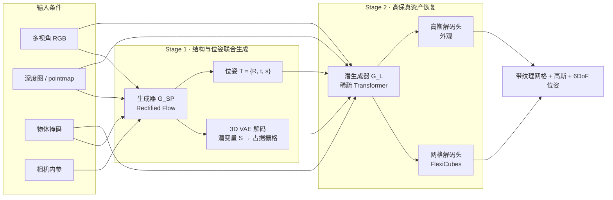
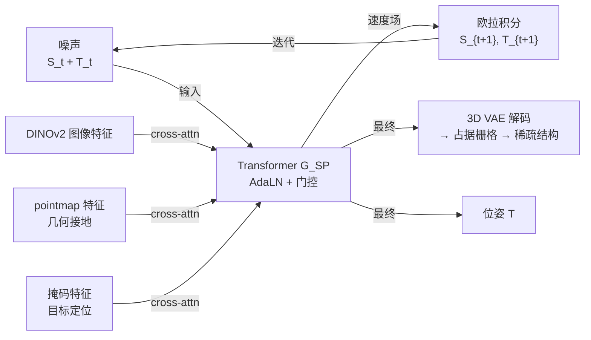
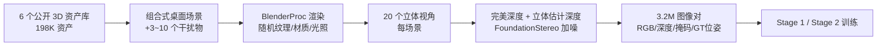

# RecGen 精读：把形状和位姿一起生成，把杂乱真实场景变成可仿真资产

> **论文**：Reconstruction by Generation: 3D Multi-Object Scene Reconstruction from Sparse Observations（arXiv 2604.27106，ECCV 2026）
> **作者**：Andrii Zadaianchuk、Leonardo Barcellona、Lennard Schuenemann、Christian Gumbsch、Zehao Wang、Muhammad Zubair Irshad、Fabien Despinoy、Rahaf Aljundi、Stratis Gavves、Sergey Zakharov
> **机构**：阿姆斯特丹大学、KU Leuven、丰田欧洲研究院（TME）、丰田研究院（TRI）
> **代码**：https://github.com/TRI-ML/recgen ｜ **项目页**：https://reconstruction-by-generation.github.io
> **基础模型**：从微软 TRELLIS-image-large 微调而来

**知识链接**：
- [6DoF 位姿估计与 ADD-S 评测指标](/前置知识/015f_前置知识_6DoF位姿估计与ADD-S评测指标) — 本文的核心评测全部建立在 ADD-SB 与 CD_norm 上
- [TRELLIS 深度解析：从一张图到三维资产的完整链路](/系列/trellis_deep_dive/01_全景图_TRELLIS在解决什么问题) — RecGen 的 Stage 2 直接沿用 TRELLIS 的 SLat 表示与 Rectified Flow 解码
- [TRELLIS.2 深度解析：从稀疏体素到全材质 3D 资产生成](/系列/trellis2_deep_dive/01_为什么3D生成这么难_已有表示方法与设计动机) — 论文点名的高容量解码器方向
- [Flow Matching 与连续归一化流](/前置知识/000g_前置知识_Flow_Matching与连续归一化流) — 两个 Stage 都用 Flow Matching 目标训练
- [DiT：Diffusion Transformer 架构](/前置知识/002x_前置知识_DiT_Diffusion_Transformer架构) — 生成骨干是带 AdaLN 的 transformer
- [DINOv2 视觉特征提取器](/前置知识/013b_前置知识_DINOv2视觉特征提取器) — 图像条件的来源
- [三维旋转表示：旋转矩阵、四元数与角速度](/前置知识/006a_前置知识_三维旋转表示_旋转矩阵四元数与角速度) — 6D/9D 旋转参数化与 z-score 归一化
- [相机模型与针孔投影](/前置知识/014a_前置知识_相机模型与针孔投影) — pointmap 的来源
- [3D Gaussian Splatting](/前置知识/007a_前置知识_3D_Gaussian_Splatting三维场景重建) — 外观解码头与纹理烘焙
- [Chamfer 距离：点云形状相似性度量](/前置知识/011b_前置知识_Chamfer距离_点云形状相似性度量) — 形状指标 CD_norm
- [图像质量指标 PSNR / SSIM / LPIPS](/前置知识/011c_前置知识_图像质量指标_PSNR_SSIM_LPIPS) — 外观指标
- [三维真值获取：Real2Sim 中的 3D GT](/前置知识/015a_前置知识_三维真值获取_Real2Sim中的3D_GT) — 训练数据的真值从哪来
- [数字表亲与 Real2Sim 数据增广](/前置知识/010b_前置知识_数字表亲与Real2Sim数据增广) — 只在合成数据上训练为何能泛化到真机
- [SPAR3D 精读](/论文综述/154_SPAR3D_单图重建两阶段概率点云网格生成) — 同样是"两阶段单图重建"，但只出形状不出位姿
- [OVOW 精读](/论文综述/161_OVOW_单目视频重建可仿真4D场景) — 另一条通往可仿真资产的路线
- [多视角物体重建与融合综述](/论文综述/S35_多视角物体重建与融合综述) — 本文在重建谱系中的位置

---

> **一句话**：RecGen 不再"先生成网格、再费劲把网格对齐到照片"，而是让一个生成模型**在相机坐标系里同时吐出稀疏结构、完整形状、纹理和 6DoF 位姿**；它从微软 TRELLIS 微调而来，只在合成数据上训练，却在重度遮挡、对称物体和真实传感器噪声下全面超过上一代 SOTA SAM3D，训练网格数还少了近 80%。
>
> **为什么要读**：把真实场景搬进仿真器（Real2Sim）时，真正卡住落地的是两件事——**位姿和尺度估不准**，以及**遮挡下的背面几何补不出来**。绝大多数生成式重建方法把位姿估计甩给一个事后的配准步骤，误差会一路累积。RecGen 的价值在于证明了：只要把位姿和形状放进同一个生成分布里联合采样，遮挡和对称这两个老大难问题会显著变好。它也是"以生成做重建"（Reconstruction by Generation）这条路线上第一个把物体、部件、多视角、传感器噪声一起考虑进来的完整系统。

---

## 贯穿全文的例子

> 一张拍在桌面上的 RGB-D 照片：桌上有一个**番茄酱瓶**和一个**马克杯**，瓶子大约有一半被杯子挡住。我们的目标不是"渲染出一张好看的补全图"，而是拿到两样东西——(1) 瓶子、杯子各自完整的**带纹理网格**（包括被挡住的那半个瓶身）；(2) 它们各自的 **6DoF 位姿和尺度**，也就是它们在相机坐标系里到底在哪、朝哪、多大。这两样东西合起来，才能作为数字孪生被原封不动地导入 Isaac Sim / SAPIEN 去跑物理。

---

## 一、Real2Sim 卡在哪：不是重建不好看，是重建出来"不能用"

仿真在机器人学习里的地位越来越高，但它被一件事拖住了：**构造高保真数字孪生的成本太高**。传统做法需要精细扫描、人工把每个物体配准到场景里，难以规模化。于是一条很自然的替代路线出现了——**直接从稀疏观测（一两张 RGB-D 图）里把结构化的多物体场景恢复出来**。

问题在于，从有限的 RGB-D 输入里同时估准**几何**和 **6DoF 位姿**，在杂乱场景里本质上是个病态问题：遮挡让可见区域太小、物体对称让朝向本身有歧义、深度传感器还有噪声。当前主流的生成式重建方法几乎都栽在这几个地方。

### 1.1 现有方法的三条路线

| 路线 | 代表 | 做法 | 卡在哪 |
|------|------|------|--------|
| **模块化管线** | SceneComplete、GigaPose、Pos3R、Gen3DSR | 先生成网格，再用对应点/深度/配准把网格对齐到观测 | 形状和位姿**解耦**，两步误差累积，杂乱场景下配准极易失败 |
| **统一前馈** | CenterSnap、ShAPO | 一次前向直接预测形状和位姿 | 多为相机中心表示、单目条件，不易扩展到多视角；形状保真度受限 |
| **生成式场景模型** | MIDI、SAM3D | 用扩散生成实例几何与场景布局 | 面向单目条件；深度只用于事后对齐；对传感器噪声敏感 |

RecGen 大致可归入第三条，但它做了三件前面方法没做全的事：**把位姿直接放进生成分布里联合生成**、**用遮挡数据训练**、**原生支持深度与多视角**。

### 1.2 论文点名的五个具体缺陷

1. **位姿靠事后配准**。图像条件的生成模型给出的网格，往往要和 RGB/深度做后验对齐；在杂乱场景、对称或弱纹理物体上，这个对齐非常脆。
2. **把可见区域当成完整几何**。很多生成模型在"无遮挡的物体"或"已经抠掉背景的掩码图"上训练，于是它会以为眼前看到的一小块就是物体的全部，或者因为缺乏上下文而补不出被挡的部分。
3. **对称物体的纹理朝向乱**。方盒、瓶、杯的形状在绕对称轴旋转下不变，纹理该贴在哪一面无法从形状推断。若外观生成不依赖位姿（如 SAM3D），纹理会经常贴反。
4. **只给单体网格，没有部件结构**。而抓取抽屉、开门这类操作需要**部件级**的形状与位姿（铰接物体的每个运动部件）。
5. **深度只是摆设**。多数生成模型以 RGB 为主、深度只用于对齐；少数支持深度的（SAM3D）对消费级深度噪声很敏感，位姿会因此错位。

---

## 二、核心思想：把"重建"重新表述为"生成"

为什么不能先估位姿、再估形状，或者反过来？因为这两件事**互为条件**：不知道物体长什么样，就无法判断照片里的朝向；不知道朝向，也无法判断看到的这一块是该物体哪一部分的形状。这是一个典型的"鸡生蛋"。

RecGen 的解法是干脆不拆：**把形状、外观、位姿当成一个联合条件分布，用生成模型一次性从条件里采样出来**。

$$
p\big(\mathbf{s},\ \mathbf{a},\ \{\mathbf{T}^{(v)}\}_{v} \mid \{\mathbf{I}^{(v)},\ \text{dpt}^{(v)},\ \mathbf{K}^{(v)}\}_{v}\big)
$$

**这个公式在做什么**：这是整篇论文的目标函数声明——给定若干视角的 RGB 图、深度图、相机内参，一次性预测出物体的**形状、外观，以及在每个视角下的位姿**，而不是分开估。

::: details 📐 公式详解（点击展开）

| 子表达式 | 它是谁 | 它在干嘛 |
|---------|--------|---------|
| $\mathbf{s}$ | **形状** | 物体的 3D 几何（本文用的是稀疏占据结构 + 结构化潜变量） |
| $\mathbf{a}$ | **外观** | 物体的纹理/材质，最终以高斯或纹理网格形式表达 |
| $\{\mathbf{T}^{(v)}\}_{v}$ | **每个视角一个位姿** | $\mathbf{T}^{(v)} \in \mathrm{Sim}(3)$ 把物体坐标系映射到第 $v$ 个视角的归一化相机坐标系 |
| $\{\mathbf{I}^{(v)},\text{dpt}^{(v)},\mathbf{K}^{(v)}\}_{v}$ | **条件** | 第 $v$ 视角的 RGB、深度、相机内参——都是可测量的输入 |
| 整个 $p(\cdot\mid\cdot)$ | **待建模的分布** | 一个极度复杂、天然多峰的分布（同一个遮挡照片可能对应多种合理的遮挡后几何） |

**用人话读**："把几张 RGB-D 照片和相机参数喂进去，让模型一次性告诉我：这几个物体各长什么样、什么颜色、在相机前摆在哪、朝哪、多大。"

**为什么非要用"分布"而不是"一个确定答案"**：遮挡和对称让输入到输出是**一对多**的。回归模型只能输出所有可能答案的平均，结果就是糊掉的几何和"四不像"的朝向；生成模型可以采样出**多个自洽的假设**（这也是论文反复强调的 multi-hypothesis）。
:::

> 两阶段流水线：Stage 1 在归一化相机系里联合生成"稀疏结构 + 位姿"，Stage 2 在这个锚定的结构上恢复高保真网格与外观。关键在于**位姿是生成出来的、且被送进了 Stage 2 的条件**，而不是事后配准出来的。

---

## 三、Stage 1：稀疏结构与位姿的联合生成

Stage 1 要做的事可以概括成一句：**在相机坐标系里，长出一个物体该有多少体积、长在哪个位置、以什么朝向和多大的包围盒存在**。它还没有精细的几何和纹理，只有一个 64³ 的粗糙占据栅格和一个刚体位姿。

### 3.1 用 3D VAE 把占据栅格压进潜空间

物体的稀疏结构 $\{\bm{p}_i\}_{i=1}^{L}$ 先被离散成一个 $64\times64\times64$ 的**二值占据栅格** $\bm{O}$。直接在 64³ 这样的大格子上跑扩散太贵，于是用一个 **3D 卷积 VAE** 把它压成 $16\times16\times16\times8$ 的连续特征网格 $\bm{S}$——空间分辨率降到 1/4，每个格子携带 8 维特征。用一个平滑的潜空间替代离散栅格，正是为了让后续的 Rectified Flow 训练稳定且信息损失小。

### 3.2 位姿怎么和结构一起被"去噪"出来

这里的做法很关键：**位姿不是一个回归头挂在网络尾巴上预测出来的，而是被当成一个额外的 token，和结构潜变量拼在一起，一起被 Flow 模型去噪**。

具体地，生成器 $\bm{\mathcal{G}}_{\mathrm{SP}}$ 是一个带 **AdaLN**（自适应层归一化）和门控的 transformer，每个时间步同时预测结构 $\bm{S}$ 和位姿 $\mathbf{T}$ 的**速度场**，再用欧拉积分更新。之所以让它们共用同一个去噪过程，是希望模型在生成时能利用"结构"和"位姿"之间的几何一致性：一个瓶子被摆成某个朝向，它的占据栅格必须和这个朝向自洽。

条件通过 **cross-attention** 注入，条件特征是三种模态加在一起：**DINOv2 图像特征**、**pointmap 特征**、**掩码特征**。

> 结构与位姿共用一条去噪轨迹：噪声里的 S 和 T 被同样的条件（图、深度、掩码）牵引着一起演化到干净状态。模态之间是**相加**融合，而不是各自维护独立表示，这也是它比 SAM3D 更省显存的原因。

### 3.3 位姿参数化：为什么不用四元数，还要做归一化

位姿的三部分——旋转、平移、尺度——取值范围差异极大：旋转是角度，平移是米，尺度是一个正数。如果直接把它们拼成一个向量去回归或去噪，平移那一项很容易在数值上主导整个损失。论文做了两层处理。

**第一层：选连续的旋转表示。** 四元数是旋转最紧凑的表示，但它在符号上是双覆盖的（$q$ 和 $-q$ 表示同一个旋转），网络输出会在这里跳变，破坏基于梯度的优化。论文沿用 [三维旋转表示](/前置知识/006a_前置知识_三维旋转表示_旋转矩阵四元数与角速度) 里的做法：**6D 表示**——存旋转矩阵的前两列，第三列用 Gram-Schmidt 正交化恢复。它连续、无奇点，适合让结构生成器去去噪。而潜生成器 $\bm{\mathcal{G}}_\mathrm{L}$ 用 **9D**（完整矩阵）表示，因为论文发现 9D 作为"模型输入"更好用。

**第二层：对整个位姿做 z-score 归一化。**

$$
\tilde{\mathbf{T}}=\Big\{\frac{\bm{\rho}-\bm{\mu}_{\rho}}{\bm{\sigma}_{\rho}},\ \frac{\bm{t}-\bm{\mu}_{t}}{\bm{\sigma}_{t}},\ \frac{s-\mu_{s}}{\sigma_{s}}\Big\}
$$

**这个公式在做什么**：把旋转、平移、尺度这三个量纲完全不同的分量，各自减掉训练集上的均值再除以标准差，让它们在数值上"平权"。

::: details 📐 公式详解（点击展开）

| 子表达式 | 它是谁 | 它在干嘛 |
|---------|--------|---------|
| $\bm{\rho}$ | **旋转参数** | 6D 或四元数形式的旋转，取值大致在 $[-1,1]$ |
| $\bm{t}$ | **平移** | 物体原心在相机系里的位置，单位是米，数值可能到个位数 |
| $s$ | **尺度** | 各向同性缩放因子，衡量物体相对"标准尺寸"的大小 |
| $\bm{\mu}_\rho,\bm{\mu}_t,\mu_s$ | **训练集均值** | 从整个训练集统计出来的每个分量的平均取值 |
| $\bm{\sigma}_\rho,\bm{\sigma}_t,\sigma_s$ | **训练集标准差** | 用来把各分量拉到统一的数值尺度 |

**用人话读**："把旋转、位置、大小各自的数字都换成'比平均值高多少个标准差'，这样它们在优化时谁也别想压过谁。"

**为什么必须做**：不做的话，平移的绝对数值（以米计）往往远大于旋转分量，Flow Matching 的损失会被平移项主导，结果就是形状学得慢、位姿也学不准。**推理时再做逆变换**：把网络输出的归一化量乘回标准差、加回均值，还原成物理位姿。论文的消融实验证实了这一点——去掉归一化后形状分数几乎不变，但位姿 ADD-SB 明显变差。
:::

### 3.4 掩码不是"抠图工具"，而是位置信号

大多数物体中心的方法会把 RGB 图按掩码抠成前景图再喂给网络。RecGen 反其道而行：**保留裁剪后的一整块图像**（含周围背景），把掩码当成一个**可学习的卷积特征图**加进图像特征里。

这样做的理由是：被挡住的物体，能帮我们推断它背面长什么样的线索，恰恰藏在**它周围的环境**里——旁边的物体是什么、遮挡边界怎么走。把背景抠掉等于把这些线索扔了。同时，为了避免整张图都算（又贵又没必要），训练时对图像和掩码做**动态裁剪**，围绕物体保留 20%–100% 的边距。

### 3.5 Pointmap 条件：让深度"接地"而不是事后对齐

这是 RecGen 相对"RGB 中心"方法的一个结构性改进。深度图本身是逐像素的尺度，不能直接当特征；RecGen 用相机内参把它反投影成 **pointmap** $\mathbf{P}\in\mathbb{R}^{d\times d\times 3}$——一个相机不变的三维点表示，作为显式几何条件直接进 cross-attention。

为了不让背景的深度噪声污染条件，先用掩码把背景过滤掉，再对物体点云做中心化和尺度归一化：

$$
\mathbf{P}^{\text{norm}}_{\text{obj}}=\frac{\mathbf{P}_{\text{obj}}-\bm{t}_{\text{obj}}}{s_{\text{obj}}}
$$

**这个公式在做什么**：把物体那部分的点云，先减掉一个稳健估计的中心、再除以一个稳健估计的尺度，使它落进一个统一的小方格里，这样网络看到的深度就不会因物体远近而分布漂移。

::: details 📐 公式详解（点击展开）

| 子表达式 | 它是谁 | 它在干嘛 |
|---------|--------|---------|
| $\mathbf{P}_{\text{obj}}=\mathbf{M}\cdot\mathbf{P}$ | **物体点云** | 用掩码 $\mathbf{M}$ 把背景深度点清零，只留目标物体 |
| $\bm{t}_{\text{obj}}$ | **物体中心** | 取点云在每个维度上的**中位数**（而非均值），对遮挡造成的离群点更稳 |
| $s_{\text{obj}}$ | **物体尺度** | 取点范数从中心算起的 **5% 到 95% 分位数之间的距离**，避开极端点 |
| $\mathbf{P}^{\text{norm}}_{\text{obj}}$ | **归一化点云** | 映射到 $[0,1]^3$，成为网络能稳定消费的几何条件 |

**用人话读**："把物体那堆点搬到以中位数为中心、按稳健尺度缩放的坐标系里，背景的深度噪声就被挡在外面了。"

**为什么用中位数和分位数而不是均值和最远点**：掩码边缘常混进背景深度，均值会被拉偏、最远点会被单个噪声点带飞。用中位数和分位数等于给中心与尺度都装了一层"抗离群"。
:::

### 3.6 训练目标：结构损失 + 位姿损失

Stage 1 同时优化结构和位姿，用的是条件流匹配（Conditional Flow Matching, CFM）目标：

$$
\mathcal{L}_{\mathrm{total}}=\mathcal{L}_{\mathrm{CFM}}(\bm{S})+\alpha\cdot\mathcal{L}_{\mathrm{CFM}}(\tilde{\mathbf{T}})
$$

**这个公式在做什么**：让同一个 Flow 模型学会两件事的"速度场"——把噪声推成物体的稀疏结构，同时把噪声推成正确的（归一化）位姿；两项按权重 $\alpha$ 相加。

::: details 📐 公式详解（点击展开）

| 子表达式 | 它是谁 | 它在干嘛 |
|---------|--------|---------|
| $\mathcal{L}_{\mathrm{CFM}}(\bm{S})$ | **结构损失** | 结构潜变量 $\bm{S}$ 的流匹配误差——结构这条主线 |
| $\mathcal{L}_{\mathrm{CFM}}(\tilde{\mathbf{T}})$ | **位姿损失** | 归一化位姿 $\tilde{\mathbf{T}}$ 的流匹配误差——位姿这条支线 |
| $\alpha=0.01$ | **位姿权重** | 一个很小的系数，让位姿损失只起"轻推"作用，不抢结构的主线 |

**用人话读**："主要把形状学对，顺手把位姿也学对——位姿这项权重给得很小。"

**为什么 $\alpha$ 这么小**：位姿只有一个短向量（$6+3+1$ 维），而结构有 $16^3\times8$ 的潜变量。若两者等权，位姿项会迅速被结构项淹没或反过来喧宾夺主，训练不稳。把位姿权重压到 0.01，是让它在不影响结构学习的前提下获得一个稳定梯度。
:::

---

## 四、Stage 2：把锚定好的结构变成高保真资产

Stage 1 只给出了粗糙结构和位姿。Stage 2 的任务是在这个"骨架"上长出精细几何和外观。

### 4.1 稀疏潜生成：只在"实心的地方"干活

Stage 2 的生成器 $\bm{\mathcal{G}}_\mathrm{L}$ 只对 Stage 1 判定的**非空体素**生成每个体素的局部潜向量 $\{\bm{z}_i\}$，数量远小于整个 64³ 网格。为了效率，它借助稀疏卷积（O-CNN 的思路）把潜变量按 $2^3$ 的空间邻域**打包**再序列化成一段序列喂给 transformer——这就是 DiT 那套"把空间维度摊平成 token 序列"的做法在稀疏结构上的推广。

### 4.2 位姿条件：解决对称物体纹理贴反的关键

这里有一个致命细节：**对称物体的外观必须和朝向绑定**。一个圆柱形瓶身上的标签，只有知道瓶子的朝向，才能确定标签应该出现在哪一侧。如果外观生成只依赖形状（形状在对称旋转下不变），标签就会被随机乱放——这正是 SAM3D 的失败模式。

RecGen 的处理是：**把 Stage 1 预测的位姿 $\mathbf{T}$ 编码后，和图像、掩码、pointmap 特征拼在一起**，作为外观生成的条件。于是"长什么样"和"朝哪边"被绑定了，纹理朝向自然就和输入照片一致。

### 4.3 解码头：网格与外观分开出

生成出的结构化潜变量 $\bm{z}=\{(\bm{z}_i,\bm{p}_i)\}_{i=1}^{L}$，交给两个解码头：

- **网格解码头 $\bm{\mathcal{D}}_{\mathrm{M}}$**：用 **FlexiCubes** 提取几何——一种可微的等值面提取方法，输出三角面网格（对比见 [NeuS / 隐式表面](/前置知识/013a_前置知识_NeuS_符号距离场隐式表面重建)）。
- **外观解码头 $\bm{\mathcal{D}}_{\mathrm{GS}}$**：输出一组带颜色的 3D 高斯（[3D Gaussian Splatting](/前置知识/007a_前置知识_3D_Gaussian_Splatting三维场景重建)），用来表达材质。

要一张**带纹理的网格**时，就把高斯从多个视角渲染成图，再把这些图**烘焙（bake）**到网格表面。之所以还单独保留高斯输出，是因为高斯渲染质量更高、也更方便做可编辑的表示。

### 4.4 多视图：不是简单地把两张图拼起来

现实中的机器人平台常常有多个相机。RecGen 原生支持第二视角：把第二个视角的图像、pointmap、掩码和它自己的位姿 $\mathbf{T}^{(2)}$ 作为额外的条件元组加进来。两个视角的 patch 沿序列维度拼接，并各自加一个可学习的**视角 token**，让 cross-attention 知道每一段特征来自哪个视角；输出端相应地也预测**每个视角一个位姿**。

训练时以概率 $p_{\text{drop}}=0.33$ **随机丢掉第二视角**，迫使网络保留单视图能力。这样同一个模型既能单图推理，也能双图推理。

**那多出来的一个位姿怎么用？** 双视图会给出同一个网格的两个候选位姿。论文给了一个不依赖真值的**选择策略**：把预测网格变换到某个视角的相机系里，计算它到该视角 pointmap 的最近邻距离（去掉最高的 10% 距离，做截断平均），谁对齐得更好就选谁。这个策略在 LMO 上把 CD_norm 从 0.056 降到 0.043（相对降低 23%）。

---

## 五、数据：198K 资产、324 万张遮挡场景图

RecGen 只在合成数据上训练，却能泛化到真实照片，靠的是数据构造方式。

**资产来源**：从 6 个公开数据集收集 198K 个高质量 3D 资产——物体来自 **Objaverse-XL、ABO、HSSD**，部件来自 **PhysXNet、PartNeXt、PartNet-Mobility**。

**场景构造**：每个物体都被放进一个小型的桌面场景里。物体场景会**随机摆 3–10 个干扰物**来制造**自然遮挡**和复杂深度关系；部件场景因为自身遮挡已经很强，就用单物体。

**渲染**：用 BlenderProc 渲染，随机化室内布局、纹理、材质和光照，每个场景采 20 个立体相机视角（覆盖不同方位角、仰角和距离）。总共产出 **3.2M 张**合成图像对，同时提供 RGB、深度、立体深度、语义/实例掩码、amodal 掩码、GT 6D 位姿和完整相机参数。

**一个容易被忽略的细节——立体噪声的意义**：训练用的深度**不是渲染出来的完美深度**，而是用 **FoundationStereo** 估计出来的深度。因为现实中机器人拿到的深度是立体匹配或 ToF 传感器算出来的、带误差的。论文的消融显示：去掉这套立体噪声增强后，物体数据集上的形状和位姿指标显著变差（CD 0.042→0.048，ADD-SB 0.062→0.078），因为模型变得不适应真实传感器噪声。

这正是 [数字表亲](/前置知识/010b_前置知识_数字表亲与Real2Sim数据增广) 的思路：与其费力扫描真实场景，不如用结构上和真实场景"同族"的合成数据（真实资产的组合 + 真实传感器的噪声模型）来训练。RecGen 甚至比 SAM3D 用了**少 80% 的训练网格**，却取得了更好的结果。

> 训练数据的核心设计是"**真实资产 + 合成组合 + 真实传感器噪声**"：资产是真三维物体（所以形状先验真实），遮挡和光照是合成的（所以可控且能规模化），深度噪声是模拟真实传感器算出来的（所以能迁移到真机）。

---

## 六、实验：它到底强在哪

评测在四个物体级基准（**LM-O、HB、HOPE、ReOcS**）和一个部件级基准（**ArtVIP**，论文自建）上进行。指标包括形状的 CD_norm、位姿的 ADD-SB / ADD-SB@0.05、尺度的 DRE，以及外观的 PSNR/SSIM/LPIPS（定义见 [6DoF 位姿估计与 ADD-S 评测指标](/前置知识/015f_前置知识_6DoF位姿估计与ADD-S评测指标)）。

> 左图形状误差（越低越好），右图位姿精度（越高越好）。RecGen 单视图在形状上已经追平甚至超过 SAM3D，而在位姿上**大幅领先**——在 LMO 上 ADD-SB@0.05 从 SAM3D 的 17.6% 直接跳到 50.0%，在部件级 ArtVIP 上从 45.8% 跳到 84.0%。位姿才是它真正的护城河，形状是"至少不输"。

### 6.1 主结果

| 数据集 | 方法 | CD_norm ↓ | ADD-SB@0.05 ↑ |
|--------|------|-----------|----------------|
| HB | SAM3D | 0.033 | 54.6% |
| HB | **RecGen (1-view)** | **0.032** | **73.8%** |
| ReOcS | SAM3D | 0.026 | 43.6% |
| ReOcS | **RecGen (1-view)** | **0.019** | **89.5%** |
| LMO | SAM3D | 0.057 | 17.6% |
| LMO | **RecGen (1-view)** | **0.050** | **50.0%** |
| ArtVIP（部件） | SAM3D | 0.056 | 45.8% |
| ArtVIP（部件） | **RecGen (1-view)** | **0.026** | **84.0%** |

论文的总结口径是：相比 SAM3D，几何形状质量提升 **30.1%**、纹理重建提升 **9.1%**、位姿估计提升 **33.9%**。

### 6.2 遮挡越重，优势越大

这是最能说明问题的一张图。把样本按"物体被遮挡的像素比例"分箱，看位姿误差怎么随遮挡增长。

> 在物体数据集上，几乎无遮挡（0–3%）时两者差距不大（0.044 vs 0.053），但到重度遮挡（40–70%）时，SAM3D 的误差涨到 0.116，RecGen 只涨到 0.073——直接拉开 37% 的相对差距。部件数据集上的趋势更极端：RecGen 几乎不退化（0.030→0.044），SAM3D 退化到 0.092。**遮挡越狠，联合生成的收益越大**，因为位姿和形状是一起被条件约束出来的，遮挡没有把其中一环单独打断。

### 6.3 对称物体：位姿条件的直接红利

论文用 **GPT-5 做朝向一致性裁判**：把 GT 位姿渲染图和 ICP 对齐后的预测渲染图并排给模型看，问"主要色块/标签/图形是否占据相同空间位置"。结果 RecGen 的朝向一致率是 **74%**，SAM3D 只有 **41%**——在 HOPE 的 3 号物体上甚至达到 88% vs 32%。这直接验证了"外观生成必须有条件化到当前位姿"的判断。

### 6.4 多视图与多假设

- 加入第二视角后，各数据集的 ADD-SB@0.05 进一步提升（平均到 73.6%）。
- 用 pointmap 对齐做**位姿选择**，可以把双视图从"用第一个位姿"的基线继续往下压（LMO 上 CD_norm 0.056→0.043）。
- 由于生成过程是随机的，跑 5 个随机种子能得到多个候选，用对齐分数挑选可把 CD_norm 从 0.031 降到 0.029，而"神谕"（选最好的那个）能到 0.023——说明**候选里确实藏着更接近真值的解**，只是自动挑选还不够好，这是明确的改进空间。

### 6.5 效率

在单张 A100-80GB 上，RecGen 推理比 SAM3D **快 1.8 倍**、显存少 **1.6 倍**（13.0s → 7.3s，22.0GB → 14.1GB）。论文把原因归给融合方式：pointmap 和掩码是**加性融合**进 DINOv2 特征的共享表示，而不是各自维护独立表示，因此更省内存、也更容易扩展到多视角。

### 6.6 消融

| 变体 | 物体 CD_norm | 物体 ADD-SB | 部件 CD_norm | 部件 ADD-SB |
|------|--------------|-------------|--------------|-------------|
| 完整模型 | 0.042 | 0.062 | 0.033 | 0.043 |
| 去掉立体噪声 | 0.048 | 0.078 | 0.030 | 0.039 |
| 去掉位姿归一化 | 0.042 | 0.074 | 0.038 | 0.056 |
| 去掉部件训练数据 | 0.040 | 0.060 | 0.073 | 0.086 |
| 不从 TRELLIS 预训练 | 0.044 | 0.067 | 0.044 | 0.056 |

三点值得记：
- **立体噪声**主要在真实传感器数据上起作用（ArtVIP 是合成无噪数据，变化很小），说明它增的是"抗真实噪声"的能力。
- **位姿归一化**几乎不影响形状（CD 保持 0.042），却明显影响位姿（0.062→0.074），印证了"归一化是为了让位姿项在联合优化中不被淹没"。
- **部件数据**在物体基准上可有可无，但在部件基准上不可替代（CD 0.033→0.073），是"部件级能力"的来源。
- **TRELLIS 预训练**提供了强几何先验，去掉后所有指标都变差——这正是"站在微软 TRELLIS 肩膀上"的价值。

---

## 七、局限与未来

- **依赖准确掩码**。掩码不准时（混进背景），背景深度会渗进物体 pointmap，污染几何条件，位姿和形状一起退化。未来方向是端到端地联合做分割与重建。
- **受底层 TRELLIS VAE 容量限制**。位姿条件解决了纹理"朝向"，但细粒度的表面细节仍会在潜编码 + 高斯解码链路中损失。论文点名说，换用 **TRELLIS.2** 这类更高容量的解码器可以进一步改善外观保真度。
- **速度还够不上实时**。两个生成阶段各 50 步去噪，加上网格提取和纹理烘焙，单个物体仍需数秒。要用于交互式操作或 AR，需要蒸馏或少步采样。
- **未来可以生成物理参数**。除了几何和外观，还可以预测质量、摩擦系数、碰撞体、关节类型，产出"仿真就绪"的孪生资产；也可以从静态扩展到**动态**：给定视频，联合重建物体及其运动轨迹。

---

## 八、总结：RecGen 改变了什么

| 维度 | 上一代（如 SAM3D / 模块化管线） | RecGen |
|------|--------------------------------|--------|
| 位姿 | 事后配准 / 弱条件 | **位姿与结构联合生成**，直接进相机系 |
| 遮挡 | 常把可见区域当完整 | **遮挡数据训练 + 全局上下文（不抠背景）** |
| 对称物体 | 纹理朝向易错 | **外观生成条件化到预测位姿** |
| 深度 | RGB 为主，深度只对齐 | **pointmap 作为一等条件，训练含真实传感器噪声** |
| 多视角 | 通常单目 | **原生双视图 + 位姿选择** |
| 部件 | 单体网格 | **物体与部件统一框架** |
| 训练成本 | 需大量网格 | **少 80% 训练网格**，且更快更省显存 |
| 底座 | 从零或自有 | **从微软 TRELLIS-image-large 微调** |

RecGen 的贡献不是"把某个 SOTA 再刷高一个点"，而是换了一种问题表述：**别再先重建、后配准，而是把"物体在哪、朝哪、多大"和"它长什么样"放进同一个生成分布里一起采样**。这带来一个很干净的结论——遮挡越严重、物体越对称，这个改动的好处越明显，因为被联合约束的几件事在困难条件下会互相"兜底"。

对于做机器人学习的读者，它最直接的意义是：Real2Sim 里最难搞的两块——**准的位姿尺度**和**被遮挡部分的几何**——现在可以用一个模型、从一两张 RGB-D 图里同时拿到，并且结果已经具备导入物理引擎的精度（论文的部件级结果尤其如此）。它离"训练机器人策略的完整数据引擎"还差物理参数和动态建模，但地基已经搭好了。

---

## 延伸阅读

- [6DoF 位姿估计与 ADD-S 评测指标](/前置知识/015f_前置知识_6DoF位姿估计与ADD-S评测指标) — 读懂本文全部评测的钥匙
- [TRELLIS 深度解析系列](/系列/trellis_deep_dive/index) — RecGen 的生成底座
- [TRELLIS.2 深度解析系列](/系列/trellis2_deep_dive/index) — 论文点名的高容量解码方向
- [SPAR3D 精读](/论文综述/154_SPAR3D_单图重建两阶段概率点云网格生成) — 另一套"两阶段单图重建"，对比它对位姿的处理
- [OVOW 精读](/论文综述/161_OVOW_单目视频重建可仿真4D场景) — 从视频重建可仿真资产的另一条路线
- [SimFoundry 精读](/论文综述/132_SimFoundry_单视频重建可交互仿真场景) — 单视频重建可交互仿真场景
- [Splatting Physical Scenes 精读](/论文综述/140_SplattingPhysicalScenes_端到端可微Real2Sim) — 端到端可微的 Real2Sim
- [real2sim-eval 精读](/论文综述/151_real2sim_eval_高斯泼溅软体仿真评估) — 重建结果如何评估"能不能仿真"
- [多视角物体重建与融合综述](/论文综述/S35_多视角物体重建与融合综述) — 重建谱系全景
- [Sim-to-Real 迁移综述](/论文综述/S04_Sim_to_Real迁移综述) — Real2Sim 在机器人学习中的整体位置
- [RecGen3D 精读](/论文综述/163_RecGen3D_重建引导规范空间三维生成) — 同期工作，同样"重建 + 生成"，但走"前馈重建定锚点 + 扩散补全"的路线（基于 VGGT 与混元 3D-Omni）
