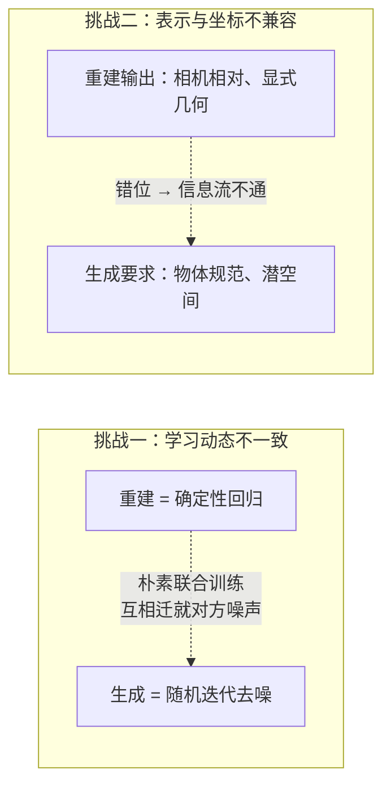
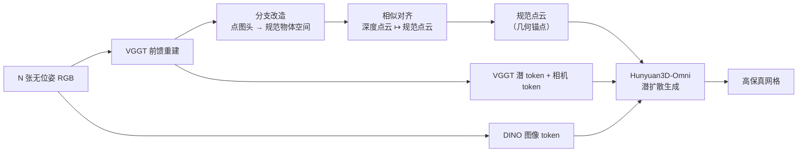
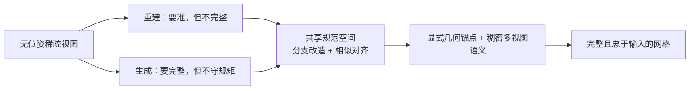

# RecGen3D 精读：先重建出一个锚点，再让生成模型补全——共享规范空间里的重建与生成统一

> **论文**：RecGen3D: Reconstruction-Guided 3D Generation in a Shared Canonical Space（SIGGRAPH Asia 2026 Conference Papers；arXiv v1 标题为 "UniRecGen: Unifying Multi-View 3D Reconstruction and Generation"，arXiv 2604.01479）
> **作者**：Zhisheng Huang、Jiahao Chen、Cheng Lin、Chenyu Hu、Hanzhuo Huang、Zhengming Yu、Mengfei Li、Yuheng Liu、Zekai Gu、Zibo Zhao、Yuan Liu、Xin Li、Wenping Wang
> **机构**：Texas A&M University、澳门科技大学、西电、上海科技大学、HKUST、UC Irvine、NUS 等
> **代码**：https://github.com/zsh523/RecGen3D ｜ **骨干**：VGGT（重建）+ 混元 Hunyuan3D-Omni（生成）

**知识链接**：
- [VGGT：前馈式多视图三维重建](/前置知识/016a_前置知识_VGGT前馈式多视图三维重建) — RecGen3D 的 Stage 1 骨干
- [混元 3D：原生三维生成的统一范式](/前置知识/016b_前置知识_混元3D生成模型Hunyuan3D) — RecGen3D 的 Stage 2 骨干
- [Flow Matching 与连续归一化流](/前置知识/000g_前置知识_Flow_Matching与连续归一化流) — 生成器的训练目标
- [DiT：Diffusion Transformer 架构](/前置知识/002x_前置知识_DiT_Diffusion_Transformer架构) — 生成骨干
- [DINOv2 视觉特征提取器](/前置知识/013b_前置知识_DINOv2视觉特征提取器) — 多视图外观条件的来源
- [相机模型与针孔投影](/前置知识/014a_前置知识_相机模型与针孔投影) — pointmap 与深度反投影
- [三维旋转表示：旋转矩阵、四元数与角速度](/前置知识/006a_前置知识_三维旋转表示_旋转矩阵四元数与角速度) — 相似变换里的旋转
- [Chamfer 距离：点云形状相似性度量](/前置知识/011b_前置知识_Chamfer距离_点云形状相似性度量) — 主评测指标
- [RecGen 精读](/论文综述/162_RecGen_生成式联合形状位姿重建) — 同样"重建 + 生成"，走联合生成形状与位姿的另一条路
- [SPAR3D 精读](/论文综述/154_SPAR3D_单图重建两阶段概率点云网格生成) — 另一套"先出点云锚点再生成网格"
- [多视角物体重建与融合综述](/论文综述/S35_多视角物体重建与融合综述) — 本工作所处谱系

---

> **一句话**：RecGen3D 把"**前馈重建**"和"**3D 扩散生成**"这两个本来各干各的范式，强行拉到同一个**规范坐标空间**里协作——先用 VGGT 从几张**无位姿**的照片里算出确定性点云当"几何锚点"，再让混元 Hunyuan3D-Omni 在这个锚点的约束下把没看到的部分生成完整；它比 SAM 3D / TRELLIS / ReconViaGen 的几何误差都低得多。
>
> **为什么要读**：稀疏视图 3D 建模一直有一对矛盾——**重建准但不完整**（看不见的地方只能空着），**生成完整但不守规矩**（会幻想出和输入对不上的细节）。RecGen3D 的价值在于它没有靠"把两个模型的特征对齐一下"糊过去，而是**先解决坐标系不兼容**（分支改造 + 相似变换），再解决**条件不兼容**（把单视图点云条件扩成多视图），给出了一条干净、可解释、模块可替换的工程路线。它也是理解"如何把 VGGT 和混元 3D 缝起来"的最佳范例。

---

## 贯穿全文的例子

> 你用手机绕着一个**毛绒玩偶**拍了 4 张照片，随手换角度，**完全没记录相机位置**，也不确定这 4 张里有没有把玩偶背面拍全。目标不是"生成一个好看的玩偶"，而是**忠实重建这一只玩偶**——背面没拍到的部分要合理地补出来，但形状必须和照片里这只玩偶一致。

---

## 一、问题背景：重建与生成，两条路的根本张力

从稀疏（甚至无位姿）的多视图里造出高保真 3D 物体，长期分成两条互不相让的路线：

**第一条是确定性重建（feed-forward reconstruction）。** 以 VGGT 为代表：把多张图直接回归成点云、深度、相机参数。它**效率高、忠于输入**——照片里是什么就重建什么，绝不瞎编。但它的软肋是**局部性**：只靠图像特征和几何对应，缺少关于"物体通常该长什么样"的全局先验，于是遮挡区域和没拍到的背面往往**残缺不全**、甚至出现空洞。

**第二条是随机生成（stochastic generation）。** 以 3D 扩散模型为代表：它们从大规模 3D 数据里学到了强大的**物体形状先验**，能合成出完整、细节丰富的几何。但代价是**不忠于输入**：它们倾向于顺着先验"幻觉"出一个"典型"的物体，而不是照片里这只具体的物体，于是经常出现和输入细节对不上的 **hallucination**。

**已有的"统一"尝试及其局限。** 近期出现一批工作（VIST3A、Gen3R）试图把 2D 视频扩散模型的潜空间和 3D 重建模型对齐，让 2D 生成"天然可被 3D 解码"。它们确实让 2D 生成更"懂三维"，但本质上**仍然拴在二维域**——生成器必须被"管着"去迁就一个它自己并不理解几何盒子，于是继承了 2D 抬升到 3D 固有的**表示鸿沟**和一致性伪影。

RecGen3D 的主张是：**不要在二维里对齐，直接在三维里统一**。重建和生成不是竞争关系，而是同一个 3D 推断问题的两个互补维度。但要真正让它们协作，有两道坎必须迈过：

> 两道坎：一是训练目标不一致（回归 vs 去噪）导致的"互相拖累"，二是坐标系与表示不一致导致的"接不上"。RecGen3D 对第一道坎用**解耦的模块化训练**，对第二道坎用**共享规范空间**。

**怎么迈过第一道坎（学习动态不一致）**：采用**隔离的模块化设计**。重建模型**先单独训好**，提供一个稳定、忠于观测的几何锚点；生成模型再作为"先验驱动的细化器"单独训练，补全未观测区域。这个顺序本身就符合问题的结构——**先把自己钉在可见证据上，再用全局先验去外推缺失部分**。

模块化还有长期好处：子模块可以随更强的模型出现而替换，中间产物可解释、可监控，注入外部先验也不需要重训整个系统。第二道坎（坐标与表示）就是本文方法的核心，下面详述。

---

## 二、方法总览：两阶段，一个共享规范空间

RecGen3D 是一条两阶段的模块化流水线：

- **Stage 1（Generation-compatible Feed-Forward Reconstruction）**：把 VGGT 的几何预测**规范化**，产出"与生成兼容"的规范点图，再经**相似对齐**得到精炼的规范点云。
- **Stage 2（Reconstruction-guided Controllable Generation）**：以这份规范点云 + 多视图图像特征为条件，微调 Hunyuan3D-Omni，生成完整的高保真网格。

> 上半部分是 Stage 1：VGGT 的相机/深度头留在参考帧，只有点图头被改造到规范物体空间，再由相似变换把更准的深度点云对齐过去，得到规范点云。下半部分是 Stage 2：这份点云和多视图图像/几何/相机特征一起条件化 3D 扩散生成。**关键点：Stage 2 的条件里既有"显式几何锚点"，又有"稠密图像语义"，缺一不可。**

---

## 三、Stage 1：把相机坐标系的 VGGT 改造成规范物体空间

### 3.1 坐标系错位是第一条鸿沟

VGGT 为了"场景无关"的通用性，把几何表示在**相对参考系**里——通常取**第一台相机**的坐标系。相机往哪摆、物体在哪，都取决于拍摄者。

而 3D 生成模型要求的是**物体中心的规范空间（canonical space）**：无论从哪个角度拍，同一个物体都摆在原点、朝向固定、尺度统一。因为生成模型训练时见到的是规范化的形状，它只认识这种朝向。

**一个训练在规范空间的生成先验，看不懂一个相机坐标系的点云**——这就是为什么不能把 VGGT 的输出直接喂给扩散模型。

### 3.2 三种改造方案，为什么选了"分支改造"

论文系统比较了三条路：

| 方案 | 做法 | 结果 |
|------|------|------|
| **直接监督迁移** | 把所有头都改成在规范空间监督 | 破坏预训练的三维先验，相机位姿与深度都退化 |
| **显式变换预测** | 加专门的 token 和头去预测"参考系→规范系"变换 | 梯度信号弱，收敛慢，全局对齐最差 |
| **分支改造（本文）** | **只**把点图头改成在规范空间输出，相机头与深度头保留在参考系 | 兼顾位姿精度与深度质量 |

背后的三点洞见是：

1. **保留相机头/深度头在参考系** = 对 VGGT 已学到的先验提供强正则，不让它被"整体挪坐标系"打乱；
2. **只监督规范空间的点图头** = 提供**稠密**的梯度信号（每个像素一个三维点），足以完成适配；
3. **深度头依然更准**，所以用相似变换把深度派生的三维点**对齐**到规范点图，得到比单用点图更好的几何。

显式变换预测为什么失败？因为它只在**一个全局位姿**上提供监督——一个样本只有一组旋转平移，梯度信号太稀疏；而点图监督是**逐像素**的，信号强度差了几个数量级。

### 3.3 相似对齐：用加权 Procrustes 把深度点云搬到规范空间

要把"深度 + 相机"得到的三维点 $\mathbf{D}_j^{\text{ref}}$ 对齐到"规范点图" $\mathbf{P}_j^{\text{can}}$，本质上是在求一个**相似变换**（旋转 + 平移 + 均匀缩放），让两套点尽可能重合。论文用**加权 Procrustes 分析**求解：

$$
\mathbf{T}=\arg\min_{\mathbf{T}\in\mathrm{Sim}(3)}\sum_{j=1}^{M} w_j\,\lVert \mathbf{P}_j^{\text{can}}-\mathbf{T}(\mathbf{D}_j^{\text{ref}})\rVert^2
$$

**这个公式在做什么**：找一个最合适的"旋转 + 平移 + 缩放"，把深度重建出来的点云整体搬到规范点云的位置上。

::: details 📐 公式详解（点击展开）

| 子表达式 | 它是谁 | 它在干嘛 |
|---------|--------|---------|
| $\mathbf{D}_j^{\text{ref}}$ | **深度派生的点** | 用参考帧里的相机参数和深度反投影出来的第 $j$ 个三维点 |
| $\mathbf{P}_j^{\text{can}}$ | **规范点图** | 点图头被改造后，同一像素在规范物体空间里的坐标 |
| $\mathbf{T}\in\mathrm{Sim}(3)$ | **相似变换** | 旋转 + 平移 + 一个各向同性缩放，把参考帧点搬到规范空间 |
| $w_j$ | **置信权重** | 每个对应点的可靠程度，用来压低不可信点的干扰 |
| $\sum_j$ | **对所有对应点求和** | 让整体误差最小，而不是迁就个别点 |

**用人话读**："深度点云和规范点图描述的是同一个物体，只是处在不同的坐标系里；找一套'转一下、挪一下、缩一下'的操作，让两套点尽量重叠。"

**为什么用加权**：匹配不是百分之百可靠的，遮挡边缘、弱纹理处容易配错。给每个对应点一个置信度权重，等于让算法"更听信那些靠得住的对应点"，避免被少数离群匹配带偏。
:::

为了高效求解，论文做了**两阶段采样**：先均匀采 **400 万个点**，再用**最远点采样（FPS）**从中挑出 $M$ 个空间上尽量分散的对应点参与求解——既保证覆盖，又让求解规模可控。

最终产物是**一支高质量的规范点云**，它就是整个系统的"几何锚点"。

---

## 四、Stage 2：用重建结果去引导可控生成

### 4.1 为什么不能直接把规范点云喂给混元 Omni

混元 Hunyuan3D-Omni 确实支持**点云条件**，看起来"把规范点云塞进去就行"。但论文发现，**原封不动地用会失败**，原因是：

1. **分布不匹配**：VGGT 重建出的点云带离群点和噪声，而 Omni 训练时见到的点云是干净、均匀的表面采样——分布不对，生成质量骤降；
2. **信息不足**：点云只提供稀疏几何，缺少**连续表面**信息（法向、稠密的表面语义）；
3. **只有单视图**：Omni 原生的图像条件是单视图的，无法利用我们手头天然有的多张照片。

于是 RecGen3D **微调 Omni**，把条件从"图像 + 点云"扩展成"**多视图图像 + 点云**"：

$$
\mathrm{cond}=\big[\mathbf{F}_1^{MV},\mathbf{F}_2^{MV},\dots,\mathbf{F}_N^{MV},\ \beta\big]
$$

**这个公式在做什么**：把"每个视角的增强图像特征"和"点云控制特征"拼成一个联合条件，交给扩散生成器。

::: details 📐 公式详解（点击展开）

| 子表达式 | 它是谁 | 它在干嘛 |
|---------|--------|---------|
| $\mathbf{F}_i^{MV}$ | **第 $i$ 视角的增强图像特征** | 在原 DINO 特征基础上注入了 VGGT 的几何上下文 |
| $\beta$ | **点云控制特征** | Omni 统一控制编码器对规范点云编码出的条件（沿用原模型路径） |
| $[\cdot,\dots,\cdot]$ | **序列拼接** | 让扩散 Transformer 的注意力同时看到所有视角和图/几何条件 |

**用人话读**："把每个视角的图像特征（已经带了几何信息）和点云条件全部拼起来，一起喂给生成模型。"

**为什么保留 $\beta$ 原样不动**：Omni 的点云条件路径是训练好的、可靠的先验，我们只需要**在旁边加上多视图这一路**，而不是重造条件系统——这也是"微调而非重训"能省钱的原因。
:::

### 4.2 两种多视图条件方案：为什么不用"点引导采样"

把多视图信息接进来，有两种思路：

**方案 A（点引导特征采样）**：用下采样后的重建点云 $\mathbf{P}^c$ 去**索引**对应位置的 DINO token，再加上点的三维位置编码，即 $\mathbf{F}_i^{MV}=\mathcal{S}(\mathbf{F}_i^{D},\mathbf{P}^c)+\mathrm{MLP}(\mathrm{PE}(\mathbf{P}^c))$，其中 $\mathcal{S}(\cdot,\mathbf{P}^c)$ 是按点 $\mathbf{P}^c$ 索引的空间采样算子。

**方案 B（潜空间增强视图条件，本文采用）**：**不动**原始 DINO token，而是把 VGGT 的**几何潜 token**和**相机 token**各经一个 MLP 投影后**加**到 DINO 特征上：

$$
\mathbf{F}_i^{MV}=\mathbf{F}_i^{D}+\mathrm{MLP}_{\text{view}}(\mathbf{F}_i^{V})+\mathrm{MLP}_{\text{cam}}(\hat{\mathbf{t}}_i^{\text{cam}})
$$

**这个公式在做什么**：在完整的 DINO 图像特征上，叠加两路几何上下文——一路是 VGGT 的几何特征，一路是相机 token，从而让扩散模型既保留稠密外观先验，又获得精确的多视图几何定位。

::: details 📐 公式详解（点击展开）

| 子表达式 | 它是谁 | 它在干嘛 |
|---------|--------|---------|
| $\mathbf{F}_i^{D}$ | **DINO 图像特征** | 原汁原味的稠密视觉语义，保证合成质量 |
| $\mathbf{F}_i^{V}$ | **VGGT 几何潜 token** | 连续的、学到的几何流形，带全局结构一致性 |
| $\hat{\mathbf{t}}_i^{\text{cam}}$ | **精炼相机 token** | 提供该视角的相机线索，帮助定位 |
| $\mathrm{MLP}_{\text{view}}/\mathrm{MLP}_{\text{cam}}$ | **两个投影头** | 把几何/相机特征投到与 DINO 特征同维再相加 |
| 相加而非拼接 | **融合方式** | 保持 token 数量不变，直接丰富每个 token 的语义 |

**用人话读**："保留每个视角完整的图像特征，再往里各加一勺'几何'和'相机位置'，让生成模型看着图、也看着几何来生成。"

**为什么方案 B 更好**：论文给出两个理由——(1) Omni 的合成质量本质上依赖 DINO token 里的**稠密语义先验**（它毕竟是基于图像到 3D 的 2.1 建的），而**图像本身比稀疏点云携带更丰富的结构信息**；用稀疏点去采样，会**丢掉大量稠密上下文**；(2) VGGT 的几何 token 是**连续、多尺度的几何流形**，比"几个离散点"更能让扩散模型整合多视图信息。
:::

### 4.3 两阶段训练

- **Stage I**：适配前馈多视图重建模块，使其产出与生成兼容的规范预测。沿用 VGGT 训练配方，两处改动：去掉跟踪损失（简化目标、提升吞吐）；每步从每个物体的 50 个渲染视角里**随机抽 4 个视角**。80K 步，峰值学习率 $1\times10^{-5}$，1K 步 warmup，4 张 H800、总 batch 32，约 **5 天**。
- **Stage II**：**冻结**重建模块，只训练 3D 生成器（用流匹配损失）。GT 点云**在线采样**；为了减少"预测几何与真值之间残余错位"带来的监督歧义，**先把 GT 点云用相似变换对齐到预测几何**，再编码进潜空间。80K 步，同样的学习率与 warmup，4 张 H800、batch 32，约 **8 天**。

值得注意的是 Stage II 里那个"**对齐再监督**"的细节：如果直接用未对齐的 GT 点云当条件，模型会学到"条件和目标差一点"的错位关系，把误差固化进生成先验。先对齐，等于让监督信号"干净"。

---

## 五、实验：它强在哪

评测在 **Toys4K**（各类高质量玩具网格）和 **GSO**（Google Scanned Objects，扫描的日用百货）上，每个数据集取 100 个物体。每个物体合成 24 个多视图，并对相机平移加随机扰动，再从中随机抽 **4 视图**作为输入——一个**稀疏且无位姿**的严苛设置。

指标分三类：

- **几何**：Chamfer-L2 距离（越低越好）、Precision / Recall（阈值 $d<0.01$）、F-Score、法向一致性 Normal、体素 IoU；
- **相机位姿**：绝对轨迹误差 ATE、相对位姿误差 RPE（平移 RPEt 与旋转 RPEr）；
- **深度**：绝对相对误差 Abs Rel、均方根误差 RMSE。

> 左图几何误差（越低越好），右图体素重叠度（越高越好）。RecGen3D 在两个数据集上都把 Chamfer-L2 压到所有方法最低（Toys4K 0.0175、GSO 0.0192），IoU 拉到最高（0.8030 / 0.8155）。注意它领先的幅度：相比最接近的 ReconViaGen，几何误差还低了约 35%。

### 5.1 几何生成

| 数据集 | 方法 | Chamfer-L2 ↓ | F-Score ↑ | IoU ↑ |
|--------|------|--------------|-----------|-------|
| Toys4K | TRELLIS-M | 0.0343 | 0.5674 | 0.6318 |
| Toys4K | SAM 3D | 0.0354 | 0.5711 | 0.6061 |
| Toys4K | ReconViaGen | 0.0281 | 0.6105 | 0.7229 |
| Toys4K | **RecGen3D** | **0.0175** | **0.7695** | **0.8030** |
| GSO | TRELLIS-M | 0.0318 | 0.4918 | 0.6489 |
| GSO | SAM 3D | 0.0296 | 0.5872 | 0.6339 |
| GSO | ReconViaGen | 0.0290 | 0.6069 | 0.6918 |
| GSO | **RecGen3D** | **0.0192** | **0.7384** | **0.8155** |

**它凭什么赢？** 论文把关键归因给"**显式几何条件 vs 隐式特征注入**"。它的同期工作 ReconViaGen 走的是"**把重建分支的隐式特征注入生成过程**"；RecGen3D 则是"**把重建出来的中间几何（点云）当作显式条件**"。实验结果支持：**直接给显式几何约束，比注入高层特征更能消解空间歧义、保持结构保真**。

### 5.2 相机位姿与深度

| 方法 | GSO ATE ↓ | GSO RPEt ↓ | GSO RPEr ↓ | Toys4K ATE ↓ |
|------|-----------|------------|------------|--------------|
| VGGT（原版） | 0.0799 | 0.1856 | 8.18 | 0.1209 |
| ReconViaGen | 0.0190 | 0.0443 | 2.12 | 0.0425 |
| **RecGen3D** | **0.0151** | **0.0338** | 2.16 | **0.0255** |

深度误差同样全面领先（GSO Abs Rel 0.0033 vs ReconViaGen 0.0051、原版 VGGT 0.0512）。

一个值得注意的现象：**在 3D 物体数据集上微调后，两个方法（RecGen3D 与 ReconViaGen）的位姿/深度都远好于原版 VGGT**——因为原版 VGGT 是在通用场景上训练的，对"单物体、近距离、无位姿"这种分布不熟。这说明**针对目标域的适配**本身就能拿到很大一部分收益。

### 5.3 消融一：规范对齐策略

这是最能说明"分支改造"为何必要的消融：

| 策略 | ATE ↓ | RPEt ↓ | RPEr ↓ |
|------|-------|--------|--------|
| 直接监督迁移 | 0.2517 | 0.1414 | 4.2376 |
| 显式刚体变换 | 0.5934 | 0.1474 | 4.4596 |
| **分支改造（本文）** | **0.0353** | **0.0453** | **1.2181** |

两种替代方案的全局 SE(3) 对齐都崩了（ATE 比本方法高一个数量级）。论文的解释与前面一致：**回归一个全局位姿提供的监督信号太弱**（一个样本只有一组旋转平移），而**稠密的点图监督**才能把坐标变换真正学进去；而强行整体搬坐标、又不加适配机制，会直接破坏 VGGT 预训练的三维先验。

### 5.4 消融二：多视图条件方案

| 策略 | Chamfer-L2 ↓ | F-Score ↑ | IoU ↑ |
|------|--------------|-----------|-------|
| 点引导采样 | 0.0260 | 0.7208 | 0.6304 |
| **潜空间增强（本文）** | **0.0259** | **0.7428** | **0.6707** |

差距主要体现在 IoU 与 F-Score 上：点引导方案用稀疏点索引图像特征，**丢掉了稠密图像上下文**，导致多视图一致性变差、出现细碎伪影；潜空间增强保留了完整特征，只是"加了一勺几何上下文"。

---

## 六、和 RecGen（前一篇）的区别：两种"重建 + 生成"

RecGen3D 和上一篇文章的 RecGen 经常被放在一起谈——它们都把"重建"和"生成"缝在一起，但缝合的位置完全不同：

| 维度 | **RecGen**（TRI，arXiv 2604.27106） | **RecGen3D**（本文） |
|------|--------------------------------------|----------------------|
| 出发点 | 单/双 RGB-D，**位姿也要估** | 多张 RGB，**无位姿** |
| 底座 | 从微软 TRELLIS-image-large 微调 | VGGT + 腾讯 Hunyuan3D-Omni |
| 核心机制 | 形状、外观、位姿**联合生成**在一个分布里 | 前馈重建**先定锚点**，扩散生成**再补全** |
| 位姿 | 生成模型直接输出 6DoF 位姿与尺度 | 由 VGGT 相机头给出，并规范到物体空间 |
| 坐标处理 | 位姿参数 z-score 归一化 | **分支改造 + 相似变换**对齐到规范空间 |
| 输出 | 物体网格 + 高斯 + 相机系位姿（面向 Real2Sim） | 物体规范空间的高保真网格 |
| 对称/遮挡 | 用位姿条件化纹理解决对称；遮挡数据训练 | 靠生成先验补全未观测区域 |
| 定位 | 面向机器人数字孪生（位姿/尺度要能用） | 面向生产级 3D 资产（几何保真度优先） |

一句话概括差异：**RecGen 把"位姿"也当成生成目标，追求"能放进物理引擎的资产"；RecGen3D 把"几何锚点"当成生成条件，追求"从无位姿照片里造出最完整的网格"。** 两者互补：RecGen3D 的规范点云如果再接一个位姿估计头，就离 RecGen 的仿真就绪能力更近一步。

---

## 七、局限与讨论

- **仍是物体中心、规范空间**。RecGen3D 输出的是物体级的规范网格，**不直接给出场景级的相机系位姿**，因此还不能直接当作 Real2Sim 资产导入物理引擎；要走到那一步，需要把它的规范点云再接一个位姿/尺度恢复环节。
- **依赖前馈重建的质量**。Stage 1 的点云是"锚点"，锚点里的离群点、遮挡边缘的错配会顺着条件传进生成器（论文正是用置信加权和 FPS 采样来压制这类噪声）。
- **模块化 = 双份训练成本**。要换更强的骨干（新 VGGT、新混元），两个模块都得重新适配。
- **对比范围**。它强在"无位姿稀疏视图 + 物体几何保真"，但对比表里的 SAM 3D 等方法是单图方法、TRELLIS 需要多视图条件，**基准设置并不完全对等**——读结果时要留意这点。

---

## 八、总结

> 全文一句话逻辑：重建负责"忠于证据"，生成负责"补全缺失"，而让这两者真正对话的前提，是**先把它们放进同一个坐标空间**。RecGen3D 的两个核心贡献——分支改造和潜空间增强多视图条件——分别解决了"坐标接不上"和"条件不够用"。

**它的定位**：在"稀疏无位姿 3D 建模"这个问题上，RecGen3D 没有去发明一个新表示或新骨干，而是**把两个最强现成模型（VGGT、混元 Omni）用一套干净的坐标与条件工程缝了起来**，并且证明了"显式几何条件优于隐式特征注入"。对工程实践而言，这类"组合式统一"往往比从零训练一个新模型更划算，也更可维护。

---

## 延伸阅读

- [VGGT 前置知识](/前置知识/016a_前置知识_VGGT前馈式多视图三维重建) — Stage 1 的全部原理
- [混元 3D 前置知识](/前置知识/016b_前置知识_混元3D生成模型Hunyuan3D) — Stage 2 的全部原理
- [RecGen 精读](/论文综述/162_RecGen_生成式联合形状位姿重建) — 同样"重建 + 生成"，但联合生成位姿，面向 Real2Sim
- [SPAR3D 精读](/论文综述/154_SPAR3D_单图重建两阶段概率点云网格生成) — 更早的"点云锚点 + 生成"两阶段
- [OVOW 精读](/论文综述/161_OVOW_单目视频重建可仿真4D场景) — 从视频追求"可仿真资产"
- [多视角物体重建与融合综述](/论文综述/S35_多视角物体重建与融合综述) — 全景定位
- [TRELLIS 深度解析系列](/系列/trellis_deep_dive/index) — 稀疏体素路线的生成骨干对照
