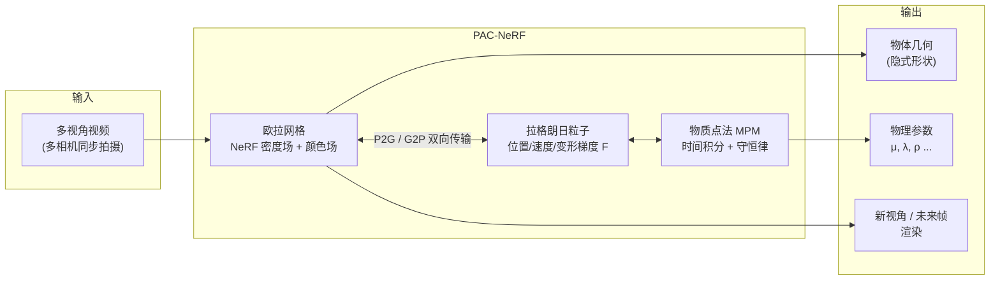
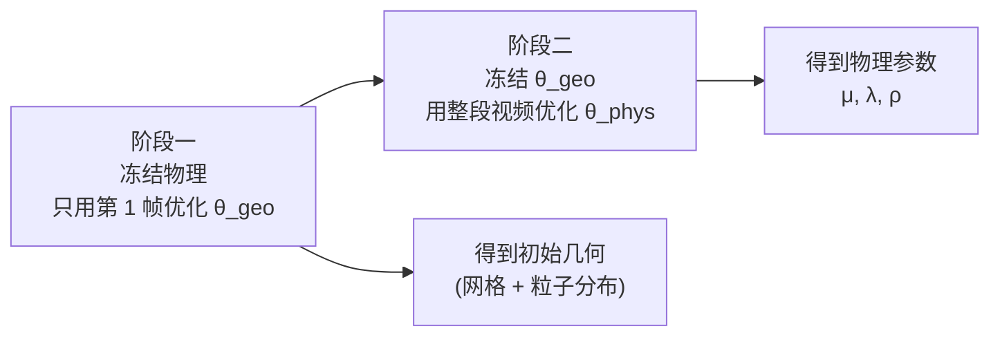
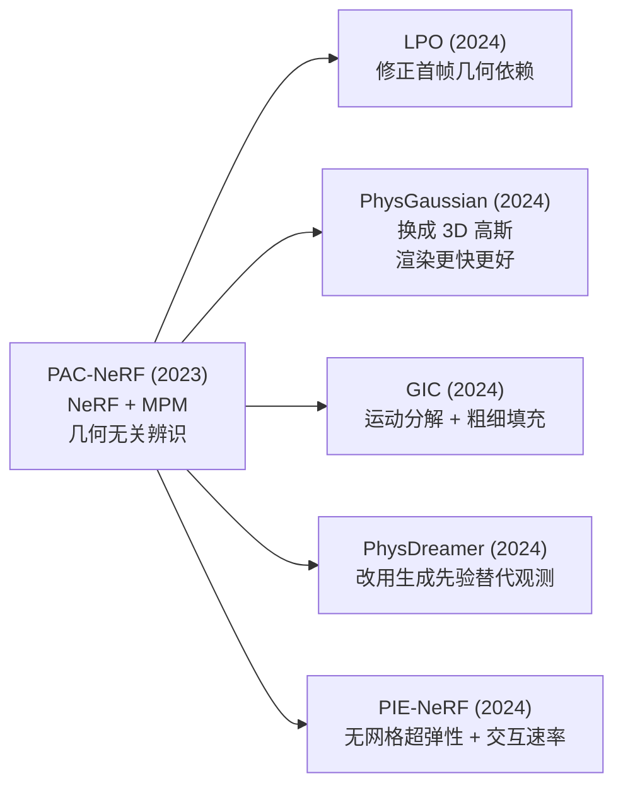

# PAC-NeRF：物理感知连续场的材料参数辨识

> **论文**：PAC-NeRF: Physics Augmented Continuum Neural Radiance Fields for Geometry-Agnostic System Identification（arXiv 2303.05512, ICLR 2023）
> **作者**：Xuan Li, Yi-Ling Qiao, Peter Yichen Chen, J. Krishna Murthy, Ming C. Lin, Chenfanfu Jiang, Chuang Gan
> **代码**：https://github.com/xxl0419/PAC-NeRF
> **关键词**：几何无关系统辨识、混合欧拉-拉格朗日表示、物质点法 MPM、可微物理仿真

**知识链接**：
- [应变能密度与超弹性本构模型全景](/前置知识/018a_前置知识_应变能密度与超弹性本构模型全景)（$\mathbf{P} = \partial\Psi/\partial\mathbf{F}$ 的来历）
- [系统辨识与逆问题基础](/前置知识/018b_前置知识_系统辨识与逆问题基础)（几何无关辨识为什么是一个逆问题）
- [PhysGaussian 精读](/论文综述/165_PhysGaussian_物理集成三维高斯动态仿真)（把 NeRF 换成高斯的后续演进）
- [GIC 精读](/论文综述/166_GIC_高斯告知连续体的材料属性辨识)
- [Spring-Gauss 精读](/论文综述/167_SpringGauss_弹簧质点高斯弹性物体重建与仿真)（离散质点弹簧的对照路线）
- [PhysDreamer 精读](/论文综述/168_PhysDreamer_视频生成先验驱动的物体物理交互)
- [OVOW 精读](/论文综述/161_OVOW_单目视频重建可仿真4D场景)

---

## 一、问题：要从视频里估参数，但连物体形状都不知道

从视频估计物体的物理参数（弹性模量、密度、粘度、摩擦系数）这件事，在这篇论文之前有一个没被明说但一直存在的天花板：**所有方法都假设自己已经知道物体的几何形状**。

这个假设的代价很大。它意味着流程必须是"先重建网格 → 再做参数辨识"，也就是参数辨识的前置依赖是一个已经做好的三维网格。而真实场景里的物体——一团橡皮泥、一把沙子、一杯倒来倒去的液体——形状本身就复杂或者根本无定形，网格重建这一步既贵又不可靠。更糟的是，一旦网格估计错了，后面辨识出的"弹性模量"是在错误的形状上拟合出来的数字，物理意义存疑。

PAC-NeRF 把这两个未知量同时放进优化器：**几何未知，物理参数也未知，一起解**。论文把这件事称为"几何无关的系统辨识"（geometry-agnostic system identification）。

这是一个典型的[逆问题](/前置知识/018b_前置知识_系统辨识与逆问题基础)，而且是最难的那一类——未知量不仅有材料参数 $\theta_\text{phys}$，还有整个物体的形状。两者的联合求解极易退化：如果几何可以自由变化，优化器总能找到一组"奇怪的形状 + 某组参数"来解释同样的观测。

PAC-NeRF 的解法不是加正则化，而是**加物理约束**：让所有中间状态都必须满足连续介质力学的守恒律。几何可以未知，但不能任意——它必须是一个物理上合法的变形序列。

---

## 二、整体架构：三个模块如何咬合

> **看什么**：中间的 `E <--> L` 双向箭头是整个方法的核心机关。欧拉网格负责"好看"（NeRF 的体渲染需要一个规则的场），拉格朗日粒子负责"能动"（MPM 的物理状态挂在粒子上）。两者用同一套数据互相喂饭。

系统里有三种状态，各自的职责完全不同：

| 模块 | 存的东西 | 为什么需要它 |
|------|---------|-------------|
| 欧拉网格 | 每个网格点的密度 $\sigma$ 和颜色 $\mathbf{c}$ | NeRF 的体渲染积分要求场在一个规则网格上采样 |
| 拉格朗日粒子 | 位置 $\mathbf{x}_p$、速度 $\mathbf{v}_p$、变形梯度 $\mathbf{F}_p$、体积 $V_p$ | MPM 的物理量必须跟随材料运动，网格做不到这一点 |
| MPM 求解器 | 网格上的动量与力 | 把粒子携带的应力转成加速度 |

---

## 三、为什么必须是"混合"表示

这是全文最重要的设计决策，值得单独拆开看。欧拉和拉格朗日两种描述方式各有致命缺陷：

| 表示 | 擅长的 | 单独使用时的问题 |
|------|--------|-----------------|
| 欧拉（网格） | 渲染（规则采样）、求梯度（有邻域结构） | 材料随网格平流后会数值耗散，形状逐渐糊掉 |
| 拉格朗日（粒子） | 精确跟踪材料历史（$\mathbf{F}$ 不耗散） | 渲染时无法直接采样，粒子分布不均匀 |

PAC-NeRF 的做法是把两者接在一起：**密度和颜色放在欧拉网格上，材料和运动状态放在粒子上**，然后让 MPM 的 P2G（particle-to-grid）和 G2P（grid-to-particle）在两个表示之间搬运数据。

::: details 📐 公式详解（点击展开）
| 子表达式 | 它是谁 | 它在干嘛 |
|---------|--------|---------|
| $\mathbf{F}_p$ | 第 $p$ 个粒子的变形梯度（$3\times3$） | 记录该粒子从参考形状到当前形状的局部线性映射，是弹性能量的输入 |
| $\mathbf{v}_p$ | 粒子速度 | 决定下一步位置的物理量 |
| $\mathbf{x}_p$ | 粒子当前位置 | 渲染时的采样锚点 |
| $V_p$ | 粒子代表的体积 | 把粒子量加权到网格时用的权重 |

**用人话读**：粒子是"material 的记账本"，网格是"渲染的画布"。每一次时间步，格子从本子上抄一遍速度去算加速度，算完再写回本子。

**为什么是这个形式**：渲染和物理对数据结构的要求是矛盾的——渲染要规则、物理要随动。混合表示的取舍是"各干各擅长的"，代价是每步多两次数据传输开销。
:::

物理状态在粒子上的演化用 MPM 的标准更新：

$$\mathbf{F}_p^{n+1} = \left(\mathbf{I} + \Delta t \,\nabla \mathbf{v}_p^{n}\right)\mathbf{F}_p^{n}$$

::: details 📐 公式详解（点击展开）
| 子表达式 | 它是谁 | 它在干嘛 |
|---------|--------|---------|
| $\mathbf{F}_p^{n}$ | 第 $n$ 步该粒子的变形梯度 | 旧的变形状态 |
| $\nabla \mathbf{v}_p^n$ | 该处速度的梯度张量 | 描述局部速度差异（拉伸/压缩/剪切） |
| $\mathbf{I} + \Delta t \nabla\mathbf{v}$ | 局部的增量变形 | 一步时间内的变形增量 |
| $\mathbf{F}_p^{n+1}$ | 更新后的变形梯度 | 新状态 |

**用人话读**：如果一小块材料周围的速度完全一致（$\nabla\mathbf{v} = 0$），它只是平移，不变形；速度有差异（$\nabla\mathbf{v} \neq 0$），它就被拉伸或压缩。左乘增量变形就是把这一步的变形累加到历史变形上。

**为什么是这个形式**：变形梯度满足 $\dot{\mathbf{F}} = (\nabla\mathbf{v})\mathbf{F}$，这是变形梯度定义直接求时间导数得到的结果。离散化后用一阶欧拉积分就是上面的形式。它保证了 $\mathbf{F}$ 是**沿着材料路径**累积的——这正是欧拉网格做不到的事。
:::

拿到 $\mathbf{F}_p$ 之后，应力通过[超弹性本构关系](/前置知识/018a_前置知识_应变能密度与超弹性本构模型全景)得到：

$$\mathbf{P}_p = \frac{\partial \Psi(\mathbf{F}_p)}{\partial \mathbf{F}_p}$$

这一步是**物理参数进入优化的入口**。$\Psi$ 里的 $\mu$、$\lambda$ 是待辨识量，它们通过应力影响下一帧的运动，进而影响渲染结果，最终在损失函数里产生对参数的梯度。**参数不是被"看"出来的，是被"仿真差异"逼出来的**。

---

## 四、渲染：为什么它保证了物理合法性

NeRF 的体渲染对光线上每个采样点累加颜色：

$$\mathbf{C}(\mathbf{r}) = \int_{t_n}^{t_f} T(t)\,\sigma(\mathbf{x}(t))\,\mathbf{c}(\mathbf{x}(t))\,\mathrm{d}t, \qquad T(t) = \exp\!\left(-\int_{t_n}^{t}\sigma(\mathbf{x}(s))\,\mathrm{d}s\right)$$

::: details 📐 公式详解（点击展开）
| 子表达式 | 它是谁 | 它在干嘛 |
|---------|--------|---------|
| $\mathbf{r}$ | 一条相机光线 | 渲染的基本单位 |
| $\sigma(\mathbf{x})$ | 位置 $\mathbf{x}$ 处的体密度 | 来自欧拉网格上的 NeRF 场 |
| $\mathbf{c}(\mathbf{x})$ | 该处的颜色 | 同样来自欧拉网格 |
| $T(t)$ | 累积透射率 | 光线到 $t$ 处还没被挡住的比例 |
| $\mathbf{C}(\mathbf{r})$ | 该光线最终的颜色 | 与观测像素比较 |

**用人话读**：光线穿过场景，沿途按密度累积颜色，前面越不透明，后面贡献越小。

**为什么是这个形式**：$\sigma$ 和 $\mathbf{c}$ 都是从**欧拉网格**上查出来的，而这个网格的状态是由拉格朗日粒子经 MPM 演化、再通过 G2P/P2G 同步过来的。因此渲染出来的图像必然对应一个物理上合法的状态——这就是"物理感知"（physics augmented）的含义：不是加一个物理损失项去惩罚不合理，而是**让表示本身只能表达物理合法的状态**。
:::

这个区别很关键。很多后续工作（例如各种把物理当作软约束的 PINN 式方法）是在损失函数里加惩罚项，合理性靠优化器自觉；PAC-NeRF 是把物理写进了表示的结构里，不合法状态**在参数空间中根本不存在**。前者是软的，后者是硬的。

---

## 五、两阶段优化

参数辨识的优化目标是渲染损失：

$$\min_{\theta_\text{geo},\, \theta_\text{phys}} \; \sum_{\text{光线}} \left\lVert \mathbf{C}(\mathbf{r}; \theta_\text{geo}, \theta_\text{phys}) - \mathbf{C}_\text{obs}(\mathbf{r}) \right\rVert^2$$

其中 $\theta_\text{geo}$ 是 NeRF 场参数（隐式几何 + 外观），$\theta_\text{phys}$ 是材料参数。理论上可以联合优化，但 PAC-NeRF 选择分成两步：

> **看什么**：两步各自的未知量被拆开了——先解几何，再解物理。这样避免了"几何和物理互相甩锅"的退化解。

两阶段的设计动机很实在：

- **阶段一**只拿第一帧（未变形状态）优化几何，因为第一帧的物体形态最有代表性（还没被运动糊掉），而且此时物理参数对渲染的影响最小，让几何先收敛更稳。
- **阶段二**冻结几何，让整段视频的每一帧都与仿真结果比对。此时唯一可动的变量就是物理参数，梯度信号干净。

**代价也随之而来**：阶段二完全依赖阶段一给出的几何。如果第一帧重建得不好（例如稀疏视角、纹理弱、遮挡严重），这个错误会被永久固化——阶段二没有任何机制去修正它。这个缺陷在论文发表一年后被跟进工作 **LPO**（Lagrangian Particle Optimization，拉格朗日粒子优化，CVPR 2024）针对性地修掉了：把粒子的位置和特征也放到整段视频上优化，让几何在整个序列中持续被物理约束校正，而不是冻结在首帧。

首帧几何敏感性值得用一个具体场景说明。假设第一帧中橡皮泥有一片阴影区，NeRF 把该区域拟合成了低密度——粒子在该处的初始分布会偏稀疏。阶段二开始时，物理引擎"看到"的物体质量分布已经失真：稀疏区等效质量偏小，优化器为了让仿真出的运动和视频对上，会倾向于系统性地调高弹性模量来"补偿"不足的惯性。LPO 的修补策略是把粒子位置 $\mathbf{x}_p$ 也列为优化变量，让整段视频的所有帧共同约束粒子的最终分布，而不只是第一帧。这意味着第一帧重建出的几何不再是唯一来源——如果粒子分布在后续帧导致持续的仿真-渲染误差，梯度会推动粒子位置自我修正。代价是每步迭代比 PAC-NeRF 多了粒子位置的梯度，收敛更慢；但几何不再被冻结，参数辨识的起点更可靠。

这个案例说明了一个[逆问题](/前置知识/018b_前置知识_系统辨识与逆问题基础)中常见的交叉敏感性：几何误差和物理参数误差在损失函数上是等效的"出口"——优化器发现改哪个都能降低损失，结果两者相互污染。两阶段分解部分缓解了这个问题（阶段一锁住几何，阶段二只动参数），但分阶段的前提是阶段一给出的解足够好。这是系统辨识领域普遍存在的**阶段敏感性**：前一阶段的误差是后一阶段的系统性偏差来源。

---

## 六、能处理什么材料

论文验证范围覆盖了连续介质力学的多种本构类型：

| 材料类别 | 本构特征 | 需要辨识的关键参数 |
|---------|---------|------------------|
| 弹性体 | 变形可恢复 | 剪切模量 $\mu$、体积模量 |
| 橡皮泥（塑性） | 屈服后永久变形 | 屈服应力 |
| 沙子（颗粒） | 无粘聚、摩擦主导 | 内摩擦角 |
| 牛顿流体 | 应力正比于应变率 | 粘度 |
| 非牛顿流体 | 应力与应变率非线性相关 | 粘度模型参数 |

**同一套框架能覆盖这么多材料**，靠的是把本构模型做成可替换的模块——MPM 的时间积分、粒子与网格的传输、渲染管线全部不变，只有 $\Psi(\mathbf{F})$ 的表达式换掉。这一点在[本构模型全景](/前置知识/018a_前置知识_应变能密度与超弹性本构模型全景)里有详细展开：不同材料就是不同的 $\Psi$。

---

## 七、这篇论文的位置

把 PAC-NeRF 放回它开启的那条线上看，各家的分工很清楚：

> **看什么**：PAC-NeRF 是"表示 + 物理引擎"这个配方的最早完整实现，后续每一条分支都在改配方里的一个部件——换渲染表示（PhysGaussian）、换几何获取方式（GIC）、换监督信号（PhysDreamer）、修优化流程（LPO）。

---

## 八、方法对比

| 维度 | PAC-NeRF | PhysGaussian | GIC |
|------|----------|--------------|-----|
| 视觉表示 | NeRF（欧拉网格） | 3D 高斯 | 动态 3D 高斯 |
| 物理引擎 | MPM | 自定义 MPM | 连续介质 + MPM 式 |
| 几何来源 | 隐式场 + 粒子 | 直接继承高斯 | 粗细填充密度场 → 提取连续体 |
| 参数辨识 | ✅ 是核心目标 | ❌ 参数需人工给定 | ✅ 是核心目标 |
| 输入要求 | 多视角视频 | 3D 资产 + 参数 | 多视角视频 |
| 渲染速度 | 慢（体渲染） | 快（溅射） | 快（溅射） |
| 主要局限 | 首帧几何敏感（LPO 已修） | 不做辨识 | 依赖高斯质量 |

这张表最值得注意的一行是"参数辨识"。PAC-NeRF 和 GIC 都是**逆问题求解器**——输入视频，输出物理参数；PhysGaussian 是**正问题求解器**——输入已经知道参数的 3D 资产，输出物理合理的运动。两者的用途完全不同，不是同一任务的竞争方案。

---

## 九、总结

| 关键点 | 内容 |
|--------|------|
| 解决的问题 | 在几何未知的前提下，从多视角视频辨识物理参数 |
| 核心表示 | 混合欧拉-拉格朗日：网格管渲染，粒子管物理 |
| 物理合法性来源 | 不是软损失惩罚，而是表示结构本身只能表达合法状态 |
| 参数进入优化的通道 | $\mathbf{P} = \partial\Psi/\partial\mathbf{F}$，$\Psi$ 里的参数影响运动进而影响渲染 |
| 优化策略 | 两阶段：先首帧解几何，再全序列解物理 |
| 覆盖面 | 弹性体、塑性、沙、牛顿与非牛顿流体（靠替换 $\Psi$） |
| 已知缺陷 | 阶段二无法修正阶段一的几何错误 → LPO 修补 |
| 历史地位 | "神经表示 + 连续介质物理"这条线的最早完整实现 |

---

## 延伸阅读

- [PhysGaussian 精读](/论文综述/165_PhysGaussian_物理集成三维高斯动态仿真)——同一配方换用 3D 高斯表示，速度提升数个量级
- [GIC 精读](/论文综述/166_GIC_高斯告知连续体的材料属性辨识)——用运动分解和粗细填充解决"从高斯里提不出连续体"的问题
- [PhysDreamer 精读](/论文综述/168_PhysDreamer_视频生成先验驱动的物体物理交互)——当多视角观测不可得时，用生成先验替代
- [系统辨识与逆问题基础](/前置知识/018b_前置知识_系统辨识与逆问题基础)——辨识为什么难、可辨识性如何判断
- [应变能密度与超弹性本构模型全景](/前置知识/018a_前置知识_应变能密度与超弹性本构模型全景)——$\Psi$ 的全部候选形式