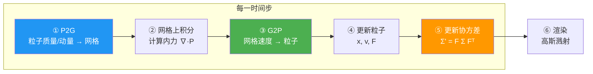
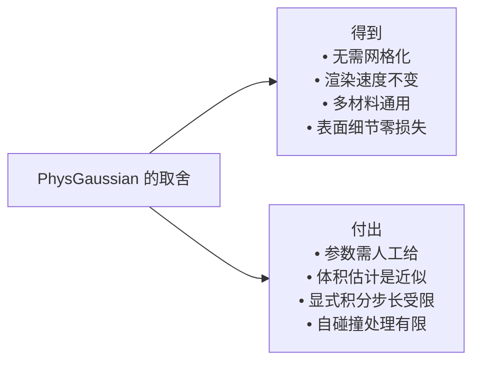

# PhysGaussian：物理集成三维高斯动态仿真

> **论文**：PhysGaussian: Physics-Integrated 3D Gaussians for Generative Dynamics（arXiv 2311.12198, CVPR 2024）
> **作者**：Tianyi Xie, Zeshun Zong, Yuxing Qiu, Xuan Li, Yutao Feng, Yin Yang, Chenfanfu Jiang
> **代码**：https://github.com/XPandora/PhysGaussian
> **关键词**：3D 高斯溅射、协方差随动、物质点法 MPM、前向物理仿真

**知识链接**：
- [PAC-NeRF 精读](/论文综述/164_PAC-NeRF_物理感知连续场的材料参数辨识)（同一配方的 NeRF 版本）
- [GIC 精读](/论文综述/166_GIC_高斯告知连续体的材料属性辨识)（把高斯接回辨识问题）
- [Spring-Gauss 精读](/论文综述/167_SpringGauss_弹簧质点高斯弹性物体重建与仿真)（离散质点路线对照）
- [PhysDreamer 精读](/论文综述/168_PhysDreamer_视频生成先验驱动的物体物理交互)（本文参数的辨识版本）
- [应变能密度与超弹性本构模型全景](/前置知识/018a_前置知识_应变能密度与超弹性本构模型全景)
- [3D 高斯溅射从零精通](/系列/3dgs_from_scratch/index)（高斯基元的数学基础）

---

## 一、问题：渲染的表示和仿真的表示，为什么不能是同一个

在 PhysGaussian 之前，任何"给一个 3D 资产加上物理让它动起来"的流程都绕不开一个转换环节。典型管线是这样的：

> **看什么**：图中 B 和 D 是两个纯工程负担。B 把视觉表示转成仿真表示，D 再转回来。两次转换都会引入误差，而且很贵。

这个管线的每一环都有具体代价：

| 环节 | 具体做法 | 代价 |
|------|---------|------|
| 几何提取 | marching cubes 从隐式场抽等值面 | 分辨率选择两难；细节被抹平 |
| 体离散化 | 四面体化 / 体素化 | 拓扑复杂时失败；薄壳结构几乎无法处理 |
| 包裹网格 | 建 cage mesh 做形变传递 | 手工劳动；cage 与物体形状不贴合时形变失真 |
| 反向渲染 | 把仿真后的网格重新驱动视觉表示 | 表面细节在往返中丢失 |

PhysGaussian 的主张是把整个转换环节删掉：**渲染用的高斯基元，就是仿真用的离散单元**。论文把这个原则命名为 **WS²（What You See is What You Simulate，所见即所仿真）**——你看到的高斯点就是被物理驱动的那些点，中间不存在第二种表示。

---

## 二、高斯基元上要挂哪些物理量

3D 高斯溅射（3D Gaussian Splatting，一种用椭球体点云做实时新视角合成的表示方法）的原始高斯基元携带五个属性：中心位置 $\boldsymbol{\mu}\in\mathbb{R}^3$、协方差矩阵 $\boldsymbol{\Sigma}\in\mathbb{R}^{3\times3}$、不透明度 $\alpha$、球谐系数（表示视角相关颜色）、以及由协方差分解出的旋转与尺度。

PhysGaussian 在这套属性上追加两个物理量：

| 新增属性 | 符号 | 物理角色 |
|---------|------|---------|
| 速度 | $\mathbf{v}_g$ | 决定该基元下一步往哪动 |
| 变形梯度 | $\mathbf{F}_g$ | 记录局部变形，是应力计算的输入 |

再加上密度（由不透明度和体积换算得到）与 Lamé 参数（$\mu$、$\lambda$，人工给定而非辨识），一整套 MPM 所需的状态就齐了。

这里有一个非常重要、也最容易被忽略的取舍：**积分体积的获取**。MPM 要求每个粒子携带一个体积 $V_p$，仿真中的质量 = 密度 × 体积。但高斯是"软"的，没有明确边界，从一堆高斯里算总体积不是天然良定义的。PhysGaussian 的解决办法是利用高斯的体积近似公式（各向同性高斯的体积与其尺度参数的三次方成正比），把每个基元的尺度换算成一个等效球形体积。这个近似在基元接近各向同性时准确，各向异性极强时会引入误差——这是这类方法的一个底层松动点。

---

## 三、核心机关：协方差随变形走

这是整篇论文最关键的一个设计。回想 3D 高斯的渲染函数：

$$G(\mathbf{x}) = \exp\!\left(-\frac{1}{2}(\mathbf{x}-\boldsymbol{\mu})^\top \boldsymbol{\Sigma}^{-1}(\mathbf{x}-\boldsymbol{\mu})\right)$$

::: details 📐 公式详解（点击展开）
| 子表达式 | 它是谁 | 它在干嘛 |
|---------|--------|---------|
| $\mathbf{x}$ | 空间中任意查询点 | 要被求值的像素射线采样点 |
| $\boldsymbol{\mu}$ | 高斯中心（3 维向量） | 椭球中心 |
| $\boldsymbol{\Sigma}$ | 协方差矩阵（$3\times3$ 对称半正定） | 决定椭球的形状与朝向 |
| $G(\mathbf{x})$ | 该点的密度贡献（标量） | 参与体渲染的 alpha 混合 |

**用人话读**：距离中心越近贡献越大，沿 $\boldsymbol{\Sigma}$ 的主轴方向衰减慢，垂直方向衰减快——所以形状是一个椭球。

**为什么是这个形式**：这是多维正态分布去掉归一化常数后的核。选择它是因为投影到任意二维图像平面后仍然是一个二维高斯，可以用光栅化高效渲染——这是 3DGS 相对 NeRF 快几个数量级的根本原因。
:::

现在关键问题来了：**当这个高斯所在的材料被拉伸、压缩、剪切时，椭球该怎么变？**

如果只有中心位置在被物理推动，椭球保持原状，那么物体运动起来会像一堆刚性小球在飞——拉伸时点之间会散开，视觉上出现空洞。PhysGaussian 的答案是让**协方差跟着材料变形一起形变**：

$$\boldsymbol{\Sigma}_g' = \mathbf{F}_g \,\boldsymbol{\Sigma}_g\, \mathbf{F}_g^\top$$

::: details 📐 公式详解（点击展开）
| 子表达式 | 它是谁 | 它在干嘛 |
|---------|--------|---------|
| $\boldsymbol{\Sigma}_g$ | 参考构型下的协方差 | 物体未变形时的椭球形状 |
| $\mathbf{F}_g$ | 该基元当前的变形梯度（来自 MPM） | 刻画局部拉伸/压缩/剪切/旋转 |
| $\mathbf{F}_g^\top$ | $\mathbf{F}_g$ 的转置 | 保证结果是协方差（对称半正定），而不是任意矩阵 |
| $\boldsymbol{\Sigma}_g'$ | 变形后的协方差 | 直接用于渲染 |

**用人话读**：材料被拉长一倍，椭球沿拉伸方向也拉长一倍；材料发生剪切，椭球也跟着倾斜。

**为什么是这个形式**：协方差矩阵在物理上就是一个二阶矩张量，它的定义是"基元内所有点相对中心的外积的期望"。对基元内每个点施加线性变换 $\mathbf{F}$（把 $\mathbf{x}$ 变成 $\mathbf{F}\mathbf{x}$，因为所有点都是相对中心的偏移），外积 $( \mathbf{F}\mathbf{x}) (\mathbf{F}\mathbf{x})^\top = \mathbf{F}\mathbf{x}\mathbf{x}^\top\mathbf{F}^\top$，取期望就得到 $\mathbf{F}\boldsymbol{\Sigma}\mathbf{F}^\top$。这不是设计选择，是线性变换下二阶矩的必然结果。

**为什么不能省掉这一步**：如果令 $\mathbf{F}_g = \mathbf{I}$（不更新协方差），仿真出来的物体会"点散形不散"——位置对了，外观完全错了。反之，如果直接用 $\mathbf{F}$ 去变换颜色或旋转而不做转置，$\mathbf{F}\boldsymbol{\Sigma}$ 一般不是对称矩阵，椭球会产生虚部特征值，渲染直接崩溃。
:::

这个公式的价值在于它让**物理的量真正驱动了视觉的量**。$\mathbf{F}_g$ 是 MPM 算出来的纯物理量，$\boldsymbol{\Sigma}_g$ 是纯渲染参数，串起两者的只有这一行。物理保真度和渲染保真度绑成了同一件事。

---

## 四、仿真回路：高斯直接进 MPM

> **看什么**：⑤ 是本文相对标准 MPM 新增的一步。标准 MPM 在 ④ 就结束了，因为它的"粒子"只是质点和体积，没有形状。PhysGaussian 的粒子有形状，所以必须多一步把 $\mathbf{F}$ 传递到协方差上。

内力来自本构模型，与 [PAC-NeRF](/论文综述/164_PAC-NeRF_物理感知连续场的材料参数辨识) 完全相同的物理：

$$\mathbf{P}_g = \frac{\partial \Psi(\mathbf{F}_g)}{\partial \mathbf{F}_g}$$

论文实现中对不同材料切换不同的 $\Psi$：弹性体用 Neo-Hookean 与 Fixed Corotated，塑性金属用带屈服面的返回映射，非牛顿流体用剪切率相关的粘度，颗粒材料用 Drucker-Prager 类屈服准则。**渲染管线一行不改，只换 $\Psi$**——这与 PAC-NeRF 的设计哲学一致，也是[连续介质力学框架](/前置知识/018a_前置知识_应变能密度与超弹性本构模型全景)模块化优势的直接体现。

位置更新是标准的一阶时间积分：

$$\mathbf{x}_g^{n+1} = \mathbf{x}_g^{n} + \Delta t\,\mathbf{v}_g^{n+1}$$

其中 $\Delta t$ 是时间步长，$\mathbf{v}_g^{n+1}$ 是 MPM 更新后的速度。**注意这里的时间步长不是自由参数**：显式 MPM 的稳定性要求 $\Delta t$ 小于网格尺寸除以最大波速（CFL 条件）。材料越硬、网格越细，步长越小，仿真越慢。这与渲染的高斯数量无关，是一个纯物理约束。

---

## 五、初始速度：让物体"动起来"的那一下

Method 部分有一个容易被略过但很实用的设计：仿真需要一个初始速度场，而静态重建出来的 3D 高斯没有速度信息。PhysGaussian 用一个简单的外插给出：

$$\mathbf{v}_g^{0} = \frac{\mathbf{x}_g^{(0)} - \mathbf{x}_g^{(-1)}}{\Delta t_\text{obs}}$$

::: details 📐 公式详解（点击展开）
| 子表达式 | 它是谁 | 它在干嘛 |
|---------|--------|---------|
| $\mathbf{x}_g^{(0)}$ | 用户指定的"初始帧"位置 | 速度估计的终点 |
| $\mathbf{x}_g^{(-1)}$ | 用户指定的"前一帧"位置 | 速度估计的起点 |
| $\Delta t_\text{obs}$ | 两帧之间的时间间隔（观测时间尺度） | 归一化因子 |
| $\mathbf{v}_g^{0}$ | 仿真初始速度 | MPM 的初始条件 |

**用人话读**：告诉仿真器"物体正在以这个方向、这个快慢运动"，方式就是给两个位置相减除以时间。

**为什么是这个形式**：这是速度的前向差分定义。缺点也很明显——它要求用户提供两个位置状态，而这两个状态通常来自人物编辑或一段真实视频的首两帧。这暴露了本文的一个定位：**它不负责从视频里估计物理参数，它负责在参数已知的前提下生成运动**。参数（$\mu$、$\lambda$、密度）和初始速度都是输入，不是输出。

**移除这一项会怎样**：初始速度设为 0，物体会静止不动（重力作用下慢慢塌陷），得不到用户想要的甩动、抛掷、撞击效果。
:::

---

## 六、能力和代价

> **看什么**：右侧两列是同一个设计决策的两面。不做几何转换省掉了全部中间环节的误差，代价是失去了网格带来的拓扑信息（尤其是自碰撞检测需要的连通性）。

| 能力 | 具体表现 |
|------|---------|
| 无需网格 | 不做 marching cubes、不做四面体化、不建 cage mesh |
| 表面细节守恒 | 视觉表示从未被替换，表面细节不存在"往返损耗" |
| 材料覆盖 | 弹性体、塑性金属、非牛顿流体、颗粒材料 |
| 渲染速度 | 与静态 3DGS 同量级（溅射的光栅化成本不变） |

| 代价 | 说明 |
|------|------|
| 参数是输入不是输出 | 弹性模量、密度、初始速度都要人工给或从别处来 |
| 体积近似 | 从软高斯反推刚体体积是启发式的，各向异性强的基元误差大 |
| 显式积分限制 | 硬材料 + 细网格 → 步长极小 → 仿真慢 |
| 自碰撞受限 | 没有网格拓扑，难以做连续碰撞检测；[布料类自接触场景](/前置知识/018c_前置知识_薄壳布料仿真基础)尤其吃亏 |

最后一项值得多说一句。布料的自碰撞是[布料仿真](/前置知识/018c_前置知识_薄壳布料仿真基础)的核心难题，需要空间哈希、连续碰撞检测、摩擦模型一整套机制。PhysGaussian 的高斯粒子没有连通性信息，无法判断"哪两片布料应该互相挡住"。所以用它处理毛巾、衣物这类薄壳物体，波浪的视觉效果可以很自然，但物体自我穿透的问题不会被物理机制阻止。

---

## 七、方法对比

| 维度 | PhysGaussian | PAC-NeRF | GIC |
|------|--------------|----------|-----|
| 视觉表示 | 3D 高斯 | NeRF（欧拉网格） | 动态 3D 高斯 |
| 表示的物理角色 | 即仿真粒子 | 仅渲染；物理在拉格朗日粒子上 | 需先提取连续体 |
| 是否需要网格转换 | ❌ 完全不需要 | ❌ 不需要 | ⚠️ 需提取连续体 |
| 任务类型 | **正问题**：参数已知，生成运动 | **逆问题**：从视频辨识参数 | **逆问题** |
| 物理参数来源 | 人工输入 | 优化得到 | 优化得到 |
| 渲染速度 | 快（溅射） | 慢（体渲染） | 快（溅射） |
| 协方差处理 | $\boldsymbol{\Sigma}'=\mathbf{F}\boldsymbol{\Sigma}\mathbf{F}^\top$ | 不适用 | 随动 + 掩码监督 |

**最关键的一行是"任务类型"**。PhysGaussian 常被拿来和 PAC-NeRF、GIC 比较物理真实度，但它们解决的问题方向相反：PAC-NeRF 和 GIC 输入视频输出参数，PhysGaussian 输入参数输出运动。二者是互补的，不是竞争的。实践中把它们串起来才是完整链路——用 GIC 类方法辨识出参数，把参数喂给 PhysGaussian 类方法生成可控运动。这个"辨识 + 生成"的组合正是 [PhysDreamer](/论文综述/168_PhysDreamer_视频生成先验驱动的物体物理交互) 试图一步到位的事。

---

## 八、WS² 原则的边界与扩展

把 WS² 推到极端，会遇到两类情形——一类是成立的，一类是不成立的，理解边界对应用这个框架至关重要。

**WS² 成立的核心假设**是：视觉内容（外观、形状）和物理行为（变形、运动）由同一批基元控制。这在大多数"实心"弹性体上成立——橡皮泥、果冻、金属球。基元的位置真的代表材料的位置，协方差真的代表材料的局部形状。

**WS² 遭遇困难的情形**有两类：

第一类是**透明体或半透明体**。烟雾、水、玻璃的外观主要由折射、散射、透射决定，不是由表面形状的变化决定。此时高斯基元描述的"密度场"不等于材料质量场——光学密度高的地方不一定有更多质量。把这些高斯当 MPM 粒子去积分质量，会系统性地错估质量分布，进而错估惯性。PhysGaussian 的论文对非牛顿流体的实验展示了水状物质的流动，但那些实验里流体是不透明的着色液体，没有真正处理透明流体。

第二类是**薄壳结构**，已在上文代价部分点出。补充一点：对于布料，问题不仅仅是自碰撞缺失。[布料的弯曲刚度](/前置知识/018c_前置知识_薄壳布料仿真基础)与膜刚度相差五个数量级（弯曲 ∝ $h^3$，膜 ∝ $h$），标准 MPM 把布料当体积单元处理会混淆这两项刚度——等效体积太厚会高估弯曲刚度，等效体积太薄会数值不稳定。专门为布料设计的薄壳仿真（IPC、Codimensional MPM）是另一套方法；PhysGaussian 风格的体 MPM 不直接覆盖它。

**WS² 的扩展方向**：论文之后的工作探索了让高斯基元不再必须是"静态重建后再做物理"，而是在重建过程中就引入物理约束，这类方法可以视为 WS² 的动态版本——不仅所见即所仿真，而且**仿真即所建**。这是 GIC 和后续工作试图实现的方向。

---

## 九、总结

| 关键点 | 内容 |
|--------|------|
| 核心主张 | 渲染的高斯基元就是仿真的离散单元，取消一切几何转换 |
| 原则命名 | WS²（What You See is What You Simulate） |
| 高斯基元新增属性 | 速度 $\mathbf{v}_g$、变形梯度 $\mathbf{F}_g$ |
| 最关键的公式 | $\boldsymbol{\Sigma}_g' = \mathbf{F}_g\boldsymbol{\Sigma}_g\mathbf{F}_g^\top$，让物理量直接驱动视觉量 |
| 为什么它成立 | 协方差是二阶矩张量，线性变换下必然如此 |
| 材料通用性 | 换 $\Psi$ 即可，渲染管线不变 |
| 定位 | 前向仿真器——参数是输入，不是输出 |
| 主要短板 | 体积估计为近似；无网格拓扑导致自碰撞处理困难；显式积分步长受限 |

---

## 延伸阅读

- [PAC-NeRF 精读](/论文综述/164_PAC-NeRF_物理感知连续场的材料参数辨识)——同一物理引擎的 NeRF 版本，做的是逆问题
- [GIC 精读](/论文综述/166_GIC_高斯告知连续体的材料属性辨识)——把高斯的参数辨识问题补上
- [PhysDreamer 精读](/论文综述/168_PhysDreamer_视频生成先验驱动的物体物理交互)——用生成先验自动找到本文需要人工给定的参数
- [3D 高斯溅射从零精通](/系列/3dgs_from_scratch/index)——高斯基元、协方差参数化、光栅化渲染的完整推导
- [薄壳布料仿真基础](/前置知识/018c_前置知识_薄壳布料仿真基础)——为什么高斯粒子处理布料会吃亏