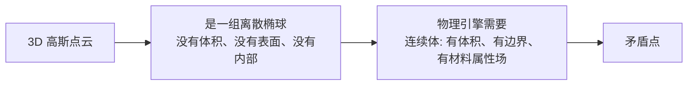
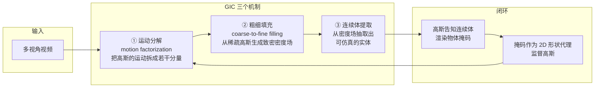
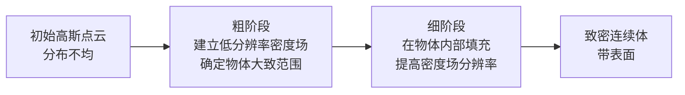
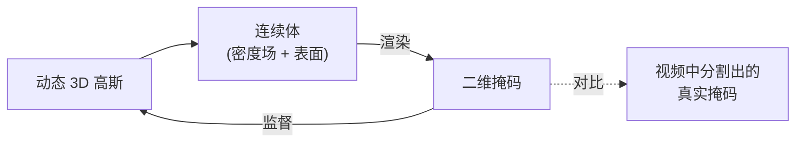
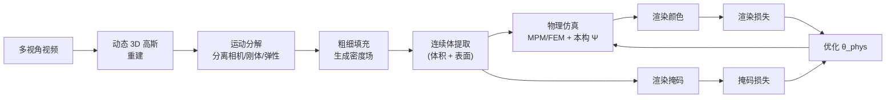
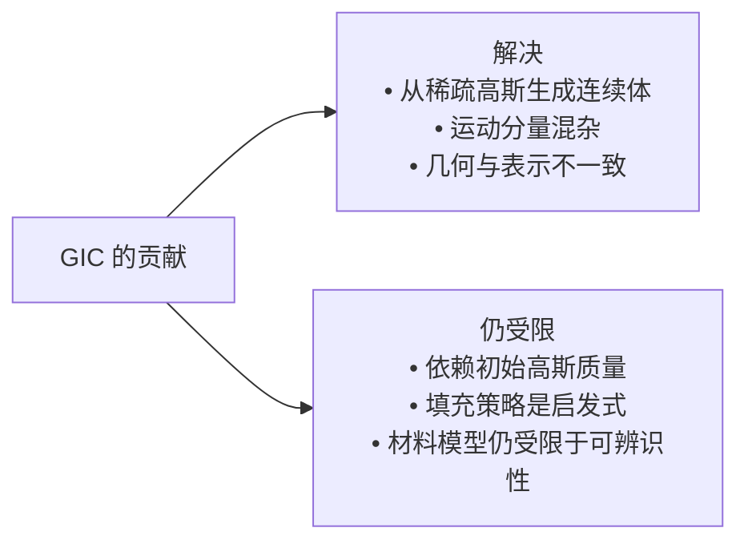
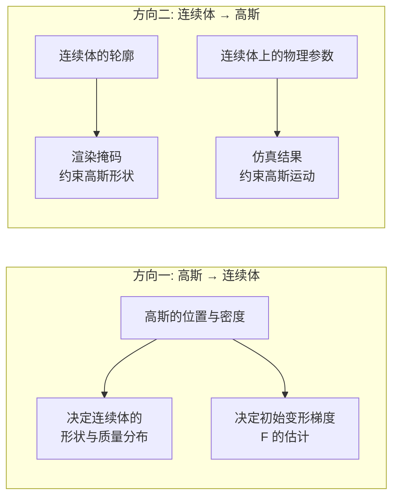

# GIC：高斯告知连续体的材料属性辨识

> **论文**：GIC: Gaussian-Informed Continuum for Physical Property Identification and Simulation（arXiv 2406.14927, NeurIPS 2024）
> **关键词**：动态 3D 高斯溅射、运动分解、粗细填充策略、密度场、二维掩码代理监督
> **代码**：见论文主页

**知识链接**：
- [PAC-NeRF 精读](/论文综述/164_PAC-NeRF_物理感知连续场的材料参数辨识)（几何无关辨识的开创工作）
- [PhysGaussian 精读](/论文综述/165_PhysGaussian_物理集成三维高斯动态仿真)（直接拿高斯当仿真粒子的路线）
- [Spring-Gauss 精读](/论文综述/167_SpringGauss_弹簧质点高斯弹性物体重建与仿真)
- [PhysDreamer 精读](/论文综述/168_PhysDreamer_视频生成先验驱动的物体物理交互)
- [系统辨识与逆问题基础](/前置知识/018b_前置知识_系统辨识与逆问题基础)
- [应变能密度与超弹性本构模型全景](/前置知识/018a_前置知识_应变能密度与超弹性本构模型全景)
- [OVOW 精读](/论文综述/161_OVOW_单目视频重建可仿真4D场景)

---

## 一、问题：高斯点云不是一个连续体

从 [PAC-NeRF](/论文综述/164_PAC-NeRF_物理感知连续场的材料参数辨识) 开始，"从视频辨识物理参数"这条线的技术路线很清楚：需要一个物理引擎（通常是 MPM 或 FEM），而物理引擎需要**连续介质**——一个体积内有明确材料属性的实体。PAC-NeRF 用 NeRF 的密度场加拉格朗日粒子解决这件事，代价是体渲染慢。

[PhysGaussian](/论文综述/165_PhysGaussian_物理集成三维高斯动态仿真) 绕开了这个问题：它直接宣布高斯基元就是 MPM 粒子。这个做法极其优雅，但它有一个隐含前提——**你已经有参数了**。PhysGaussian 解决的是正问题（参数 → 运动），不是逆问题（视频 → 参数）。

GIC 要同时拿到两件事：3D 高斯溅射的渲染速度和逆问题的参数辨识能力。这中间卡着一个本质矛盾：

> **看什么**：高斯点云是"表面看起来像物体"的表示，但它内部是空的——高斯只描述空间中的密度分布，不描述"这是不是实心物体"。物理仿真需要知道物体占据哪些体积、边界在哪、每一处的材料是什么。

这个缺口有三个具体表现：

| 缺口 | 说明 |
|------|------|
| 没有封闭表面 | 高斯是软的、无限延伸的核，没有明确等值面 |
| 没有体积划分 | 无法直接回答"这个物体占了多少体积、内部有哪些点" |
| 点分布不均 | 重建出的高斯在纹理丰富区密集、平坦区稀疏，直接当粒子会导致质量分布失真 |

---

## 二、三个核心设计

GIC 的贡献可以拆成三个互相咬合的机制。

> **看什么**：上半部分是"从高斯到连续体"的正向构造（① → ② → ③），下半部分是"从连续体回到高斯"的反向监督（渲染掩码 → 约束高斯）。这个闭环是 GIC 区别于单向流程的关键。

### 2.1 运动分解

高斯的运动不是单一原因造成的。摄像机在动、物体整体在平移、物体在旋转、物体自身在弹性变形——这些成分叠加在一起，全部混在每个基元的位置变化里。如果直接把首尾帧位置差当作物理速度，得到的位移场会包含摄像机和刚体运动的贡献，物理引擎会把这些当成"巨大的初始速度"去积分，结果完全错误。

**运动分解**的作用就是把观测到的运动拆成这些分量，让物理引擎只拿到属于弹性变形的那一部分。这对[逆问题](/前置知识/018b_前置知识_系统辨识与逆问题基础)的可辨识性至关重要：

| 如果不分解 | 后果 |
|-----------|------|
| 摄像机运动混入物体运动 | 辨识出的"弹性模量"吸收了摄像机位移 |
| 刚体运动混入弹性变形 | 优化器倾向于用刚体运动解释观测，弹性参数趋于退化值 |
| 整体平移混入局部速度 | 初始速度场错误，仿真第一帧就崩 |

### 2.2 粗细填充策略

从稀疏、不均匀的高斯分布生成可用于仿真的致密密度场。论文的思路是**由粗到细**（coarse-to-fine）：

> **看什么**：粗阶段的目的是"划出大范围，别漏掉物体的一部分"，细阶段的目的是"把内部填实，边缘修准"。直接做细会陷入局部——稀疏区域一开始就没有高斯，优化器没有信号把它们补上。

### 2.3 高斯告知连续体（Gaussian-Informed Continuum）

这是论文的命名来源。从密度场提取出的连续体渲染出**物体掩码**（mask，即物体在图像中的二维轮廓区域），这个掩码作为**二维形状代理**（2D shape surrogate）去监督高斯表示。

> **看什么**：掩码是一条比像素颜色更"干净"的监督信号。物体轮廓对光照、纹理、反射都不敏感，能提供稳定的形状约束，而这正是提取连续体最需要的信息。

这个设计的巧妙之处在于它解决了"几何在两种表示间不一致"的问题。从高斯提取的连续体可能和高斯的实际形状对不上（填充策略引入了误差），掩码监督把两者重新拉齐——如果连续体的轮廓和高斯渲染的轮廓不一致，损失就会产生梯度去修正。

---

## 三、为什么需要辨识物理属性

GIC 的最终目标是**辨识物理属性并仿真**。这需要把[连续介质力学的本构关系](/前置知识/018a_前置知识_应变能密度与超弹性本构模型全景)接进来。

从密度场提取的连续体带有变形梯度 $\mathbf{F}$，材料的应力由应变能密度导出：

$$\mathbf{P} = \frac{\partial \Psi(\mathbf{F})}{\partial \mathbf{F}}$$

::: details 📐 公式详解（点击展开）
| 子表达式 | 它是谁 | 它在干嘛 |
|---------|--------|---------|
| $\mathbf{F}$ | 变形梯度（$3\times3$） | 描述该材料点从参考形状到当前形状的局部线性映射 |
| $\Psi(\mathbf{F})$ | 应变能密度（标量，单位 $\mathrm{J/m^3}$） | 该变形状态储存的弹性能；内部含有待辨识的材料参数 |
| $\mathbf{P}$ | 第一类 Piola-Kirchhoff 应力（$3\times3$） | 参考面积上的力密度，物理引擎用它算内力 |

**用人话读**：材料被变形了，就储存了能量。能量对变形求导，得到"想恢复原状"的力。

**为什么这个形式对辨识关键**：待辨识的弹性参数（剪切模量 $\mu$、拉梅第二参数 $\lambda$、密度 $\rho$）全部藏在 $\Psi$ 里面。它们通过这条链影响内力 → 影响运动 → 影响渲染 → 影响与视频的差异 → 产生梯度。这就是参数能被"辨识"出来的唯一通道。详细推导见 [018a](/前置知识/018a_前置知识_应变能密度与超弹性本构模型全景)。
:::

辨识的优化目标仍是渲染与观测的一致性：

$$\min_{\theta_\text{phys}} \; \mathcal{L}_\text{render} + \lambda_\text{mask}\mathcal{L}_\text{mask}$$

::: details 📐 公式详解（点击展开）
| 子表达式 | 它是谁 | 它在干嘛 |
|---------|--------|---------|
| $\theta_\text{phys}$ | 待辨识的物理参数集合（$\mu, \lambda, \rho, \dots$） | 优化变量 |
| $\mathcal{L}_\text{render}$ | 渲染图像与视频帧的差异 | 主要监督信号 |
| $\mathcal{L}_\text{mask}$ | 连续体渲染掩码与观测掩码的差异 | 形状约束，防止几何漂移 |
| $\lambda_\text{mask}$ | 掩码损失的权重（标量超参） | 平衡两项贡献 |

**用人话读**：一边让画面像视频，一边让轮廓像视频里物体的轮廓。

**为什么需要第二项**：只有渲染损失时，优化器可以通过调整外观（颜色、透明度）来解释画面差异，而不必修正几何。加上掩码损失后，几何错误会直接暴露，逼优化器去修正连续体形状。
:::

---

## 四、完整流程

> **看什么**：这是一条闭环。仿真产生的状态被渲染出来，和视频比对，梯度反传回去更新物理参数，再进入下一轮仿真。整个过程要求仿真可微。

可微性依赖[自动微分](/前置知识/018b_前置知识_系统辨识与逆问题基础)：把整个时间积分序列记成计算图，反向传播一次就能得到对所有物理参数的梯度，代价与参数个数无关。这与数值差分（$N$ 个参数要跑 $N+1$ 次仿真）相比是数量级的优势。

---

## 五、它解决了什么、没解决什么

| 解决 | 怎么解决的 |
|------|-----------|
| 高斯无法直接当连续体 | 粗细填充生成密度场，再提取带表面的连续体 |
| 运动分量混杂 | 运动分解把相机、刚体、弹性分量拆开 |
| 几何与表示不一致 | 连续体渲染掩码反向监督高斯 |

| 仍受限 | 原因 |
|--------|------|
| 依赖初始高斯质量 | 填充只能补密度，不能凭空创造没被重建出来的结构 |
| 填充是启发式的 | 无法保证填充出的内部结构符合真实物体的内部 |
| 可辨识性上界 | 与所有逆问题一样，观测信息量决定了能辨识出多少参数 |

第三条值得展开。按照[系统辨识](/前置知识/018b_前置知识_系统辨识与逆问题基础)的基本原理，一段运动只激发有限的变形模式。如果视频里的物体只做了轻微摆动，那么无论填充多精细、优化多充分，都推不出准确的弹性模量——因为不同模量的物体在轻微摆动下的表现差异小于噪声。这解释了为什么这类方法的实验通常使用明显的大变形运动。

---

## 六、"高斯告知连续体"到底告知了什么

命名里的"informed"（告知）是双向的，这一点值得单独拆开，因为它是 GIC 与前后工作的分水岭。

> **看什么**：前向（高斯→连续体）决定"连续体长什么样"，反向（连续体→高斯）决定"高斯该被修正成什么样"。前者是一次性的构造，后者是贯穿整个优化的闭环监督。

前向这一侧，GIC 相对 PAC-NeRF 有一个实质性的信息增益。PAC-NeRF 的拉格朗日粒子分布是从 NeRF 密度场采样出来的，采样策略决定了粒子在哪里密集；GIC 的高斯本身是从多视角图像优化出来的，它们的空间分布携带了**外观信息**——纹理丰富、几何细节多的地方高斯更密。这些地方通常也是形状变化最剧烈、对参数辨识最敏感的地方。把高斯的分布直接用作连续体的质量分布，等于让"视觉显著性"自动加权到"物理显著性"上。

反向这一侧，掩码监督的作用比表面看起来更强。它同时约束了三件事：

| 约束对象 | 机制 |
|---------|------|
| 轮廓位置 | 连续体投影出的轮廓必须和视频里分割出的物体轮廓对齐 |
| 内部填充程度 | 填充过度会让投影轮廓外扩，填充不足会让轮廓内缩 |
| 时序一致性 | 每一帧都要求轮廓对齐，间接约束了运动轨迹 |

第三项是最容易被忽视的。掩码损失不只是几何约束，它同时是一种弱运动监督——如果仿真出的物体运动轨迹偏离视频，即使每一帧的形状都正确，轮廓在时序上也会错位。这让参数辨识多了一条独立于渲染颜色的梯度通道。

---

## 七、方法对比

| 维度 | GIC | PAC-NeRF | PhysGaussian |
|------|-----|----------|--------------|
| 视觉表示 | 动态 3D 高斯 | NeRF（欧拉网格） | 3D 高斯 |
| 高斯与仿真的关系 | 高斯**告知**连续体（不是高斯本身） | 不适用 | 高斯**就是**仿真粒子 |
| 提取连续体的方式 | 粗细填充密度场 → 抽面 | 隐式密度场 + 拉格朗日粒子 | 不提取 |
| 运动处理 | 显式的运动分解 | 未特别处理 | 需要人工给初始速度 |
| 监督信号 | 渲染损失 + 掩码损失 | 渲染损失 | 无（前向仿真） |
| 任务类型 | **逆问题**（视频 → 参数） | **逆问题** | **正问题**（参数 → 运动） |
| 渲染速度 | 快（溅射） | 慢（体渲染） | 快（溅射） |
| 是否需要网格化 | 需提取连续体（非三角网格） | 不需要 | 完全不需要 |

**最值得对照的是第二行**。PhysGaussian 的哲学是"高斯即粒子"，GIC 的是"高斯告知如何构造粒子"。两条路线的取舍很具体：

- PhysGaussian 完全不做转换，因此没有任何转换误差，但体积估计是启发式的近似，且参数必须外部给定。
- GIC 主动做转换，付出了填充策略可能不准确的代价，换来的是一个真正的连续体——而只有连续体才能承载参数辨识。

这不是谁更好的问题，是任务不同导致的必然选择。

---

## 八、总结

| 关键点 | 内容 |
|--------|------|
| 要解决的问题 | 高斯点云不是连续体，无法直接做物理参数辨识 |
| 机制一 | 运动分解——把相机、刚体、弹性运动拆开，保证物理引擎拿到干净的速度场 |
| 机制二 | 粗细填充——从稀疏、不均匀的高斯生成致密密度场 |
| 机制三 | 高斯告知连续体——连续体渲染掩码，反向监督高斯形状 |
| 物理接入点 | $\mathbf{P} = \partial\Psi/\partial\mathbf{F}$，参数藏在 $\Psi$ 里 |
| 监督信号 | 渲染损失（外观）+ 掩码损失（形状），后者提供更干净的几何约束 |
| 定位 | 逆问题求解器：输入视频，输出物理参数 |
| 主要局限 | 依赖初始高斯质量；填充是启发式；可辨识性受观测激励限制 |

---

## 延伸阅读

- [PAC-NeRF 精读](/论文综述/164_PAC-NeRF_物理感知连续场的材料参数辨识)——几何无关辨识的起点
- [PhysGaussian 精读](/论文综述/165_PhysGaussian_物理集成三维高斯动态仿真)——"高斯即粒子"的对立路线
- [PhysDreamer 精读](/论文综述/168_PhysDreamer_视频生成先验驱动的物体物理交互)——当观测不足时改用生成先验
- [系统辨识与逆问题基础](/前置知识/018b_前置知识_系统辨识与逆问题基础)——可辨识性、激励不足、梯度的三种来源
- [OVOW 精读](/论文综述/161_OVOW_单目视频重建可仿真4D场景)——单目输入下的同类问题