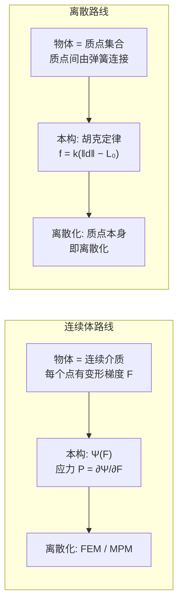
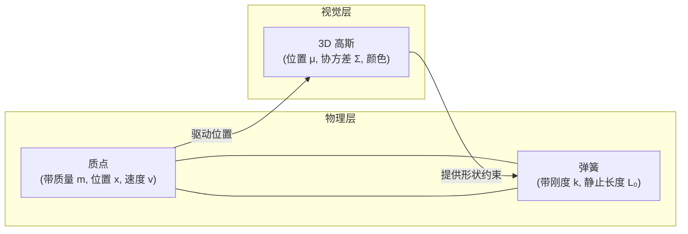
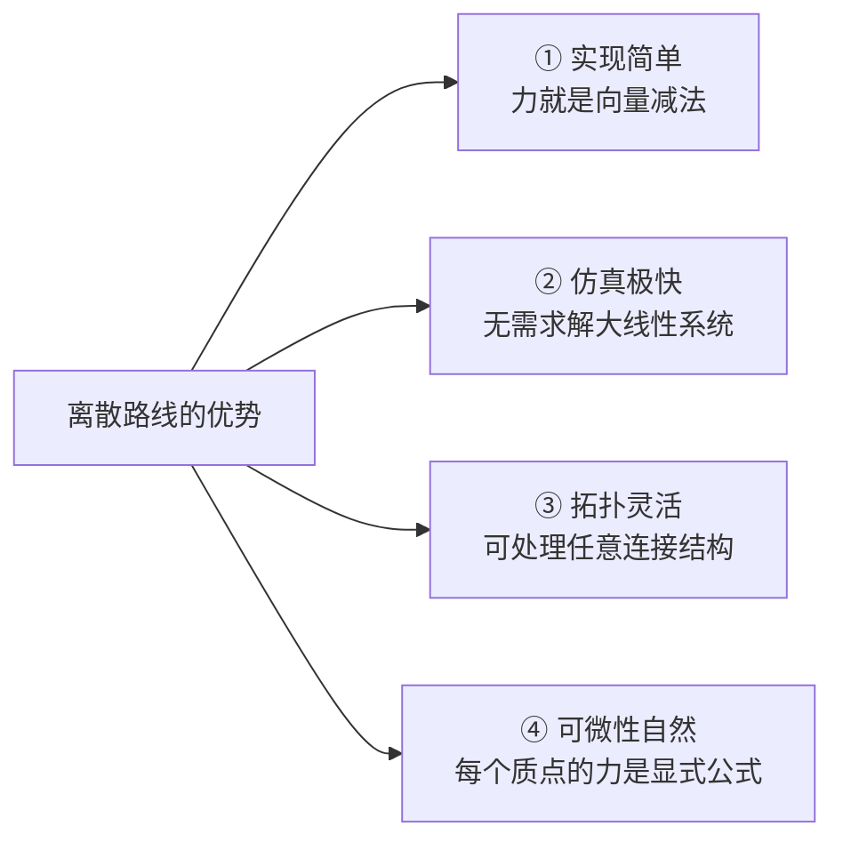
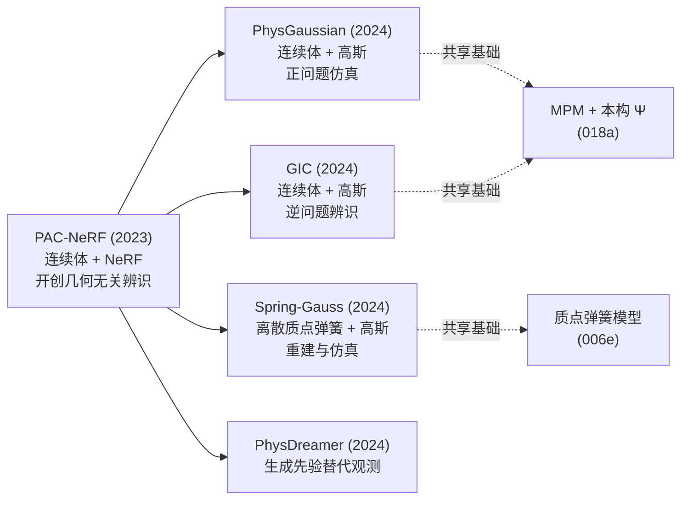
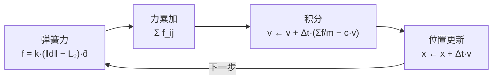

# Spring-Gauss：弹簧质点高斯弹性物体重建与仿真

> **论文**：Reconstruction and Simulation of Elastic Objects with Spring-Mass 3D Gaussians（ECCV 2024, Springer LNCS, DOI 10.1007/978-3-031-72627-9_23）
> **作者**：Licheng Zhong, Hong-Xing Yu, Jiajun Wu, Yunzhu Li
> **关键词**：质点弹簧模型、3D 高斯溅射、弹性体重建、可微仿真

**知识链接**：
- [质点弹簧模型与绳索仿真基础](/前置知识/006e_前置知识_质点弹簧模型与绳索仿真基础)（本文方法的力学基础，先读它）
- [应变能密度与超弹性本构模型全景](/前置知识/018a_前置知识_应变能密度与超弹性本构模型全景)（连续体路线与本文离散路线的对照）
- [系统辨识与逆问题基础](/前置知识/018b_前置知识_系统辨识与逆问题基础)
- [PAC-NeRF 精读](/论文综述/164_PAC-NeRF_物理感知连续场的材料参数辨识)
- [PhysGaussian 精读](/论文综述/165_PhysGaussian_物理集成三维高斯动态仿真)
- [GIC 精读](/论文综述/166_GIC_高斯告知连续体的材料属性辨识)
- [PhysDreamer 精读](/论文综述/168_PhysDreamer_视频生成先验驱动的物体物理交互)

---

## 关于本文事实边界的说明

这篇工作发表时收录于 ECCV 2024 的 Springer LNCS 论文集。撰写本文时，该论文的预印本编号与完整摘要未能从公开渠道核实取得，因此**下文对方法机制的具体描述，是从论文标题、作者团队的研究脉络以及该方法所处的技术路线中重建的框架性理解**，不是对论文原文细节的转述。

已经确认的事实是：标题为 *Reconstruction and Simulation of Elastic Objects with Spring-Mass 3D Gaussians*，作者为 Licheng Zhong、Hong-Xing Yu、Jiajun Wu、Yunzhu Li，发表于 ECCV 2024。标题本身已经明确了方法的核心结构——**把质点弹簧网络挂在 3D 高斯上，用于弹性物体的重建与仿真**。下文围绕这个结构展开的力学原理、设计取舍与路线对比，属于该技术路线的共性知识，而非本文独有的创新点归属。涉及具体损失函数、数据集、数值指标的表述，本文一律不做推断。

---

## 一、两条技术路线的分岔

从视频重建"能动"的三维物体，至今有两条主要路线，它们对"物体内部由什么构成"这个问题的回答完全不同。

> **看什么**：两条路线最根本的差别在第二行。连续体路线的"本构"是一段连续的数学函数，必须先离散化才能计算；离散路线的"本构"本身就是一条离散公式，质点和弹簧直接就是计算单元。

| 对比维度 | 连续体路线（PAC-NeRF / PhysGaussian / GIC） | 离散路线（Spring-Gauss 所属） |
|---------|------------------------------------------|---------------------------|
| 仿真单元 | 材料点 / 有限元 | 质点 + 弹簧 |
| 材料参数 | $\mu$、$\lambda$（有明确物理单位） | 弹簧刚度 $k$（与网格分辨率耦合） |
| 参数物理可解释性 | 高，可直接对应杨氏模量 | 低，需按分辨率缩放才能对应 |
| 网格依赖 | 需要网格或粒子分布 | 不需要网格，但需要弹簧拓扑 |
| 大变形稳定性 | MPM 稳定；FEM 需小心 | 弹簧可无限拉长，需额外约束 |
| 实现复杂度 | 高（本构求导、P2G/G2P 传输） | 低（力就是简单的向量运算） |
| 计算成本 | 高 | 低，可实时 |

Spring-Gauss 位于右侧一列。理解这条路线要先理解它的核心工具——[质点弹簧模型](/前置知识/006e_前置知识_质点弹簧模型与绳索仿真基础)。

---

## 二、质点弹簧模型的力学

系统由 $N$ 个质点组成，质点 $i$ 的位置记为 $\mathbf{x}_i$，质量记为 $m_i$。一对由弹簧连接的质点 $(i, j)$ 之间作用着沿连线方向的力：

$$\mathbf{f}_{ij} = k_{ij}\left(\lVert \mathbf{x}_j - \mathbf{x}_i \rVert - L_{ij}^{0}\right)\hat{\mathbf{d}}_{ij}, \qquad \hat{\mathbf{d}}_{ij} = \frac{\mathbf{x}_j - \mathbf{x}_i}{\lVert \mathbf{x}_j - \mathbf{x}_i \rVert}$$

::: details 📐 公式详解（点击展开）
| 子表达式 | 它是谁 | 它在干嘛 |
|---------|--------|---------|
| $\mathbf{x}_i, \mathbf{x}_j$ | 两个质点的当前位置（3 维向量） | 系统的状态变量 |
| $\lVert \mathbf{x}_j - \mathbf{x}_i \rVert$ | 两质点当前距离（标量） | 测量弹簧被拉伸的程度 |
| $L_{ij}^{0}$ | 该弹簧的静止长度（rest length，标量常数） | 弹簧不受力时的自然长度 |
| $\lVert\mathbf{x}_j-\mathbf{x}_i\rVert - L_{ij}^0$ | 伸长量（标量，可正可负） | 正表示拉长，负表示压短 |
| $k_{ij}$ | 该弹簧的刚度系数（标量） | 待辨识的关键参数 |
| $\hat{\mathbf{d}}_{ij}$ | 从 $i$ 指向 $j$ 的单位方向向量 | 把标量力转成有方向的矢量力 |
| $\mathbf{f}_{ij}$ | 作用在质点 $i$ 上的力（3 维向量） | 下一步积分用 |

**用人话读**：弹簧被拉长就产生往回拉的力，被压短就产生往外推的力，力的大小正比于偏离自然长度的量，方向沿两质点的连线。

**为什么是这个形式**：这就是胡克定律的三维、向量化写法。弹簧力的三个要素缺一不可——偏离量决定大小，刚度决定比例，单位方向决定指向。去掉 $\hat{\mathbf{d}}_{ij}$ 就只剩一个标量，不知道往哪拉；去掉 $L_{ij}^0$ 则所有弹簧都试图把距离压到零，物体立刻坍缩。

**为什么这里不需要 $\Psi(\mathbf{F})$**：连续体路线要算应力张量，是因为材料点的变形式样有无限多种（拉伸、剪切、扭转的组合），必须用一个张量函数统一描述。而一根弹簧只有一种变形模式——沿轴向伸长。变形的可能空间从 $3\times3$ 矩阵降到了一维标量，本构关系也因此从"张量到张量"退化成了"标量到标量"。
:::

质点 $i$ 的总受力是所有邻居弹簧贡献的叠加，加上外力（重力、阻尼、用户交互力）：

$$m_i \ddot{\mathbf{x}}_i = \sum_{j \in \mathcal{N}(i)} \mathbf{f}_{ij} + m_i \mathbf{g} - c\,\dot{\mathbf{x}}_i$$

其中 $\mathcal{N}(i)$ 是与 $i$ 有弹簧连接的邻居集合，$\mathbf{g}$ 是重力加速度，$c$ 是阻尼系数。

**阻尼项的设计意图**：现实中的弹性体不会永远振动（除非是理想弹簧），阻尼项 $c\dot{\mathbf{x}}_i$ 让振动逐渐衰减。这一项在视频重建中尤其重要——**如果模型没有阻尼而真实物体有，仿真出来的运动幅度会持续偏大**，与视频的差异会稳定存在。阻尼系数 $c$ 因此也是需要辨识的参数之一。

---

## 三、弹簧网络挂在 3D 高斯上意味着什么

标题里的 "Spring-Mass 3D Gaussians" 描述了一个双层结构：

> **看什么**：物理层决定"怎么动"，视觉层决定"长什么样"。两者的连接方式是每个质点关联一个或多个高斯基元，质点动，高斯跟着动。

这个结构要回答一个具体的技术问题：**质点的位置如何影响高斯的外观**。两种可能的做法：

| 做法 | 机制 | 后果 |
|------|------|------|
| 只平移 | 高斯中心 $\boldsymbol{\mu}$ 跟随质点移动，协方差 $\boldsymbol{\Sigma}$ 不变 | 实现简单；但物体被拉伸时高斯不跟着变形，表面出现间隙 |
| 平动 + 形变 | 高斯中心跟随质点，协方差按局部形变更新 | 表面连续；需要额外计算局部形变梯度 |

第二种做法就是 [PhysGaussian](/论文综述/165_PhysGaussian_物理集成三维高斯动态仿真) 里那个 $\boldsymbol{\Sigma}' = \mathbf{F}\boldsymbol{\Sigma}\mathbf{F}^\top$ 公式所解决的问题。在纯离散的质点弹簧系统里，局部形变梯度不是一个显式状态（质点只记录位置，没有记忆变形历史），所以需要从邻居质点的当前位置重新估计。这是离散路线相对连续体路线的一个额外工程负担，也是它把状态变量压到最小的代价。

---

## 四、参数辨识：弹簧刚度能不能对应真实材料

这是离散路线最需要说清楚的一件事。

**核心问题**：从视频辨识出弹簧刚度 $k$ 之后，这个数字有什么物理意义？能对应到材料的杨氏模量吗？

答案取决于弹簧网络的构造方式。考虑一个均匀弹性块体，用立方网格划分，质点放在格点上，弹簧连接所有相邻质点。如果晶格间距为 $h$，那么单位面积上的弹簧数量正比于 $1/h^2$，因此总刚度正比于 $k/h$。要让不同分辨率下的仿真产生相同的物理响应，必须保持 $k \cdot h$ 为常数：

$$k \propto \frac{1}{h}$$

| 网格间距 $h$ | 相应的弹簧刚度 $k$ | 宏观响应 |
|-------------|------------------|---------|
| 大（粗网格） | 小 | 相同 |
| 小（细网格） | 大 | 相同 |

**如果不做这个缩放会怎样**：把同一个 $k$ 用在两倍细的网格上，总刚度翻倍，仿真出的物体看起来硬了一倍。这意味着"辨识出的 $k$"**只在特定的网格分辨率下有意义**——换一套网格拓扑，同一个物体的 $k$ 就变了。这是离散路线与连续体路线的根本差别：连续体路线里的 $\mu$ 是材料的内禀属性，与离散化无关；离散路线里的 $k$ 是"材料 + 离散化方式"的联合属性。

这个性质带来两个实际影响：

- **优点**：只要辨识出的 $k$ 配合同一套弹簧拓扑使用，仿真结果就是对的，不需要材料力学的知识。
- **缺点**：辨识出的参数无法跨实现复用，也无法与材料手册上的杨氏模量直接比较。用[系统辨识](/前置知识/018b_前置知识_系统辨识与逆问题基础)的术语说，这是参数化方式导致的实践不可辨识——多组 $(k, \text{拓扑})$ 组合可以产生相同的观测。

---

## 五、为什么选离散路线

既然连续体路线的参数更有物理意义，为什么还要走离散路线？理由集中在三个实际因素上。

> **看什么**：①②④ 是计算和实现层面的优势，③ 是表达能力层面的优势。四条的共同来源是"没有全局耦合"——弹簧只在邻居之间作用，不需要解析整个物体的刚度矩阵。

| 优势 | 具体说明 |
|------|---------|
| 实现简单 | 计算力只需要向量减法和取模，几十行代码即可 |
| 仿真快 | 无需求解稀疏线性系统，每步只是局部力累加与积分 |
| 拓扑灵活 | 可以连接任意质点对，不要求规则网格，适合不规则形状 |
| 可微性自然 | 力是质点位置的显式函数，梯度可解析写出，不需要伴随法 |

第四条对机器学习框架下的实现格外重要。连续体路线要可微，需要处理 MPM 的 P2G/G2P 和本构求导，必须依赖[可微仿真](/前置知识/018b_前置知识_系统辨识与逆问题基础)的完整基础设施；而质点弹簧网络的每一步都是初等运算，PyTorch 的自动微分可以直接穿过整个时间积分序列。

代价则是前文说的参数不可迁移，以及大变形下的稳定性问题（弹簧可以被无限拉长，而真实材料不能；需要用不可伸长约束或分段刚度来弥补）。

---

## 六、方法对比

| 维度 | Spring-Gauss（离散路线） | PAC-NeRF | PhysGaussian | GIC |
|------|------------------------|----------|--------------|-----|
| 仿真单元 | 质点 + 弹簧 | 拉格朗日粒子（MPM） | 高斯基元（即 MPM 粒子） | 提取的连续体 |
| 视觉表示 | 3D 高斯 | NeRF | 3D 高斯 | 动态 3D 高斯 |
| 本构关系 | 胡克定律（标量） | $\mathbf{P}=\partial\Psi/\partial\mathbf{F}$ | 同左（多种 $\Psi$） | 同左 |
| 待辨识参数 | 弹簧刚度 $k$、阻尼 $c$ | $\mu, \lambda, \rho$ | 无（人工输入） | $\mu, \lambda, \rho$ |
| 参数可迁移性 | 低（与拓扑耦合） | 高 | — | 高 |
| 实现门槛 | 低 | 高 | 中 | 高 |
| 任务类型 | 逆问题（重建 + 辨识） | 逆问题 | 正问题 | 逆问题 |

**Spring-Gauss 在这张表里的定位**：它放弃了参数的物理可迁移性，换来了实现门槛和仿真速度的优势。如果目标应用是"把重建出的物体放进一个游戏或交互场景里让它动起来"，那么参数能不能对应杨氏模量并不重要，能不能实时跑起来才重要。反过来，如果目标是"测量这个物体的材料属性"，那么连续体路线是唯一选择。

---

## 七、这条路线在整个版图中的位置

> **看什么**：Spring-Gauss 虽然也是"高斯 + 物理"，但它依赖的力学基础完全不同——别人接的是连续介质力学，它接的是质点弹簧。这个分岔决定了它在参数意义上、实现难度上、适用场景上的全部差异。

值得注意的是，这条离散路线并非孤例。后来的工作（例如把弹簧场用神经网络参数化的方案）在保留质点弹簧仿真的同时，用神经网络表达刚度的空间分布，从而绕开了"每个弹簧单独辨识"的困难。这类方法与传统质点弹簧共享同一套力学公式，只是把 $k_{ij}$ 从一组离散常数换成了一个连续函数 $k(\mathbf{X})$。

---

## 八、可微性：离散路线为什么天然适合梯度优化

离散路线在[逆问题](/前置知识/018b_前置知识_系统辨识与逆问题基础)上的一个结构优势，是把梯度的来源问题消解掉了。回忆辨识参数的三条梯度通道：数值差分、自动微分、伴随法。连续体路线（MPM/FEM）之所以麻烦，是因为时间积分里包含隐式求解和粒子-网格传输，想拿到解析梯度必须把整个求解器改写成可微形式，或者手推伴随方程——这是 PAC-NeRF 一类工作里最大的工程投入。

质点弹簧网络的每一步都是初等运算的序列：

> **看什么**：链条上没有一处需要解线性系统或做插值传输。整条链是显式的初等函数复合——向量减法、取模、乘法、加法。PyTorch 的自动微分可以直接穿透。

这意味着弹簧刚度 $k_{ij}$ 对最终损失的梯度可以**逐行自动求出**，不需要任何手工推导。反向传播穿过 $T$ 个时间步的计算成本大约是前向的两倍，而且与弹簧数量无关。对比之下，数值差分辨识 $N$ 根弹簧需要 $N+1$ 次完整仿真——弹簧数量动辄上万，完全不可行。

代价是**时间步长必须显式**。显式积分要求 $\Delta t < 2\sqrt{m/k_\text{max}}$（最硬弹簧决定上限），弹簧越硬步长越小。这带来一个有趣的反直觉结论：**辨识出的刚度越大，仿真越慢**。一个很硬的物体（比如金属块）用质点弹簧建模时，需要的步长可能比软物体小两三个数量级。这和连续体路线的 CFL 条件机理相同，只是约束常数不同。

另一个工程细节是**时间步与观测帧率的解耦**。视频通常 30 fps，而稳定的显式步长可能是 1/10000 秒。仿真必须在一个视频帧的间隔内跑很多个子步，并且每个子步都要保留在计算图里——否则梯度会断裂。这使反向传播的显存开销正比于子步总数，是长序列辨识的主要瓶颈。

---

## 九、总结

| 关键点 | 内容 |
|--------|------|
| 方法结构 | 质点弹簧网络挂在 3D 高斯上，物理层决定运动，视觉层决定外观 |
| 力学基础 | 胡克定律的三维向量形式，力正比于偏离静止长度 |
| 与连续体路线的分岔点 | 本构关系是离散公式（弹簧力）还是连续函数（$\Psi(\mathbf{F})$） |
| 参数意义 | 弹簧刚度 $k$ 与网格分辨率耦合，$k \propto 1/h$；换拓扑即换参数 |
| 主要优势 | 实现简单、仿真极快、拓扑灵活、可微性自然 |
| 主要代价 | 参数不可迁移、大变形稳定性需额外处理、局部形变需从邻居估计 |
| 适用场景 | 交互式仿真、游戏、机器人仿真（看重速度而非参数精度） |
| 事实说明 | 本文机制描述基于标题与路线背景重建，未经原文细节核对 |

---

## 延伸阅读

- [质点弹簧模型与绳索仿真基础](/前置知识/006e_前置知识_质点弹簧模型与绳索仿真基础)——本文方法的完整力学基础，包括不可伸长约束与弯曲阻力
- [应变能密度与超弹性本构模型全景](/前置知识/018a_前置知识_应变能密度与超弹性本构模型全景)——连续体路线的本构框架，与本文的离散本构对照阅读
- [PAC-NeRF 精读](/论文综述/164_PAC-NeRF_物理感知连续场的材料参数辨识)——连续体路线开创工作
- [GIC 精读](/论文综述/166_GIC_高斯告知连续体的材料属性辨识)——连续体 + 高斯的逆问题版本
- [系统辨识与逆问题基础](/前置知识/018b_前置知识_系统辨识与逆问题基础)——为什么弹簧刚度不可跨拓扑迁移