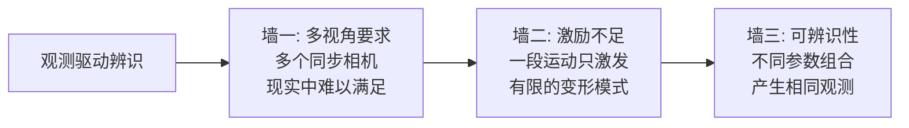
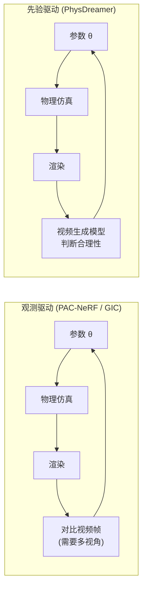
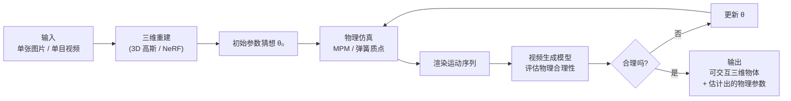
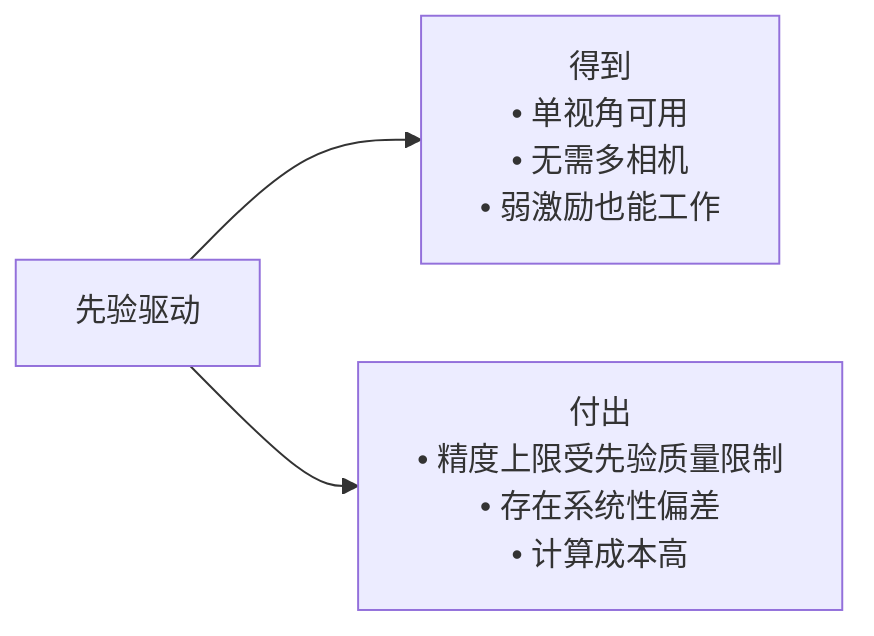
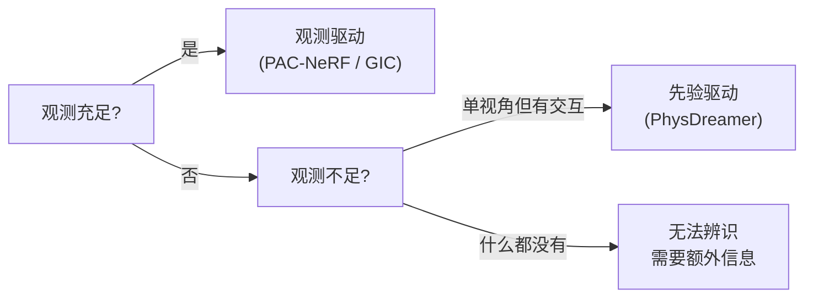
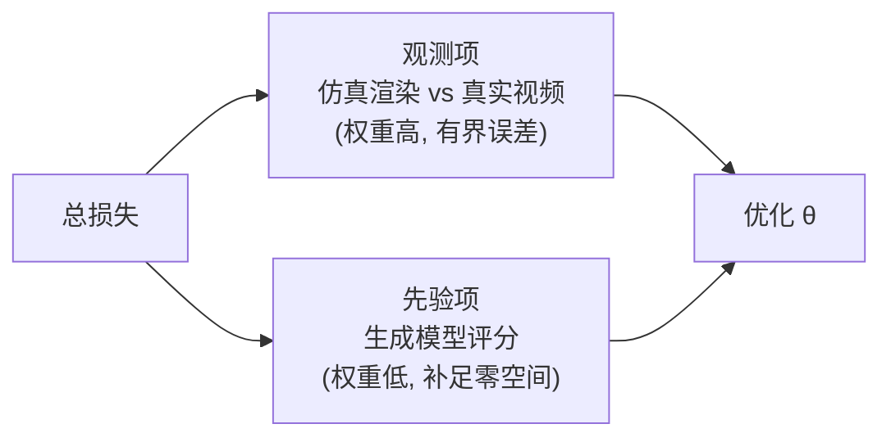

# PhysDreamer：视频生成先验驱动的物体物理交互

> **论文**：PhysDreamer: Physics-Based Interaction with 3D Objects via Video Generation（ECCV 2024, Springer LNCS, DOI 10.1007/978-3-031-72627-9_22）
> **作者**：Tianyuan Zhang, Hong-Xing Yu, Rundi Wu, Brandon Y. Feng, Changxi Zheng, Noah Snavely, Jiajun Wu, William T. Freeman
> **关键词**：视频生成先验、材料属性估计、单视角输入、可交互三维物体

**知识链接**：
- [系统辨识与逆问题基础](/前置知识/018b_前置知识_系统辨识与逆问题基础)（观测驱动 vs 先验驱动的辨识框架）
- [应变能密度与超弹性本构模型全景](/前置知识/018a_前置知识_应变能密度与超弹性本构模型全景)（被估计的参数是什么）
- [PAC-NeRF 精读](/论文综述/164_PAC-NeRF_物理感知连续场的材料参数辨识)（观测驱动的代表）
- [PhysGaussian 精读](/论文综述/165_PhysGaussian_物理集成三维高斯动态仿真)（前向仿真器，本方法的下游）
- [GIC 精读](/论文综述/166_GIC_高斯告知连续体的材料属性辨识)（观测驱动的后续）
- [Spring-Gauss 精读](/论文综述/167_SpringGauss_弹簧质点高斯弹性物体重建与仿真)
- [OVOW 精读](/论文综述/161_OVOW_单目视频重建可仿真4D场景)

---

## 关于本文事实边界的说明

这篇工作发表于 ECCV 2024 的 Springer LNCS 论文集。撰写本文时，其预印本编号与完整摘要未能从公开渠道核实取得，因此**下文对方法细节的描述，是从论文标题、作者团队的既有工作脉络，以及该方法所代表的"生成先验替代观测"这一技术方向中重建的框架性理解**。

已确认的事实：标题为 *PhysDreamer: Physics-Based Interaction with 3D Objects via Video Generation*，作者为 Tianyuan Zhang、Hong-Xing Yu、Rundi Wu、Brandon Y. Feng、Changxi Zheng、 Noah Snavely、Jiajun Wu、William T. Freeman，发表于 ECCV 2024。标题明确了两件事——目标是"与三维物体的基于物理的交互"，手段是"通过视频生成"。下文围绕这个组合展开的原理分析属于该方向的共性知识，涉及具体损失权重、数据集名称、数值指标的表述一律不做推断。

---

## 一、观测驱动辨识的死穴

从 [PAC-NeRF](/论文综述/164_PAC-NeRF_物理感知连续场的材料参数辨识) 开始的一整条路线，做参数辨识的方式是同一个套路：**仿真一遍，跟视频比对，差异传梯度，改参数**。

这个套路的成立有一个隐含前提：**视频里的观测足够丰富，能够约束住所有待辨识的参数**。而在[系统辨识](/前置知识/018b_前置知识_系统辨识与逆问题基础)的语言里，这是一条非常强的要求。

具体来说，观测驱动的辨识依次撞上三堵墙：

> **看什么**：三堵墙是递进的。第一堵是采集条件的物理限制，第二堵是数据信息量的限制，第三堵是问题结构本身的限制。越过任何一堵都不能靠"优化得更久"。

| 墙 | 具体表现 | 为什么致命 |
|----|---------|-----------|
| 多视角要求 | PAC-NeRF、GIC 都需要多相机同步拍摄 | 普通用户手里只有一段手机视频 |
| 激励不足 | 物体只被轻轻碰了一下，只做小幅摆动 | 小幅摆动下不同刚度的表现差异小于噪声 |
| 参数耦合 | $\mu/\rho$ 只以比值出现 | 单独辨识 $\mu$ 需要额外的质量信息 |

第二堵墙尤其隐蔽。假设一段视频里物体只是轻微晃动，那么"很硬的轻物体"和"很软的轻物体"在画面上的差别微乎其微。优化器会沿着损失函数的平坦方向滑到某个解上，但这个解未必是真实参数。这就是实践不可辨识：理论上有唯一解，实际上损失曲面的平坦方向被噪声淹没。

---

## 二、PhysDreamer 的转向：把"像视频"换成"像合理物理"

PhysDreamer 的做法是换掉监督信号的来源。它不再问"仿真结果和这段视频像不像"，而是问：

> 这个参数下仿真出来的运动，**像不像一个物理上合理的物体该怎么动**？

这个判断由一个**视频生成模型**给出。视频生成模型在大规模视频数据上训练过，它隐式地学到了"物体被这样推一下通常该怎么动"——软的东西怎么晃、硬的东西怎么弹、布怎么飘。这个学到的知识被当作先验使用。

> **看什么**：两条链的结构完全一样，只有最后一环不同。观测驱动需要真实视频做比对对象，先验驱动只需要一个会"评价"运动的生成模型。这个替换带来的最大好处是：**不再需要多视角视频，单张图片或一段单手拍摄的视频就够**。

为什么生成模型能替代观测？因为它对"合理运动"有密度估计能力。给定一个静态物体和一次交互（推、拉、撞），它能评估"接下来应该发生什么样的运动"。这个评估不需要知道真实参数，只需要知道哪些运动是常见的、合理的。参数搜索的目标就变成了：找一组参数，使仿真出的运动落在生成模型认为高概率的区域里。

---

## 三、参数搜索的目标函数

把上述思路写成优化问题。有两种等价的组织方式。

### 3.1 最小化"生成模型认为的不合理度"

$$\min_{\theta} \; \mathbb{E}_{t}\left[\, w(t)\left\lVert \epsilon_\phi\!\left(\mathbf{z}_t;\, \mathbf{c}(\mathbf{x}_\theta)\right) - \epsilon \right\rVert^2 \right]$$

::: details 📐 公式详解（点击展开）
| 子表达式 | 它是谁 | 它在干嘛 |
|---------|--------|---------|
| $\theta$ | 待搜索的物理参数（弹性模量、密度、阻尼等） | 优化变量 |
| $\mathbf{x}_\theta$ | 参数取 $\theta$ 时仿真产生的运动序列（渲染成帧） | 物理仿真器的输出 |
| $\mathbf{c}(\mathbf{x}_\theta)$ | 把这些帧编码成的条件输入（潜在表示） | 生成模型的条件 |
| $\mathbf{z}_t$ | 加噪到第 $t$ 步的潜在变量 | 扩散过程的中间状态 |
| $\epsilon_\phi(\cdot)$ | 视频生成模型的噪声预测网络（$\phi$ 是其权重，已冻结） | 判断给定条件下的噪声是否符合预期 |
| $\epsilon$ | 实际加入的噪声 | 监督目标 |
| $w(t)$ | 时间步权重（标量函数） | 平衡不同噪声强度下的贡献 |

**用人话读**：把仿真出的运动交给一个训练好的视频生成模型，问它"这段运动在物理上合理吗"。生成模型如果觉得别扭，就会给出较大的预测误差，这个误差反传回去，推动参数往更合理的方向调整。

**为什么是"预测噪声的误差"**：扩散模型（Diffusion Model，通过对数据逐步加噪再学习反向去噪来生成样本的模型）的训练目标就是预测所加的噪声。一个训练充分的模型面对"训练分布内的合理样本"时预测准确；面对"分布外的怪异样本"时预测偏差大。这个偏差因此可以当作**合理性评分**使用，不需要额外的判别器。

**为什么生成模型权重要冻结**：$\phi$ 是整个优化过程里唯一不动的东西。如果它也参与更新，模型会为了迁就某组参数而改变自己"什么是合理"的判断，先验就失效了。冻结 $\phi$ 保证了"判断标准"在整个搜索过程中是固定的一把尺子。
:::

### 3.2 最小化"仿真与生成模型预期的偏差"

另一种组织方式是让生成模型直接生成"应该出现的运动"，然后让仿真去接近它：

$$\min_{\theta} \; \left\lVert \mathbf{S}(\theta) - \mathbf{G}(\mathbf{I}_0, \mathbf{a}) \right\rVert^2$$

其中 $\mathbf{S}(\theta)$ 是参数 $\theta$ 下的仿真运动，$\mathbf{G}(\mathbf{I}_0, \mathbf{a})$ 是给定初始画面 $\mathbf{I}_0$ 与交互动作 $\mathbf{a}$ 时生成模型想象的未来运动。

**两种表述的实质相同**：都是"让仿真的结果落在生成模型认可的区域"。区别在于第一种用评分（间接），第二种用生成样本（直接）。评分方式不需要生成完整视频，计算更省；生成方式提供更具体的梯度方向。

---

## 四、完整流程

> **看什么**：整个循环里没有一步需要真实视频的中间帧做监督——唯一的输入是初始的那张图或那段视频。判据完全来自生成模型内部的知识。

流程里有三个值得注意的环节：

**三维重建在前，参数搜索在后。** 重建负责给出物体的静态形状和外观，参数搜索负责回答"它是什么材料做的"。两者解耦，因为它们的监督信号来源不同——重建靠输入图像，参数靠生成先验。

**参数搜索是迭代的。** 每一轮都要完整跑一次仿真、一次渲染、一次生成模型推理。这比观测驱动的辨识更贵，因为生成模型的推理开销远大于一次图像比对。参数搜索的效率取决于搜索策略：穷举网格太粗，梯度下降需要评分对参数可微（可以做到，因为整个链条都是可微的）。

**输出是一个"能玩"的物体。** 最终的产物是与估计参数绑定的三维资产，用户可以施加新的力、新的交互，仿真会给出物理上自洽的响应。

---

## 五、先验驱动的代价

这个方法有一个必须说清楚的代价，它来自"监督信号的来源从数据换成了模型"这件事本身。

> **看什么**：右侧两列是一体两面。用先验填补观测缺口，意味着最终的估计精度被先验精度封顶。

| 代价 | 机制 | 后果 |
|------|------|------|
| 精度受先验限制 | 参数是被"生成模型认为合理"约束的，不是被真实物理约束的 | 先验不覆盖的材料（罕见材质）估计不准 |
| 系统性偏差 | 生成模型学的是统计常见规律，不是物理定律 | 会把常见材质的属性"拉向平均值" |
| 反物理风险 | 生成模型可能认为某些物理上错误但在训练数据里常见的运动是合理的 | 例如它可能接受运动幅度不守恒能量的结果 |
| 计算成本 | 每轮需要一次生成模型推理 | 搜索迭代次数受限 |

**第二条是最需要警惕的**。观测驱动的辨识即使失败，失败方式也是"估计出噪声"，因为它的目标是复现真实数据。先验驱动的辨识在失败时会**自信地给出错误答案**——生成模型对"常见物体的常见运动"有强偏好，这种偏好会把估计值往训练分布的密集区域拉。一个不常见的软材料可能被估计成常见的中等刚度材料，而且损失值很低，看起来像收敛得很好。

这也是为什么这类方法在评估上比观测驱动方法更难：没有真实轨迹可比，只能用"人眼看起来合理"或者"在已知材料的合成数据上测试"来验证。

---

## 六、两条范式的关系

PhysDreamer 与 PAC-NeRF/GIC 的关系不是替代，而是**互补的两端**：

| 维度 | 观测驱动（PAC-NeRF / GIC） | 先验驱动（PhysDreamer） |
|------|--------------------------|----------------------|
| 监督信号来源 | 真实视频像素 | 视频生成模型的合理性判断 |
| 输入要求 | 多视角同步视频 | 单张图片或单目视频 |
| 激励要求 | 需要丰富的大变形运动 | 弱激励也可工作 |
| 精度决定因素 | 观测质量与信息量 | 生成先验的质量 |
| 失败方式 | 估计出噪声（方差大） | 自信地偏离真值（偏差大） |
| 计算成本 | 中（仿真 + 渲染） | 高（仿真 + 渲染 + 生成模型） |
| 适用场景 | 实验室标定、已知采集条件 | 普通用户的照片/短视频 |

> **看什么**：选择哪条路线取决于手上有多少观测。观测充足时用观测驱动，因为它的误差有界；观测不足但有生成先验可用时，先验驱动是唯一可行的路径，代价是要接受先验带来的偏差。

一个自然的组合是**两者一起用**：以观测驱动为主，先验作为正则项。这样既能利用真实观测的准确性，又能在观测不足的方向上用先验补位。这也解释了为什么后续工作普遍把物理合理性损失作为辅助项而非主项。

> **看什么**：两项的分工不是"各管一半"，而是"主项定尺度、辅项定方向"。观测项在它敏感的参数方向上提供准确梯度；先验项只在观测项梯度接近零的方向上起作用，也就是损失曲面的平坦方向。

这个组合方式有一个理论依据。先用[系统辨识](/前置知识/018b_前置知识_系统辨识与逆问题基础)的语言说：观测项的海森矩阵在某些方向上特征值很小（对应激励不足的参数组合），这些方向构成一个近似零空间。沿零空间移动参数几乎不改变观测损失，因此优化器无从判断该往哪走。先验项的价值正是在这个零空间里提供梯度——它不参与那些已经被观测约束住的方向，因为在那里观测项的梯度远大于先验项。这就是**用低权重正则项填补零空间**的常见做法，加权最小二乘的吉洪诺夫正则（Tikhonov regularization）是它的线性特例。

---

## 七、这条线解决了什么

回到最开头的问题：能不能只拍一段视频（甚至一张照片）就得到一个带物理属性、可以交互的三维物体？

把四篇工作串起来看，这个问题的答案逐渐成型：

| 工作 | 补充的能力 |
|------|-----------|
| PAC-NeRF | 首次在几何未知下做参数辨识；要求多视角 |
| PhysGaussian | 把渲染与仿真统一，速度提升；但参数需人工给 |
| GIC | 让高斯能承载连续体，从而能做辨识；仍要求多视角 |
| PhysDreamer | 用生成先验替代缺失的观测；单视角可用 |

> **看什么**：四步各自解决了问题的一个侧面——几何未知、速度、表示适配、观测不足。合起来才凑齐了"随手拍一段就能仿真"的全部条件。这也是为什么这四篇要一起读。

---

## 八、总结

| 关键点 | 内容 |
|--------|------|
| 核心转向 | 用视频生成模型对"物理合理性"的判断，替代真实视频做监督 |
| 解决的根本问题 | 观测驱动辨识需要多视角且怕激励不足；先验驱动只需要单视角 |
| 优化目标 | 让仿真出的运动落在生成模型认为高概率的区域 |
| 关键实现约束 | 生成模型权重冻结——判据必须固定，否则先验失效 |
| 最大代价 | 精度被先验质量封顶；失败时是系统性偏差而非随机噪声 |
| 与观测驱动的关系 | 互补而非替代；实践中常把先验当正则项与观测联合使用 |
| 定位 | 把"随手拍一段视频→得到可交互物理物体"的最后一环补上 |

---

## 延伸阅读

- [PAC-NeRF 精读](/论文综述/164_PAC-NeRF_物理感知连续场的材料参数辨识)——观测驱动范式的开创工作
- [GIC 精读](/论文综述/166_GIC_高斯告知连续体的材料属性辨识)——观测驱动范式下用高斯做辨识
- [PhysGaussian 精读](/论文综述/165_PhysGaussian_物理集成三维高斯动态仿真)——参数已知时的前向仿真器，常作为本方法的仿真后端
- [系统辨识与逆问题基础](/前置知识/018b_前置知识_系统辨识与逆问题基础)——可辨识性、激励不足、先验如何改善逆问题
- [OVOW 精读](/论文综述/161_OVOW_单目视频重建可仿真4D场景)——单目输入这条线上的同类探索