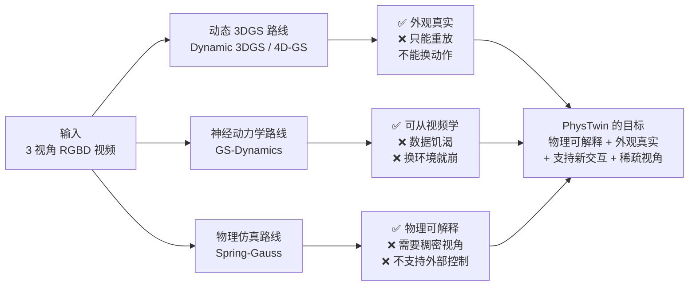
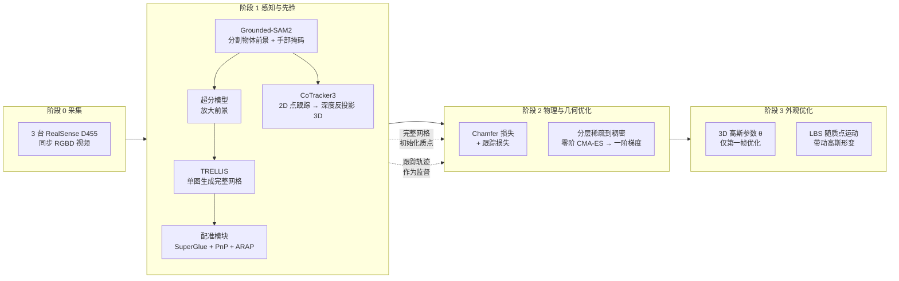
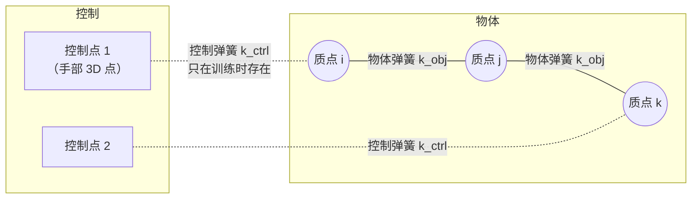
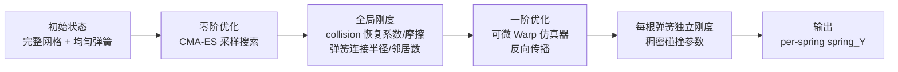

# PhysTwin：从稀疏视频构建可交互软体数字孪生

> **论文**：PhysTwin: Physics-Informed Reconstruction and Simulation of Deformable Objects from Videos（arXiv:2503.17973，2025 年 3 月）
> **作者**：Hanxiao Jiang、Hao-Yu Hsu、Kaifeng Zhang、Hsin-Ni Yu、Shenlong Wang、Yunzhu Li（UIUC）
> **关键词**：稀疏视角 RGBD 视频、质点弹簧模型、可微仿真、形状先验、高斯溅射、逆物理

**知识链接**：
- [质点弹簧模型与绳索仿真基础](/前置知识/006e_前置知识_质点弹簧模型与绳索仿真基础) — 弹簧力公式、阻尼、差分积分的力学基础，本文第四章直接建立在其上
- [系统辨识与逆问题基础](/前置知识/018b_前置知识_系统辨识与逆问题基础) — 本文两阶段优化的理论框架：从观测反推模型参数
- [Chamfer 距离：点云形状相似性度量](/前置知识/011b_前置知识_Chamfer距离_点云形状相似性度量) — Stage 1 几何损失的核心度量
- [3D Gaussian Splatting：用一堆椭球把真实场景搬进电脑](/前置知识/007a_前置知识_3D_Gaussian_Splatting三维场景重建) — 本文的外观表示与渲染方式
- [6DoF 位姿估计与 ADD-S 评测指标](/前置知识/015f_前置知识_6DoF位姿估计与ADD-S评测指标) — 形状先验配准中 PnP 的角色
- [CMA-ES：让零阶优化器自己学会搜索方向](/前置知识/018e_前置知识_CMA-ES协方差矩阵自适应进化策略) — Stage 1 零阶阶段的核心优化器
- [SAM 2：一个模型分割任意视频中的任意物体](/前置知识/019a_前置知识_SAM2视频分割基础模型) — 管线第一步：从视频中分割物体前景与手部
- [CoTracker：在视频中追踪任意一组点的去向](/前置知识/019b_前置知识_CoTracker点追踪基础模型) — 跟踪物体表面点和手部关键点，为物理优化提供监督信号
- [ARAP——"尽量刚性"变形](/前置知识/012_前置知识_ARAP与弹性正则) — 配准模块中非刚性变形的方法
- [Real2Sim：从真实世界到仿真场景的跨越](/前置知识/015c_前置知识_Real2Sim) — 本文属于 Real2Sim 大方向
- [TRELLIS 深度解析系列](/系列/trellis_deep_dive/index) — 形状先验生成器 TRELLIS 的完整原理
- [Spring-Gauss 精读](/论文综述/167_SpringGauss_弹簧质点高斯弹性物体重建与仿真) — 同样把弹簧质点挂在 3D 高斯上，对照阅读可以看出两者的定位差异
- [PhysDreamer 精读](/论文综述/168_PhysDreamer_视频生成先验驱动的物体物理交互) — 用视频生成模型提供物理先验的另一条路线
- [real2sim-eval 深度解析](/系列/real2sim_eval_deep_dive/index) — 把 PhysTwin 放进策略评测闭环的工程实现

---

## 贯穿全文的例子

> **场景**：桌面上放着一根橙色尼龙绳，一只手从左侧把它提起、在空中晃了两下又放下。三台固定位置的 RGBD 相机同时拍下了这 1 到 10 秒的过程。现在的问题是：只凭这三段视频，能不能造出一个"可以上手玩的"数字绳子——用键盘控制一组虚拟的手去抓它、拉它，它会像真绳子一样弯曲、下垂、回弹，而且从任意视角看都像真的？

这个场景把问题拆成了三件事：**几何要完整**（视频只看到三个角度，绳子的背面和侧面是空的）、**物理要正确**（要知道这根绳有多软、多重、和桌面摩擦多大）、**外观要逼真**（要能渲染出照片级的画面）。PhysTwin 的整套设计就是为了同时解决这三件事。

---

## 一、问题定位：为什么现有的路都走不通

讲清楚 PhysTwin 在做什么之前，先看它要绕开的三个失败模式。这三个失败模式决定了此后每一个设计选择。

> **看什么**：三条已有路线各自只满足了一半需求。动态 3DGS 的"动态"是逐帧拟合出来的，没有物理规律，换一个动作就要重新拍；神经动力学用 GNN 直接从数据学运动，能预测未来但对数据量极其敏感；Spring-Gauss 有真正的物理模型，但它的参数辨识依赖稠密视角，而且模型里没有"外部控制输入"这个概念，没法被新的手部动作驱动。

PhysTwin 的定位是：**用物理模型保证"可交互"和"可泛化"，用生成式形状先验补足稀疏视角下的几何，用高斯溅射补足外观**。三块拼在一起，才构成一个真正的"数字孪生"（digital twin）——不是一段回放，而是一个可以被任意动作驱动的虚拟复制品。

---

## 二、整体管线：四个阶段

PhysTwin 的完整流程分为四个阶段，前两个阶段是"准备输入"，后两个阶段是论文所说的**两阶段优化**。

> **看什么**：阶段 1 输出的两样东西分别喂给阶段 2 和阶段 3——**完整网格**决定质点的初始位置和弹簧拓扑，**跟踪轨迹**决定优化时的监督信号。阶段 2 和阶段 3 是串行的：必须先有正确的质点运动轨迹，高斯才有东西可以"跟着动"。图中两条虚线是跨阶段的依赖，也是理解这篇论文结构的关键。

论文原文把阶段 2 和阶段 3 称为"两阶段（two-stage）优化"：**Stage 1 优化物理与几何，Stage 2 优化外观**。这个划分容易被误读，因为 Stage 1 内部又套了一层"零阶 → 一阶"的分层优化。第五章区分这两组"两阶段"。

---

## 三、感知输入：从像素到物理量

这一章回答一个问题：视频里的像素，怎么变成物理仿真器能吃的数字。整个过程有四个独立的感知模块，它们各自解决一个具体的歧义。

### 3.1 分割：先知道"哪个是物体"

仿真器只关心绳子本身，但画面里还有手、桌面、背景。[Grounded-SAM2](/前置知识/019a_前置知识_SAM2视频分割基础模型)（把开放词汇检测器 Grounding DINO 和分割模型 [SAM 2](/前置知识/019a_前置知识_SAM2视频分割基础模型) 串起来的组合模型）负责两件事：

- 用文本提示（如 "rope"）框出并分割出**物体前景**
- 单独分割出**手部掩码**，这个掩码用于提取控制点

分割结果直接决定了 Stage 1 优化时使用哪些像素的深度值。分割错了，后续所有物理参数都是在一个错误物体上拟合的。

### 3.2 形状先验：补上视频没拍到的部分

这是整条管线里最容易被低估的一步。三台相机拍到的只是物体朝向相机的一侧，绳子的背面、毛绒玩具的底部完全没有观测。如果直接把可见点云丢进弹簧系统，物体在仿真里是一片"薄片"，一受力就会以错误的方式弯曲。

PhysTwin 用 TRELLIS（一个以稀疏体素潜表示为中间层、能从单张图生成完整三维网格的生成模型）补全几何。流程是：

> **看什么**：TRELLIS 的输出不是"拿来即用"的。生成模型只保证形状合理，不保证它和你视频里的那个物体的**尺度、朝向、摆放姿态、当前形变**一致。所以中间必须插入一个配准模块，把生成的网格"摆正"。

### 3.3 配准：把生成的网格对齐到真实观测

配准模块要连续消掉四种不一致，顺序不能换，因为后一步依赖前一步的结果：

| 不一致 | 消除方法 | 为什么必须在这个顺序 |
|--------|---------|-------------------|
| 旋转 | 球面上均匀布置虚拟相机渲染生成网格，用 SuperGlue（基于图神经网络的图像特征匹配器）和真实图像做 2D 匹配，选匹配点最多的视角作粗估计；再用 PnP（Perspective-n-Point，已知 3D 点和对应 2D 像素反解相机外参）精化 | 必须先有正确朝向，尺度和平移才有意义 |
| 尺度 + 平移 | 在相机坐标系下优化匹配点对之间的距离。经过 PnP 后，生成网格上的点和观测点云上的对应点位于同一条过相机原点的射线上，因此尺度和平移的歧义可以化简为只优化一个尺度因子 | 旋转对齐后，对应点才落在同一条射线上 |
| 非刚性形变 | 用 [ARAP](/前置知识/012_前置知识_ARAP与弹性正则)（As-Rigid-As-Possible，在"尽量保持局部刚性"的约束下做非刚性配准）把网格变形到匹配观测的形状 | 前三种都是刚体变换，真实物体当前可能是被压扁的 |
| 遮挡 | 从相机发射射线做 ray-casting 对齐，确保观测点既不背网格挡住、也不被网格穿透 | 最后一步修正几何细节 |

配准完成后的完整网格有两个用途：提供质点的初始位置，提供弹簧的静止长度。这一步的精度直接决定了物理仿真的起点是否可信——如果网格和真实物体差了 2 厘米，后续无论怎么优化刚度，仿真轨迹都会系统性偏移。

### 3.4 跟踪：物体会动，得知道每个点去了哪

Stage 1 的监督信号来自逐帧的点对应关系。PhysTwin 用 [CoTracker3](/前置知识/019b_前置知识_CoTracker点追踪基础模型)（一个基于 Transformer 的点跟踪基础模型，输入一段视频和若干查询点，输出这些点在每一帧的像素坐标）获得 2D 轨迹，再用对应帧的深度图把像素反投影成 3D 点。

这里的深度反投影需要相机内外参。三台相机固定不动，内外参在采集前标定好，所以每个像素的 3D 坐标可以直接算出来：

$$
\mathbf{X}_{t} = \pi^{-1}\left(\mathbf{u}_{t},\; D_{t}(\mathbf{u}_{t})\right)
$$

**这个公式在做什么**：把 2D 跟踪器输出的像素坐标，加上该像素的深度值，还原成相机坐标系下的三维点——这是所有"2D 跟踪 + 深度"方案的公共底座。

::: details 📐 公式详解（点击展开）

| 子表达式 | 它是谁 | 它在干嘛 |
|---------|--------|---------|
| $\mathbf{u}_{t}$ | 第 $t$ 帧的像素坐标（2 维） | CoTracker3 输出的跟踪结果，是输入 |
| $D_{t}(\mathbf{u}_{t})$ | 该像素的深度值（标量） | 深度图在对应位置的读数，是输入 |
| $\pi^{-1}$ | 反投影函数 | 把"像素 + 深度"翻译成相机坐标系下的三维点 |
| $\mathbf{X}_{t}$ | 反投影得到的三维点 | 后续要作为 Stage 1 的跟踪监督 |

**用人话读**："跟踪器告诉我们这个点在画面上的哪个位置，深度图告诉我们它离相机多远，两者合起来就是它在空间中的位置。"

**为什么不能只用 2D**：物理仿真的状态是三维位置，2D 像素无法区分"物体靠近相机"和"物体变大"。深度图提供了缺失的第三个坐标。
:::

控制点也是用同一套工具链提取的，但对象换成手：[Grounded-SAM2](/前置知识/019a_前置知识_SAM2视频分割基础模型) 分割手部掩码 → [CoTracker3](/前置知识/019b_前置知识_CoTracker点追踪基础模型) 跟踪手部关键点 → 深度反投影到 3D → 最远点采样（FPS，Farthest Point Sampling，反复选取离已选集合最远的点，保证采样点均匀分布）得到最终的控制点集合。

---

## 四、物理表示：弹簧-质点 + 控制弹簧

### 4.1 为什么是弹簧-质点，而不是有限元

连续体方法（[FEM](/前置知识/012d_前置知识_FEM_弹性力)、[MPM](/前置知识/006n_前置知识_物质点法MPM基础_颗粒材料与网格粒子转换)）用[本构模型](/前置知识/014c_前置知识_本构模型)描述材料，参数有明确的物理单位（杨氏模量、泊松比），但需要体网格或粒子分布，而且从稀疏表面观测反推材料参数需要求解一个很病态的逆问题。[弹簧-质点模型](/前置知识/006e_前置知识_质点弹簧模型与绳索仿真基础)把物体离散成质点加弹簧，每个弹簧只有一个刚度参数，梯度可以直接穿过去，参数辨识的难度低一个量级。

代价是弹簧刚度不再对应真实材料的杨氏模量——它和网格分辨率耦合，换一个质点密度，同一根绳子的最优刚度值会变。PhysTwin 接受这个代价，因为它要的不是"测出这根绳的杨氏模量"，而是"造一个行为像这根绳的仿真器"。前者是材料科学问题，后者是系统辨识问题。

PhysTwin 使用的弹簧力与阻尼力（按开源实现的参数化）为：

$$
\mathbf{f}_{ij} = k_{ij}\left(\frac{\lVert \mathbf{x}_j - \mathbf{x}_i \rVert}{l_{ij}^{0}} - 1\right)\hat{\mathbf{d}}_{ij} + \gamma\,(\mathbf{v}_j - \mathbf{v}_i)\cdot\hat{\mathbf{d}}_{ij}\,\hat{\mathbf{d}}_{ij}
$$

**这个公式在做什么**：第一项是胡克弹性力，用**相对伸长量**（当前长度除以静止长度再减一）而不是绝对伸长量，让同一刚度值对不同长度的弹簧具有一致的含义；第二项是沿弹簧方向的阻尼，只耗散伸缩方向的相对速度，不阻止弯曲。

::: details 📐 公式详解（点击展开）

| 子表达式 | 它是谁 | 它在干嘛 |
|---------|--------|---------|
| $\lVert \mathbf{x}_j - \mathbf{x}_i \rVert / l_{ij}^{0} - 1$ | **应变**（无量纲） | 弹簧被拉长或压短的比例。大于 0 拉长，小于 0 压缩 |
| $k_{ij}$ | 这根弹簧的刚度 | 每根弹簧独立一个值，Stage 1 要优化的核心参数 |
| $\hat{\mathbf{d}}_{ij}$ | 从 $i$ 指向 $j$ 的单位向量 | 把标量力变成有方向的矢量 |
| $\gamma$ | 阻尼系数 | 防止纯弹性系统永远振荡 |
| $(\mathbf{v}_j - \mathbf{v}_i)\cdot\hat{\mathbf{d}}_{ij}$ | 沿弹簧方向的相对速度 | 只取相对速度在弹簧方向上的投影，垂直分量不参与 |
| $\hat{\mathbf{d}}_{ij}\hat{\mathbf{d}}_{ij}$ | 投影算子 | 把标量阻尼力重新投射回弹簧方向 |

**用人话读**："弹簧比原长伸长或压缩了百分之几，就按刚度的百分之几沿连线往回拉；同时沿连线方向加一点刹车，让振动慢慢停下来。"

**为什么用比值而不是差值**：同样 1 毫米的形变，对 1 厘米长的弹簧是 10% 的应变，对 10 厘米长的弹簧只有 1%。用差值会让长弹簧被严重低估，用比值则让不同尺寸的弹簧共享同一个刚度量纲。
:::

**与论文式和开源实现的对应关系**：论文正文式 (1) 把弹性力写成 $k_{ij}(\lVert \mathbf{x}_j-\mathbf{x}_i\rVert - l_{ij})\hat{\mathbf{d}}_{ij}$，用的是绝对伸长量；阻尼写成 $-\gamma(\mathbf{v}_i-\mathbf{v}_j)$，没有投影到弹簧方向。开源实现（`spring_mass_warp.py`）则写成 $\exp(Y_{ij})\cdot(\lVert\mathbf{x}_j-\mathbf{x}_i\rVert / l_{ij} - 1)\hat{\mathbf{d}}_{ij}$ 与 $\gamma\,[(\mathbf{v}_j-\mathbf{v}_i)\cdot\hat{\mathbf{d}}_{ij}]\hat{\mathbf{d}}_{ij}$：刚度以对数形式 $Y_{ij}=\log k_{ij}$ 存储（保证优化过程中刚度恒为正），弹性项换成相对应变，阻尼投影到轴向。上面展示的是实现版本，因为它决定了优化变量 `spring_Y` 的物理含义；两种弹性写法只差一个与静止长度有关的常数因子，在每根弹簧的静止长度固定时是等价的重新参数化。阻尼的差别则是实质性的：投影版本只耗散沿弹簧方向的相对速度，横向摆动不受阻尼抑制，这正是绳子能自在下垂、摆动的原因。

### 4.2 控制弹簧：让"手"能驱动仿真

这是 PhysTwin 与 Spring-Gauss 最关键的结构差异。Spring-Gauss 的仿真完全由重力驱动，没有外部输入；PhysTwin 在物体系和"控制点"之间额外连了一组**控制弹簧**：

> **看什么**：实线是物体内部的弹簧，虚线是控制弹簧。控制弹簧把手的运动"翻译"成物体受到的力——手离质点越近，控制弹簧越短，产生的牵引就越强。这套结构在训练时由真实手部轨迹驱动，在推理时由用户输入或机器人末端执行器驱动，同一套仿真器不需要改动。

控制弹簧的存在解释了为什么 PhysTwin 能做"新交互泛化"：物体的物理属性（物体弹簧刚度）和交互方式（控制点怎么动）是解耦的。换一种抓法，只需要换控制点的轨迹，物体内部参数完全不动。

控制弹簧的拓扑由两个参数控制：**连接半径**（控制点到多远范围内的物体点可以连弹簧）和**最大邻居数**。这两个参数不可微，所以只能在零阶优化里搜索——这就是为什么 Stage 1 必须分层，而不能直接端到端梯度下降。

---

## 五、Stage 1：物理与几何优化

### 5.1 优化目标

Stage 1 要解的是一个逆物理问题：给定观测到的点云序列和对齐好的完整网格，找到一组物理参数，使得仿真器从初始状态出发、被控制点驱动时，产生的轨迹和观测尽可能一致。

$$
\min_{\alpha,\,G_0}\;\sum_{t}\Big[\underbrace{\mathcal{C}_{\text{geometry}}\big(\hat{\mathbf{X}}_t,\mathbf{X}_t\big)}_{\text{几何要对齐}}+\underbrace{\mathcal{C}_{\text{motion}}\big(\hat{\mathbf{x}}_t^{i},\mathbf{x}_t^{i}\big)}_{\text{跟踪点要对齐}}\Big]
\quad\text{s.t.}\quad \hat{\mathbf{X}}_{t+1}=f_{\alpha,G_0}(\hat{\mathbf{X}}_t,\mathbf{a}_t)
$$

**这个公式在做什么**：两项损失分别约束"整体形状"和"具体点的位置"，约束条件是仿真器必须按物理规律推进——不是让预测去凑观测，而是让物理参数去凑观测。

::: details 📐 公式详解（点击展开）

| 子表达式 | 它是谁 | 它在干嘛 |
|---------|--------|---------|
| $\alpha$ | 全部物理参数 | 包含每根弹簧的刚度 $k_{ij}$、碰撞参数（法向恢复系数与切向摩擦）、阻尼、控制弹簧参数 |
| $G_0$ | 几何与拓扑 | 质点的初始位置、弹簧的连接关系、静止长度 |
| $\mathbf{X}_t$ | 观测到的部分点云 | 从深度图反投影得到的、只覆盖可见表面的点集 |
| $\hat{\mathbf{X}}_t$ | 仿真器预测的完整点云 | 包含可见和不可见的全部质点 |
| $\mathcal{C}_{\text{geometry}}$ | 单向 Chamfer 距离 | 每个观测点到最近的预测点的距离之和——只惩罚"观测点找不到对应"，不惩罚"预测点找不到对应"（因为预测本来就包含不可见部分） |
| $\mathcal{C}_{\text{motion}}$ | 跟踪误差 | 仿真中某个质点与 CoTracker3 给出的对应点之间的距离 |
| $f_{\alpha,G_0}$ | 前向仿真器 | 从当前状态和当前动作推进一个时间步 |
| $\mathbf{a}_t$ | 当前动作 | 控制点在时刻 $t$ 的位置（训练时来自手部轨迹） |

**用人话读**："调物理参数，让仿真跑出来的形状贴合相机看到的形状，让仿真里每个被跟踪的点贴合跟踪器记录的轨迹。"

**为什么几何损失用单向 Chamfer**：观测只有可见表面，是一个"缺了一块"的点云；仿真输出是完整点云。标准双向 Chamfer 会让不可见部分被迫去匹配最近的可视点，把完整几何拉塌。单向只要求"每个看到的点都能在仿真里找到对应"，不要求反过来。
:::

### 5.2 三个难点与分层策略

Stage 1 难在三件事同时发生：

1. **部分观测**：只有三个视角，可见点云覆盖不完整；
2. **离散参数不可微**：弹簧的连接半径、最大邻居数是离散选择，梯度无法穿过；
3. **参数空间巨大**：为了表达不同区域的材质差异，每根弹簧都有独立刚度，一个物体动辄上万根弹簧。

直接用梯度下降解不了第 2 点，用零阶搜索解不了第 3 点。PhysTwin 的解法是把参数按"能否求梯度"和"尺度"分层：

> **看什么**：零阶阶段解决的是**结构**（弹簧怎么连、大致多硬），一阶阶段解决的是**细节**（每根弹簧精确多硬）。两个阶段优化的是同一组状态的不同参数子集，不是两套独立的模型。

零阶阶段用 [CMA-ES](/前置知识/018e_前置知识_CMA-ES协方差矩阵自适应进化策略)（协方差矩阵自适应进化策略——一种不需要梯度、通过采样种群并自适应调整搜索分布的优化器）搜索全局参数，论文引用的是 Hansen 关于该策略的综述 [18]。这一阶段的有效性来自一个事实：全局刚度、碰撞参数这些量只有几个维度，采样搜索的代价可以接受。

一阶阶段切换到一个用 NVIDIA Warp 实现的可微弹簧质点仿真器，梯度可以一路从轨迹误差反向传到每根弹簧的刚度。此时参数上万维，但初值已经由零阶阶段给定，优化只需要在局部精修。

### 5.3 消融：分层到底带来多少收益

论文的消融实验直接对比三种配置（重建/重仿真任务）：

| 配置 | CD ↓ | 跟踪误差 ↓ | IoU % ↑ | PSNR ↑ |
|------|------|-----------|---------|--------|
| 只用零阶 | 0.007 | 0.012 | 80.2 | 27.409 |
| 只用一阶 | 0.008 | 0.012 | 82.7 | 27.913 |
| 分层（完整） | **0.005** | **0.009** | **84.4** | **28.214** |

> **看什么**：三组柱子中，蓝色（分层完整）在全部三个指标上均最优。零阶（橙色）在 IoU 上落后约 4 个点；一阶（紫色）的几何指标尚可，但它跳过了弹簧连接等不可微参数的优化，默认拓扑无法准确表达真实物体结构。

这个结果的信息量比数字本身更大：**只用零阶**能拿到不错的几何（CD 0.007），但无法表达不同区域的材质差异，外观指标明显落后；**只用一阶**的几何也不差，但它依赖固定的弹簧连接，无法优化拓扑和连接半径，在需要精细结构的物体上会系统性偏差。两者缺的不是"精度"，是"另一类参数"。

---

## 六、Stage 2：外观优化

### 6.1 只优化第一帧

外观部分用一组静态 3D 高斯核表示物体，参数为 $\theta$（位置、旋转四元数、缩放、不透明度、球谐颜色系数）。优化目标是最小化渲染图和真实图像的差异：

$$
\min_{\theta}\;\sum_{i,t}\mathcal{C}_{\text{render}}\big(\hat{I}_{i,t}, I_{i,t}\big)
\quad\text{s.t.}\quad \hat{I}_{i,t}=g_\theta(\hat{\mathbf{X}}_t,i)
$$

**这个公式在做什么**：让高斯渲染出来的图和相机拍到的图尽可能一致，但渲染必须经过"当前质点状态 → 高斯形变 → 投影"这条链路，所以外观和物理是耦合的。

::: details 📐 公式详解（点击展开）

| 子表达式 | 它是谁 | 它在干嘛 |
|---------|--------|---------|
| $\theta$ | 全部高斯参数 | 每个高斯的中心、旋转、缩放、不透明度、颜色 |
| $g_\theta(\hat{\mathbf{X}}_t,i)$ | 渲染函数 | 把第 $t$ 帧的质点状态和相机 $i$ 的位姿，变成一张渲染图 |
| $\hat{I}_{i,t}$ | 渲染图 | 预测 |
| $I_{i,t}$ | 真实图像 | 监督 |
| $\mathcal{C}_{\text{render}}$ | L1 + D-SSIM | L1 管颜色准确，D-SSIM（结构相似性的变体）管结构一致 |

**用人话读**："调高斯的外观参数，让它在每一帧被物理状态带动变形之后，渲染出来的画面和真实相机拍到的画面一样。"

**为什么只在第一帧优化**：如果每帧都优化外观，高斯就会去补偿物理轨迹的误差——物理不对的地方，外观硬拟合上去，最后得到一个"看起来对但一动就露馅"的模型。固定在 $t=0$、让高斯完全由物理状态驱动，才能保证形变是物理产生的，不是拟合出来的。论文中只优化第一帧，后续帧的高斯位置由线性混合蒙皮（LBS，Linear Blend Skinning——用邻近骨骼/质点的刚体变换加权插值驱动顶点运动的标准方法）根据邻近质点的运动插值得到。
:::

### 6.2 LBS：让几十万个高斯跟着几千个质点动

质点只有千级别，高斯有几十万级别。每个高斯不可能单独绑定一个质点，做法是找它最近的 $K$ 个质点，按距离反比加权，用这些质点的局部刚体变换来插值高斯的运动：

$$
\boldsymbol{\mu}_j^{t+1}=\sum_{k\in\mathcal{N}(j)}w_{jk}^{t}\Big(R_k^{t}\big(\boldsymbol{\mu}_j^{t}-\hat{\boldsymbol{\mu}}_k^{t}\big)+\hat{\boldsymbol{\mu}}_k^{t}+\mathbf{T}_k^{t}\Big),
\qquad
w_{jk}^{t}=\frac{\lVert \boldsymbol{\mu}_j^{t}-\hat{\boldsymbol{\mu}}_k^{t}\rVert^{-1}}{\sum_{m\in\mathcal{N}(j)}\lVert \boldsymbol{\mu}_j^{t}-\hat{\boldsymbol{\mu}}_m^{t}\rVert^{-1}}
$$

**这个公式在做什么**：每个高斯的位置由邻近几个质点共同决定，质点离得越近权重越大——本质上是把稀疏的物理运动"涂抹"到稠密的渲染基元上。

::: details 📐 公式详解（点击展开）

| 子表达式 | 它是谁 | 它在干嘛 |
|---------|--------|---------|
| $\boldsymbol{\mu}_j^{t}$ | 第 $j$ 个高斯在 $t$ 时刻的中心 | 渲染用的稠密表示 |
| $\hat{\boldsymbol{\mu}}_k^{t}$ | 第 $k$ 个质点在 $t$ 时刻的位置 | 物理用的稀疏表示 |
| $R_k^{t}$, $\mathbf{T}_k^{t}$ | 质点 $k$ 从 $t$ 到 $t+1$ 的局部旋转和平移 | 由邻近质点的运动估计出的刚体变换 |
| $\mathcal{N}(j)$ | 高斯 $j$ 的 $K$ 个最近质点 | 决定哪些质点对这个高斯有影响 |
| $w_{jk}^{t}$ | 距离反比权重 | 越近的质点话语权越大 |

**用人话读**："每个高斯看它周围最近的几个质点怎么动，按距离远近把这些运动加权平均，得到自己该怎么动。"

**为什么权重用距离反比而不是高斯核**：反比权重在质点密集处和稀疏处的相对关系更平滑，且不需要额外的带宽参数——带宽如果设错，会在稀疏区域产生明显的块状伪影。
:::

高斯的旋转也需要同步更新（用四元数加权乘积），否则高斯在形变过程中会保持原朝向，渲染出错误的反射方向。论文额外限制了高斯形状为各向同性，防止大幅形变时拉出尖刺。

---

## 七、实验：它到底好多少

### 7.1 数据集与任务

论文自建数据集：3 台 RealSense D455 相机，22 个场景，覆盖绳子、毛绒玩具、布料、快递包裹；每段视频 1–10 秒，包含单手/双手的提起、拉伸、推压、挤压；每个场景按 7:3 划分训练/测试，只用训练集构建 PhysTwin。三个任务：

1. **重建与重仿真**：用训练段的控制点轨迹驱动仿真，比较仿真结果和真实观测；
2. **未来预测**：用训练段构建模型，预测测试段（未见过的时间）的状态；
3. **新交互泛化**：用同一物体的 A 交互构建模型，在 B 交互上测试（共 22 组迁移，来自 11 对交互的正反两个方向）。

### 7.2 定量结果

重建/重仿真与未来预测：

| 方法 | CD ↓ | 跟踪误差 ↓ | IoU % ↑ | PSNR ↑ | LPIPS ↓ |
|------|------|-----------|---------|--------|---------|
| Spring-Gauss | 0.041 | 0.050 | 57.6 | 23.445 | 0.102 |
| GS-Dynamics | 0.014 | 0.022 | 72.1 | 26.260 | 0.052 |
| **PhysTwin** | **0.005** | **0.009** | **84.4** | **28.214** | **0.034** |

> **看什么**：蓝色柱（PhysTwin）在四个子图中全部最优。从重建/重仿真（上排）切换到未来预测（下排）时，PhysTwin 的 CD 绝对增量是 0.007，GS-Dynamics 是 0.027，Spring-Gauss 是 0.021——物理模型外推到未见过的时间段时误差增长得最慢。

未来预测（未见过的时间段）：

| 方法 | CD ↓ | 跟踪误差 ↓ | IoU % ↑ | PSNR ↑ |
|------|------|-----------|---------|--------|
| Spring-Gauss | 0.062 | 0.094 | 46.4 | 22.488 |
| GS-Dynamics | 0.041 | 0.070 | 49.8 | 22.540 |
| **PhysTwin** | **0.012** | **0.022** | **72.5** | **25.617** |

两件事值得注意。第一，PhysTwin 在未来预测上的退化远小于两个基线——CD 从 0.005 到 0.012，而 GS-Dynamics 从 0.014 到 0.041。物理模型一旦辨识正确，外推是它的强项。第二，论文报告了一个反直觉的现象：**优化后的跟踪结果比作为监督的 CoTracker3 原始预测更准、更平滑**。原因是物理约束起了正则化作用——CoTracker3 的逐帧输出有抖动和漂移，仿真器的全局一致性把这些噪声压掉了。

新交互泛化任务上（同样只跟 GS-Dynamics 比较，因为 Spring-Gauss 不具备外部控制能力），PhysTwin 的 CD 为 0.013、跟踪误差 0.018、IoU 72.18，GS-Dynamics 分别为 0.029、0.038、63.4。

论文还做了一个数据效率对照：为了公平比较，作者为 GS-Dynamics 在同一段"双手拉伸并折叠绳子"的运动上额外采集了 29 个数据点，凑到 30 个训练样本；PhysTwin 只用 1 个数据点。结果显示 GS-Dynamics 在拿到 30 倍数据后性能没有明显提升。这说明两者的差距不是数据量造成的，而是"从数据里学动力学"和"从数据里辨识物理参数"这两条路线的样本效率差异。

### 7.3 应用

- **实时交互仿真**：Warp 实现的仿真器加高斯渲染，支持键盘控制单手/双手实时操作物体
- **机器人规划**：把构建好的 PhysTwin 作为动力学模型，做基于模型的运动规划（例如把绳子提成指定形状）
- **遥操作预测**：在机械臂遥操作时实时预测物体的未来状态

---

## 八、设计取舍与适用边界

### 8.1 三个关键设计的对照

| 设计选择 | 替代方案 | 为什么选这个 |
|---------|---------|-------------|
| 弹簧-质点，而非 FEM/MPM | 连续体仿真 | 参数少、可微、从稀疏表面观测反推的逆问题更良态；代价是刚度无法对应真实材料常数 |
| 生成式形状先验，而非多视角重建 | COLMAP/MVS | 三视角下 MVS 在背面完全失败；生成模型提供合理的完整几何，再用配准消除生成先验的尺度和形变误差 |
| 两阶段（物理→外观） | 联合优化 | 联合优化时外观会补偿物理误差，掩盖问题；分离后物理轨迹必须自己对齐 |

### 8.2 什么时候不该用

- **需要真实材料参数**：弹簧刚度是"对这个离散化和这个分辨率而言"的参数，换质点密度就要重新辨识。如果目标是测杨氏模量，应该用连续体方法。
- **布料的高保真仿真**：布料是各向异性的（经向和纬向刚度不同），弹簧-质点只能近似。论文的布料结果可用，但不如专门的布料本构模型。
- **极端大变形**：弹簧可以被无限拉长，虽然加了阻尼和碰撞约束，超弹性材料在大应变下的非线性硬化行为无法用单一刚度表达。
- **单目无深度**：当前管线依赖 RGBD。论文的 future work 明确指出，单目 RGB 是下一步方向，但需要额外解决尺度歧义。

---

## 九、与相关工作对比

| 维度 | PhysTwin | Spring-Gauss | GS-Dynamics | [PhysGaussian](/前置知识/014e_前置知识_PhysGaussian弹性高斯) |
|------|----------|--------------|-------------|--------------|
| 物理表示 | [弹簧-质点](/前置知识/006e_前置知识_质点弹簧模型与绳索仿真基础) | 弹簧-质点 | GNN 神经动力学 | [MPM 连续体](/前置知识/006n_前置知识_物质点法MPM基础_颗粒材料与网格粒子转换) |
| 外观表示 | [3D 高斯](/前置知识/007a_前置知识_3D_Gaussian_Splatting三维场景重建) | 3D 高斯 | 3D 高斯 | 3D 高斯 |
| 外部控制 | ✅ 控制弹簧 | ❌ 需额外改造 | ✅ 动作条件 | ❌ |
| 视角要求 | 3 个 RGBD | 稠密视角 | 稀疏可 | 多视角视频 |
| 新交互泛化 | ✅ | ❌ | 有限 | ❌ |
| 参数可解释 | 中（刚度） | 中 | 低（黑箱网络） | 高（本构参数） |
| 数据效率 | 1 个数据点 | — | 同运动 30 个数据点仍无提升 | — |

---

## 十、总结

PhysTwin 的核心贡献不在于任何单个模块的新颖性——弹簧-质点、3D 高斯、CoTracker3、TRELLIS、SuperGlue 都是已有工作。它的贡献在于**把这些模块组织成一条能走通的逆物理管线**，并且让每个模块的输出恰好是下一个模块需要的输入形式：

1. **分割 + 形状先验 + 配准**把稀疏的单侧观测变成完整的、几何一致的初始网格——解决了"看不见的部分怎么办"；
2. **控制弹簧**把外部交互变成可以驱动仿真的输入——解决了"怎么让数字孪生能被新动作驱动"；
3. **分层稀疏到稠密优化**把不可微的拓扑参数和上万维的连续刚度分开处理——解决了"逆问题太大、太病态"；
4. **物理与外观分离优化 + LBS**保证外观不会掩盖物理误差——解决了"看起来对但一动就崩"。

这套组合的结果是一个可以被实时驱动、能从任意视角渲染、并且能在没见过的交互下保持合理的软体数字孪生。它的边界也同样清楚：它给出的是"行为正确的仿真器"，不是"材料参数测量仪"。

---

## 关于本文事实边界的说明

本文的方法描述以 arXiv:2503.17973 的正文与附录为准，三处细节需要单独标出：

1. **公式写法与开源实现的差异**已在 4.1 节说明。论文正文式 (1) 的弹性项用绝对伸长量、阻尼项不投影；`real2sim-eval` 中的 `spring_mass_warp.py` 用相对应变与投影阻尼，并以 $\log$ 形式存储刚度。本文展示的是实现版本，因为"每根弹簧的刚度如何被优化"这个问题只有在实现版本下才成立。
2. **超分模型的具体身份未在文中断言**。论文正文只说"a super-resolution model [48]"，而参考文献 [48] 指向的是潜在扩散模型（LDM）的条目，与超分任务不是直接对应。本文因此只写"超分模型"，不指认具体模型。
3. **数据效率实验的规模**是同一段"双手拉伸并折叠绳子"运动上的 30 个数据点，不是 30 个场景，也不是 30 个物体。7.2 节按论文原意表述。

---

## 延伸阅读

- [Spring-Gauss 精读](/论文综述/167_SpringGauss_弹簧质点高斯弹性物体重建与仿真) — 弹簧-质点 + 高斯的另一条实现路线，重点看参数辨识部分的差异
- [PhysGaussian 精读](/论文综述/165_PhysGaussian_物理集成三维高斯动态仿真) — 连续体 MPM 路线，和本文的离散路线形成对照
- [PhysDreamer 精读](/论文综述/168_PhysDreamer_视频生成先验驱动的物体物理交互) — 用视频生成模型提供交互先验
- [PAC-NeRF 精读](/论文综述/164_PAC-NeRF_物理感知连续场的材料参数辨识) — 连续体逆物理的代表
- [real2sim-eval 深度解析](/系列/real2sim_eval_deep_dive/index) — PhysTwin 在策略评测闭环中的工程落地，含 checkpoint 结构与代码实现
- [质点弹簧模型与绳索仿真基础](/前置知识/006e_前置知识_质点弹簧模型与绳索仿真基础) — 本文所有力学公式的前置
- [系统辨识与逆问题基础](/前置知识/018b_前置知识_系统辨识与逆问题基础) — "从观测反推参数"的一般框架
- [CMA-ES：让零阶优化器自己学会搜索方向](/前置知识/018e_前置知识_CMA-ES协方差矩阵自适应进化策略) — Stage 1 零阶优化的核心算法
- [SAM 2 视频分割基础模型](/前置知识/019a_前置知识_SAM2视频分割基础模型) — 管线第一步的分割模型
- [CoTracker 点追踪基础模型](/前置知识/019b_前置知识_CoTracker点追踪基础模型) — 获取跟踪监督信号的追踪模型
- [Bear Twin 工程实践系列](/系列/bear_twin_工程实践/) — 通用几何构建流程（Poisson 重建 → 粒子采样 → 弹簧连接）
- [PhysTwin 深度解析系列](/系列/phystwin_deep_dive/) — PhysTwin 完整工程实现的代码级拆解
