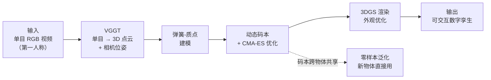
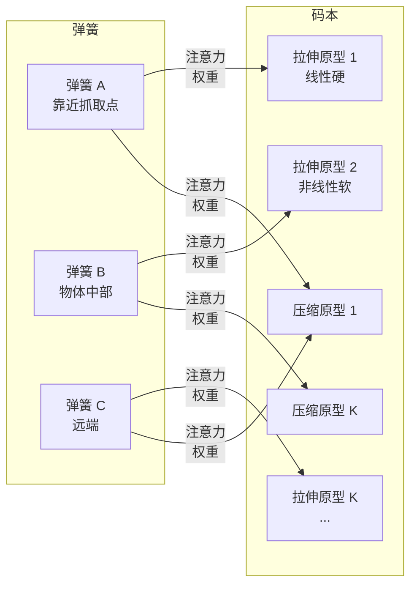

# EgoPhys：第一人称视频构建可形变物体物理数字孪生

> **论文**：EgoPhys: Egocentric Physical Twin from a Single RGB Video（arXiv:2606.16202，2025 年 6 月）
> **作者**：Hyunjin Kim、Ri-Zhao Qiu、Guangqi Jiang、Rocktim Jyoti Das、Dinesh Manocha、Xiaolong Wang（UC San Diego）
> **关键词**：第一人称 RGB 视频、弹簧-质点模型、可微仿真、物理先验码本、3D 高斯溅射、零样本泛化

**知识链接**：
- [质点弹簧模型与绳索仿真基础](/前置知识/006e_前置知识_质点弹簧模型与绳索仿真基础) — 弹簧力、阻尼、显式积分的完整力学基础，EgoPhys 的物理层直接建立在其上
- [系统辨识与逆问题基础](/前置知识/018b_前置知识_系统辨识与逆问题基础) — 从观测反推物理参数的一般框架
- [3D Gaussian Splatting：用一堆椭球把真实场景搬进电脑](/前置知识/007a_前置知识_3D_Gaussian_Splatting三维场景重建) — EgoPhys 的外观渲染方式
- [CMA-ES：让零阶优化器自己学会搜索方向](/前置知识/018e_前置知识_CMA-ES协方差矩阵自适应进化策略) — 全局参数搜索的核心优化器
- [Real2Sim：从真实世界到仿真场景的跨越](/前置知识/015c_前置知识_Real2Sim) — EgoPhys 属于 Real2Sim 方向
- [PhysTwin 精读](/论文综述/169_PhysTwin_从稀疏视频构建可交互软体数字孪生) — EgoPhys 的直接前作和主要基线：同样用弹簧-质点 + 3DGS，但需要三视角 RGBD
- [Spring-Gauss 精读](/论文综述/167_SpringGauss_弹簧质点高斯弹性物体重建与仿真) — 另一条弹簧-质点 + 高斯路线，不支持外部控制
- [具身高斯与机器人世界模型综述](/论文综述/S36_具身高斯_机器人世界模型综述) — 把 EgoPhys 放入五条路线的大图中理解

---

## 贯穿全文的例子

> **场景**：你戴着一副 Meta Project Aria 眼镜，坐在桌前用双手揉捏一个泡沫海绵球。眼镜的单目 RGB 相机以 30fps 拍下了全过程——没有深度传感器、没有额外的固定相机、没有标定。现在的问题是：只凭这一段第一人称 RGB 视频，能不能造出一个可以在电脑里用任意方式捏的数字海绵球？
>
> 这比 [PhysTwin](/论文综述/169_PhysTwin_从稀疏视频构建可交互软体数字孪生) 的三视角 RGBD 设定困难得多。PhysTwin 有三台固定 RGBD 相机提供多视角深度；EgoPhys 只有一个移动的 RGB 相机，没有深度。更麻烦的是，第一人称视角的相机在不断运动（头在转），场景的观测角度帧帧不同，而且手经常挡住大半个物体。

---

## 一、问题定位：从多视角 RGBD 到单目 RGB

### 1.1 PhysTwin 的三个前提

[PhysTwin](/论文综述/169_PhysTwin_从稀疏视频构建可交互软体数字孪生) 证明了弹簧-质点 + 3DGS + 分层优化可以构建可交互的数字孪生。但它依赖三个前提：

1. **多视角**：三台固定相机同时拍，一帧里就有三个视角的信息
2. **深度**：RGBD 传感器直接给出点云，不需要估计三维几何
3. **固定相机**：内外参在采集前标定好，每帧的投影关系已知

如果只有一台移动的 RGB 相机（比如头戴式眼镜），这三个前提全部不成立。

### 1.2 EgoPhys 的解法概览

EgoPhys 的策略是把缺失的信息用两个工具补回来，再用一个新结构提升效率和泛化：

| 缺失 | 补偿方法 |
|------|---------|
| 没有多视角和深度 | 用 VGGT（Visual Geometry Grounded Transformer——一个从单张或少量 RGB 图像直接预测三维点云、深度和相机位姿的 Transformer 基础模型）把单目 RGB 提升到三维点云 |
| 每根弹簧独立优化太慢 | 用**动态物理先验码本**（codebook）把弹簧的刚度参数从逐根独立变成"查表 + 微调"，优化维度从上万降到几十 |
| 每个物体都要从头辨识 | 码本学到跨物体的物理先验，新物体可以零样本泛化 |

> **看什么**：和 PhysTwin 相比，EgoPhys 在前端用 VGGT 替换了 RGBD 传感器 + 多视角重建，在中间用码本替换了逐弹簧独立优化。最终的输出形式（弹簧-质点 + 3DGS 驱动的数字孪生）和 PhysTwin 一样。

---

## 二、VGGT：从单目 RGB 到三维点云

### 2.1 为什么需要一个专门的 3D 提升模型

单目 RGB 图像缺少深度信息。传统方法用运动恢复结构（Structure from Motion, SfM——从多帧图像中联合估计相机位姿和三维点的几何方法，代表是 [COLMAP](/系列/colmap_deep_dive/index)）从视频序列恢复三维，但 SfM 对第一人称视频效果很差：头部运动导致大范围视角变化，手和物体经常遮挡大部分画面，而且 SfM 需要足够多的静态特征点——在形变物体上这个前提不成立。

VGGT（Visual Geometry Grounded Transformer，Wang et al., 2025）是一个端到端的 Transformer 基础模型，输入一张或几张 RGB 图像，直接输出逐像素的三维坐标、深度图和相机位姿。它在海量数据上预训练，学会了单目深度估计和位姿估计的隐式先验。EgoPhys 用 VGGT 把每帧 RGB 图像转换成三维点云，取代了 PhysTwin 的 RGBD 传感器。

### 2.2 VGGT 输出的后处理

VGGT 的原始输出是逐帧的三维点云和相机位姿。EgoPhys 对它做三步后处理：

1. **尺度对齐**：VGGT 的深度是相对尺度（单目歧义），需要和物理仿真的绝对尺度对齐。EgoPhys 用物体在第一帧的已知尺寸（或标定板）确定缩放因子。
2. **前景分割**：用视觉基础模型分割出物体和手部掩码，只保留物体表面的点。
3. **时序一致性**：逐帧的点云可能抖动。EgoPhys 在弹簧-质点优化阶段通过物理约束隐式地平滑抖动，而不是在点云阶段做显式平滑。

---

## 三、弹簧-质点模型与控制弹簧

EgoPhys 的物理表示和 [PhysTwin](/论文综述/169_PhysTwin_从稀疏视频构建可交互软体数字孪生) 基本相同：一组质点通过弹簧连接，弹簧力是 [胡克弹性力 + 轴向阻尼](/前置知识/006e_前置知识_质点弹簧模型与绳索仿真基础)。每根弹簧有一个独立的刚度参数 $k_{ij}$，以对数形式存储保证正性。质点的运动由半隐式欧拉积分推进。

控制弹簧也延用 PhysTwin 的设计：在物体质点和手部控制点之间连额外的弹簧，把手的运动"翻译"成物体受到的力。训练时控制点轨迹来自手部追踪，推理时来自用户输入或机器人末端执行器。

这部分的公式和 PhysTwin 完全相同，不再重复——详见 [PhysTwin 精读的第四章](/论文综述/169_PhysTwin_从稀疏视频构建可交互软体数字孪生#四物理表示弹簧-质点--控制弹簧)。

---

## 四、核心创新：动态物理先验码本

### 4.1 逐弹簧优化的瓶颈

PhysTwin 的 Stage 1 一阶优化阶段要为每根弹簧独立优化刚度参数。一个物体有上千根弹簧，参数空间的维度很高，优化需要几十到几百个 CMA-ES + 梯度迭代。如果对每个新物体都重新走一遍，成本无法接受。

更根本的问题是：不同物体的弹簧刚度分布其实有共性。一根布绳和一根尼龙绳的拉伸刚度不同，但它们的刚度在弹簧之间的分布模式是相似的——都是"弯曲处偏软、直线段偏硬"。逐弹簧独立优化完全忽略了这种跨物体的先验知识。

### 4.2 码本结构

EgoPhys 引入了一个**动态物理先验码本**（dynamic physics prior codebook）。思路是：把所有可能的弹簧刚度行为分成两类——**拉伸行为**和**压缩行为**——各用 $K$ 个原型（prototype）表示。每根弹簧不再独立存储刚度值，而是从码本中查找最匹配的原型，再做微小的局部修正。

具体来说，码本有两个库（bank）：

- **拉伸原型库** $\{c_1^+, c_2^+, \dots, c_K^+\}$：每个原型 $c_k^+$ 编码一种拉伸行为（比如"线性硬弹簧"或"软弹簧、拉长后迅速变硬"）
- **压缩原型库** $\{c_1^-, c_2^-, \dots, c_K^-\}$：每个原型 $c_k^-$ 编码一种压缩行为

每根弹簧被分配一个拉伸原型和一个压缩原型。分配方式是根据弹簧的局部几何特征（位置、连接拓扑、邻域结构）通过注意力机制动态计算的——不同位置的弹簧可以选择不同的原型。

> **看什么**：每根弹簧不存储自己的刚度值，而是从码本中用注意力权重加权组合出自己的行为。码本只有 $2K$ 个原型（论文取 $K=4$，即 8 个原型），远远少于上千根弹簧的独立参数。优化时只需要优化 8 个原型向量和注意力网络的参数。

### 4.3 码本如何降低优化代价

| 方法 | 优化变量数 | 单物体优化时间 |
|------|-----------|--------------|
| PhysTwin（逐弹簧） | $N_{\text{spring}}$（上千） | 基准 |
| EgoPhys（码本 $K=4$） | $2K + \text{注意力参数}$（几十） | 降低 10–59× |

论文 Table 2 的消融实验显示，$K=4$ 是最优选择。$K=1$（只有一个原型）太粗糙，$K=8$ 的改进不明显且计算量增加。$K=4$ 意味着系统用 4 种拉伸模式和 4 种压缩模式就能覆盖观测到的材料行为多样性。

### 4.4 码本的泛化能力

码本的更大价值在于**跨物体泛化**。码本的原型在多个物体上联合训练后，编码了"软体物体的刚度通常长什么样"这类跨物体先验。面对一个新物体，不需要从头优化——直接用码本的原型做加权组合，零样本就能得到合理的物理参数。

论文的零样本实验（Table 3）：在训练集物体上学到码本后，直接应用到未见过的物体上，CD=0.0319、TE=0.0621、IoU=57.9%。作为对比，PhysTwin 在同样的零样本设定下 CD=0.0457、TE=0.0818——EgoPhys 在更难的设定（单目 RGB vs 三视角 RGBD）上反而更好，因为码本提供了 PhysTwin 没有的物理先验。

---

## 五、优化流程

### 5.1 两阶段结构

和 PhysTwin 一样，EgoPhys 的优化分为两个阶段：先优化物理参数，再优化外观参数。

**Stage 1：物理优化**。最小化仿真轨迹和 VGGT 给出的三维点云之间的差异：

$$
\mathcal{L}_{\text{phys}} = \sum_{t}\Big[\lambda_{\text{CD}}\,\text{CD}(\hat{\mathbf{X}}_t, \mathbf{X}_t) + \lambda_{\text{track}}\sum_{i}\lVert\hat{\mathbf{x}}_t^i - \mathbf{x}_t^i\rVert^2\Big]
$$

**这个公式在做什么**：两项损失分别约束"整体形状要对"和"每个被追踪的点要对"，和 PhysTwin 的物理优化目标相同，只是观测源从 RGBD 变成了 VGGT 预测的点云。

::: details 📐 公式详解（点击展开）

| 子表达式 | 它是谁 | 它在干嘛 |
|---------|--------|---------|
| $\text{CD}(\hat{\mathbf{X}}_t, \mathbf{X}_t)$ | 单向 Chamfer 距离 | 每个观测点到最近预测点的距离之和——惩罚"看到的点找不到仿真对应" |
| $\lVert\hat{\mathbf{x}}_t^i - \mathbf{x}_t^i\rVert^2$ | 跟踪误差 | 特定追踪点的预测位置与观测位置的偏差 |
| $\lambda_{\text{CD}}, \lambda_{\text{track}}$ | 权重系数 | 平衡两项损失的相对重要性 |

**用人话读**："调物理参数，让仿真跑出来的形状和 VGGT 看到的形状尽可能一致，让每个追踪点的轨迹也尽可能一致。"

**为什么 Chamfer 用单向**：VGGT 的点云只覆盖可见表面，不包含被遮挡的部分。双向 Chamfer 会把不可见部分的质点拉向最近的可视点，破坏完整几何。
:::

物理优化同样使用 [CMA-ES](/前置知识/018e_前置知识_CMA-ES协方差矩阵自适应进化策略) 搜索全局参数（碰撞、阻尼、弹簧连接），然后切换到梯度优化精修码本原型和注意力权重。

**Stage 2：外观优化**。固定物理参数，优化 [3D 高斯](/前置知识/007a_前置知识_3D_Gaussian_Splatting三维场景重建)的外观参数（位置、旋转、缩放、不透明度、颜色），使渲染结果和真实图像匹配。高斯通过线性混合蒙皮（LBS）跟随质点运动，和 PhysTwin 的第六章完全相同。

---

## 六、实验

### 6.1 数据集

论文自建数据集：19 个场景，使用 Meta Project Aria Gen 1 眼镜采集。Aria 是 Meta 研发的头戴式 AR 设备，配备多个相机和 IMU（惯性测量单元），但 EgoPhys 只使用其中的单目 RGB 相机流（3990 帧，30fps）。物体包括海绵球、毛绒玩具、弹性管、布料等。

相比 PhysTwin 的数据集（3 台固定 RealSense D455、22 个场景），EgoPhys 的采集条件显著更难：
- 单目 vs 三视角
- RGB vs RGBD
- 移动相机 vs 固定相机
- 手部遮挡更严重（第一人称视角下手总在画面中）

### 6.2 定量结果：未来预测

未来预测任务：用训练段构建模型，预测测试段（未见过的时间）的状态。

表中六项指标分成两组——前三项评估**三维几何**预测精度，后三项评估**渲染图像**质量：

| 指标 | 全称 | 度量什么 | 直觉理解 |
|------|------|---------|---------|
| CD ↓ | Chamfer Distance（倒角距离） | 预测点云与真实点云之间的平均最近点距离（单位 m） | 值越小说明预测出的三维形状越贴合真实形状；0.028 意味着平均偏差约 2.8 cm |
| TE ↓ | Tracking Error（跟踪误差） | 每个被追踪的表面点，预测位置与真实位置的平均欧氏距离（单位 m） | 衡量"每个具体的点有没有跑对位置"，比 CD 更严格——CD 只管最近点配对，TE 要求每个点 ID 都对上 |
| IoU ↑ | Intersection over Union（交并比） | 预测占据体积与真实占据体积的交集除以并集（%） | 衡量"物体在不在对的地方"，100% 表示完全重合 |
| PSNR ↑ | Peak Signal-to-Noise Ratio（峰值信噪比） | 渲染图像与真实图像的像素误差，以 dB 为单位 | 越高越好，22 dB 在单目重建中属于可用水平 |
| SSIM ↑ | Structural Similarity Index（结构相似度） | 考虑亮度、对比度、结构三个维度的图像相似度，范围 0–1 | 比 PSNR 更贴近人眼感知，0.938 表示与真实图像高度相似 |
| LPIPS ↓ | Learned Perceptual Image Patch Similarity（感知相似度） | 用预训练深度网络提取特征后计算的图像差异，范围 0–1 | 比 SSIM 更能捕捉人眼注意到的视觉差异，越低越好 |

| 方法 | CD ↓ | TE ↓ | IoU % ↑ | PSNR ↑ | SSIM ↑ | LPIPS ↓ |
|------|------|------|---------|--------|--------|---------|
| Spring-Gauss | 32.924 | 2.064 | — | — | — | — |
| PhysTwin | 0.034 | 0.064 | 52.4 | — | — | — |
| **EgoPhys** | **0.028** | **0.052** | **58.8** | **22.019** | **0.938** | **0.087** |

三件事值得注意：

1. **EgoPhys 在更难的设定下超过了 PhysTwin**。PhysTwin 有三视角 RGBD，EgoPhys 只有单目 RGB，但 CD 从 0.034 降到 0.028，IoU 从 52.4% 升到 58.8%。这个提升主要来自码本的物理先验——PhysTwin 为每个物体独立优化参数，没有利用跨物体的共性。
2. **[Spring-Gauss](/论文综述/167_SpringGauss_弹簧质点高斯弹性物体重建与仿真) 在此数据集上几乎完全失败**（CD 高出三个数量级）。Spring-Gauss 和 EgoPhys 一样用"弹簧-质点 + 3D 高斯"来建模可形变物体，但它的参数辨识方式完全不同：Spring-Gauss 需要**多台相机同时从不同角度拍摄**（稠密多视角），通过不同视角的图像差异来反推每根弹簧有多硬、阻尼有多大。当输入退化到只有一台移动的 RGB 相机（单目），单帧只能看到物体的一个面，被遮挡的那一面完全没有信息，Spring-Gauss 的优化器无法区分"弹簧参数错了"还是"只是看不到那一面"，导致参数辨识彻底崩溃——CD 从正常的 0.03 量级飙到 32.9，相当于预测的点云和真实位置差了 30 多米，已经不是"不准"而是"完全没在工作"。
3. **PSNR 22.0、SSIM 0.938** 在单目重建的上下文中是合理的——不如多视角方法但已经可用。

### 6.3 零样本泛化

码本在训练集物体上训练后，直接应用到未见过的物体上：

| 方法 | CD ↓ | TE ↓ | IoU % ↑ | PSNR ↑ |
|------|------|------|---------|--------|
| PhysTwin（零样本） | 0.0457 | 0.0818 | — | — |
| **EgoPhys（零样本）** | **0.0319** | **0.0621** | **57.9** | **22.80** |

零样本设定是 EgoPhys 相对 PhysTwin 的最大优势。PhysTwin 没有跨物体先验，零样本只能用默认参数初始化；EgoPhys 的码本编码了"弹簧刚度的合理分布长什么样"，新物体只需要查表就能得到合理的初始参数。

### 6.4 消融实验

**码本大小**（Table 2）：

| 码本配置 | CD ↓ | TE ↓ |
|---------|------|------|
| 无码本（逐弹簧优化） | 0.0368 | 0.0700 |
| 静态码本 $K=4$ | 0.0340 | 0.0650 |
| **动态码本 $K=4$** | **0.0280** | **0.0520** |

"动态"指码本的原型可以根据弹簧的局部特征自适应选择（通过注意力），"静态"指所有弹簧共享固定的原型权重。动态码本的优势在于物体不同区域（比如绳子的弯曲段和直线段）可以选择不同的力学行为。

**优化成本对比**：码本 $K=4$ 相比逐弹簧优化，单物体优化时间减少 10–59 倍（取决于物体复杂度和弹簧数量）。

### 6.5 机器人应用

EgoPhys 构建的数字孪生可以直接用于机器人规划。论文使用 MPPI（Model Predictive Path Integral——一种基于采样的模型预测控制方法，通过在仿真器中大量并行采样轨迹来选择最优动作）在 xArm6 和 UR3e 两个机械臂上做基于模型的操作规划。

| 方法 | 规划成功率 |
|------|-----------|
| PhysTwin | 36.4% |
| **EgoPhys** | **42.4%** |

EgoPhys 的规划成功率更高，原因和前面一致：码本提供的物理先验使得动力学模型更准确，MPPI 在更准确的模型上做规划自然效果更好。

---

## 七、与 PhysTwin 的关键差异

EgoPhys 和 [PhysTwin](/论文综述/169_PhysTwin_从稀疏视频构建可交互软体数字孪生) 在整体架构上高度相似——都是弹簧-质点 + CMA-ES/梯度分层优化 + 3DGS。关键差异集中在三处：

| 维度 | PhysTwin | EgoPhys |
|------|----------|---------|
| **输入** | 3 视角 RGBD（固定相机） | 单目 RGB（头戴移动相机） |
| **3D 提升** | 深度图反投影（精确） | VGGT 单目预测（有噪声） |
| **参数化** | 逐弹簧独立刚度 | 码本 $K=4$ 原型 + 注意力 |
| **跨物体泛化** | 不支持（每物体重头优化） | 零样本（码本先验） |
| **形状先验** | TRELLIS 生成完整网格 | VGGT 已提供足够几何 |
| **优化成本** | 基准 | 降低 10–59× |

PhysTwin 的形状先验管线（TRELLIS 生成 → 配准 → 完整网格）在 EgoPhys 中被 VGGT 简化了：VGGT 直接从 RGB 预测三维点云，不需要额外的形状生成和配准步骤。这简化了管线，但代价是 VGGT 的点云精度不如 RGBD 传感器。

---

## 八、设计取舍与适用边界

### 8.1 什么时候用 EgoPhys 而不是 PhysTwin

- **只有单目 RGB**（头戴设备、手持手机）：EgoPhys 是唯一选择
- **需要快速部署到多个物体**：码本的零样本泛化避免了逐物体优化
- **不需要极高几何精度**：VGGT 的单目深度不如 RGBD，EgoPhys 的几何精度上限低于 PhysTwin

### 8.2 什么时候不该用

- **需要精确物理参数**：和 PhysTwin 一样，弹簧刚度是系统辨识意义上的参数，不是材料的杨氏模量
- **极端遮挡**：如果物体在整段视频中大部分被手遮挡，VGGT 的点云质量会严重退化
- **动态光照变化大**：头戴设备在不同光照环境间移动时，VGGT 和 3DGS 的性能都会下降
- **需要处理布料各向异性**：弹簧-质点无法表达经纬向刚度差异（和 PhysTwin 同样的限制）

---

## 九、与相关工作对比

| 维度 | EgoPhys | [PhysTwin](/论文综述/169_PhysTwin_从稀疏视频构建可交互软体数字孪生) | [Spring-Gauss](/论文综述/167_SpringGauss_弹簧质点高斯弹性物体重建与仿真) | [MonoPhysics](/论文综述/172_MonoPhysics_单目视频估计几何外观与物理参数) |
|------|---------|----------|-------------|-------------|
| 输入 | 单目 RGB（移动） | 3 视角 RGBD（固定） | 稠密多视角 | 单目 RGB |
| 物理模型 | 弹簧-质点 | 弹簧-质点 | 弹簧-质点 | [MPM](/前置知识/006n_前置知识_物质点法MPM基础_颗粒材料与网格粒子转换) |
| 渲染 | [3DGS](/前置知识/007a_前置知识_3D_Gaussian_Splatting三维场景重建) | 3DGS | 3DGS | 3DGS |
| 外部控制 | ✅ 控制弹簧 | ✅ 控制弹簧 | ❌ | ❌ |
| 跨物体泛化 | ✅ 码本零样本 | ❌ | ❌ | ❌ |
| 物理参数输出 | 弹簧刚度（码本） | 弹簧刚度 | 弹簧刚度 | 杨氏模量 + 泊松比 |
| 数据效率 | 1 段视频 | 1 段视频 | — | 1 段视频 |
| 机器人规划 | ✅ MPPI 42.4% | ✅ MPPI 36.4% | ❌ | ❌ |

---

## 十、总结

EgoPhys 的核心贡献是把 PhysTwin 的可交互数字孪生管线从"实验室多相机 RGBD 设定"推广到"日常头戴单目 RGB 设定"。实现这个推广靠两个设计：

1. **VGGT 3D 提升**：用预训练的视觉几何 Transformer 把单目 RGB 变成三维点云，替换掉 RGBD 传感器和多视角重建。
2. **动态物理先验码本**：用 $K=4$ 个拉伸/压缩原型编码跨物体的弹簧刚度先验，把优化维度从上千降到几十，同时获得零样本泛化能力。

结果是：在更难的输入条件下（单目 vs 三视角、RGB vs RGBD），EgoPhys 的物理预测精度反而高于 PhysTwin（CD 0.028 vs 0.034），零样本泛化能力是 PhysTwin 不具备的新功能，机器人规划成功率从 36.4% 提升到 42.4%。

---

## 关于本文事实边界的说明

本文的方法描述以 arXiv:2606.16202 的正文为准。以下两点需要标出：

1. **VGGT 的具体版本**：论文引用的 VGGT 是 Wang et al., 2025 的版本。VGGT 是一个快速迭代的项目，后续版本的精度可能不同。本文描述的是论文实验所用版本的能力。
2. **Project Aria 设备细节**：论文使用 Meta Project Aria Gen 1 眼镜采集数据，但 EgoPhys 方法本身不依赖 Aria 特有的传感器——任何提供单目 RGB 视频流的设备都可以使用。

---

## 延伸阅读

- [PhysTwin 精读](/论文综述/169_PhysTwin_从稀疏视频构建可交互软体数字孪生) — EgoPhys 的直接前作，对照阅读可以清楚看到码本带来的改进
- [Spring-Gauss 精读](/论文综述/167_SpringGauss_弹簧质点高斯弹性物体重建与仿真) — 弹簧-质点 + 高斯的另一条路线
- [MonoPhysics 精读](/论文综述/172_MonoPhysics_单目视频估计几何外观与物理参数) — 同为单目 RGB 输入，但用 MPM 而非弹簧-质点
- [具身高斯与机器人世界模型综述](/论文综述/S36_具身高斯_机器人世界模型综述) — 五条路线的大图
- [质点弹簧模型与绳索仿真基础](/前置知识/006e_前置知识_质点弹簧模型与绳索仿真基础) — 弹簧力公式的前置
- [CMA-ES](/前置知识/018e_前置知识_CMA-ES协方差矩阵自适应进化策略) — 零阶优化器
- [3D Gaussian Splatting](/前置知识/007a_前置知识_3D_Gaussian_Splatting三维场景重建) — 外观渲染
- [PhysTwin 深度解析系列](/系列/phystwin_deep_dive/) — PhysTwin 的代码级拆解
