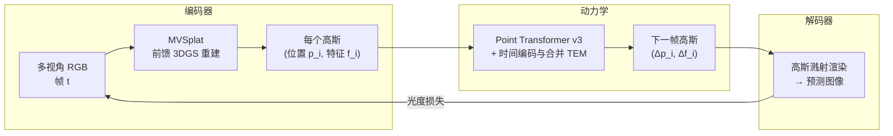

# 3DGSim：从 RGB 视频学习三维高斯动力学仿真器

> **论文**：3DGSim: Simulating 3D Gaussian Splats via Learning（arXiv:2503.24009，ICML 2026）
> **作者**：Mikel Zhobro、A. René Geist、Georg Martius（University of Tübingen / MPI-IS Tübingen）
> **关键词**：3D 高斯溅射、端到端物理仿真学习、点云 Transformer、多视角 RGB、前馈重建

**知识链接**：
- [3D Gaussian Splatting：用一堆椭球把真实场景搬进电脑](/前置知识/007a_前置知识_3D_Gaussian_Splatting三维场景重建) — 3DGSim 的输入和输出表示
- [具身高斯与机器人世界模型综述](/论文综述/S36_具身高斯_机器人世界模型综述) — 把 3DGSim 放入五条路线的大图中理解
- [PhysGaussian 精读](/论文综述/165_PhysGaussian_物理集成三维高斯动态仿真) — 用 MPM 驱动高斯的物理路线，和 3DGSim 的学习路线形成对照

---

## 贯穿全文的例子

> **场景**：一台双机械臂把一块方形弹性垫子从桌面上拎起来。你有六台固定的 RGB 相机同时拍下了这个过程——抓取、抬起、垫子中间下垂、放回桌面。现在问题是：只凭这些 RGB 视频，能不能训出一个模型，让它在**同样场景的新初始构型**下（比如把垫子换个位置、换一个物体、多加一个球）直接预测未来的三维高斯状态并渲染出逼真的画面？
>
> 和前面看到的 [PhysTwin](/论文综述/169_PhysTwin_从稀疏视频构建可交互软体数字孪生)、[EgoPhys](/论文综述/170_EgoPhys_第一人称视频构建可形变物体物理数字孪生) 不同，3DGSim **不做系统辨识**——不估计弹簧刚度、杨氏模量或任何物理参数。它把动力学预测当作一个纯粹的序列到序列学习问题，直接学"3D 高斯的状态在时间上怎么演化"。

---

## 一、定位：为什么不走物理仿真路线

### 1.1 物理仿真路线的代价

[PhysTwin](/论文综述/169_PhysTwin_从稀疏视频构建可交互软体数字孪生)、[PhysGaussian](/论文综述/165_PhysGaussian_物理集成三维高斯动态仿真)、[GIC](/论文综述/166_GIC_高斯告知连续体的材料属性辨识) 等方法走的是"逆物理"路线：假设一个物理模型（弹簧-质点、[MPM](/前置知识/006n_前置知识_物质点法MPM基础_颗粒材料与网格粒子转换)、FEM），从观测中辨识模型参数，然后用物理仿真器做预测。这条路线的优势是预测服从物理定律，外推能力强；代价有三：

1. **需要选对物理模型**：弹性体用弹簧-质点，流体用 SPH，刚体用刚体动力学——模型选错，参数再怎么优化也没用
2. **逐场景优化**：每个新物体/场景都要重新做参数辨识
3. **仿真速度受限于物理求解器的时间步**：MPM/FEM 的显式积分需要很小的时间步，隐式积分需要求解线性系统

### 1.2 3DGSim 的替代方案

3DGSim 走的是另一条路：直接用神经网络学习"3D 高斯状态 → 下一时刻 3D 高斯状态"的映射，跳过物理模型的选择和参数辨识。输入是多视角 RGB 视频，输出是一个可以自回归 rollout 的动力学预测器。

这条路线的优势：
- **不需要选物理模型**：同一个网络架构可以学刚体、弹性体、布料
- **训练后推理快**：一步前向传播替代了多步物理积分
- **可以学到物理模型难以描述的行为**：比如复杂接触、材料非线性

代价：
- **没有物理保证**：长期 rollout 可能违反守恒律
- **泛化受限于训练分布**：没见过的材料/构型预测不可靠
- **需要大量训练数据**：物理模型的样本效率远高于数据驱动方法

---

## 二、整体架构

3DGSim 的端到端管线分为三个模块：编码器、动力学模块、解码器。

> **看什么**：编码器把 RGB 图像变成 3D 高斯，动力学模块预测高斯的状态变化（位置增量和特征增量），解码器把预测的高斯渲染成图像，和真实图像比较计算损失。整个管线端到端可微，三个模块联合训练。

### 2.1 编码器：MVSplat

MVSplat（Chen et al., 2024）是一个前馈式多视角 3DGS 重建模型——输入几张带已知位姿的 RGB 图像，直接输出一组 3D 高斯核的参数，不需要逐场景优化。它和标准 3DGS 的关键区别是：标准 3DGS 对每个场景做几十分钟的优化，MVSplat 在大量场景上预训练后，新场景一次前向传播就出结果。

3DGSim 用 MVSplat 把每帧的多视角 RGB 编码成一组高斯。每个高斯的状态表示为 $\tilde{g}_i(t_k) = (p_i(t_k), f_i(t_k))$：三维位置 $p_i$ 和一个特征向量 $f_i$。特征向量 $f_i$ 是 MVSplat 编码器输出的中间表示，编码了高斯的形状、颜色等外观信息。

### 2.2 视角无关特征编码

MVSplat 原本输出的特征是**视角相关**的（view-dependent）——同一个高斯从不同相机看到的特征不同，因为它编码了视角相关的颜色信息（如高光反射）。但动力学预测需要的是**视角无关**（view-independent）的特征——高斯的物理状态不应该因为观察者的位置而改变。

3DGSim 在 MVSplat 的编码器中注入了 FiLM（Feature-wise Linear Modulation——用一组可学习的缩放和偏移参数对特征做仿射变换的条件化方法）层。FiLM 层接收相机位姿作为条件，把视角相关的特征转换成视角无关的特征。解码时再用逆向的 FiLM 层把视角无关的特征转回视角相关的特征用于渲染。

---

## 三、动力学模块：Point Transformer v3 + TEM

### 3.1 为什么用点云 Transformer

动力学预测的输入是一组三维点（高斯的位置），这天然是一个点云处理任务。3DGSim 选择了 Point Transformer v3（PTv3，Wu et al., 2024）——一个基于空间序列化（spatial serialization）和注意力机制的点云处理架构。

PTv3 的核心思想是把三维点云用空间填充曲线（如 Z-order curve）序列化成一维序列，然后在序列上做窗口注意力（和 Swin Transformer 类似）。这样既保留了空间邻近性（序列化后相邻的点在空间中也相邻），又避免了全局注意力的 $O(N^2)$ 开销。

### 3.2 时间编码与合并（TEM）

动力学预测需要知道"这些点过去怎么动的"——不能只看当前帧。3DGSim 引入了 Temporal Encoding and Merging（TEM）机制来处理时间信息。

TEM 的做法是把**多个时间步的点云合并成一个大点云**，然后在序列化编码中用位操作（bit-shift）嵌入时间信息。具体来说：

每个点的空间位置 $(x,y,z)$ 被量化成整数坐标，然后编码成一个 64 位整数。TEM 把时间步编号 $k$ 也编进这个整数的高位——效果是同一空间位置在不同时间步的点会被编码成序列化顺序上相邻的编码，使得 PTv3 的窗口注意力自然地覆盖了时间维度。

| 无 TEM | 有 TEM |
|--------|--------|
| 每帧独立编码，时间信息丢失 | 多帧合并编码，时间信息嵌入空间序列化 |
| 只能看当前帧 | 窗口注意力覆盖过去多帧 |
| 无法学到速度/加速度 | 从相邻帧的位移隐式获取速度信息 |

Table 1 的消融实验显示 TEM 是最关键的组件：移除 TEM 后，弹性体预测的 PSNR 从 33.15 骤降到 18.19（降 14.96 dB），几乎等于没有动力学能力。

### 3.3 动力学预测的自回归 rollout

训练时，模型看过去 $H$ 帧的高斯状态，预测下一帧的状态增量 $(\Delta p_i, \Delta f_i)$。推理时，从真实观测的初始帧出发，用预测结果替代真实观测，自回归地 rollout 到任意多步。

为了减少自回归 rollout 中的误差累积，训练时采用了 scheduled sampling：以一定概率用模型自身的预测替代真实观测作为下一步的输入，让模型学会在有噪声的输入上做预测。

---

## 四、训练与损失

3DGSim 的损失函数是渲染层面的光度损失：

$$
\mathcal{L} = \sum_{v}\Big[\lambda_1\,\lVert\hat{I}_v - I_v\rVert_1 + \lambda_2\,(1 - \text{SSIM}(\hat{I}_v, I_v))\Big]
$$

**这个公式在做什么**：把预测的高斯状态渲染成多视角图像，和真实图像比较——L1 管像素精确度，SSIM（Structural Similarity Index——衡量两张图在亮度、对比度、结构三个维度相似度的指标）管结构一致性。

::: details 📐 公式详解（点击展开）

| 子表达式 | 它是谁 | 它在干嘛 |
|---------|--------|---------|
| $\hat{I}_v$ | 预测图像（从预测高斯渲染，视角 $v$） | 模型认为这个视角看到的画面 |
| $I_v$ | 真实图像（视角 $v$） | 相机实际拍到的画面 |
| $\lVert\cdot\rVert_1$ | L1 距离 | 逐像素绝对差，对离群像素不过分惩罚 |
| $\text{SSIM}(\cdot,\cdot)$ | 结构相似性 | 比较亮度、对比度、结构三个维度的匹配度，$(1-\text{SSIM})$ 越小越好 |
| $\sum_v$ | 对所有视角求和 | 多视角监督，防止模型只照顾一个角度 |

**用人话读**："从多个角度比较预测画面和真实画面，像素差异和结构差异都要小。"

**为什么用渲染损失而不是直接比较高斯参数**：高斯参数的"正确值"不唯一——很多不同的高斯配置可以渲染出同样的图像。用渲染损失让模型自由选择最好的高斯表示方式。
:::

因为损失是在渲染后计算的，梯度需要从图像一路反传到动力学模块和编码器。3DGSim 用可微高斯光栅化器实现这个反传。

---

## 五、数据集与实验

### 5.1 数据集

3DGSim 的训练和测试数据来自**仿真生成**，不是真实视频：

| 数据集 | 物理类型 | 物体来源 | 轨迹数 | 仿真器 |
|--------|---------|---------|--------|--------|
| 刚体 | 自由落体 + 碰撞 | MOVI/GSO 数据集 | 1000 | — |
| 弹性体 | 弹性变形 | 6 种 Genesis 物体 | — | Genesis MPM |
| 布料 | 布料下垂（四角固定） | 同 6 种物体 | — | Genesis MPM |

训练数据是用仿真器渲染的多视角图像序列。3DGSim 从 RGB 图像学习，不直接访问仿真器的物理状态——所以虽然数据来自仿真，方法本身不假设有仿真器接口。

### 5.2 消融实验

弹性体数据集上的消融（Table 1）：

| 配置 | PSNR ↑ |
|------|--------|
| 完整模型 | **33.15 ± 3.51** |
| 无 TEM（时间编码） | 18.19 (−14.96) |
| 用显式 3DGS 替代 MVSplat | 29.69 (−3.46) |
| 2-step rollout（只预测两步） | 26.43 (−6.72) |

三个发现：

1. **TEM 是决定性组件**。没有时间编码，模型看不到速度信息，预测几乎随机。PSNR 从 33.15 掉到 18.19，这个降幅比其他任何消融都大。
2. **MVSplat 比显式 3DGS 好 3.46 dB**。MVSplat 的前馈编码器在大量场景上预训练过，提取的特征比逐场景优化的 3DGS 更有泛化性。
3. **长 rollout 训练很重要**。只训 2 步 rollout 的模型在长程预测上退化严重，因为它没学过如何处理自回归误差累积。

### 5.3 与视频生成模型的对比

3DGSim 和视频生成模型（Cosmos-1.0、微调的 CosmosFT）做了对比。视频生成模型直接在像素空间做预测，不经过三维表示。

结果：3DGSim 在短期预测（前 20 步）和中期预测（20–80 步）上与 Cosmos 持平甚至更好。长期预测（80+ 步）上 Cosmos 略优——这并不意外，因为 Cosmos 是在海量视频上预训练的大模型（~140 亿参数），而 3DGSim 只在任务相关的仿真数据上训练。

3DGSim 相对视频生成模型的优势不在数字上，而在**能力差异**：
- 3DGSim 输出的是三维高斯，可以从任意新视角渲染；视频模型输出的是固定视角的像素
- 3DGSim 的高斯可以被编辑（删除物体、改变位置）；视频模型的输出不可编辑
- 3DGSim 支持场景组合（把不同物体的高斯合并）；视频模型不支持

### 5.4 泛化能力

3DGSim 展示了三种泛化：

1. **未见过的多体交互**：训练时只见过单物体运动，测试时两个物体碰撞——模型能预测出合理的碰撞行为
2. **场景编辑**：移除地面后物体自由下落——模型正确地预测了无支撑的下落
3. **物体组合**：把不同训练场景的物体组合到一个新场景中——模型对组合场景的预测合理

这些泛化能力来自三维高斯表示的**组合性**（composability）：因为每个物体是独立的一组高斯，合并、删除、替换都是集合操作，不需要重新训练。

---

## 六、设计取舍与适用边界

### 6.1 为什么选"学习"而不是"物理"

3DGSim 的论文标题里有"Learning"而不是"Physics"——这是一个明确的设计选择。在以下场景中学习路线优于物理路线：

- **不知道用什么物理模型**：面对未知材料或复杂接触，选错模型的代价比不用物理模型更高
- **需要快速推理**：一步前向传播 vs 数百步物理积分
- **有足够的训练数据**：仿真环境可以无限生成数据

### 6.2 什么时候不该用

- **需要物理可解释性**：3DGSim 的动力学是黑箱，无法给出刚度、质量等物理参数
- **长期精确预测**：自回归 rollout 的误差会累积，80 步以后精度下降
- **真实世界数据稀缺**：当前实验全部在仿真数据上，真实场景的泛化尚未验证
- **需要外力交互**：当前版本不支持在 rollout 过程中施加外力（和 PhysTwin/EgoPhys 的控制弹簧不同）

### 6.3 与物理路线的互补

3DGSim 和物理路线不是非此即彼的关系。一个可能的组合方式是：用 3DGSim 做快速预筛（哪些动作大致可行），再用 PhysTwin 级别的物理模型做精细优化。3DGSim 的速度优势在规划的初始阶段有价值，物理模型的精度优势在最终执行阶段有价值。

---

## 七、与相关工作对比

| 维度 | 3DGSim | [PhysTwin](/论文综述/169_PhysTwin_从稀疏视频构建可交互软体数字孪生) | [PhysGaussian](/论文综述/165_PhysGaussian_物理集成三维高斯动态仿真) | 视频生成（Cosmos） |
|------|--------|----------|-------------|---------|
| 动力学 | 学习（PTv3） | 物理（弹簧） | 物理（MPM） | 学习（扩散） |
| 表示 | 3D 高斯 | 3D 高斯 | 3D 高斯 | 像素 |
| 任意视角渲染 | ✅ | ✅ | ✅ | ❌ |
| 场景编辑 | ✅ | 有限 | 有限 | ❌ |
| 物理可解释 | ❌ | ✅ | ✅ | ❌ |
| 外力交互 | ❌ | ✅ | ✅ | ❌ |
| 推理速度 | 快（一步前向） | 慢（多步积分） | 慢 | 中等 |
| 数据需求 | 高（需训练集） | 低（1 段视频） | 低 | 极高 |
| 发表 | ICML 2026 | arXiv 2025.03 | CVPR 2024 | — |

---

## 八、总结

3DGSim 的核心贡献是把 3D 高斯溅射从"静态场景表示"推广到"动态场景预测"，方法是用 Point Transformer v3 直接学习高斯状态在时间上的演化规律。三个关键设计：

1. **MVSplat 编码器 + FiLM 视角解耦**：从多视角 RGB 图像前馈生成视角无关的 3D 高斯特征
2. **TEM 时间编码**：把多帧的高斯点云合并成一个时空点云，让 PTv3 的窗口注意力自然覆盖时间维度
3. **端到端可微渲染训练**：所有模块联合优化，损失在渲染后的图像空间计算

在仿真数据上，完整模型达到 PSNR 33.15（弹性体），和大规模视频生成模型 Cosmos 可比；TEM 是决定性组件（移除后降 14.96 dB）。三维高斯表示带来了视频模型不具备的能力：任意视角渲染、场景编辑、物体组合。

当前的局限是缺少真实数据验证、不支持外力交互、长期 rollout 精度下降。

---

## 延伸阅读

- [3D Gaussian Splatting 基础](/前置知识/007a_前置知识_3D_Gaussian_Splatting三维场景重建) — 高斯参数、可微光栅化、优化流程
- [PhysTwin 精读](/论文综述/169_PhysTwin_从稀疏视频构建可交互软体数字孪生) — 物理仿真路线的代表，对照阅读看"学习 vs 物理"的取舍
- [PhysGaussian 精读](/论文综述/165_PhysGaussian_物理集成三维高斯动态仿真) — MPM 物理路线
- [EgoPhys 精读](/论文综述/170_EgoPhys_第一人称视频构建可形变物体物理数字孪生) — 弹簧-质点路线 + 物理先验码本
- [具身高斯与机器人世界模型综述](/论文综述/S36_具身高斯_机器人世界模型综述) — 高斯溅射在机器人中的五条路线
