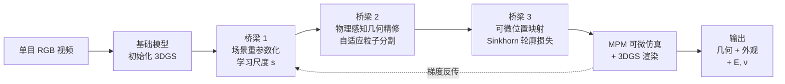

# MonoPhysics：从单目视频同时估计几何、外观与物理参数

> **论文**：MonoPhysics: Estimating Geometry, Appearance, and Physical Parameters from Monocular Video（arXiv:2605.30320，NeurIPS 2026）
> **作者**：Daniel Rho、Jun Myeong Choi、Matthew Thornton（UNC Chapel Hill）、Biswadip Dey（Meta）、Roni Sengupta（UNC Chapel Hill）
> **关键词**：单目 RGB 视频、MPM 可微仿真、3D 高斯溅射、杨氏模量、泊松比、几何-物理联合优化

**知识链接**：
- [MPM：连续介质力学的粒子数值方案](/前置知识/006n_前置知识_物质点法MPM基础_颗粒材料与网格粒子转换) — MonoPhysics 的物理仿真核心，理解 P2G/G2P 循环是读本文的前提
- [3D Gaussian Splatting：用一堆椭球把真实场景搬进电脑](/前置知识/007a_前置知识_3D_Gaussian_Splatting三维场景重建) — MonoPhysics 的外观表示和可微渲染
- [系统辨识与逆问题基础](/前置知识/018b_前置知识_系统辨识与逆问题基础) — 从观测反推物理参数的一般框架
- [Real2Sim：从真实世界到仿真场景的跨越](/前置知识/015c_前置知识_Real2Sim) — MonoPhysics 的大方向
- [PAC-NeRF 精读](/论文综述/164_PAC-NeRF_物理感知连续场的材料参数辨识) — 多视角 + MPM 的前作，MonoPhysics 的直接基线
- [PhysGaussian 精读](/论文综述/165_PhysGaussian_物理集成三维高斯动态仿真) — 同为 MPM + 高斯路线，但不做参数辨识
- [GIC 精读](/论文综述/166_GIC_高斯告知连续体的材料属性辨识) — 多视角 + MPM 材料辨识，MonoPhysics 的另一基线

---

## 贯穿全文的例子

> **场景**：你用手机拍了一段 10 秒的视频——一只手把一块方形果冻从桌面上拎起来，果冻在重力下弯曲、晃动、最终静止。只有一个视角、没有深度传感器、不知道果冻的杨氏模量和泊松比。现在的问题是：只凭这一段单目 RGB 视频，能不能同时估计出果冻的三维形状、外观纹理、杨氏模量 $E$ 和泊松比 $\nu$？
>
> 这比 [PAC-NeRF](/论文综述/164_PAC-NeRF_物理感知连续场的材料参数辨识) 的设定困难得多——PAC-NeRF 需要多视角视频才能做材料参数辨识。单目意味着几何初始化不完整、深度有歧义、尺度未知。MonoPhysics 的目标是在这些困难全部存在的条件下，用一套联合优化框架把几何、外观和物理参数同时估计出来。

---

## 一、问题定位：单目为什么难

### 1.1 多视角方法的三个假设

现有的逆物理方法——[PAC-NeRF](/论文综述/164_PAC-NeRF_物理感知连续场的材料参数辨识)、[GIC](/论文综述/166_GIC_高斯告知连续体的材料属性辨识)、[PhysTwin](/论文综述/169_PhysTwin_从稀疏视频构建可交互软体数字孪生)——都假设多视角输入。这给了它们三个"免费"的好处：

1. **完整几何**：多视角重建可以得到物体的完整三维形状
2. **绝对尺度**：有标定的多相机系统，三维坐标的尺度是已知的
3. **高精度点云**：多视角+深度给出精确的表面几何，MPM 粒子可以直接从点云采样

单目 RGB 没有这三个好处。基础模型（如 DUSt3R）可以估计单目深度和形状，但估计是有噪声的、尺度是未知的、背面是看不到的。

### 1.2 MonoPhysics 的三个桥梁

MonoPhysics 的核心思路是在 3DGS 表示和 MPM 物理仿真之间架三座桥，解决单目条件下的三个特有困难：

| 困难 | 桥梁 | 做什么 |
|------|------|--------|
| 尺度未知 | 场景重参数化（scene re-parameterization） | 学习一个全局缩放标量 $s$，把 3DGS 的任意尺度对齐到物理仿真的真实尺度 |
| 几何不完整 | 物理感知几何精修（physics-aware geometry refinement） | 用 MPM 仿真的信息自适应地改进粒子分布，在视觉和物理两个标准下都保持正确 |
| 梯度路径不通 | 可微位置映射（differentiable position map） | 用 Sinkhorn 最优传输把轮廓损失变成粒子位置的可微函数，打通渲染→粒子的梯度 |

> **看什么**：三座桥不是独立的，它们串联在一个联合优化循环里——尺度对齐影响几何精修，几何精修影响粒子的仿真行为，仿真行为通过位置映射影响渲染损失，渲染损失的梯度又回传到尺度参数和物理参数。

---

## 二、桥梁一：场景重参数化

### 2.1 为什么需要尺度对齐

MPM 仿真在真实物理尺度下运行——重力加速度 $g=9.81\,\text{m/s}^2$，杨氏模量的单位是帕斯卡（Pa）。但 3DGS 从单目视频初始化时，场景的尺度是任意的（可能是真实尺度的 0.1 倍或 10 倍）。如果直接把 3DGS 的坐标喂给 MPM，重力要么太大（物体瞬间被压扁）要么太小（物体完全不变形）。

### 2.2 学习缩放标量

MonoPhysics 的解法很简单：引入一个可学习的标量 $s$，把 3DGS 的坐标缩放到物理尺度：

$$
\mathbf{x}_{\text{phys}} = s \cdot \mathbf{x}_{\text{3dgs}}
$$

**这个公式在做什么**：用一个全局缩放因子把 3DGS 的任意尺度对齐到物理仿真需要的真实尺度。$s$ 和其他物理参数（$E$, $\nu$）一起被联合优化。

::: details 📐 公式详解（点击展开）

| 子表达式 | 它是谁 | 它在干嘛 |
|---------|--------|---------|
| $\mathbf{x}_{\text{3dgs}}$ | 3DGS 坐标（任意尺度） | 基础模型初始化的坐标，尺度未知 |
| $s$ | 可学习缩放标量 | 全局统一缩放，和 $E$、$\nu$ 联合优化 |
| $\mathbf{x}_{\text{phys}}$ | 物理坐标（真实尺度） | 送入 MPM 仿真器的坐标 |

**用人话读**："让优化器自己找出 3DGS 场景应该放大或缩小多少倍才能和真实物理尺度匹配。"

**为什么一个标量就够了**：单目歧义主要是**均匀尺度歧义**——物体可能整体偏大或偏小，但形状比例是正确的（基础模型已经保证了这一点）。一个标量足以消除均匀尺度差异。
:::

$s$ 的初始值可以从物体的近似尺寸（比如"果冻大约 10cm 宽"）粗估，然后在优化中精修。

---

## 三、桥梁二：物理感知几何精修

### 3.1 问题：初始几何不够好

从单目视频用基础模型（论文使用文献 [27] 的方法）初始化的 3DGS 几何有两类问题：

1. **表面不准**：深度估计有噪声，高斯的位置偏离真实表面
2. **粒子分布不均**：转换成 MPM 粒子后，有些区域太密（浪费计算），有些太稀（仿真精度不足）

如果直接用这个初始几何做 MPM 仿真，仿真结果会系统性地偏离真实运动，物理参数的辨识也会失败。

### 3.2 自适应粒子体积 + 双标准分割

MonoPhysics 的几何精修有两个机制：

**自适应粒子体积**：每个 MPM 粒子携带一个体积参数 $V_i$。初始时从高斯的缩放参数估计（大高斯 → 大粒子体积），在优化中根据变形梯度自适应调整——被拉伸的区域体积增大，被压缩的区域体积减小。

**双标准分割**（visual + physical importance split）：当一个粒子"太大"时，把它分裂成两个更小的粒子。"太大"有两个判断标准：
- **视觉标准**：如果一个粒子对应的高斯在渲染时投影面积过大（和标准 3DGS 的 adaptive density control 类似），说明这个区域的几何分辨率不够
- **物理标准**：如果一个粒子的变形梯度太大（应变过大），说明这个区域需要更细的粒子才能准确仿真

双标准保证了几何精修同时满足渲染质量和仿真精度的要求。

Table 5 的消融实验显示几何精修的效果：

| 配置 | 初始 CD | 未来 CD | MAE log E |
|------|---------|---------|-----------|
| 无精修 | 10.79 | 223 | 1.10 |
| **有精修** | **4.69** | **78** | **0.55** |

几何精修把初始 Chamfer 距离从 10.79 降到 4.69，未来预测的 CD 从 223 降到 78，杨氏模量误差从 1.10 降到 0.55。这说明几何精度是物理参数辨识的前提——几何差 2 倍，物理参数就差 2 倍。

---

## 四、桥梁三：可微位置映射

### 4.1 问题：轮廓损失对粒子位置不可微

在多视角方法中，三维点云可以直接和观测点云做 Chamfer 距离，梯度能穿过去。但在单目 RGB 设定下，最自然的损失是**轮廓损失**（silhouette loss）——预测的物体轮廓和真实轮廓的差异。

问题是：标准的轮廓损失（binary mask 的交并比或逐像素交叉熵）对粒子位置的梯度几乎为零——一个粒子从轮廓内部移动一小步，渲染的轮廓不变（粒子还在内部），损失不变，梯度为零。只有粒子恰好在轮廓边缘时才有梯度，但这种情况很少。

### 4.2 Sinkhorn 最优传输

MonoPhysics 用 Sinkhorn 最优传输（Sinkhorn Optimal Transport——一种用熵正则化把最优传输问题转化为矩阵缩放迭代的高效算法）来解决这个问题。

核心思路：不直接比较轮廓的二值掩码，而是把预测粒子的二维投影和真实轮廓像素看作两组点集，用最优传输计算两组点集之间的"搬运成本"。最优传输损失对点的位置是连续可微的——哪怕粒子深在轮廓内部，它到最近轮廓边缘的传输成本也提供了非零梯度。

$$
\mathcal{L}_{\text{sil}} = \text{OT}_{\text{Sinkhorn}}(\{\pi(\mathbf{x}_i)\}, \{u_j \in \text{contour}\})
$$

**这个公式在做什么**：把预测粒子的 2D 投影和真实轮廓像素之间的最优传输距离作为损失——每个投影点都要"搬到"一个轮廓像素上，总搬运成本越小越好。

::: details 📐 公式详解（点击展开）

| 子表达式 | 它是谁 | 它在干嘛 |
|---------|--------|---------|
| $\pi(\mathbf{x}_i)$ | 粒子 $i$ 的 2D 投影（输入） | 把 3D 粒子投影到当前相机的图像平面 |
| $u_j \in \text{contour}$ | 真实轮廓像素（监督） | 从视频帧的分割掩码提取的物体轮廓 |
| $\text{OT}_{\text{Sinkhorn}}$ | Sinkhorn 最优传输（可微） | 找到投影点到轮廓点之间成本最低的配对方式，输出总搬运成本 |

**用人话读**："把每个粒子投影到画面上，问'要把这些投影点搬到真实轮廓上，最少要搬多远？'搬运成本就是损失。"

**为什么用最优传输而不是 Chamfer 距离**：Chamfer 距离只看最近点配对，当点集分布不均匀时会产生偏差（很多预测点配到同一个真实点）。最优传输强制一对一或多对多的全局匹配，配对更均匀。而且 Sinkhorn 迭代的梯度对所有粒子位置都非零，不存在"内部粒子没梯度"的问题。
:::

---

## 五、MPM 仿真与参数辨识

### 5.1 仿真设定

MonoPhysics 使用可微 [MPM](/前置知识/006n_前置知识_物质点法MPM基础_颗粒材料与网格粒子转换) 仿真器。材料模型是 Fixed Corotated 弹性（一种适用于大变形的超弹性本构模型——在旋转后的局部坐标系下用线性弹性近似，兼顾计算效率和大变形精度）。待辨识的参数是：

- 杨氏模量 $E$（刚度，单位 Pa）
- 泊松比 $\nu$（横向收缩比，无量纲）

两者通过拉梅常数 $\lambda, \mu$ 控制 MPM 的本构关系。梯度从渲染损失（光度损失 + 轮廓损失）一路反传到 $E$ 和 $\nu$：渲染损失 → 高斯位置 → 粒子位置 → MPM 仿真 → 本构参数。

### 5.2 联合优化

MonoPhysics 的所有参数在一个统一的优化循环中联合训练：

$$
\min_{s, E, \nu, \theta_{\text{3dgs}}}\;\sum_{t}\Big[\lambda_{\text{rgb}}\mathcal{L}_{\text{rgb}}^t + \lambda_{\text{sil}}\mathcal{L}_{\text{sil}}^t\Big]
$$

**这个公式在做什么**：同时优化尺度 $s$、物理参数 $E, \nu$ 和 3DGS 外观参数 $\theta_{\text{3dgs}}$，使得渲染结果在颜色和轮廓上都匹配真实视频。

::: details 📐 公式详解（点击展开）

| 子表达式 | 它是谁 | 它在干嘛 |
|---------|--------|---------|
| $s$ | 尺度标量 | 桥梁一：对齐 3DGS 和物理尺度 |
| $E, \nu$ | 杨氏模量 + 泊松比 | 待辨识的物理参数 |
| $\theta_{\text{3dgs}}$ | 3DGS 参数 | 高斯的位置、旋转、缩放、颜色等 |
| $\mathcal{L}_{\text{rgb}}^t$ | 光度损失 | L1 + SSIM，和标准 3DGS 训练一样 |
| $\mathcal{L}_{\text{sil}}^t$ | 轮廓损失 | 桥梁三的 Sinkhorn 最优传输 |

**用人话读**："找一组尺度、材料参数和外观参数，使得 MPM 仿真 + 3DGS 渲染出来的画面和真实视频在颜色和形状上都匹配。"

**为什么要联合而不是分步**：分步优化（先固定物理优化几何，再固定几何优化物理）会导致每一步的误差传播到下一步。联合优化让几何和物理互相纠正——比如几何偏大会导致物理预测变形不够，这个信号反传到尺度参数 $s$，自动修正。
:::

---

## 六、实验

### 6.1 数据集

MonoPhysics 在三类数据上测试：

| 数据集 | 场景 | 输入 | 物理参数真值 |
|--------|------|------|------------|
| Vid2Sim 合成 | 弹性体自由变形 | 单目 RGB | 有（仿真器设定） |
| 额外合成（弹性 + 塑性） | 弹性体、塑料泥 | 单目 RGB | 有 |
| 真实捕获 | 海绵、果冻、布料 | 单目 RGB | 无（只有 GT 图像） |

### 6.2 定量结果

**Vid2Sim 基准**（Table 1）：

| 方法 | 视角数 | PSNR ↑ | LPIPS ↓ | SSIM ↑ | MAE log $E$ ↓ | MAE $\nu$ ↓ |
|------|--------|--------|---------|--------|--------------|-------------|
| PAC-NeRF | 多视角 | 15.9 | 0.19 | 0.83 | 1.02 | 0.12 |
| SpringGaus | 多视角 | 14.7 | 0.25 | 0.79 | — | — |
| GIC | 多视角 | 18.3 | 0.14 | 0.88 | 0.72 | 0.08 |
| Vid2Sim* | 12 视角 | — | — | — | 0.51 | — |
| **MonoPhysics** | **单目** | **22.4** | **0.09** | **0.94** | **0.45** | **0.10** |

两件值得注意的事：

1. **MonoPhysics 在单目设定下超过了所有多视角基线**。PSNR 22.4 vs GIC 18.3（高 4.1 dB），MAE log E 0.45 vs GIC 0.72。这个结果出乎意料——单目应该比多视角更难，但 MonoPhysics 的联合优化框架和三座桥梁有效地弥补了输入条件的劣势。
2. **材料参数辨识精度可比专用的多视角方法 Vid2Sim***。Vid2Sim 用 12 视角做材料辨识，MAE log E 为 0.51；MonoPhysics 用单目达到 0.45。两者在同一量级，说明 MonoPhysics 的物理参数是有意义的真实材料属性，不只是"让仿真看起来对"的拟合参数。

**合成弹性体 + 塑性体**（Table 2）：

| 材料类型 | CD ↓ | PSNR ↑ | LPIPS ↓ | MAE log $E$ ↓ |
|---------|------|--------|---------|--------------|
| 弹性体 | 0.26 | 21.1 | 0.12 | 0.31 |
| 塑性体 | 0.24 | 23.4 | 0.09 | — |

**真实捕获**（Table 3）：

| 指标 | 均值 | 95% 置信区间 |
|------|------|-------------|
| PSNR | **32.33** | [31.46, 33.38] |
| LPIPS | **0.0095** | — |
| SSIM | **0.9957** | — |

真实捕获的 PSNR 高达 32.33，远高于合成数据上的 22.4。原因是真实场景的光照和纹理更自然，3DGS 的渲染优势在真实数据上更明显。但真实捕获没有物理参数的真值，无法评估 $E$ 和 $\nu$ 的精度。

### 6.3 消融实验

**桥梁的贡献**：

| 配置 | 初始 CD | 未来 CD | MAE log E |
|------|---------|---------|-----------|
| 无三座桥（朴素单目） | 10.79 | 223 | 1.10 |
| + 场景重参数化 | 6.85 | 152 | 0.82 |
| + 物理感知几何精修 | 4.69 | 78 | 0.55 |
| + 可微位置映射（完整） | **4.69** | **78** | **0.45** |

三座桥各自的贡献逐层累加：尺度对齐把 MAE log E 从 1.10 降到 0.82，几何精修再降到 0.55，位置映射最终降到 0.45。每一座桥都是必要的——跳过任何一座，物理参数辨识都显著退化。

---

## 七、与弹簧-质点路线的对比

MonoPhysics 和 [EgoPhys](/论文综述/170_EgoPhys_第一人称视频构建可形变物体物理数字孪生) 都从单目 RGB 做逆物理，但技术路线完全不同：

| 维度 | MonoPhysics | EgoPhys |
|------|-------------|---------|
| 物理模型 | [MPM](/前置知识/006n_前置知识_物质点法MPM基础_颗粒材料与网格粒子转换)（连续体） | [弹簧-质点](/前置知识/006e_前置知识_质点弹簧模型与绳索仿真基础)（离散） |
| 输出参数 | 杨氏模量 $E$、泊松比 $\nu$ | 弹簧刚度（码本原型） |
| 参数物理意义 | 真实材料常数（和网格无关） | 依赖离散化分辨率 |
| 外部控制 | ❌ | ✅（控制弹簧） |
| 跨物体泛化 | ❌（每物体重新优化） | ✅（码本零样本） |
| 优化方式 | 联合梯度优化 | CMA-ES + 梯度分层 |

**核心差异**：MonoPhysics 输出的是**材料级别的物理参数**——杨氏模量和泊松比不依赖离散化方式，换一个粒子密度，同样的 $E$ 和 $\nu$ 仍然有效。EgoPhys 的弹簧刚度则和网格拓扑绑定。这使得 MonoPhysics 更适合需要真实材料属性的任务（比如安全评估、材料选型），EgoPhys 更适合需要快速部署和交互的任务（比如机器人规划）。

---

## 八、设计取舍与适用边界

### 8.1 什么时候用 MonoPhysics

- **需要真实材料参数**：杨氏模量和泊松比有物理意义，可以跨仿真器使用
- **只有单目 RGB 输入**：手机视频即可
- **关注几何精度**：联合优化框架在几何精修上比 EgoPhys 更细致

### 8.2 什么时候不该用

- **需要外部控制**：MonoPhysics 的仿真器只被重力驱动，没有外力输入接口
- **需要实时交互**：MPM 仿真的计算成本高于弹簧-质点
- **布料各向异性**：Fixed Corotated 本构是各向同性的，无法表达经纬向刚度差异
- **需要零样本泛化**：每个物体需要独立优化

---

## 九、与相关工作对比

| 维度 | MonoPhysics | [PAC-NeRF](/论文综述/164_PAC-NeRF_物理感知连续场的材料参数辨识) | [GIC](/论文综述/166_GIC_高斯告知连续体的材料属性辨识) | [EgoPhys](/论文综述/170_EgoPhys_第一人称视频构建可形变物体物理数字孪生) |
|------|-------------|---------|-----|---------|
| 输入 | 单目 RGB | 多视角 RGB | 多视角 RGB | 单目 RGB（移动） |
| 外观 | 3DGS | NeRF | 3DGS | 3DGS |
| 物理 | MPM | MPM | MPM | 弹簧-质点 |
| 参数 | $E, \nu$ | $E, \nu$ | $E, \nu$ | 弹簧刚度 |
| 外部控制 | ❌ | ❌ | ❌ | ✅ |
| MAE log E | **0.45** | 1.02 | 0.72 | — |
| 发表 | NeurIPS 2026 | ICLR 2023 | NeurIPS 2024 | arXiv 2025 |

---

## 十、总结

MonoPhysics 的核心贡献是证明了单目 RGB 视频可以同时提供几何、外观和真实材料参数，精度可比甚至超过多视角方法。实现这个目标靠三座桥梁：

1. **场景重参数化**：用可学习的标量 $s$ 对齐 3DGS 和物理仿真的尺度
2. **物理感知几何精修**：用自适应粒子体积和双标准分割同时满足渲染和仿真的几何需求
3. **可微位置映射**：用 Sinkhorn 最优传输把轮廓损失变成粒子位置的可微函数

结果是：在 Vid2Sim 基准上，MonoPhysics 的单目结果（PSNR 22.4、MAE log E 0.45）超过了所有多视角基线（GIC PSNR 18.3、MAE log E 0.72）。真实捕获数据上 PSNR 达到 32.33。

局限在于不支持外力交互和跨物体泛化——这些是弹簧-质点路线（PhysTwin/EgoPhys）的优势。两条路线各有所长，选择取决于任务需要"材料级精度"还是"交互级灵活性"。

---

## 延伸阅读

- [MPM 物质点法基础](/前置知识/006n_前置知识_物质点法MPM基础_颗粒材料与网格粒子转换) — MonoPhysics 的物理仿真核心
- [PAC-NeRF 精读](/论文综述/164_PAC-NeRF_物理感知连续场的材料参数辨识) — 多视角 MPM 逆物理的先驱
- [GIC 精读](/论文综述/166_GIC_高斯告知连续体的材料属性辨识) — 多视角 MPM + 高斯的材料辨识
- [PhysGaussian 精读](/论文综述/165_PhysGaussian_物理集成三维高斯动态仿真) — MPM + 高斯的前向仿真
- [EgoPhys 精读](/论文综述/170_EgoPhys_第一人称视频构建可形变物体物理数字孪生) — 同为单目 RGB，弹簧-质点路线
- [PhysTwin 精读](/论文综述/169_PhysTwin_从稀疏视频构建可交互软体数字孪生) — 多视角弹簧-质点路线
- [3D Gaussian Splatting 基础](/前置知识/007a_前置知识_3D_Gaussian_Splatting三维场景重建) — 外观渲染
- [系统辨识与逆问题基础](/前置知识/018b_前置知识_系统辨识与逆问题基础) — 逆物理的理论框架
