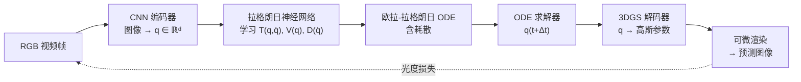

# LaGSplat：潜在拉格朗日高斯溅射实现物理一致交互仿真

> **论文**：LaGSplat: Lagrangian Gaussian Splatting for Physically-Consistent Interactive Simulation（arXiv:2608.16324，2025 年 8 月，预印本）
> **作者**：Louen Pottier（Université Paris-Saclay, CEA, List）
> **关键词**：拉格朗日神经网络、3D 高斯溅射、潜在空间动力学、能量守恒、耗散系统、虚功原理、力回传

**知识链接**：
- [拉格朗日神经网络（LNN）：让神经网络自动遵守物理守恒律](/前置知识/020b_前置知识_拉格朗日神经网络LNN学习守恒律的神经ODE) — LaGSplat 的动力学核心。必须先理解 LNN 为什么能保证能量守恒
- [拉格朗日力学与欧拉-拉格朗日方程](/前置知识/008c_前置知识_拉格朗日力学与欧拉拉格朗日方程) — 广义坐标、欧拉-拉格朗日方程的数学基础
- [3D Gaussian Splatting：用一堆椭球把真实场景搬进电脑](/前置知识/007a_前置知识_3D_Gaussian_Splatting三维场景重建) — LaGSplat 的渲染表示

---

## 贯穿全文的例子

> **场景**：一个彩虹摇摆器（rainbow rocker）——一块弧形木板——放在桌面上，往一边推一下就会来回摇摆。你拍了一段 30 秒的视频记录了它自然衰减的摇摆过程。现在问题是：能不能从这段视频中学到一个模型，让它（1）在没有外力时正确预测摇摆频率和衰减速率，（2）在用户实时施加力时做出物理一致的响应——推得越狠摆得越大，松手后自然衰减到平衡？
>
> 这个问题和前面看到的 [PhysTwin](/论文综述/169_PhysTwin_从稀疏视频构建可交互软体数字孪生)、[EgoPhys](/论文综述/170_EgoPhys_第一人称视频构建可形变物体物理数字孪生) 的目标不同。PhysTwin/EgoPhys 用弹簧-质点显式建模每个粒子，适用于软体大变形；LaGSplat 把整个场景的状态压缩到一个低维潜在空间中，用 [拉格朗日神经网络](/前置知识/020b_前置知识_拉格朗日神经网络LNN学习守恒律的神经ODE) 在这个空间里学习动力学，适用于自由度少但需要长期物理一致性的振动、摆动、旋转等周期性运动。

---

## 一、定位：从"拟合动态外观"到"学到物理规律"

### 1.1 现有方法的共同弱点

动态 3DGS（如 Deformable 3DGS、4D Gaussian Splatting）和基于神经网络的动态场景方法（如 GaussianPrediction）可以从视频学习场景的运动并预测未来帧。但它们都有一个共同弱点：**不保证物理一致性**。

具体来说：
- **不守恒**：预测的运动可能违反能量守恒——一个无摩擦的钟摆在预测中可能越摆越大（能量凭空增加）或越摆越小（能量凭空消失）
- **不保频率**：摇摆器的频率由质量分布和几何决定，是一个固有属性，但黑箱方法学到的频率可能随 rollout 步数漂移
- **不收敛到平衡**：有耗散的系统（有摩擦）最终应该停在平衡位置，但黑箱方法可能永远不停（GaussianPrediction 在 1000 秒后仍然以原始振幅的 53% 摆动）

### 1.2 LaGSplat 的思路

LaGSplat 的核心思路是把物理守恒律**内建到网络结构中**，而不是让网络从数据中学到它。具体做法是在 3DGS 渲染器和场景动力学之间插入一个**潜在拉格朗日层**：

> **看什么**：和 [3DGSim](/论文综述/171_3DGSim_从RGB视频学习三维高斯仿真器) 的端到端学习不同，LaGSplat 在动力学部分有明确的物理结构——拉格朗日神经网络保证了能量守恒（保守部分）和单调耗散（耗散部分），ODE 求解器保证了时间演化的连续性。

---

## 二、潜在空间设计

### 2.1 广义坐标 $q$ 的双重角色

LaGSplat 设计中最巧妙的一点是：**潜在状态 $q$ 同时扮演两个角色**——

1. **拉格朗日广义坐标**：$q$ 是 LNN 的输入，LNN 学习的是 $\mathcal{L}(q, \dot{q})$
2. **3DGS 解码器的条件变量**：$q$ 决定了每个高斯基元的位置 $\mu_i(q)$、旋转、缩放等参数

这个设计的关键后果是：**高斯的三维位置是 $q$ 的显式函数**。这意味着可以对 $\mu_i(q)$ 求雅可比矩阵 $J_i = \partial \mu_i / \partial q$，然后通过[虚功原理](/前置知识/008f_前置知识_机器人静力学虚功与雅可比转置)把三维空间中的外力 $f$ 拉回到广义坐标空间：

$$
\tau = J_i^T f = \left(\frac{\partial \mu_i}{\partial q}\right)^T f
$$

**这个公式在做什么**：把用户在三维空间中施加到某个高斯基元上的力 $f$，转换成广义坐标 $q$ 上的等效广义力 $\tau$——然后 $\tau$ 直接进入带外力的欧拉-拉格朗日方程的右侧。

::: details 📐 公式详解（点击展开）

| 子表达式 | 它是谁 | 它在干嘛 |
|---------|--------|---------|
| $f$ | 三维外力（用户输入） | 用户在渲染画面上点击/拖拽产生的力 |
| $\mu_i(q)$ | 高斯 $i$ 的三维位置（解码器输出） | 是 $q$ 的可微函数 |
| $J_i = \frac{\partial \mu_i}{\partial q}$ | 解码器雅可比（$3 \times d$ 矩阵） | 描述广义坐标的微小变化如何移动高斯 $i$ |
| $J_i^T f$ | 广义力（$d$ 维向量） | 外力在每个广义坐标方向上的等效力矩 |
| $\tau$ | 带入拉格朗日方程的驱动力 | 右侧从 $-\partial\mathcal{D}/\partial\dot{q}$ 变成 $\tau - \partial\mathcal{D}/\partial\dot{q}$ |

**用人话读**："用户推了一个高斯点，雅可比转置把这个三维推力翻译成潜在空间里每个自由度该受多大的力。"

**为什么这个设计能实现交互**：如果 $q$ 和高斯位置之间没有显式的函数关系（比如 $q$ 只是一个抽象编码），就无法计算雅可比，外力就无法传入动力学方程。LaGSplat 让解码器的输出 $\mu_i$ 是 $q$ 的**显式可微函数**，雅可比天然存在。
:::

### 2.2 潜在空间的维度

$d$ 是潜在空间的维度，对应系统的有效自由度。论文的测试案例：

| 场景 | $d$ | 物理含义 |
|------|-----|---------|
| 单摆 | 1 | 一个摆角 |
| 彩虹摇摆器 | 1 | 一个摇摆角 |
| 摇椅 | 1 | 一个倾斜角 |
| 挂袋 | 2 | 两个摆动方向 |
| 双摆 | 2 | 两个关节角 |
| 单段软体机器人 | 2 | 弯曲 + 伸长 |
| 双段软体机器人 | 4 | 每段弯曲 + 伸长 |

$d$ 是超参数，需要根据场景的自由度设定。设太小会欠拟合（无法表达运动），设太大会让 Hessian 计算变贵且优化更困难。

---

## 三、耗散拉格朗日动力学

### 3.1 三个网络，各管一件事

LaGSplat 的动力学部分用三个独立的 MLP（多层感知机）分别学习：

| 网络 | 输入 | 输出 | 编码什么 |
|------|------|------|---------|
| $T_\theta(q, \dot{q})$ | 广义坐标 + 广义速度 | 标量 $\geq 0$ | 动能——系统运动的"快慢" |
| $V_\phi(q)$ | 广义坐标 | 标量 | 势能——系统位置的"高低" |
| $D_\psi(\dot{q})$ | 广义速度 | 标量 $\geq 0$ | [Rayleigh 耗散函数](/前置知识/020b_前置知识_拉格朗日神经网络LNN学习守恒律的神经ODE#四多自由度系统与耗散扩展)——摩擦把能量变成热 |

拉格朗日量是 $\mathcal{L} = T - V$。带耗散的运动方程是：

$$
\frac{d}{dt}\frac{\partial \mathcal{L}}{\partial \dot{q}} - \frac{\partial \mathcal{L}}{\partial q} = -\frac{\partial \mathcal{D}}{\partial \dot{q}} + \tau
$$

**这个公式在做什么**：标准欧拉-拉格朗日方程加上两个右侧项——耗散力（自动减速）和外力（用户交互）。三个网络的输出通过自动微分计算所有偏导数，代入后得到加速度 $\ddot{q}$。

::: details 📐 公式详解（点击展开）

| 子表达式 | 它是谁 | 它在干嘛 |
|---------|--------|---------|
| $\frac{d}{dt}\frac{\partial \mathcal{L}}{\partial \dot{q}} - \frac{\partial \mathcal{L}}{\partial q}$ | 保守力学项 | 来自动能和势能，保证能量守恒的运动 |
| $-\frac{\partial \mathcal{D}}{\partial \dot{q}}$ | 耗散力 | 和速度方向相反，单调消耗能量，让系统最终停下来 |
| $\tau = J_i^T f$ | 外部广义力 | 用户交互或外部驱动输入的力 |

**用人话读**："保守力让系统自然摆动，耗散力让它慢慢停下来，外力让用户可以推它。三种力加在一起决定加速度。"

**为什么把耗散分开学**：如果把耗散混进拉格朗日量里，守恒律的结构保证就被破坏了。分开后，$\mathcal{L}$ 对应的系统是精确守恒的，$\mathcal{D}$ 只负责单调耗散。总能量的变化率恰好是 $-2\mathcal{D} + \tau^T\dot{q}$（耗散减少能量，外力注入能量），物理上完全可解释。
:::

### 3.2 为什么三个网络好于一个

一个合理的问题是：为什么不用一个网络直接学 $\ddot{q} = f(q, \dot{q})$（黑箱 Neural ODE）？

答案在 [LNN 前置知识](/前置知识/020b_前置知识_拉格朗日神经网络LNN学习守恒律的神经ODE#一问题直接学加速度为什么会出错)中已经讲过：黑箱方法不保证能量守恒，长期 rollout 会发散。LaGSplat 的 Table 3 用 1000 秒 rollout 实验验证了这一点——

| 方法 | 平均频率误差 | 耗散误差 | **1000 秒后振幅（占初始的%）** |
|------|-----------|---------|--------------------------|
| GaussianPrediction（黑箱） | 0.9% | 60% | **53%** |
| **LaGSplat** | 1.2% | 29% | **0.00%** |

GaussianPrediction 在 1000 秒后仍然以初始振幅的 53% 摆动——它永远不会停下来。LaGSplat 正确收敛到平衡（0.00%），因为 Rayleigh 耗散函数保证了能量的单调减少。

---

## 四、两阶段训练

### 4.1 阶段一：编码器 + 解码器

先不管动力学，只训练编码器和解码器：

- 编码器 $E_\theta$：CNN，输入 RGB 图像，输出 $q \in \mathbb{R}^d$
- 解码器 $D_\phi$：输入 $q$，输出每个高斯基元的参数（位置、旋转、缩放、不透明度、颜色）

损失是标准的 3DGS 重建损失（L1 + SSIM）。这一阶段的目标是让 $q$ 成为一个有意义的场景表示——不同的 $q$ 值对应场景的不同构型。

### 4.2 阶段二：拟合拉格朗日动力学

固定编码器和解码器，用编码器把训练视频的每帧编码成 $q(t_k)$，然后用有限差分估计 $\dot{q}(t_k)$。在这些 $(q, \dot{q})$ 数据上训练三个动力学网络 $T, V, D$。

训练方式是标准的 LNN 训练：
1. 从 $(q_k, \dot{q}_k)$ 出发，用欧拉-拉格朗日方程算出 $\ddot{q}_k$
2. 用 ODE 求解器积分到下一帧 $(q_{k+1}, \dot{q}_{k+1})$
3. 和编码器给出的真值 $(q_{k+1}^*, \dot{q}_{k+1}^*)$ 比较
4. 反向传播更新 $T, V, D$ 的参数

两阶段分离的原因：联合训练时，动力学网络的梯度可能干扰编码器/解码器的外观学习，导致渲染质量下降。

---

## 五、实验

### 5.1 自由 rollout（无外力）

Table 2 展示了各场景的自由 rollout 精度：

| 场景 | $d$ | 频率误差 $\varepsilon_{\text{freq}}$ | 状态误差 $\varepsilon_q$ |
|------|-----|------|------|
| 单摆 | 1 | 3.4% | 0.308 |
| 彩虹摇摆器 | 1 | 1.2% | 0.125 |
| 摇椅 | 1 | 2.9% | — |
| 挂袋 | 2 | 2.0% | — |
| 双摆 | 2 | 6.0% | — |
| 单段软体机器人 | 2 | 31.4% | — |
| 双段软体机器人 | 4 | 5.7% | 0.273 |

频率误差在大多数场景下低于 6%——这意味着学到的系统会以接近正确的频率摆动。单段软体机器人的 31.4% 是个例外，原因是这个场景的运动不是简谐的（有强非线性），频率的定义本身就不太适用。

### 5.2 与 GaussianPrediction 的对比

在彩虹摇摆器上（Table 3）：

| 指标 | LaGSplat | GaussianPrediction |
|------|----------|-------------------|
| 平均 PSNR | 25.88 | **27.86** |
| 频率误差 | **1.2%** | 0.9% |
| 耗散误差 | **29%** | 60% |
| 1000s 后振幅 | **0.00%** | 53% |

GaussianPrediction 在短期 PSNR 上更高（27.86 vs 25.88），因为它的黑箱方法有更大的拟合自由度。但在物理指标上 LaGSplat 全面领先：耗散误差低一半（29% vs 60%），且**正确收敛到平衡**（0% vs 53%）。

这个对比清楚地展示了结构先验的价值：牺牲少量短期拟合精度（2 dB），换来了**物理一致的长期行为**。在交互仿真场景中，长期行为的正确性远比某一帧的 PSNR 重要——用户不会在意摇摆器某帧的颜色差了一点，但会立刻注意到"推一下之后它永远不停"。

### 5.3 交互演示

LaGSplat 的项目页面提供了实时交互演示：用户可以在渲染的三维场景中点击任意高斯基元并拖拽，施加外力。外力通过 $\tau = J_i^T f$ 传入拉格朗日方程，系统实时响应。推得越狠摆得越大，松手后自然衰减——行为符合物理直觉。

---

## 六、设计取舍与适用边界

### 6.1 什么时候用 LaGSplat

- **低自由度周期运动**：钟摆、摇椅、弹簧振子——$d \leq 4$ 的系统
- **需要长期物理一致性**：几百秒的 rollout 要求频率和衰减都正确
- **需要实时交互**：低维 ODE 求解 + 3DGS 渲染 = 实时帧率
- **不知道精确物理模型**：LNN 从数据中学习，不需要手写动能/势能表达式

### 6.2 什么时候不该用

- **高自由度大变形**：软体物体的形变自由度远超 4，需要上千个粒子——这是弹簧-质点或 MPM 的领地
- **需要真实材料参数**：LaGSplat 学到的是潜在空间中的动能/势能/耗散函数，不输出杨氏模量或弹簧刚度
- **多物体交互**：当前版本假设整个场景是一个统一的动力系统，没有物体级别的分离
- **非周期运动**：方法的验证主要在周期/准周期运动上，对碰撞等非连续事件的处理能力未知

### 6.3 和其他方法的互补

LaGSplat 和 PhysTwin/EgoPhys/MonoPhysics 不是竞争关系，而是针对不同类型运动的互补方案：

| 运动类型 | 推荐方法 |
|---------|---------|
| 低自由度振动/摆动 | LaGSplat（结构性守恒） |
| 软体大变形（绳、布、海绵） | PhysTwin/EgoPhys（弹簧-质点） |
| 需要真实材料参数 | MonoPhysics（MPM + $E, \nu$） |
| 任意场景快速预测 | [3DGSim](/论文综述/171_3DGSim_从RGB视频学习三维高斯仿真器)（端到端学习） |

---

## 七、与相关工作对比

| 维度 | LaGSplat | [PhysTwin](/论文综述/169_PhysTwin_从稀疏视频构建可交互软体数字孪生) | [3DGSim](/论文综述/171_3DGSim_从RGB视频学习三维高斯仿真器) | GaussianPrediction |
|------|----------|----------|--------|-------------------|
| 动力学 | [LNN](/前置知识/020b_前置知识_拉格朗日神经网络LNN学习守恒律的神经ODE)（结构性守恒） | 弹簧-质点（物理仿真） | PTv3（黑箱学习） | 黑箱神经网络 |
| 守恒律 | ✅ 结构保证 | ✅ 物理方程保证 | ❌ | ❌ |
| 耗散 | ✅ Rayleigh 函数 | ✅ 弹簧阻尼 | ❌ | ❌ |
| 外力交互 | ✅ $J^T f$ | ✅ 控制弹簧 | ❌ | ❌ |
| 适用自由度 | 低（$d \leq 4$） | 中–高（上千粒子） | 高 | — |
| 长期 rollout | 稳定 | 稳定 | 退化 | 退化 |
| 物理参数输出 | 无（潜在空间） | 弹簧刚度 | 无 | 无 |
| 1000s 后振幅 | 0% | — | — | 53% |

---

## 八、总结

LaGSplat 的核心贡献是把 [拉格朗日神经网络](/前置知识/020b_前置知识_拉格朗日神经网络LNN学习守恒律的神经ODE) 嵌入 3D 高斯溅射的编码-解码框架中，用结构先验保证动态场景预测的物理一致性。三个关键设计：

1. **潜在状态 $q$ 的双重角色**：既是拉格朗日广义坐标（进入动力学方程），又是 3DGS 解码器的条件变量（决定高斯位置）。这个设计使得外力可以通过解码器雅可比 $J_i^T f$ 从渲染空间传回动力学空间。
2. **三网络分工**：$T(q,\dot{q})$ 学动能、$V(q)$ 学势能、$D(\dot{q})$ 学耗散。保守部分和耗散部分分开，守恒律在结构上成立。
3. **两阶段训练**：先学外观编解码（$q$ 是场景表示），再学动力学（$q$ 是广义坐标）。避免两个目标的梯度冲突。

在彩虹摇摆器上，LaGSplat 的频率误差为 1.2%，1000 秒后正确收敛到平衡（振幅 0%），而黑箱方法 GaussianPrediction 的振幅仍为 53%。

LaGSplat 适用于低自由度（$d \leq 4$）的周期/振动系统，和弹簧-质点方法（PhysTwin/EgoPhys）在软体大变形上的能力互补。

---

## 延伸阅读

- [拉格朗日神经网络（LNN）](/前置知识/020b_前置知识_拉格朗日神经网络LNN学习守恒律的神经ODE) — LaGSplat 动力学的理论基础
- [拉格朗日力学与欧拉-拉格朗日方程](/前置知识/008c_前置知识_拉格朗日力学与欧拉拉格朗日方程) — 广义坐标、动能、势能、运动方程
- [3D Gaussian Splatting 基础](/前置知识/007a_前置知识_3D_Gaussian_Splatting三维场景重建) — 高斯表示和可微渲染
- [PhysTwin 精读](/论文综述/169_PhysTwin_从稀疏视频构建可交互软体数字孪生) — 弹簧-质点路线的代表，和 LaGSplat 形成高维 vs 低维的互补
- [3DGSim 精读](/论文综述/171_3DGSim_从RGB视频学习三维高斯仿真器) — 端到端学习路线，不保证守恒
- [EgoPhys 精读](/论文综述/170_EgoPhys_第一人称视频构建可形变物体物理数字孪生) — 弹簧-质点 + 物理先验码本
- [MonoPhysics 精读](/论文综述/172_MonoPhysics_单目视频估计几何外观与物理参数) — MPM 路线 + 材料参数辨识
