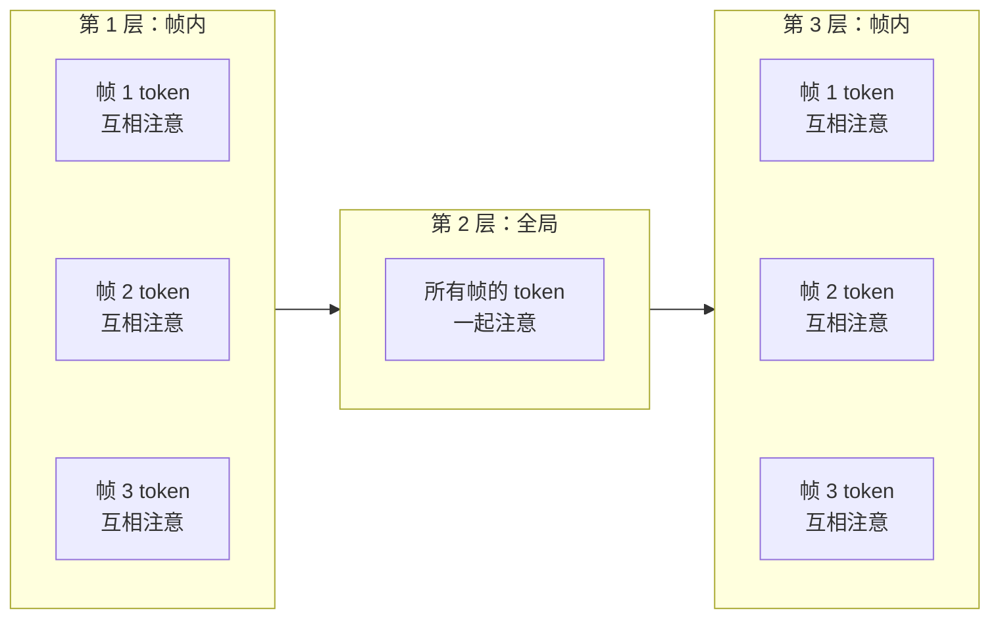

# VGGT：一次前向同时预测相机、深度、点云与轨迹的视觉几何基础模型

> **论文**：VGGT: Visual Geometry Grounded Transformer  
> **作者**：Jianyuan Wang, Minghao Chen, Nikita Karaev, Andrea Vedaldi, Christian Rupprecht, David Novotny  
> **机构**：Visual Geometry Group, University of Oxford / Meta AI  
> **arXiv**：2503.11651（2025 年 3 月）  
> **代码**：https://github.com/facebookresearch/vggt

> **一句话**：喂进 1～几百张照片，**一次前向传播**（< 1 秒）同时输出相机内外参、深度图、全局一致点云和点跟踪特征——精度超过跑十几秒迭代优化的传统管线，而且预训练特征还能直接做下游任务的骨干。

**知识链接**：
- [VGGT 前馈式多视图三维重建（前置知识）](/前置知识/016a_前置知识_VGGT前馈式多视图三维重建) — 本文是这篇前置知识的深度展开，建议先读前置
- [相机模型与针孔投影](/前置知识/014a_前置知识_相机模型与针孔投影) — 相机内参外参的定义
- [对极几何：两视图几何基础](/前置知识/014b_前置知识_对极几何两视图几何基础) — VGGT 替代的经典几何管线
- [Bundle Adjustment 捆绑调整](/前置知识/014e_前置知识_BundleAdjustment捆绑调整) — VGGT 绕开的后优化步骤
- [DINOv2 视觉特征提取器](/前置知识/013b_前置知识_DINOv2视觉特征提取器) — VGGT 的图像 tokenizer
- [CoTracker 点追踪基础模型](/前置知识/019b_前置知识_CoTracker点追踪基础模型) — VGGT 跟踪头的架构来源
- [三维旋转表示：旋转矩阵、四元数与角速度](/前置知识/006a_前置知识_三维旋转表示_旋转矩阵四元数与角速度) — 相机外参的旋转参数化
- [Chamfer 距离：点云形状相似性度量](/前置知识/011b_前置知识_Chamfer距离_点云形状相似性度量) — 点图评测指标

---

## 一、这篇论文解决的核心问题

从一组照片恢复三维场景，传统做法（[COLMAP](/系列/colmap_deep_dive/) 等 SfM 管线）分三步：特征匹配 → 三角化 → [Bundle Adjustment](/前置知识/014e_前置知识_BundleAdjustment捆绑调整)。后两步是迭代优化，十几秒起步，且对初始值敏感。近年 DUSt3R / MASt3R 证明"两张图的三维重建可以一次前向搞定"，但多于两张时又不得不把成对结果拼接对齐——本质上还是 **"网络 + 后处理"** 的混合体。

VGGT 的核心主张：**把多视图三维重建从"几何优化问题"变成"大模型单次推理问题"。** 给任意 $N$ 张图（1 ～ 几百张），一个 12 亿参数的 Transformer 一次前向就同时输出所有几何量，精度超过需要后优化的方法，速度快 50 ～ 100 倍。

### 1.1 VGGT 与前作的关键区别

| 维度 | DUSt3R / MASt3R | VGGSfM v2 | VGGT |
|------|-----------------|-----------|------|
| 处理单位 | 一对图 → 全局对齐拼接 | 端到端可微 SfM | 原生多图一次前向 |
| 输出 | 点图（需对齐才全局一致） | 相机 + 稀疏点云 | 相机 + 深度 + 密集点图 + 跟踪特征 |
| 是否需要后优化 | 需要全局对齐（~7-9 秒） | 需要 BA（~10 秒） | 纯前馈即 SOTA；可选 BA 再涨 |
| 是否支持单图 | 不支持（必须输入一对） | 不支持 | 支持（全局注意力退化为帧内注意力） |
| 速度（10 帧） | ~7-9 秒 | ~10 秒 | **~0.2 秒** |

---

## 二、问题定义：输入、输出与坐标约定

### 2.1 输入与输出

VGGT 是一个函数 $f$：

$$
f\bigl((I_i)_{i=1}^{N}\bigr) = \bigl(\mathbf{g}_i, D_i, P_i, T_i\bigr)_{i=1}^{N}
$$

**这个公式在做什么**：一个 Transformer $f$ 接收 $N$ 张 RGB 图像，对**每一张**同时输出四样东西——相机参数、深度图、点图和跟踪特征。

::: details 📐 公式详解（点击展开）

| 子表达式 | 它是谁 | 它在干嘛 |
|---------|--------|---------|
| $(I_i)_{i=1}^{N}$ | **一组照片** | $N$ 张同一场景的 RGB 图像，$I_i \in \mathbb{R}^{3 \times H \times W}$ |
| $\mathbf{g}_i \in \mathbb{R}^9$ | **相机参数** | 四元数旋转 $\mathbf{q} \in \mathbb{R}^4$ + 平移 $\mathbf{t} \in \mathbb{R}^3$ + 视场角 $\mathbf{f} \in \mathbb{R}^2$，定义这台相机在世界坐标系中的位姿和焦距 |
| $D_i \in \mathbb{R}^{H \times W}$ | **深度图** | 每个像素到相机光心的距离 |
| $P_i \in \mathbb{R}^{3 \times H \times W}$ | **点图** | 每个像素对应的三维场景坐标，在第一台相机坐标系中（viewpoint invariant） |
| $T_i \in \mathbb{R}^{C \times H \times W}$ | **跟踪特征** | 密集特征图，供跟踪模块做跨帧对应 |

**用人话读**："给 N 张照片，网络一次性告诉你每台相机在哪、每个像素多深、每个像素在三维空间哪里、以及用于点跟踪的特征。"

**为什么是这个形式**：把传统 SfM 管线的所有输出（相机位姿、密集深度、三维点云）全部统一成一个 Transformer 的多头输出，端到端学习。
:::

### 2.2 坐标约定

所有输出都定义在**第一台相机 $\mathbf{g}_1$ 的坐标系**中：

- 第一台相机的旋转四元数固定为 $\mathbf{q}_1 = [0,0,0,1]$（单位旋转），平移固定为 $\mathbf{t}_1 = [0,0,0]$
- 其它相机的位姿 $\mathbf{g}_i$ 都是相对于第一台的
- 点图 $P_i$ 中的三维坐标也在第一台相机的坐标系下——这意味着**不同视角看到的同一个物理点，在点图中会落到相同的三维坐标**（viewpoint invariant）

这个约定消除了全局坐标系的歧义，但**绝对尺度**仍然未知（把整个场景等比缩放，照片不变）。VGGT 通过训练数据的归一化学会了一个"规范尺度"——具体做法见第四节。

### 2.3 图像顺序的处理

图像序列的顺序是任意的，**但第一张图被选为参考帧**。网络通过给第一帧的相机 token 和寄存器 token 使用与其它帧**不同的可学习初始化**来区分"谁是参考"。除了参考帧这个特殊地位，网络对其余帧的排列是等变的——打乱 2 ～ $N$ 的顺序不影响输出。

---

## 三、架构：极简设计，靠数据学几何

VGGT 的设计哲学是**尽可能少的三维归纳偏置**：不用 epipolar 采样、不用 cost volume、不用交叉注意力——就是一个标准 Transformer，靠大量三维标注数据学出几何理解。这和 GPT / DINO / CLIP 的思路一脉相承。

### 3.1 图像 tokenization：DINOv2 + 特殊 token

每张图像 $I_i$ 先经预训练的 [DINOv2](/前置知识/013b_前置知识_DINOv2视觉特征提取器)（ViT-L，patch size 14）切成 $K$ 个 patch token $\mathrm{t}^I_i \in \mathbb{R}^{K \times C}$（$C=1024$）。然后给每张图拼上两类额外 token：

- **1 个相机 token** $\mathrm{t}^{\mathbf{g}}_i \in \mathbb{R}^{1 \times C'}$：专门用来"汇聚"并存放这张图的相机信息。
- **4 个寄存器 token** $\mathrm{t}^R_i \in \mathbb{R}^{4 \times C'}$：不承担任何输出，只给网络提供"暂存中间计算"的缓冲区。这个设计来自 DINOv2 论文中对 register token 的发现——它们能吸收 attention sink，避免某些 token 被过度关注。

**关键细节**：第一帧的相机 token 和寄存器 token 使用**独立的可学习向量** $\bar{\mathrm{t}}^{\mathbf{g}}, \bar{\mathrm{t}}^R$，其余帧使用另一组 $\overline{\overline{\mathrm{t}}}^{\mathbf{g}}, \overline{\overline{\mathrm{t}}}^R$。这样网络能从一开始就知道"谁是参考帧"。

**为什么用 DINOv2 而不是 14×14 卷积做 tokenizer？** 论文在 Discussion 中说明：DINOv2 不仅性能更好，而且训练初期更稳定，对学习率和 momentum 等超参数的敏感度更低。

### 3.2 Alternating-Attention：帧内与全局交替

标准 Transformer 让所有 token 互相注意，计算量随帧数平方增长。VGGT 用一个简单但关键的改动：**帧内自注意力与全局自注意力逐层交替**。

> 帧内注意力让每张图的 patch token 与它自己的相机 token、寄存器 token 互相整合，负责"把一张图的信息整理好"；全局注意力让所有帧的 token 一起交互，负责"跨视角匹配和几何推理"。两者共 $L=24$ 层（12 层帧内 + 12 层全局）。

**两个重要细节**：

1. **全程只用自注意力，没有 cross-attention**。论文消融实验（Table 5）表明，cross-attention 变体在 ETH3D 上的 Overall 指标为 1.061，全局自注意力为 0.827，交替注意力进一步降到 **0.709**——交替注意力比纯全局和交叉注意力都好。
2. **帧内注意力的关键作用是归一化**。没有帧内注意力时，每帧的 token 只在"全局大锅"里互相注意，缺少帧内一致性。帧内层让相机 token 能与自己帧的图像 token 充分融合，相当于"先把自己搞清楚，再去和别人对话"。

### 3.3 稳定训练的工程技巧

论文在附录 B 中给出了关键的训练稳定性技巧：

- **QKNorm**：对 Query 和 Key 做归一化，防止注意力分数爆炸
- **LayerScale**：每个注意力层的输出乘以一个初始值为 0.01 的可学习标量，确保残差连接在训练初期接近恒等映射
- **DPT 特征提取层**：从第 4、11、17、23 层抽取中间特征送入 DPT 头，而不是只用最后一层——这和 DINOv2 的多尺度特征抽取思路一致

---

## 四、三个预测头：从 token 到几何量

### 4.1 相机头：从 1 个 token 回归 9 维参数

输出的相机 token $\hat{\mathrm{t}}^{\mathbf{g}}_i$ 经过**额外 4 层自注意力**（所有帧的相机 token 一起注意）和一个线性层，回归出 9 维向量 $\mathbf{g}_i = [\mathbf{q}, \mathbf{t}, \mathbf{f}]$：

| 分量 | 维度 | 含义 |
|------|------|------|
| [四元数](/前置知识/006a_前置知识_三维旋转表示_旋转矩阵四元数与角速度) $\mathbf{q}$ | 4 | 相机在世界系中的朝向 |
| 平移 $\mathbf{t}$ | 3 | 相机在世界系中的位置 |
| 视场角 $\mathbf{f}$ | 2 | 水平和垂直方向的 Field of View（FoV），等价于焦距 |

主点（principal point）固定在图像中心，不单独预测——这和大多数 SfM 框架一致，简化了输出空间。

**为什么给相机头额外 4 层注意力？** 相机参数是一个全局量（每张图一个 9 维向量），比深度图和点图的"空间密度"低得多。仅靠主干 24 层学到的 1 个相机 token 难以承载足够精确的位姿信息，额外 4 层让所有帧的相机 token 再做一轮专门的相互推理——类似于"讨论会"，大家先各自准备（主干），然后坐在一起对齐结论（额外 4 层）。这 4 层只处理 $N$ 个 token（帧数量），计算量极小。

### 4.2 DPT 密集头：深度、点图和跟踪特征

主干输出的图像 token $\hat{\mathrm{t}}^I_i$ 先经一个 [DPT](https://arxiv.org/abs/2103.13413) 模块上采样到密集特征图 $\mathbf{F}_i \in \mathbb{R}^{C'' \times H \times W}$，然后用 $3\times3$ 卷积分别映射为：

- **深度图** $\hat{D}_i \in \mathbb{R}^{H \times W}$ 和**深度不确定性** $\hat{\Sigma}^D_i \in \mathbb{R}^{H \times W}$
- **点图** $\hat{P}_i \in \mathbb{R}^{3 \times H \times W}$ 和**点图不确定性** $\hat{\Sigma}^P_i \in \mathbb{R}^{H \times W}$
- **跟踪特征** $T_i \in \mathbb{R}^{C \times H \times W}$

不确定性图的作用是让网络学会"哪些像素的预测靠谱"——在损失函数中充当置信度权重（见第五节）。

### 4.3 跟踪头：借用 CoTracker2 的架构

跟踪头不是直接从 DPT 特征回归对应点，而是用一个独立的跟踪模块 $\mathcal{T}$，架构借鉴 [CoTracker2](/前置知识/019b_前置知识_CoTracker点追踪基础模型)：

1. 给定查询图 $I_q$ 中的查询点 $\mathbf{y}_q$，在 $T_q$ 上双线性插值取出查询特征
2. 将查询特征与所有帧的 $T_i$（$i \neq q$）做相关，得到相关图
3. 相关图经自注意力层处理，输出各帧中的对应 2D 位置 $\hat{\mathbf{y}}_i$

训练时查询图固定为第一帧（$q=1$），推理时任意帧都可以做查询。关键区别：VGGT 的跟踪器**不假设时间顺序**，适用于无序图像集合，不只是视频。

---

## 五、Over-complete Predictions：为什么预测冗余量反而更好

这是 VGGT 最反直觉但最重要的设计决策。

### 5.1 三种输出之间的闭式关系

相机参数 $\mathbf{g}_i$、深度图 $D_i$、点图 $P_i$ 之间**不是独立的**：

- 知道深度图 $D_i$ 和相机参数 $\mathbf{g}_i$，可以用反投影公式直接算出点图 $P_i$
- 知道点图 $P_i$，可以用 PnP（Perspective-n-Point）解出相机参数 $\mathbf{g}_i$
- 知道点图 $P_i$ 和相机参数 $\mathbf{g}_i$，可以推出深度图 $D_i$

既然它们互相蕴含，为什么还要全都预测？

### 5.2 训练时：多任务互相监督提升表示质量

论文消融实验（Table 6）给出了决定性证据——在 ETH3D 点图估计任务上：

| 训练配置 | Acc. ↓ | Comp. ↓ | Overall ↓ |
|---------|--------|---------|-----------|
| 不训相机头 | 1.042 | 0.627 | 0.834 |
| 不训深度头 | 0.920 | 0.534 | 0.727 |
| 不训跟踪头 | 0.976 | 0.603 | 0.790 |
| **全部训** | **0.901** | **0.518** | **0.709** |

注意：即使最终只看**点图**精度，把看似"冗余"的相机头和跟踪头一起训，也会让点图更准。原因是多任务损失迫使共享主干学到更丰富的几何表征——相机头让主干"理解全局位姿关系"，跟踪头让主干"理解逐点对应"，这些理解反过来帮助点图预测。

### 5.3 推理时：分解路径比直接预测更准

这里有一个看似矛盾的结论——训练时要同时预测所有量，但推理时**不直接用点图头的输出**，而是用"深度图 + 相机参数 → 反投影"得到的三维点。Table 3 的数据：

| 推理路径 | Acc. ↓ | Comp. ↓ | Overall ↓ |
|---------|--------|---------|-----------|
| 直接用点图头（Ours Point） | 0.901 | 0.518 | 0.709 |
| 深度 + 相机反投影（Ours Depth+Cam） | **0.873** | **0.482** | **0.677** |

深度 + 相机的组合比直接点图更好。为什么？因为点图要求每个像素直接回归三维坐标——这是一个**高维、全局一致**的任务，一个像素的误差会牵连相邻像素。而深度图只需要每个像素给一个标量（距相机的距离），相机参数只需要 9 个数——**把一个难任务拆成两个简单子任务，分别做准了再组装**。

**VGGT 的推理最佳实践**：用深度头和相机头的输出做反投影得到点云，点图头的输出只用于"规范空间点云"等特殊场景（比如 [RecGen3D](/论文综述/163_RecGen3D_重建引导规范空间三维生成) 的 branch repurposing）。

---

## 六、训练：损失函数与数据

### 6.1 多任务损失

VGGT 的总损失是四项之和：

$$
\mathcal{L} = \mathcal{L}_{\text{camera}} + \mathcal{L}_{\text{depth}} + \mathcal{L}_{\text{pmap}} + \lambda\,\mathcal{L}_{\text{track}}
$$

**这个公式在做什么**：同时监督相机、深度、点图和跟踪四个任务，其中前三项量级相近不加权，跟踪项用 $\lambda=0.05$ 降权（因为跟踪是辅助任务）。

::: details 📐 公式详解（点击展开）

| 子表达式 | 它是谁 | 它在干嘛 |
|---------|--------|---------|
| $\mathcal{L}_{\text{camera}}$ | **相机损失** | Huber 损失比较预测与真值相机参数 |
| $\mathcal{L}_{\text{depth}}$ | **深度损失** | 不确定性加权的深度误差 + 深度梯度差异 |
| $\mathcal{L}_{\text{pmap}}$ | **点图损失** | 结构与深度损失相同，但作用在逐像素三维坐标上 |
| $\lambda\,\mathcal{L}_{\text{track}}$ | **跟踪损失** | 对应点的 L2 距离 + 可见性的二分类交叉熵 |
| $\lambda = 0.05$ | **降权因子** | 跟踪任务的梯度信号不应喧宾夺主 |

**用人话读**："让网络学四件事：相机在哪、像素多深、像素对应的三维点在哪、一个点在其它图里落到哪。各项损失一起优化同一个共享骨干。"

**为什么跟踪权重很小**：跟踪的真值是通过深度反投影+重投影的方式**间接构造的**（不是人工标注），信噪比低于其它三项；而且跟踪任务本身对主干的几何理解帮助有限（消融实验中去掉跟踪项只使 Overall 从 0.709 升到 0.790），所以降权。
:::

### 6.2 深度损失的具体形式

深度损失是 VGGT 训练策略中最精心设计的部分，值得展开：

$$
\mathcal{L}_{\text{depth}} = \sum_{i=1}^{N} \bigl\lVert \hat{\Sigma}^D_i \odot (\hat{D}_i - D_i) \bigr\rVert + \bigl\lVert \hat{\Sigma}^D_i \odot (\nabla\hat{D}_i - \nabla D_i) \bigr\rVert - \alpha \log \hat{\Sigma}^D_i
$$

**这个公式在做什么**：比较预测深度 $\hat{D}_i$ 和真值深度 $D_i$ 的差异，但不是粗暴地算像素差——用网络自己预测的不确定性 $\hat{\Sigma}^D_i$ 做加权，外加一个梯度差异项来保住边缘锐度。

::: details 📐 公式详解（点击展开）

| 子表达式 | 它是谁 | 它在干嘛 |
|---------|--------|---------|
| $\hat{\Sigma}^D_i \odot (\hat{D}_i - D_i)$ | **不确定性加权的像素差** | 网络觉得"没把握"的像素（$\hat{\Sigma}^D_i$ 大），误差被放大；反之被缩小——逼网络诚实地报告自己哪里不确定 |
| $\hat{\Sigma}^D_i \odot (\nabla\hat{D}_i - \nabla D_i)$ | **梯度差异项** | 比较深度图的空间梯度——在物体边缘处深度应该有跳变，不应该被"糊"过去 |
| $-\alpha \log \hat{\Sigma}^D_i$ | **不确定性正则项** | 防止网络把所有不确定性都设成无穷大来"作弊"（把所有误差乘以 0），这项让不确定性不能无限制地增大 |
| $\odot$ | **逐元素相乘** | channel-broadcast element-wise product |

**用人话读**："算预测深度和真值的差距时，让网络自己说哪些像素它没把握，没把握的地方可以宽容一些但不能永远回避；另外额外惩罚深度边缘被糊掉的情况。"

**为什么要加梯度差异项**：纯像素差在大面积均匀区域（白墙、天空）几乎没有梯度信号，网络学到"糊成一片也不亏"。梯度项强制网络在物体边界处保留深度跳变——这对下游的点云质量至关重要，因为模糊的边缘会产生"飞点"。
:::

点图损失 $\mathcal{L}_{\text{pmap}}$ 与深度损失结构完全相同，只是把标量 $D_i$ 换成三维向量 $P_i$，不确定性用 $\hat{\Sigma}^P_i$。

### 6.3 坐标归一化：消除绝对尺度歧义

一组照片的**绝对尺度无法确定**——把场景缩放 2 倍，所有照片完全一样。VGGT 的归一化策略：

1. 所有三维量定义在第一台相机 $\mathbf{g}_1$ 的坐标系中
2. 计算所有真值三维点到原点的平均欧氏距离作为尺度因子
3. 用这个尺度因子归一化相机平移 $\mathbf{t}$、点图 $P$ 和深度 $D$

**与 DUSt3R 的关键区别**：DUSt3R 在推理时也做归一化（后处理），而 VGGT **只在训练数据上归一化，推理时让网络自己学会输出归一化后的结果**。归一化变成了模型内化的能力而非外挂的预处理——更简洁，也更有利于网络学到尺度感。

### 6.4 训练配置

| 配置项 | 值 |
|--------|------|
| 主干层数 | 24 层（12 帧内 + 12 全局） |
| 总参数量 | ~12 亿 |
| 隐层维度 | 1024，16 头 |
| 优化器 | AdamW，cosine schedule |
| 峰值学习率 | 0.0002，warmup 8K 步 |
| 总训练步数 | 160K |
| 每批帧数 | 2～24 帧（随机采样），总 48 帧/batch |
| 图像分辨率 | 最长边 518 像素 |
| 长宽比 | 0.33 ～ 1.0 之间随机 |
| 数据增强 | 颜色抖动、高斯模糊、灰度化 |
| 硬件 | 64 × A100 GPU，训练 9 天 |
| 精度 | bfloat16 + 梯度检查点 |
| 梯度裁剪 | gradient norm clipping，阈值 1.0 |

### 6.5 训练数据

VGGT 使用了**十几个数据集**的混合，覆盖室内、室外、合成和真实场景：

| 数据集 | 场景类型 | 三维标注来源 |
|--------|---------|-------------|
| Co3Dv2 | 日常物体多视图 | 直接传感器 |
| BlendMVS | 大规模多视图 | 合成引擎 |
| DL3DV | 大规模室外 | SfM |
| MegaDepth | 旅游照片 | SfM |
| Kubric | 合成动画 | 渲染引擎 |
| WildRGB | 野外 RGB | 传感器 |
| ScanNet | 室内扫描 | 深度传感器 |
| HyperSim | 合成室内 | 渲染引擎 |
| Replica | 合成室内 | 渲染引擎 |
| Mapillary | 街景 | SfM |
| Habitat | 合成室内 | 渲染引擎 |
| MVS-Synth | 合成多视图 | 渲染引擎 |
| PointOdyssey | 合成运动 | 渲染引擎 |
| Virtual KITTI | 合成驾驶 | 渲染引擎 |
| Aria | AR 眼镜 | 直接传感器 |
| Objaverse | 三维物体 | 渲染引擎 |

数据规模与 MASt3R 相当，但 VGGT 强调**多样性**——合成与真实混合，室内室外混合——这是它泛化能力的关键来源。

**跟踪真值的构造**：跟踪标注不是人工标注的，而是通过"深度反投影 → 3D → 重投影到目标帧"的方式自动生成——从深度图和相机参数反推哪些点在哪些帧中可见，以及它们的 2D 位置。与查询帧相似度太低的帧在采样时被排除，没有有效对应关系的极端情况下跟踪损失被省略。

---

## 七、实验：在四大任务上全面 SOTA

### 7.1 相机位姿估计

**数据集**：RealEstate10K（Re10K）和 CO3Dv2，每场景 10 帧，用 AUC@30 评测。

| 方法 | 类型 | Re10K AUC@30 ↑ | CO3Dv2 AUC@30 ↑ | 时间 |
|------|------|----------------|-----------------|------|
| COLMAP+SPSG | 传统 SfM | 45.2 | 25.3 | ~15s |
| PixSfM | 传统 SfM | 49.4 | 30.1 | >20s |
| DUSt3R | 前馈 + 全局对齐 | 67.7 | 76.7 | ~7s |
| MASt3R | 前馈 + 全局对齐 | 76.4 | 81.8 | ~9s |
| VGGSfM v2 | 可微 SfM | 78.9 | 83.4 | ~10s |
| Fast3R | 前馈 | 72.7 | 82.5 | ~0.2s |
| **VGGT（前馈）** | **前馈** | **85.3** | **88.2** | **~0.2s** |
| **VGGT + BA** | **前馈 + BA** | **93.5** | **91.8** | **~1.8s** |

两个关键观察：

1. **纯前馈的 VGGT 已经超过所有需要后优化的方法**——在 Re10K 上比 VGGSfM v2 高 6.4 分，速度快 50 倍
2. **叠加 BA 再涨约 3-8 分**，但此时 BA 快得多——因为 VGGT 直接给出了接近真值的初始化，BA 不需要从三角化开始，只需要做微调

### 7.2 多视图深度估计

**数据集**：DTU，标准 Accuracy / Completeness / Overall 指标（越低越好）。

| 方法 | 是否需要相机 | Acc. ↓ | Comp. ↓ | Overall ↓ | 时间 |
|------|-------------|--------|---------|-----------|------|
| DUSt3R | 否 | 1.167 | 0.842 | 1.005 | ~7s |
| MASt3R | 否 | 0.968 | 0.684 | 0.826 | ~9s |
| VGGT（点图） | 否 | 0.901 | 0.518 | 0.709 | ~0.2s |
| **VGGT（深度+相机）** | **否** | **0.873** | **0.482** | **0.677** | **~0.2s** |

VGGT 在不知道相机的情况下，接近甚至超过一些需要已知相机的方法（如 GeoMVSNet 的 Overall 0.295 需要已知相机）。

### 7.3 点图估计

**数据集**：ETH3D，用 [Chamfer 距离](/前置知识/011b_前置知识_Chamfer距离_点云形状相似性度量) 评测。

VGGT 在前馈模式下的 Overall（0.677）比 DUSt3R 做完全局对齐后的 Overall（1.741）低了一半多，且速度快 35 倍。前面已详细分析了"深度 + 相机"组合优于直接点图输出的原因。

### 7.4 两视图匹配

**数据集**：ScanNet-1500，用 AUC 评测。

| 方法 | AUC@5 ↑ | AUC@10 ↑ | AUC@20 ↑ |
|------|---------|----------|----------|
| SuperGlue | 16.2 | 33.8 | 51.8 |
| LoFTR | 22.1 | 40.8 | 57.6 |
| Roma | 31.8 | 53.4 | 70.9 |
| **VGGT** | **33.9** | **55.2** | **73.4** |

VGGT 的跟踪头**并不是专门为两视图匹配设计的**，但依然在 ScanNet-1500 上超过了专用的匹配方法 Roma——这体现了 VGGT 学到的几何特征的通用性。

### 7.5 IMC 相机位姿估计

在 Image Matching Challenge（IMC）这个传统 SfM 方法的主场上，VGGT 也表现出色：

| 方法 | 需要后优化 | AUC@10 ↑ | 时间 |
|------|---------|----------|------|
| COLMAP (SIFT+NN) | 是 | 44.79 | >10s |
| VGGSfM v2 | 是 | 76.82 | ~10s |
| **VGGT（前馈）** | **否** | **71.26** | **0.2s** |
| **VGGT + BA** | **是** | **84.91** | **1.8s** |

前馈 VGGT 在 AUC@10 上（71.26）已经接近 VGGSfM v2（76.82），而叠加 BA 后（84.91）则大幅超过。

---

## 八、消融实验：每个设计决策的量化证据

### 8.1 Alternating-Attention vs 其它注意力架构

在 ETH3D 点图估计上：

| 注意力类型 | Acc. ↓ | Comp. ↓ | Overall ↓ |
|-----------|--------|---------|-----------|
| Cross-Attention | 1.287 | 0.835 | 1.061 |
| 全局自注意力 | 1.032 | 0.621 | 0.827 |
| **交替注意力** | **0.901** | **0.518** | **0.709** |

所有变体使用相同的 $2L$ 层总深度。交替注意力比全局自注意力好 14%，比交叉注意力好 33%。论文还指出，其它探索性实验也一致表明交叉注意力劣于自注意力——可能是因为交叉注意力强制分离了"查询来源"和"被查询来源"，限制了信息流动的灵活性。

### 8.2 多任务训练的收益

消融"不训某个头"对点图估计的影响（ETH3D）：

| 去掉哪个头 | Acc. ↓ | Comp. ↓ | Overall ↓ | 相对全训的退化 |
|-----------|--------|---------|-----------|------------|
| 去掉相机头 | 1.042 | 0.627 | 0.834 | +17.6% |
| 去掉跟踪头 | 0.976 | 0.603 | 0.790 | +11.4% |
| 去掉深度头 | 0.920 | 0.534 | 0.727 | +2.5% |
| **全部训** | **0.901** | **0.518** | **0.709** | — |

**相机头的监督信号最关键**——即使你不需要相机参数，训相机头也会让点图更准。深度头的监督贡献最小，但依然是正的。这证明了 over-complete predictions 的价值不只是"多一个输出"，而是"多一路梯度信号流经共享主干"。

---

## 九、下游任务微调：VGGT 作为几何骨干

### 9.1 前馈新视角合成

VGGT 的特征可以直接用于新视角合成（Novel View Synthesis, NVS），方法是在 VGGT 的 AA Transformer 上做简单修改：

- 输入帧照常被 DINO tokenize
- **目标视角**用 Plücker 射线编码后做一个卷积变成 token
- 输入帧和目标帧的 token 一起送入 AA Transformer
- DPT 头输出目标视角的 RGB 图像

关键约束：**不给输入帧的相机参数**——网络必须从图像本身推断几何关系。即便如此，在 GSO 数据集上，VGGT 仅用 20% 训练集就达到了 PSNR 30.41 / SSIM 0.949 / LPIPS 0.033，与 LVSM 等专用方法相当。

### 9.2 动态点跟踪

将预训练 VGGT 的骨干（替换 CoTracker 的特征提取器）接入 CoTracker2 的跟踪头，在 TAP-Vid 上：

| 方法 | TAP-Vid Kinetics $\delta^{\text{vis}}_{\text{avg}}$ ↑ | RGB-S $\delta^{\text{vis}}_{\text{avg}}$ ↑ | DAVIS OA ↑ |
|------|------|------|------|
| CoTracker（原始骨干） | 64.3 | 67.4 | 88.3 |
| **CoTracker + VGGT 骨干** | **69.0** | **72.1** | **91.4** |
| BootsTAPIR | 68.4 | 86.5 | 88.7 |

VGGT 的几何特征让 CoTracker 在所有指标上都有明显提升（Kinetics 上 +4.7），证明 VGGT 学到的不只是"三维重建的答案"，还有"通用的几何表征"——和 DINOv2 之于视觉分类、CLIP 之于多模态是同一种模式。

---

## 十、运行时性能与内存

| 输入帧数 | 1 | 2 | 4 | 8 | 10 | 20 | 50 | 100 | 200 |
|---------|---|---|---|---|----|----|----|----|-----|
| 时间（秒） | 0.04 | 0.05 | 0.07 | 0.11 | 0.14 | 0.31 | 1.04 | 3.12 | 8.75 |
| 显存（GB） | 1.88 | 2.07 | 2.45 | 3.23 | 3.63 | 5.58 | 11.41 | 21.15 | 40.63 |

以上在单张 H100 GPU 上测量，图像分辨率 336 × 518，使用 flash attention v3。

- **骨干推理**占约 95% 的时间和 98% 的显存——相机头只占 ~5% 时间和 ~2% 显存，DPT 头约 0.03 秒/帧和 0.2 GB/帧
- 帧数 ≤ 20 时显存在 6 GB 以内，消费级 GPU 可用
- 全局注意力的内存随帧数平方增长——200 帧需要 40 GB。论文建议大帧数场景可以用 LLM 推理中的张量并行或 Fast3R 的多 GPU 推理来加速

**逐帧模式的选项**：当显存不够时，用户可以只跑骨干的帧内注意力（不跑全局注意力），让 DPT 头逐帧输出——但这样跨帧一致性会下降。

---

## 十一、局限与未来方向

### 11.1 当前局限

| 局限 | 说明 |
|------|------|
| 不支持鱼眼 / 全景图 | 训练数据全是针孔相机，主点固定在图像中心 |
| 极端旋转时性能下降 | 两帧之间旋转角度很大时，重建质量明显退化 |
| 不支持大形变 | 能处理轻微非刚体运动，但柔性物体（如布料）的重建会失败 |
| 全局注意力内存限制 | 200 帧以上需要 40+ GB 显存 |

### 11.2 论文讨论的未来方向

1. **可微 BA（Differentiable BA）**：论文做了小规模实验，发现训练时接入可微 BA 效果不错但计算量增加 4 倍，暂时放弃。但这是一个有潜力的方向——用 BA 作为训练时的辅助监督信号（而非后处理）。
2. **归一化预测（Normalizing Prediction）**：与 DUSt3R 的推理时归一化相比，VGGT 选择让网络自己学归一化。论文发现推理时做归一化对最终性能既不帮忙也不添乱，但会引入训练不稳定性——证实了"内化"方案的优越性。
3. **单视图重建**：VGGT 天然支持单张图输入（全局注意力退化为帧内注意力），虽然没有专门为此训练，但已经展现了比 DUSt3R（需要复制图像凑一对）更自然的单图重建能力。

---

## 十二、总结与记忆锚点

### 核心贡献对比表

| 维度 | 传统 SfM 管线 | DUSt3R / MASt3R | VGGT |
|------|-------------|-----------------|------|
| 处理模式 | 匹配→三角化→BA | 成对前馈→全局对齐 | **原生多图前馈** |
| 是否需要优化 | 必须 | 需要全局对齐 | 不需要（可选 BA 提升） |
| 输出内容 | 相机+稀疏点云 | 成对点图 | **相机+深度+密集点图+跟踪** |
| 速度（10 帧） | ~15 秒 | ~7-9 秒 | **~0.2 秒** |
| 单图支持 | 不支持 | 不支持 | 支持 |
| 作为骨干的泛化性 | 不适用 | 有限 | **显著提升下游任务** |

### 记忆锚点

1. **一次前向搞定所有几何**：VGGT 把三维重建从"优化问题"变成"预测问题"，12 亿参数 Transformer 一次前向输出相机 + 深度 + 点云 + 跟踪特征
2. **交替注意力**：帧内 ↔ 全局自注意力逐层交替，比全局自注意力好 14%，比交叉注意力好 33%
3. **冗余预测提升每一项**：训练时同时预测相机、深度、点图（虽然它们互相蕴含），让共享骨干学到更好的几何表示；推理时用"深度+相机→反投影"比直接用点图头更准
4. **几何基础模型**：VGGT 的预训练特征能显著提升下游任务（点跟踪 +4.7、新视角合成可竞争专用方法），是"视觉几何的 DINOv2"

---

## 延伸阅读

- [VGGT 前馈式多视图三维重建（前置知识）](/前置知识/016a_前置知识_VGGT前馈式多视图三维重建) — 本文的前置入门版
- [RecGen3D 精读](/论文综述/163_RecGen3D_重建引导规范空间三维生成) — 把 VGGT 的规范点云接到 3D 扩散生成上
- [多视角物体重建与融合综述](/论文综述/S35_多视角物体重建与融合综述) — VGGT 在多视角重建谱系中的位置
- [COLMAP 深度解析系列](/系列/colmap_deep_dive/) — VGGT 替代的经典管线的完整解析
- [Depth Anything 3 深度解析](/系列/da3_deep_dive/01_深度估计的困境与DA3的答案) — 另一条"几何基础模型"路线：从单目深度出发
- [DINOv2 视觉特征提取器](/前置知识/013b_前置知识_DINOv2视觉特征提取器) — VGGT 的图像 tokenizer
- [CoTracker 点追踪基础模型](/前置知识/019b_前置知识_CoTracker点追踪基础模型) — VGGT 跟踪头的架构来源
