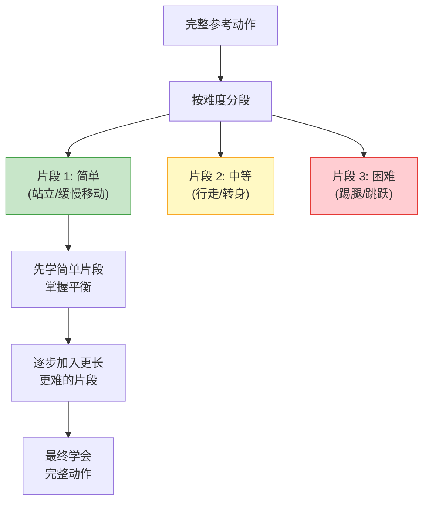
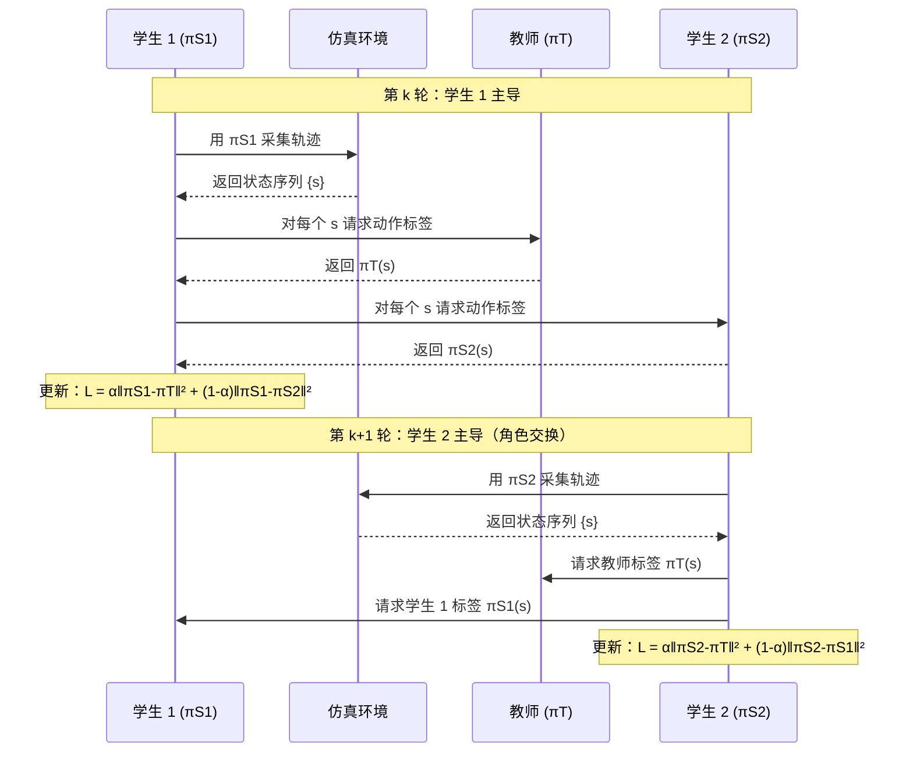

# SuperMimic：从单个互联网视频生成人形机器人全身动作

> **论文**：SuperMimic: Generating Humanoid Robot Motions from Single Internet Video  
> **作者**：Luca Scimeca\*, Giada Galasso\*, Kehan Wen, Zhenjia Xu, Byron Boots, Shuran Song  
> **机构**：University of Washington / Columbia University  
> **arXiv**：2506.06910（2025 年 6 月）  
> **代码**：https://github.com/UWRobotLearning/SuperMimic  
> **项目页**：https://supermimic.github.io

> **一句话**：给一段网上随便找的人体动作视频，SuperMimic 自动把它变成人形机器人能在真实世界执行的全身运动——涵盖走路、跑步、跳舞、踢腿、挥手、健身操等 50+ 种动作。

**知识链接**：
- [正运动学与 DH 参数](/前置知识/003a_前置知识_正运动学与DH参数) — 重定向阶段的正运动学 FK 计算
- [三维旋转表示：旋转矩阵、四元数与角速度](/前置知识/006a_前置知识_三维旋转表示_旋转矩阵四元数与角速度) — SMPL 和机器人关节的旋转参数化
- [刚体动力学：牛顿-欧拉方程与惯性张量](/前置知识/006b_前置知识_刚体动力学_牛顿欧拉方程与惯性张量) — 人形机器人的动力学约束
- [物理仿真引擎：时间积分与接触模型](/前置知识/006c_前置知识_物理仿真引擎_时间积分与接触模型) — Isaac Lab 仿真基础
- [Sim-Real 联合强化学习综述](/论文综述/S32_仿真增强真机的Sim_Real联合强化学习综述) — Sim-to-Real 迁移的技术背景

---

## 一、这篇论文解决的核心问题

人形机器人要在人类环境中工作，首先得会做各种全身动作——走路、跑步、转身、跳舞、挥手。**动作数据从哪来？** 传统方法依赖专业动捕（Motion Capture）系统，设备昂贵、场景受限。互联网上有海量的人体运动视频，如果能把这些视频直接"翻译"成机器人可执行的动作，就打通了一条低成本、高多样性的技能获取通道。

但从视频到真实机器人运动，需要跨越三道鸿沟：

| 鸿沟 | 核心困难 | SuperMimic 的解法 |
|------|---------|------------------|
| **视频 → 人体动作** | 单目视频无深度，遮挡严重 | 用 TRAM 从单目视频估计 SMPL 全身参数 |
| **人体动作 → 机器人动作** | 人和机器人关节数不同、运动范围不同 | 基于优化的运动重定向（IK 求解 + 正则化） |
| **仿真动作 → 真机动作** | Sim-to-Real gap：传感器噪声、动力学差异 | 课程 RL + DualDAgger 双学生策略蒸馏 |

### 1.1 与已有工作的关键区别

DeepMimic（2018）开创了用 RL 模仿参考动作的范式，但它依赖 MoCap 数据，且只在仿真角色上运行。后续的 humanoid motion imitation 工作大多需要专用动捕设备或精确的运动学模型。SuperMimic 的贡献在于把**整条管线都打通了**：从互联网视频（无任何标注）到真实机器人全身动作部署，全自动、端到端。

---

## 二、系统全局：三阶段管线

*三阶段管线：互联网视频 → 运动重定向 → 课程 RL 训练 → DualDAgger 蒸馏 → 真机部署。每个阶段解决一道从视频到真实机器人的鸿沟。*

---

## 三、阶段 1——运动重定向：从人体视频到机器人关节轨迹

### 3.1 人体运动估计（视频 → SMPL）

SuperMimic 使用 TRAM（2024）从单目视频估计人体运动。TRAM 的输出是每帧的 SMPL 参数：

- **全局平移** $\mathbf{t} \in \mathbb{R}^3$：人体在世界坐标系中的位置
- **全局朝向** $\mathbf{R}_0$：骨盆的旋转
- **身体姿态** $\boldsymbol{\theta} \in \mathbb{R}^{23 \times 3}$：23 个关节的轴角旋转

SMPL 有 24 个关节组成树状骨架。通过正运动学，从根关节（骨盆）逐关节累乘旋转矩阵，可以算出每个关节在世界坐标系中的三维位置。

### 3.2 重定向优化（SMPL → 机器人关节）

SMPL 有 24 个关节、72 个自由度，而 Unitree H1 只有 19 个驱动关节（每条腿 5 个、每条手臂 4 个、腰部 1 个）。两者的骨骼比例、关节活动范围也不同。重定向要做的是：**找一组机器人关节角度，使机器人端点（手、脚、头）尽量贴合 SMPL 对应位置。**

对每一帧，求解优化问题：

$$
\min_{\mathbf{q}} \;\sum_{i} w_i \bigl\| \mathrm{FK}_{\text{robot}}(\mathbf{q}, i) - \mathbf{p}_{\text{SMPL}}(i) \bigr\|^2 + \lambda_{\text{ref}} \|\mathbf{q} - \mathbf{q}_{\text{ref}}\|^2 + \lambda_{\text{smooth}} \|\mathbf{q} - \mathbf{q}_{\text{prev}}\|^2
$$

$$
\text{s.t.} \quad \mathbf{q}_{\min} \le \mathbf{q} \le \mathbf{q}_{\max}
$$

**这个公式在做什么**：在机器人关节限位内，找一组关节角度 $\mathbf{q}$，同时满足三个目标——（1）机器人各关键点位置贴合 SMPL 目标位置，（2）关节角度不要偏离默认站立姿态太远，（3）相邻帧之间关节角度变化平滑。

::: details 📐 公式设计剖析（点击展开）

| 项 | 公式 | 作用 | 去掉会怎样？ |
|----|------|------|-------------|
| **位置匹配** | $\sum_i w_i \lVert \mathrm{FK}(\mathbf{q},i) - \mathbf{p}_{\text{SMPL}}(i) \rVert^2$ | 核心目标：让机器人端点对齐 SMPL 关节 | 没有目标函数，优化无意义 |
| **姿态正则** | $\lambda_{\text{ref}} \lVert \mathbf{q} - \mathbf{q}_{\text{ref}} \rVert^2$ | 拉向默认站立姿态，避免不自然的怪异姿势 | 机器人可能采用反关节等物理上不稳定的姿态 |
| **时序平滑** | $\lambda_{\text{smooth}} \lVert \mathbf{q} - \mathbf{q}_{\text{prev}} \rVert^2$ | 相邻帧连续，避免关节角跳变 | 轨迹抖动，PD 控制器跟踪困难 |
| **关节限位** | $\mathbf{q}_{\min} \le \mathbf{q} \le \mathbf{q}_{\max}$ | 硬约束：关节角不超出机器人物理范围 | 产生不可执行的关节角度 |

**FK 是什么**：$\mathrm{FK}_{\text{robot}}(\mathbf{q}, i)$ 即正运动学（Forward Kinematics），给定关节角度 $\mathbf{q}$，计算机器人第 $i$ 个关键点在世界坐标系中的三维位置。

**为什么用 $w_i$ 加权**：不同关键点的重要性不同。脚的位置匹配直接影响平衡（权重高），而手指末端可以容忍更大误差（权重低）。
:::

### 3.3 后处理

优化完成后，还需两步后处理：

1. **低通滤波**：去除关节轨迹中的高频抖动（来自 TRAM 估计噪声）
2. **根部高度校正**：调整骨盆高度轨迹，确保站立和行走时脚底与地面保持接触

---

## 四、阶段 2——课程强化学习：从易到难学习全身运动

### 4.1 状态、动作与控制频率

| 要素 | 具体内容 |
|------|---------|
| **观测（状态）** | 投影重力向量（3D）、关节角度（19D）、关节角速度（19D）、未来 K 步参考动作、相位变量 |
| **动作** | 目标关节角度（19D），经 PD 控制器转换为力矩 |
| **控制频率** | 策略 50 Hz，仿真 200 Hz（每步策略输出后仿真跑 4 步） |
| **并行环境** | Isaac Lab，4096 个并行仿真环境 |

**相位变量**是一个标量 $\phi \in [0, 1]$，指示当前执行到参考动作的哪个位置。策略不仅看当前关节状态，还看"接下来要做什么"（未来 K 步参考），这让它能提前规划。

### 4.2 奖励函数

$$
r = w_{\text{track}} \cdot r_{\text{track}} + w_{\text{vel}} \cdot r_{\text{vel}} + w_{\text{root}} \cdot r_{\text{root}} + w_{\text{contact}} \cdot r_{\text{contact}} + w_{\text{reg}} \cdot r_{\text{reg}}
$$

每一项都用指数衰减的形式，让"差一点点"和"差很多"有明确的数值区分：

| 奖励项 | 公式 | 物理含义 |
|--------|------|---------|
| 关节跟踪 | $r_{\text{track}} = \exp\!\bigl(-\alpha \sum_j \lVert q_j - q_j^{\text{ref}} \rVert^2\bigr)$ | 关节角度贴合参考 |
| 速度跟踪 | $r_{\text{vel}} = \exp\!\bigl(-\beta \sum_j \lVert \dot{q}_j - \dot{q}_j^{\text{ref}} \rVert^2\bigr)$ | 关节速度也要对 |
| 根部跟踪 | $r_{\text{root}} = \exp\!\bigl(-\gamma (\lVert \mathbf{p} - \mathbf{p}^{\text{ref}} \rVert^2 + \lVert \boldsymbol{\omega} - \boldsymbol{\omega}^{\text{ref}} \rVert^2)\bigr)$ | 骨盆位置和朝向 |
| 脚底接触 | $r_{\text{contact}}$ | 鼓励正确的脚地接触模式 |
| 正则化 | $r_{\text{reg}}$ | 惩罚过大力矩、加速度和动作幅度 |

**为什么用 $\exp(-\cdot)$ 而不是线性惩罚？** 指数形式在误差小时梯度也小（"差不多就行"），误差大时快速衰减到零（"完全不对就别挣扎了"），比线性惩罚更稳定，也是 DeepMimic 以来运动模仿 RL 的标准做法。

### 4.3 课程策略：为什么不能直接学？

复杂动作（如武术踢腿、动态舞蹈）需要先站稳再迈步，先迈步再发力。如果一上来就让策略模仿完整动作，它连站都站不稳就被终止了，奖励信号极其稀疏，学不出来。

SuperMimic 的课程策略：

**难度度量**：与默认站立姿态的偏差 + 是否有单脚支撑阶段。偏差越大、单脚支撑越多 = 越难。

**消融实验证实了课程的必要性**：

| 训练方式 | 成功率 | 平均跟踪误差 (rad) |
|---------|-------|-------------------|
| 无课程（直接学） | 45% | 0.142 |
| 随机片段（无难度排序） | 62% | 0.118 |
| **难度课程（SuperMimic）** | **89%** | **0.087** |

无课程时近一半的困难动作根本学不出来；加入难度排序后成功率翻倍。

---

## 五、阶段 3——DualDAgger：双学生策略蒸馏

### 5.1 为什么需要蒸馏？

阶段 2 训练出的教师策略 $\pi_T$ 使用**特权信息**：精确的刚体速度、加速度、地面接触状态、地形几何——这些在仿真里可以直接读取，但真实机器人上没有这些传感器。真机只有关节编码器、IMU 和上一步动作。

蒸馏的目标：训练一个**学生策略** $\pi_S$，输入只有真机可用的传感器数据，但行为接近教师。

| | 教师策略 $\pi_T$ | 学生策略 $\pi_S$ |
|--|-----------------|-----------------|
| 重力投影 | ✅ | ✅（IMU） |
| 关节角度、角速度 | ✅ | ✅（编码器） |
| 关节加速度 | ✅ | ❌ |
| 刚体线速度/角速度 | ✅ | ❌ |
| 地面接触状态 | ✅ | ❌ |
| 地形几何 | ✅ | ❌ |
| 参考动作特征 | ✅ | ✅ |
| 上一步动作 | — | ✅ |

### 5.2 Standard DAgger 的局限

Standard DAgger（Dataset Aggregation）是经典的模仿学习方法：学生在仿真中用**自己的策略**采集轨迹，但训练标签来自教师。这比纯行为克隆（BC）好，因为学生能看到自己犯错后的状态并学会纠正。

但 Standard DAgger 只有一个学生，它的训练数据分布完全取决于自身策略——如果学生在某些状态区域探索不足，就永远缺乏那里的纠正信号。

### 5.3 DualDAgger：互相纠正的双学生

*左：Standard DAgger 只有一个学生从教师获取标签。右：DualDAgger 引入两个学生互相纠正——每个学生既从教师学习，也从另一个学生的不同探索经验中获益。*

DualDAgger 的核心思想：**训练两个学生策略 $\pi_{S1}$ 和 $\pi_{S2}$，它们轮流采集数据并互相提供纠正信号。**

每轮迭代的流程：

### 5.4 DualDAgger 损失函数

学生 1 的更新损失：

$$
\mathcal{L}_{S1} = \alpha \bigl\| \pi_{S1}(\mathbf{s}) - \pi_T(\mathbf{s}) \bigr\|^2 + (1 - \alpha) \bigl\| \pi_{S1}(\mathbf{s}) - \pi_{S2}(\mathbf{s}) \bigr\|^2
$$

**这个公式在做什么**：学生 1 的更新目标是两个监督信号的加权组合——一部分跟教师学（权重 $\alpha$），一部分跟另一个学生学（权重 $1-\alpha$）。

**为什么另一个学生的标签有用？** 两个学生在不同分布上采集数据，探索到的状态空间区域不同。当学生 1 走到一个自己不熟悉的状态时，学生 2 可能恰好在那个区域有经验，能提供比教师"更接地气"的纠正——因为学生 2 也只能看到可部署的传感器信息，它的纠正更符合学生能实际做到的事。

**$\alpha$ 的退火策略**：$\alpha$ 从 0.5 线性增加到 0.9。

| 训练阶段 | $\alpha$ | 行为 |
|---------|---------|------|
| 初期 | 0.5 | 教师和对方学生各占一半，充分利用互补探索 |
| 中期 | 0.7 | 逐渐更信任教师，减少学生间可能的错误传播 |
| 末期 | 0.9 | 以教师为主，微调收敛 |

**如果 $\alpha$ 太快变大**：两个学生很早就只跟教师学，退化为各跑一遍 Standard DAgger，丧失互相纠正的好处。**如果 $\alpha$ 太小**：学生主要跟对方学，教师信号太弱，可能互相放大错误。

### 5.5 蒸馏方法对比

| 方法 | 跟踪误差 (rad) | 成功率 |
|------|---------------|-------|
| 行为克隆 (BC) | 0.121 | 72% |
| Standard DAgger | 0.089 | 85% |
| **DualDAgger** | **0.076** | **92%** |

DualDAgger 比 Standard DAgger 跟踪误差降低 15%，成功率提升 7 个百分点。

---

## 六、实验结果

### 6.1 实验设置

- **机器人**：Unitree H1，1.8 m 高，47 kg，19 个驱动关节
- **仿真**：Isaac Lab v2.1.0，4096 并行环境，200 Hz 仿真 / 50 Hz 控制
- **域随机化**：摩擦系数、电机力量、观测噪声、外部扰动
- **参考动作**：50+ 段互联网视频，涵盖行走、跑步、跳舞、武术、健身、手势等类别

### 6.2 仿真跟踪精度

| 动作类别 | SuperMimic | DeepMimic | AMP |
|---------|-----------|-----------|-----|
| 行走 | **0.052** | 0.068 | 0.089 |
| 跑步 | **0.071** | 0.094 | 0.112 |
| 跳舞 | **0.083** | 0.131 | 0.098 |
| 武术 | **0.091** | 0.158 | 0.121 |
| 健身 | **0.067** | 0.089 | 0.095 |
| 手势 | **0.048** | 0.062 | 0.078 |
| **平均** | **0.069** | 0.100 | 0.099 |

SuperMimic 在所有类别上都取得了最低跟踪误差，平均误差比 DeepMimic 低 31%，比 AMP 低 30%。差距在高难度动作（跳舞、武术）上尤其明显——课程训练让策略能处理这些传统方法学不出来的复杂动作。

### 6.3 Sim-to-Real 迁移

| 方法 | 仿真成功率 | 真机成功率 | Gap |
|------|----------|----------|-----|
| Standard DAgger | 85% | 60% | 25% |
| **DualDAgger** | **92%** | **80%** | **12%** |

DualDAgger 把 sim-to-real gap 从 25% 压缩到 12%——真机上的成功率从 60% 提升到 80%。

### 6.4 真机演示的动作种类

SuperMimic 在真实 Unitree H1 上成功复现了以下类型的全身动作：

- **行走**：休闲步态、正步、潜行
- **跳舞**：街舞、简单编舞
- **武术**：踢腿、出拳、格挡
- **健身**：深蹲、手臂拉伸、躯干扭转
- **手势**：挥手、鞠躬、指向

### 6.5 消融实验：重定向管线各模块

| 变体 | 跟踪误差 | 视觉质量 (1-5) |
|------|---------|---------------|
| 去掉平滑滤波 | 0.089 | 2.8 |
| 去掉关节限位 | 0.065 | 3.1 |
| 去掉根部高度校正 | 0.082 | 3.0 |
| **完整管线** | **0.069** | **4.2** |

去掉关节限位虽然数值误差最低（因为没了约束，优化能更自由地贴合目标），但视觉质量只有 3.1——产生了很多不自然的姿态。完整管线在数值和视觉质量上取得了最佳平衡。

---

## 七、局限与讨论

| 局限 | 说明 |
|------|------|
| **运动估计质量** | 依赖 TRAM 的估计精度；遮挡、奇异视角、快速运动会产生噪声 |
| **只保证运动学可行** | 重定向只考虑关节限位，未显式优化动力学可行性；某些运动学可行但动力学上不稳定的动作仍会失败 |
| **单动作单策略** | 每个参考动作训练一个独立策略；多动作条件生成或统一策略是重要的未来方向 |
| **上肢表达力受限** | H1 每条手臂只有 4 DoF，无法复现手指级别的精细动作 |
| **定量评估困难** | 真机运动质量缺乏 ground truth，主要依赖人工评分 |

---

## 八、总结

SuperMimic 是第一个从**单个互联网视频**到**真实人形机器人全身运动**的完整开源管线。它的三项关键设计——优化重定向（把人体 SMPL 动作映射到机器人关节空间）、课程 RL（从易到难渐进学习）、DualDAgger（双学生互相纠正的策略蒸馏）——各自解决了一个关键技术瓶颈。实验表明，这套组合让机器人能学会 50+ 种多样化的全身动作，并以 80% 的成功率迁移到真机，sim-to-real gap 仅 12%。

**如果只记住一件事**：互联网视频 → SMPL 估计 → 优化重定向 → 课程 RL → DualDAgger 蒸馏 → 真机部署。这条管线让"看一段视频就教会机器人"从概念走向了可复现的工程现实。
