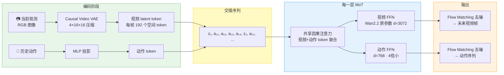
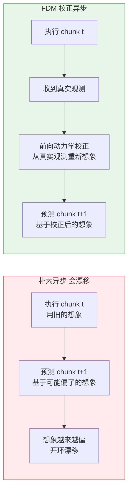

# LingBot-VA：因果视频-动作世界模型驱动的机器人控制

> **论文**：Causal World Modeling for Robot Control  
> **arXiv**：2601.21998（2025 年 1 月，v2 2026 年 3 月）  
> **团队**：Robbyant（蚂蚁技术团队）  
> **代码**：[GitHub](https://github.com/robbyant/lingbot-va)

> **一句话**：把预训练的视频生成模型 Wan2.2 当作"物理想象引擎"，先自回归地预测未来画面，再从画面变化反推机器人动作——视频流和动作流共享注意力但各走各的 FFN，推理时用 KV Cache 保持长程记忆、用部分去噪和异步流水线压延迟。

**知识链接**：

- [世界模型基础](/前置知识/000t_前置知识_世界模型基础) — LingBot-VA 的设计哲学根基
- [Flow Matching 与连续归一化流](/前置知识/000g_前置知识_Flow_Matching与连续归一化流) — 视频流和动作流共用的生成框架
- [逆动力学模型与潜动作学习](/前置知识/007b_前置知识_逆动力学模型与潜动作学习) — 动作流的解码原理
- [KV Cache 与自回归解码](/前置知识/002m_前置知识_KV_Cache与自回归解码) — 推理时的长程记忆机制
- [因果注意力掩码](/前置知识/001g_前置知识_Causal_Attention因果注意力掩码) — 注意力设计基础
- [FSDP 全分片数据并行](/前置知识/001i_前置知识_FSDP全分片数据并行) — 分布式训练基础
- [LingBot-VA 代码深度解析](/系列/lingbot_va_deep_dive/) — 代码级拆解系列（6 章）
- [LingBot-VLA 2.0 精读](/论文综述/139_LingBotVLA2_从基础到应用的实用VLA) — 同团队的 VLA 路线
- [LingBot-VLA 2.0 代码深度解析](/系列/lingbot_vla2_deep_dive/) — VLA 路线的代码级拆解

---

## 一、LingBot-VA 要解决什么问题

主流的 VLA（Vision-Language-Action）模型——如 [LingBot-VLA](/论文综述/139_LingBotVLA2_从基础到应用的实用VLA)、$\pi_0$——走的是"观测 → 直接出动作"的路线。它只有一个监督信号（动作标签），却要网络同时学三件事：

1. **视觉场景理解**：碗在哪、桌子什么颜色
2. **物理动力学**：推了碗会发生什么
3. **运动控制**：关节角应该怎么变

三件事压缩在一个网络里、用同一个动作 loss 监督，结果是网络靠"模式匹配"而不是"物理理解"做决策——简单任务还行，长程任务（比如叠三个碗）就容易崩。

**LingBot-VA 的解法**：把"理解世界"和"输出动作"拆成两步。

| 步骤 | 做什么 | 对应哪条流 |
|------|--------|-----------|
| **第一步：视觉动力学预测** | 给定历史观测，先"想象"未来几帧画面 | 视频流（Wan2.2 骨架） |
| **第二步：逆动力学推断** | 看到"现在"和"想象的未来"，反推要做什么动作 | 动作流（轻量 FFN） |

这样，第一步可以利用海量无标签视频学物理先验（不需要动作标签），第二步才用机器人数据建立"画面变化 → 关节动作"的映射。

贯穿全文，我们用一个具体场景来理解：**一台双臂桌面机器人做"叠碗"任务——把三个碗按从大到小的顺序叠起来**。这个任务需要 3 步操作，涉及抓取、放置、顺序判断，是论文实验中的典型任务。

---

## 二、架构：视频流 + 动作流的 MoT 双塔

LingBot-VA 的核心是 **Mixture-of-Transformers（MoT）** 双流结构。两条流的角色完全不同：

| | 视频流 | 动作流 |
|---|---|---|
| **骨架来源** | 预训练视频生成模型 **Wan2.2-5B** | 从视频流权重复制并缩小 |
| **隐层维度** | $d_v = 3072$ | $d_a = 768$（**4 倍小**） |
| **参数量** | ~5B | ~350M |
| **职责** | 预测未来画面（视觉动力学） | 推断动作（[逆动力学](/前置知识/007b_前置知识_逆动力学模型与潜动作学习)） |

**不对称设计的原因**：动作是一个低维信号（30 维向量），其分布远比视频简单，不需要和视频一样多的参数来建模。

每一层 MoT 做两件事：
1. **共享因果注意力**：视频 token 和动作 token 拼在一起做一次联合自注意力——动作流能"看到"视频流想象出的未来画面，视频流也能感知到动作历史
2. **分开的 FFN**：注意力做完后，视频 token 走 Wan2.2 原有的 FFN（维度 3072），动作 token 走独立的轻量 FFN（维度 768）

### Wan2.2 作为"物理想象引擎"

**Wan2.2-5B** 是一个在大规模视频数据上预训练的视频扩散模型，已经学会了"物体被推会怎么动"、"水倒出来会怎么流"这类物理先验。LingBot-VA 把它当作视频流的骨架，相当于给机器人装了一个"物理想象引擎"。

> 关于 Wan2.2 的详细架构，项目里已有系列讲解：[Wan2.2 整体架构与设计哲学](/系列/fastwam_human_pretrain/01_Wan2.2整体架构与设计哲学)。

### 动作网络初始化：复制 + 缩放

动作流是新加的模块，初始化不好会导致训练不稳定。论文对比了三种策略：

| 初始化策略 | 效果 |
|-----------|------|
| 随机初始化 | 梯度剧烈抖动、收敛极慢 |
| 直接复制视频权重 | 训练稳定但性能不是最优 |
| **复制 + 缩放** $\alpha = \sqrt{d_v / d_a}$ | 训练稳定且收敛最快 |

$\alpha = \sqrt{3072 / 768} = 2$。这个缩放保证了动作流的输出方差和视频流一致，使联合注意力从第一步就能正常工作。

---

## 三、视频稀疏化与交错序列

视频帧之间有大量冗余（机器人操作场景变化缓慢），如果每帧都编码，序列太长。LingBot-VA 对视频帧做 **4 倍时间下采样**——每 4 帧只保留 1 帧的视频 token。

但动作需要高频控制（如 50Hz），所以每个视频帧关联 $\tau = 4$ 个连续动作 token。最终的交错序列：

$$
[\underbrace{z_t}_{\text{视频帧}},\ \underbrace{a_{t,1},\ a_{t,2},\ a_{t,3},\ a_{t,4}}_{\text{4 个动作}},\ \underbrace{z_{t+1}}_{\text{下一帧}},\ a_{t+1,1},\ \ldots]
$$

**这个公式在做什么**：把视频 token 和动作 token 按时间顺序交替排列，形成一条"看到什么 → 做了什么 → 世界变成什么"的因果叙事序列。

::: details 📐 公式详解（点击展开）

| 子表达式 | 它是谁 | 它在干嘛 |
|---------|--------|---------|
| $z_t$ | **场景快照** | 经 Causal Video VAE 压缩后的当前帧 latent（192 个空间 token） |
| $a_{t,1} \ldots a_{t,4}$ | **精细动作序列** | 当前帧到下一帧之间的 4 步关节动作，保证高频控制精度 |
| 交错排列 | **时间线叙事** | 因果注意力天然建模"观测 → 动作 → 下一个观测"的时间链 |

**用人话读**："每隔 4 个动作 token 插一个视频帧 token，按时间排好，每个 token 只能看到前面的内容。"

**为什么交错而不是先视频后动作**：交错让动作 token 直接关注最近的视频帧，视频帧也能看到刚执行过的动作——两种信息在注意力层自然融合，不需要额外的跨模态对齐模块。
:::

预测 $K$ 帧视频就同时生成 $\tau \times K$ 个动作——例如 $K=4$ 帧对应 16 个动作步，在 50Hz 控制频率下覆盖 0.32 秒的动作窗口。

---

## 四、训练：双路 Loss + 噪声历史增强

### 4.1 Teacher Forcing 与因果掩码

训练时使用 teacher forcing：模型预测下一个 token 时用的上下文是真实数据（ground truth），而不是自己的预测。对 LingBot-VA 来说，这和真实部署天然一致——机器人每执行完一个 chunk 后都会拿到新的真实观测。

一个 episode 的所有时间步在一次前向传播中并行计算，[因果注意力掩码](/前置知识/001g_前置知识_Causal_Attention因果注意力掩码)保证时间方向的正确性。

### 4.2 双路 Loss

训练有两个 loss，分别监督两条流：

1. **视觉动力学 loss** $\mathcal{L}_{\text{dyn}}$：训练视频流预测未来帧——用 [Flow Matching](/前置知识/000g_前置知识_Flow_Matching与连续归一化流) 去噪出下一帧的 latent，和 ground truth 比较
2. **逆动力学 loss** $\mathcal{L}_{\text{inv}}$：训练动作流推断动作——用 Flow Matching 去噪出动作序列，和 ground truth 比较

$$
\mathcal{L} = \mathcal{L}_{\text{dyn}} + \lambda \cdot \mathcal{L}_{\text{inv}}, \quad \lambda = 1
$$

**这个公式在做什么**：两路 loss 权重相等地加在一起，视频流学"世界会怎么变"，动作流学"要做什么才能让世界这样变"，两者同时训练、互相增强。

::: details 📐 公式详解（点击展开）

| 子表达式 | 它是谁 | 它在干嘛 |
|---------|--------|---------|
| $\mathcal{L}_{\text{dyn}}$ | **想象力教练** | 逼视频流准确预测未来画面 |
| $\mathcal{L}_{\text{inv}}$ | **动作教练** | 逼动作流从"现在 vs 未来"的画面差异中推断正确动作 |
| $\lambda = 1$ | **平等对待** | 两路 loss 不偏不倚，不刻意强调哪一路 |

**用人话读**："模型同时被两个教练打分——一个考'你想象的未来对不对'，一个考'你推断的动作对不对'，总分是两个分数之和。"

**为什么 $\lambda=1$**：视频 token 数量远多于动作 token（每帧 192 vs 每个动作 1），loss 计算时按 token 平均后自然就平衡了，不需要额外调 $\lambda$。
:::

### 4.3 噪声历史增强

推理时的性能瓶颈是视频帧的生成——视频 token 数量远多于动作 token，且每个 token 需要多步去噪。

LingBot-VA 的一个关键洞察：**动作预测并不需要完美的视频重建，只需要语义层面正确就够了**——碗的大致位置对了，即使纹理不完美，也足以推断出正确的抓取动作。

基于这个洞察，训练时以 50% 的概率给历史视频 token 注入噪声：

$$
\tilde{z}_{\leq t} = \begin{cases} (1-s_{\text{aug}}) \cdot \epsilon + s_{\text{aug}} \cdot z_{\leq t}, & \text{概率 } 0.5, \quad s_{\text{aug}} \in [0.5, 1] \\ z_{\leq t}, & \text{概率 } 0.5 \end{cases}
$$

**这个公式在做什么**：训练时随机给历史视频 token 掺噪声，逼迫动作流学会从"半成品视频"中也能准确推断动作——推理时就不用把视频完全去噪到底，只去噪到一半就够用，**直接省掉一半的视频去噪计算量**。

::: details 📐 公式详解（点击展开）

| 子表达式 | 它是谁 | 它在干嘛 |
|---------|--------|---------|
| $z_{\leq t}$ | **干净的历史视频** | ground truth 的 latent 表示 |
| $\epsilon \sim \mathcal{N}(0, I)$ | **纯噪声** | 标准高斯噪声 |
| $s_{\text{aug}} \in [0.5, 1]$ | **噪声程度旋钮** | 1 = 完全干净，0.5 = 一半噪声一半信号 |
| $(1-s_{\text{aug}}) \cdot \epsilon + s_{\text{aug}} \cdot z_{\leq t}$ | **掺了噪声的历史** | 和 Flow Matching 的正向插值公式一致 |

**用人话读**："训练时一半概率把历史视频搞模糊（掺 50%～0% 的噪声），另一半概率保持原样。模型学会从不完美的视频里也能做正确决策。"

**为什么噪声范围是 $[0.5, 1]$ 而不是 $[0, 1]$**：低于 0.5 时噪声太多，视频 token 几乎是纯噪声，动作流提取不到有用信息；0.5 是"能保留语义结构的最低去噪水平"。
:::

---

## 五、推理：自回归 + KV Cache + 异步流水线

### 5.1 基本推理循环

推理时，模型按自回归方式一个 chunk 一个 chunk 地生成：

1. 编码当前真实观测 $o_t \rightarrow z_t$（经 Causal Video VAE）
2. 用 Flow Matching 从噪声积分生成未来 $K$ 帧视频 token（**只积分到 $s = 0.5$，不完全去噪**——这正是噪声增强训练的收益）
3. 用 Flow Matching 从噪声积分生成对应的动作序列（**完全积分到 $s = 1$**）
4. 执行动作，获取新观测，更新 [KV Cache](/前置知识/002m_前置知识_KV_Cache与自回归解码)，回到步骤 1

KV Cache 在这里发挥关键作用：历史的所有视频和动作 token 的 Key/Value 被缓存下来，每步只需计算新 token 的注意力——提供了**持久的长程记忆**，是 LingBot-VA 在长程任务上表现优异的重要原因。

### 5.2 异步推理与 FDM 校正

即使有了部分去噪和 KV Cache，视频生成仍需不少计算时间。LingBot-VA 设计了**异步推理流水线**：在机器人执行当前 chunk 的动作时，模型同时在预测下一个 chunk。

但朴素异步有问题：模型预测下一个 chunk 时用的视频上下文是"上上个 chunk 的真实观测 + 上个 chunk 的想象画面"——如果想象偏了，后续预测越跑越偏（开环漂移）。

解法是加一个**前向动力学模型（Forward Dynamics Model, FDM）校正步骤**：拿到最新的真实观测后，让模型重新"想象"执行当前动作后的视觉结果，替换旧的预测。模型的想象始终锚定在真实世界反馈上，不会漂移。

实验结果：加了 FDM 校正的异步推理在 RoboTwin 任务上达到 90.4% 成功率，朴素异步只有 74.3%——差距在长程任务上最大（Horizon=3 时 85.6% vs 32.9%）。

### 5.3 可变 Chunk 大小

训练时，每次随机从 $[1, 4]$ 采样 chunk 大小 $K$，让模型在推理时灵活选择：

- **大 chunk**（$K=4$）：自回归步数少、计算量小，但闭环校正频率低
- **小 chunk**（$K=1$）：每步都能用真实观测校正，精度高，但延迟大

实际部署中 $K=4$ 是好的折中点。

---

## 六、数据与统一动作表示

- **规模**：约 16,000 小时机器人数据（另可利用大量无标签视频做视频流预训练）
- **来源**：Agibot、RoboMind、InternData-A1、OXE（OpenVLA 子集）、UMI 人类演示、RoboCOIN
- **统一动作表示**：每条臂 7 维末端姿态 + 7 维关节角 + 1 维夹爪 = 15 维，双臂共 30 维
- **归一化**：用分位数归一化（quantile normalization），取训练集 1% 和 99% 分位数作为归一化边界，将动作映射到 $[-1, 1]$

---

## 七、实验结果

### 7.1 仿真评测（RoboTwin 2.0）

| 方法 | Easy 平均成功率 | Hard 平均成功率 | Easy Horizon=3 | Hard Horizon=3 |
|------|---------------|---------------|----------------|----------------|
| $\pi_{0.5}$ | 82.7% | 76.8% | 78.6% | 67.4% |
| LingBot-VLA（有深度蒸馏） | 88.6% | 86.7% | — | — |
| **LingBot-VA** | **92.9%** | **91.6%** | **93.2%** | **93.3%** |

关键观察：
- LingBot-VA 全面优于 LingBot-VLA 和 $\pi_{0.5}$
- **长程任务差距最大**：Horizon=3 时超过 $\pi_{0.5}$ 约 15-26 个百分点——验证了世界模型路线在需要"想多步"的任务上优势明显

### 7.2 数据效率对比

| 训练数据量 | LingBot-VA 进度分 | $\pi_{0.5}$ 进度分 | 差距 |
|-----------|-----------------|-------------------|------|
| 10 条 | ~55% | ~40% | **+15.6%** |
| 30 条 | ~70% | ~60% | +10% |
| 50 条 | ~80% | ~73% | +7% |

世界模型预训练提供了丰富的视觉物理先验——即使训练数据很少，模型也知道"碗被推会怎么动"，不需要从演示中重新学习物理规律。

---

## 八、设计教训

### 8.1 世界模型的价值在"长"和"少"

LingBot-VA 的优势集中在两个场景：**长程任务**（需要多步推理和记忆）和**少数据**（需要物理先验弥补数据不足）。如果任务只有 1-2 步、数据充足，VLA 路线（如 [LingBot-VLA 2.0](/论文综述/139_LingBotVLA2_从基础到应用的实用VLA)）可能更高效。

### 8.2 异步推理是工程关键

世界模型路线最大的工程挑战是推理延迟。LingBot-VA 通过三个手段压延迟：
- **部分去噪**：省一半视频生成计算
- **KV Cache**：避免重算历史
- **异步流水线 + FDM 校正**：计算和执行重叠

三个缺一不可——缺了 FDM 校正，异步推理会开环漂移；缺了部分去噪，延迟还是太高。

### 8.3 不对称设计是效率关键

动作流只有视频流 1/4 的参数（350M vs 5B），但每一层都通过共享注意力获取视频流的全部信息。这个不对称设计让总参数量控制在 5.3B，而不是翻倍到 10B。

---

## 九、延伸阅读

- [LingBot-VA 代码深度解析](/系列/lingbot_va_deep_dive/) — 6 章系列，代码级拆解 VA 的所有组件
- [LingBot-VLA 2.0 精读](/论文综述/139_LingBotVLA2_从基础到应用的实用VLA) — 同团队 VLA 路线
- [LingBot-VLA 2.0 代码深度解析](/系列/lingbot_vla2_deep_dive/) — VLA 路线的代码拆解
- [世界模型强化学习综述](/论文综述/S10_世界模型强化学习综述) — 世界模型在 RL 中的系统综述
- [Fast-WAM 深度解析](/系列/fastwam_deep_dive/) — 另一条世界动作模型路线
- [Zero-WAM 精读](/论文综述/137_ZeroWAM_人类视频引导的零样本世界动作模型) — 同类工作对比
