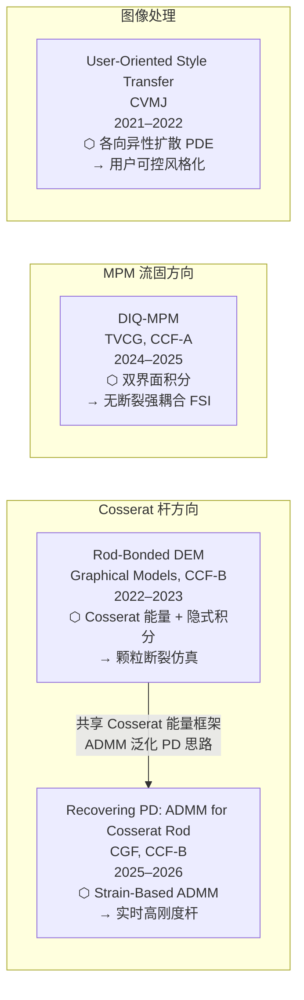
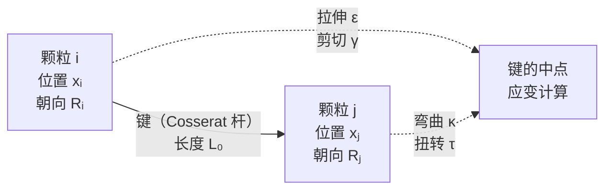
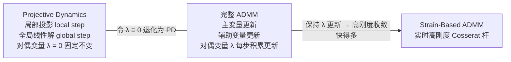
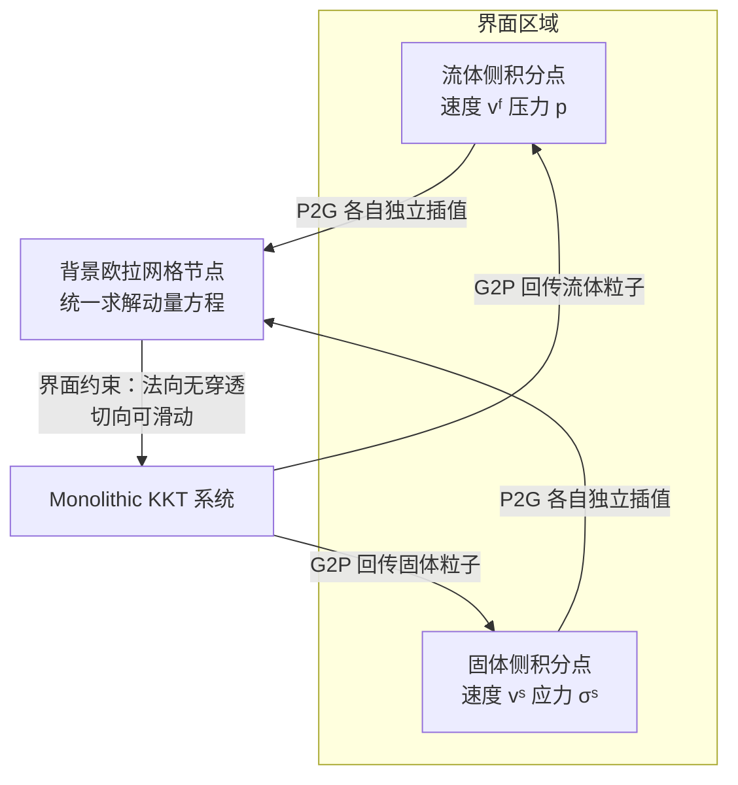

# Cosserat 杆、MPM 流固耦合与断裂仿真：Kangrui Zhang 四篇论文综述

> **综述范围**：Kangrui Zhang（北京航空航天大学）在 2022—2026 年间发表的四篇论文，覆盖
> 三个物理仿真问题（Cosserat 杆断裂、高刚度杆实时仿真、MPM 流固耦合）和一个图像处理问题
> （用户导向交互式风格迁移）。本文逐篇讲透每个方法的问题动机、核心设计与关键技术。
>
> **关键词**：Cosserat 杆、ADMM、Projective Dynamics、离散元（DEM）、物质点法（MPM）、
> 流固耦合（FSI）、双界面积分、各向异性扩散
>
> **适用读者**：了解有限元基础和时间积分概念、希望深入理解图形学物理仿真前沿方法的读者。
> 建议先读 [Projective Dynamics 前置知识](/前置知识/006l_前置知识_局部全局求解框架与Projective_Dynamics)
> 和 [MPM 基础](/前置知识/006n_前置知识_物质点法MPM基础_颗粒材料与网格粒子转换)。

---

## 相关阅读

- [Cosserat 杆：带截面朝向的弹性杆模型](/前置知识/013b_前置知识_Cosserat杆弹性杆模型与截面朝向) ——
  第一、二篇论文的核心能量框架：四分量应变能、director frame、断裂判据。
- [DEM 离散元法基础](/前置知识/013d_前置知识_DEM离散元法) ——
  第一篇论文的材料表示方式：刚性颗粒、键、断裂即删键。
- [ADMM 交替方向乘子法](/前置知识/013c_前置知识_ADMM交替方向乘子法) ——
  第二篇论文的算法框架：三步迭代、对偶变量、与 PD 的关系。
- [KKT 条件与鞍点线性系统](/前置知识/013e_前置知识_KKT条件与鞍点线性系统) ——
  第三篇论文 monolithic 流固耦合求解的数学基础。
- [各向异性扩散方程](/前置知识/013f_前置知识_各向异性扩散方程) ——
  第四篇论文的核心 PDE：扩散张量、结构张量、隐式离散化。
- [局部-全局求解框架与 Projective Dynamics](/前置知识/006l_前置知识_局部全局求解框架与Projective_Dynamics) ——
  第二篇论文的出发点：把 PD 视为 ADMM 的特例，进而扩展到高刚度杆。
- [物质点法 MPM 基础](/前置知识/006n_前置知识_物质点法MPM基础_颗粒材料与网格粒子转换) ——
  第三篇论文的基础求解器，本文在其界面处理上做扩展。
- [稀疏线性系统与共轭梯度法](/前置知识/006k_前置知识_稀疏线性系统与共轭梯度法) ——
  三篇物理仿真论文在全局步均需要解的线性系统。

---

## 研究全貌：四篇工作的位置与联系

四篇论文横跨物理仿真的不同子方向，但在方法论上有清晰的脉络：两篇都用到 Cosserat 杆的能量框架（论文一和论文二），一篇把 MPM 推向更强的流固耦合（论文三），一篇在图像处理中隐式求解偏微分方程（论文四）。下图展示它们的时间顺序和方法联系。

> 论文一（BDEM）奠定了 Cosserat 能量在颗粒系统中的使用方式；论文二在此基础上把 ADMM 框架
> 引入，实现了实时求解；两者都绕不开 Cosserat 杆的应变能这个核心公式。MPM 和风格迁移是
> 独立的技术路线，但同样体现了"把难问题分解为可高效求解的子结构"这一贯穿性思路。

---

## 一、Rod-Bonded DEM：用 Cosserat 能量驱动颗粒断裂仿真

**Graphical Models, CCF-B，2022—2023**  
*Kangrui Zhang, Han Yan, Jia-Ming Lu, Bo Ren*

### 标准 DEM 解决不了的问题：弯曲和扭转

[离散元法（Discrete Element Method，DEM）](/前置知识/013d_前置知识_DEM离散元法) 把材料建模为一堆刚性颗粒，颗粒之间可以形成"键"（bond）传递力。标准 DEM 的键通常只能处理**轴向拉压**——两颗粒靠近或远离时产生弹力；可一旦材料需要抵抗弯曲或扭转（比如一根细杆、一片薄板被折弯），标准 DEM 的键就无法准确描述这种阻力，导致材料看起来"太软"或断裂行为失真。

这个问题的根源在于：弯曲和扭转属于**弯矩和扭矩**，而标准 DEM 的键只记录轴向力和剪切力，缺少一个能统一描述所有变形模式的能量框架。

### 解法：把 Cosserat 杆的应变能"接入"颗粒键

[Cosserat 杆](/前置知识/013b_前置知识_Cosserat杆弹性杆模型与截面朝向)（Cosserat rod）是一种经典力学模型，它把一根杆描述为：一条中心线 + 沿中心线附着的一组旋转框架（称为 director）。相比普通弹性杆，Cosserat 杆明确追踪了每个截面的朝向，因此天然地把拉伸（stretch）、剪切（shear）、弯曲（bending）和扭转（torsion）这四种变形模式分开记录，并给每种模式一个独立的刚度系数。

Rod-Bonded DEM 的核心思路是：把相邻两颗粒之间的键视为一段 Cosserat 杆。颗粒的位置给出中心线方向，颗粒自身的旋转自由度给出截面 director，于是四种变形模式都有了计算依据。下图展示键的几何关系：

> 两颗粒之间的一条键就承载了四种变形模式的测量值。断裂发生时，这条键被移除——颗粒之间不再有约束。

### 键的 Cosserat 应变能公式

整个方法的能量核心是一个离散化的 Cosserat 应变能。对于编号为 $b$ 的键，其储存的弹性能为：

$$
E_b = \frac{L_b}{2} \left( k_s \lVert \boldsymbol{\varepsilon} \rVert^2 + k_{sh} \lVert \boldsymbol{\gamma} \rVert^2 + k_b \lVert \boldsymbol{\kappa} \rVert^2 + k_t \tau^2 \right)
$$

**这个公式在做什么**：把一条键所承受的全部弹性势能用四项相加来衡量——分别对应拉伸、剪切、弯曲、扭转，每项的权重由对应的刚度系数控制，最终决定这条键能抵抗哪种变形、多强。

::: details 📐 公式详解（点击展开）

| 子表达式 | 它是谁 | 它在干嘛 |
|---------|--------|---------|
| $L_b$ | **键的静止长度** | 做长度归一化，让刚度参数的物理含义与键长无关 |
| $k_s \lVert \boldsymbol{\varepsilon} \rVert^2$ | **拉伸项** | 键被拉长或压短时的能量代价，$\boldsymbol{\varepsilon}$ 是轴向应变向量 |
| $k_{sh} \lVert \boldsymbol{\gamma} \rVert^2$ | **剪切项** | 两端颗粒横向相对位移产生的能量，$\boldsymbol{\gamma}$ 是剪切应变 |
| $k_b \lVert \boldsymbol{\kappa} \rVert^2$ | **弯曲项** | 两端 director 旋转不一致（弯了）产生的能量，$\boldsymbol{\kappa}$ 是曲率向量 |
| $k_t \tau^2$ | **扭转项** | 两端绕键轴方向相对旋转（拧了）产生的能量，$\tau$ 是扭转角 |

**用人话读**："这条键被拉、被切、被弯、被拧，四种受苦程度加权求和，就是它现在储存的弹性能。"

**为什么要四项独立**：四种变形模式对应不同的物理机制，刚度差异可以很大（比如钢杆轴向很硬、扭转相对软）。分开记录才能分别调刚度，精确模拟各向异性材料。
:::

### 隐式时间积分与断裂判断

**为什么用隐式积分**：Cosserat 键的刚度往往很高（尤其是拉伸刚度），显式积分（Euler forward）为了保持数值稳定必须把时间步取得极小，计算效率极低。隐式积分把当前步的力算进时间步末的方程里，允许用大时间步而不爆炸。

代价是每步需要解一个**非线性方程组**（因为旋转自由度的更新是非线性的）。论文采用牛顿迭代法，在每次迭代内把问题线性化为一个稀疏线性系统，再用直接求解器或共轭梯度求解。

**断裂触发**：当某条键所储存的总能量 $E_b$ 超过一个预设阈值 $E_{\text{frac}}$ 时，键被删除，对应的颗粒对解除约束。这比基于应力最大值的判据更简单鲁棒，不需要每种变形模式分别设阈值。

---

## 二、Recovering Projective Dynamics：面向 Cosserat 杆的 Strain-Based ADMM

**Computer Graphics Forum, CCF-B，2025—2026**  
*Kangrui Zhang, Bo Ren*

### 问题：高刚度杆让 Projective Dynamics 失效

[Projective Dynamics（PD）](/前置知识/006l_前置知识_局部全局求解框架与Projective_Dynamics) 是近年来最流行的快速软体仿真框架之一：它把每步隐式积分的非线性方程组，分解为交替的"局部投影"和"全局线性求解"两步，让系统矩阵只用在预处理阶段分解一次，之后每步只需做快速的直接回代。

但 PD 对**高刚度约束**有一个众所周知的致命缺陷：当约束的刚度参数 $k$ 很大时，PD 的局部-全局迭代收敛极慢，实际上需要几百次甚至上千次迭代才能"感受到"高刚度约束对形状的修正，渲染出来的结果就是杆在大刚度下依然看起来很软，甚至抖动发散。

对 Cosserat 杆来说这个问题尤为突出：一根"硬杆"（如金属细杆、鱼线）的拉伸刚度可能比弯曲刚度高三个数量级，直接用 PD 只能接受其中一端刚度，另一端要么太软要么数值爆炸。

### 核心洞察：PD 是 ADMM 的一个特例

这篇论文的关键观察是：**Projective Dynamics 等价于 [ADMM（Alternating Direction Method of Multipliers，交替方向乘子法）](/前置知识/013c_前置知识_ADMM交替方向乘子法) 在罚函数参数 $\rho$ 固定为刚度 $k$ 时的特例**。

ADMM 是一种通用的约束优化分裂算法，把原问题拆成"主变量更新"和"辅助变量更新"两步交替，并通过一个**对偶变量**（拉格朗日乘子）在两步之间传递约束不满足的信息。PD 完全对应 ADMM 的结构，区别仅在于 PD 把对偶变量固定为 0，每步不更新——这正是 PD 对高刚度收敛慢的根源：没有对偶变量的积累，系统在高刚度约束处的信息传播只靠罚函数，速度极慢。

> PD 是 ADMM 的一个退化版本。把对偶变量的更新补回来，就是这篇论文的完整算法。

### Strain-Based ADMM 的三步状态转移

对 Cosserat 杆问题，论文在 ADMM 框架内把约束定义为**应变约束**（strain constraint）：限制拉伸应变、剪切应变、曲率和扭率在合理范围内。每个时间步的完整状态转移如下。

**初始化**：令 $\mathbf{p}^{(0)} = \mathbf{q}^n$（上一步末状态），$\boldsymbol{\lambda}^{(0)} = \boldsymbol{\lambda}^n$（上一步末对偶变量）。

**第 $k$ 次 ADMM 迭代的三个子步：**

**步骤 1：辅助变量（应变投影，local step）**，对每个约束单独求解：

$$
\mathbf{z}^{(k+1)} = \arg\min_{\mathbf{z}} \frac{\rho}{2} \lVert \mathcal{G}(\mathbf{q}^{(k)}) - \mathbf{z} + \boldsymbol{\lambda}^{(k)} / \rho \rVert^2 + g(\mathbf{z})
$$

**这个公式在做什么**：给定当前主变量 $\mathbf{q}^{(k)}$，找一个合法的应变目标 $\mathbf{z}$，让它既靠近当前计算的应变 $\mathcal{G}(\mathbf{q}^{(k)})$，又满足约束 $g$（如应变在弹性范围内）。$\boldsymbol{\lambda}/\rho$ 是上一轮积累的"欠账修正"。

::: details 📐 公式详解（点击展开）

| 子表达式 | 它是谁 | 它在干嘛 |
|---------|--------|---------|
| $\mathcal{G}(\mathbf{q}^{(k)})$ | **应变算子** | 从当前主变量（位置+旋转）计算 Cosserat 四种应变 |
| $\mathbf{z}$ | **应变目标** | 希望约束满足时应该对应的应变值 |
| $\boldsymbol{\lambda}^{(k)} / \rho$ | **对偶修正量** | 上轮约束没满足欠下的"债"，这里补偿进来，让投影方向更准 |
| $g(\mathbf{z})$ | **约束指示函数** | 如果 $\mathbf{z}$ 合法为 0，否则为 $+\infty$——强制投影结果必须合法 |

**用人话读**："找到一个合法的应变目标，让它离当前应变加上历史修正的位置尽可能近。"

**为什么有 $\boldsymbol{\lambda}/\rho$ 这一项**：这正是 ADMM 比 PD 强的地方。PD 相当于每次把这个修正量设为 0，投影方向只看当前应变——高刚度时需要极多次才能把大误差纠正过来。ADMM 积累修正量，一步就能把上轮欠下的偏差大幅补偿，收敛快几十倍。
:::

**步骤 2：主变量更新（global step）**，在所有约束的汇聚下解一个线性系统：

$$
\mathbf{q}^{(k+1)} = \arg\min_{\mathbf{q}} \frac{1}{2} \lVert \mathbf{M}^{1/2}(\mathbf{q} - \tilde{\mathbf{q}}) \rVert^2 + \frac{\rho}{2} \lVert \mathcal{G}(\mathbf{q}) - \mathbf{z}^{(k+1)} + \boldsymbol{\lambda}^{(k)} / \rho \rVert^2
$$

**这个公式在做什么**：在惯性项（不偏离预测位置太远）和约束满足项（靠近刚刚求出的应变目标）之间折中，通过解一个稀疏线性方程组得到新的主变量。

::: details 📐 公式详解（点击展开）

| 子表达式 | 它是谁 | 它在干嘛 |
|---------|--------|---------|
| $\mathbf{M}^{1/2}(\mathbf{q} - \tilde{\mathbf{q}})$ | **惯性项** | 让更新后的 $\mathbf{q}$ 不偏离惯性预测位置 $\tilde{\mathbf{q}}$（质量加权） |
| $\mathcal{G}(\mathbf{q}) - \mathbf{z}^{(k+1)} + \boldsymbol{\lambda}^{(k)}/\rho$ | **约束残差** | 当前应变离目标还差多少，乘以 $\rho$ 就是惩罚力度 |

**用人话读**："在'不飞太远'和'满足所有约束'之间取平衡，解一次线性系统。"

**为什么系统矩阵可以预分解**：应变算子 $\mathcal{G}$ 在 Cosserat 杆的小变形假设下关于位置是线性的，于是整个二次目标的 Hessian 是常数矩阵（与 $\mathbf{q}$ 无关），只需分解一次，之后每步迭代只做回代——这保留了 PD 最宝贵的计算优势。
:::

**步骤 3：对偶变量更新**：

$$
\boldsymbol{\lambda}^{(k+1)} = \boldsymbol{\lambda}^{(k)} + \rho \left( \mathcal{G}(\mathbf{q}^{(k+1)}) - \mathbf{z}^{(k+1)} \right)
$$

**这个公式在做什么**：把这轮仍未满足的约束残差累加到对偶变量中，驱动系统在下一次迭代向约束满足方向收敛。PD 跳过这步（固定 $\boldsymbol{\lambda} = 0$），这正是它在高刚度下慢的根本原因。

::: details 📐 公式详解（点击展开）

| 子表达式 | 它是谁 | 它在干嘛 |
|---------|--------|---------|
| $\boldsymbol{\lambda}^{(k)}$ | **已积累的欠账** | 前几轮约束没满足时留下的欠债总和 |
| $\mathcal{G}(\mathbf{q}^{(k+1)}) - \mathbf{z}^{(k+1)}$ | **本轮残差** | 这一轮更新完之后，应变和目标之间还差多少 |
| $\rho \cdot (\text{残差})$ | **欠账增量** | 按罚参数 $\rho$ 缩放后写入账本，下轮投影会把它补偿进去 |

**用人话读**："这轮没还清的债，乘以利率 $\rho$，记进账本——下轮投影会带着这笔债重新计算，不让它越欠越多。"

**和 PD 的对比**：PD 相当于账本永远为零——每轮约束差多少都当没发生，完全靠大量重复迭代磨平误差；ADMM 记账，所以几轮迭代就能收敛。
:::

### 退化情形验证：ADMM 还原为 PD

当 $\boldsymbol{\lambda}^{(k)} \equiv 0$ 且不更新时，步骤 1 变成标准 PD 的局部投影（找最近合法投影点），步骤 2 变成 PD 的全局线性步，完全还原 PD。这是一个重要的理论健全性检查：ADMM 在 $\rho = k$、$\boldsymbol{\lambda}=0$ 时退化为 PD，激活对偶变量更新后收敛速度可比 PD 快 10–100 倍（具体取决于刚度比）。

---

## 三、DIQ-MPM：双界面积分 MPM 实现强双向流固耦合

**TVCG, CCF-A，2024—2025**  
*Kangrui Zhang, Ruihong Cen, Siyan Zhu, Ruoyan Chen, Bo Ren*

### 传统 MPM 流固耦合的两类失败模式

[物质点法（MPM）](/前置知识/006n_前置知识_物质点法MPM基础_颗粒材料与网格粒子转换) 天然支持大变形：粒子携带状态，背景欧拉网格负责求解动量方程，通过插值在两者之间传递。这让 MPM 特别适合仿真泥沙、雪、橡胶等极端变形材料。

把流体和固体一起放入 MPM 仿真（流固耦合，FSI）时，界面处理成了核心难题。现有两类主流做法各有致命缺陷。

**方法 A：分离求解器（Staggered FSI）** 流体和固体分别用各自的求解器，界面上通过迭代交换边界力和速度来耦合。问题是：迭代不收敛时会出现**数值断裂**（virtual gaps）——在界面处流体和固体相互穿透或出现真空，视觉上破裂。

**方法 B：单一 MPM 背景网格（Monolithic MPM）** 流固都用同一套粒子和网格，界面通过粒子重叠自动耦合。问题是：当固体边界薄、密度和刚度与流体差异极大时，界面两侧的应力场不连续，但共享的网格节点会把不兼容的速度场强行平均，导致固体被流体"冲穿"或产生非物理振荡。

这两类失败模式的共同根源是：**界面的积分方式和自由度表示都不能准确捕捉两侧场量的不连续性**。

### DIQ-MPM 的解法：两套界面积分

DIQ-MPM 的核心思路是：在流固界面附近，**同时维护两套独立的积分点**——一套属于流体，一套属于固体——让两侧的应力场在界面处可以有跳变，然后通过一个统一的 monolithic 线性系统把界面力精确耦合起来。

> 关键在于：流体和固体的粒子向网格传递质量和动量时，走**各自独立的路径**，不混合——界面两侧的速度场在网格层面是分开表示的；然后用约束把法向速度锁住，防止穿透，切向允许自由滑动（对应无摩擦界面）。

### Monolithic KKT 系统：统一求解界面约束

把时间步末的速度场和界面拉格朗日乘子统一写成一个[鞍点系统（KKT 系统）](/前置知识/013e_前置知识_KKT条件与鞍点线性系统)：

$$
\begin{bmatrix} \mathbf{A}_f & 0 & \mathbf{G}^T \\ 0 & \mathbf{A}_s & -\mathbf{G}^T \\ \mathbf{G} & -\mathbf{G} & 0 \end{bmatrix} \begin{bmatrix} \mathbf{v}_f \\ \mathbf{v}_s \\ \boldsymbol{\lambda} \end{bmatrix} = \begin{bmatrix} \mathbf{f}_f \\ \mathbf{f}_s \\ 0 \end{bmatrix}
$$

**这个公式在做什么**：在一次线性求解中，同时得到流体网格速度 $\mathbf{v}_f$、固体网格速度 $\mathbf{v}_s$，以及界面上的接触力 $\boldsymbol{\lambda}$——这三者相互耦合，必须联立求解，这就是"monolithic"的含义。

::: details 📐 公式详解（点击展开）

| 子表达式 | 它是谁 | 它在干嘛 |
|---------|--------|---------|
| $\mathbf{A}_f$，$\mathbf{A}_s$ | **质量-刚度矩阵** | 流体和固体各自的隐式积分系统矩阵（来自 MPM 的 G2P-P2G 流程） |
| $\mathbf{G}$ | **界面约束矩阵** | 把网格节点速度投影到法向，提取流固两侧的法向速度差 |
| $\boldsymbol{\lambda}$ | **界面拉格朗日乘子** | 界面处的法向接触力——正值表示排斥（固体推开流体），由系统自动求解 |
| 右端第三行的 $0$ | **无穿透约束** | 强制 $\mathbf{G}\mathbf{v}_f - \mathbf{G}\mathbf{v}_s = 0$，即法向速度必须连续（无穿透、无分离） |

**用人话读**："流体和固体一起解，界面力由系统自动算出来，保证两侧在法线方向上速度一致——既不穿透也不分离。"

**为什么不用迭代**：迭代方法（Staggered）的数值断裂来自迭代不收敛；这里直接列 KKT 方程一步求解，界面约束在数学上严格满足，断裂从根源上被消除。代价是系统变大，但稀疏性可以充分利用。
:::

### 双界面积分的物理意义

DIQ（Dual Interface Quadrature）中"双"的意思正是：界面两侧**各自保留独立的积分点**，它们向网格传递质量和动量时不混合，所以应力场在界面处可以有跳变——这对流固密度相差大（如水和钢）的问题至关重要。传统 monolithic MPM 只用单套粒子，界面处的状态被强行平均，高刚度比时就会出现非物理渗透。双套积分点加 KKT 联立求解，两个问题同时解决。

---

## 四、User-Oriented Interactive Style Transfer：隐式 PDE 驱动的可控风格迁移

**CVMJ，2021—2022**  
*Zheng Lin, Zhao Zhang, Kangrui Zhang, Bo Ren, Ming-Ming Cheng*  
*(本文作者贡献：在二维网格上隐式求解各向异性扩散方程)*

### 风格迁移中"用户控制"的难题

深度神经网络风格迁移方法（如 Gram 矩阵匹配）擅长整张图统一风格化，但对于**局部控制**非常困难——用户想让背景有油画笔触、前景保持清晰轮廓时，全局风格化没法分区处理，必须手工后期合成。

更根本的问题是：风格化的传播方式默认是各向同性的（四方向均匀扩散），不能沿图像内容的方向走——比如让毛发风格沿毛发走向流动、建筑风格沿边缘保持锐利。各向同性传播会把风格"渗透"到不该影响的区域，破坏原图的内容结构。

### 各向异性扩散方程的设计

这篇论文中张康睿负责的核心贡献是：在二维图像网格上，用[各向异性扩散方程](/前置知识/013f_前置知识_各向异性扩散方程)来传播风格笔触。对每个像素位置 $\mathbf{x}$，扩散方程写为：

$$
\frac{\partial u}{\partial t} = \nabla \cdot \left( \mathbf{D}(\mathbf{x}) \nabla u \right)
$$

**这个公式在做什么**：把风格化的程度 $u$（即"这个像素被风格笔触覆盖多少"）随时间 $t$ 扩散开来，但扩散速率由位置相关的张量 $\mathbf{D}(\mathbf{x})$ 控制——让风格沿内容边缘方向流、垂直于边缘方向慢，最终风格自然地贴着内容结构蔓延。

::: details 📐 公式详解（点击展开）

| 子表达式 | 它是谁 | 它在干嘛 |
|---------|--------|---------|
| $u(\mathbf{x}, t)$ | **风格强度场** | 每个像素当前被风格化的程度，从用户指定的笔触种子扩散 |
| $\nabla u$ | **强度梯度** | 风格强度的空间变化方向——从强到弱的方向 |
| $\mathbf{D}(\mathbf{x})$ | **扩散张量** | 2×2 正定矩阵，控制该像素处扩散的快慢和方向性 |
| $\nabla \cdot (\mathbf{D} \nabla u)$ | **各向异性散度** | 加权求和后的净扩散量——沿 $\mathbf{D}$ 的主方向扩散快，垂直方向慢 |

**用人话读**："风格笔触从用户点击的种子出发，沿着图像内容的方向（如毛发走向、建筑轮廓）蔓延，垂直于内容方向的传播被压制——结果是风格自然地贴着内容结构流动。"

**为什么是各向异性而不是均匀扩散**：均匀扩散（$\mathbf{D} = \mathbf{I}$）会让风格越过边缘扩散到不该影响的区域；各向异性的 $\mathbf{D}$ 沿边缘方向设置大特征值（扩散快）、垂直边缘方向设置小特征值（扩散慢），风格自然被"锁"在正确的内容区域内。扩散张量 $\mathbf{D}$ 由图像结构张量（structure tensor）的特征向量旋转得到，完全由图像内容自动计算，无需人工标注。
:::

### 隐式离散化与二维网格求解

**为什么用隐式求解**：显式时间积分的稳定条件要求时间步 $\Delta t \leq h^2 / (2 \max\lambda(\mathbf{D}))$，在高分辨率图像（$h$ 小）或强各向异性（$\max\lambda(\mathbf{D})$ 大）时会极小，计算极慢。隐式积分无条件稳定，允许用大时间步快速扩散到稳态。

把 $u^{n+1}$ 的方程在二维像素网格上离散化后，变成一个稀疏对称正定线性系统：

$$
\left( \mathbf{I} + \Delta t \mathbf{L}_{\mathbf{D}} \right) \mathbf{u}^{n+1} = \mathbf{u}^n
$$

**这个公式在做什么**：把每一步扩散的更新压缩成解一个线性方程组——左端矩阵只由扩散张量决定、与风格强度无关，因此可以预分解；用预条件共轭梯度法（PCG）求解，在毫秒级完成单步扩散，支持实时交互。

::: details 📐 公式详解（点击展开）

| 子表达式 | 它是谁 | 它在干嘛 |
|---------|--------|---------|
| $\mathbf{I}$ | **恒等项** | 保留上一步的风格强度（不让它凭空消失） |
| $\Delta t \mathbf{L}_{\mathbf{D}}$ | **各向异性拉普拉斯** | 离散化的 $\nabla \cdot (\mathbf{D} \nabla)$ 算子，把邻域信息加权汇聚到当前像素 |
| $\mathbf{u}^n$ | **上一步的风格场** | 当前已知状态，作为右端驱动项 |

**用人话读**："下一步的风格强度 = 当前强度 + 各向异性扩散一步——解一个线性方程组就搞定。"

**为什么矩阵可以预分解**：$\mathbf{L}_{\mathbf{D}}$ 只依赖图像结构，与用户笔触无关；只要图像不换，矩阵只需分解一次，之后每次用户笔刷操作只需代入右端新的 $\mathbf{u}^n$ 做回代，响应延迟在毫秒量级。
:::

**用户控制的接入点**：用户通过笔刷在图像上涂抹风格种子（指定 $\mathbf{u}^0$ 的非零初值），系统自动求解扩散方程把风格传播到周围像素；不同区域可以指定不同的目标风格（$\mathbf{D}$ 矩阵不同），实现局部各向异性控制。

---

## 五、四篇工作的设计思路对比

| | Rod-Bonded DEM | Strain-Based ADMM | DIQ-MPM | 各向异性扩散风格迁移 |
|--|--|--|--|--|
| **核心问题** | 颗粒键缺少弯曲/扭转阻力 | PD 对高刚度收敛慢 | MPM 界面处理导致数值断裂 | 风格迁移无法局部各向异性控制 |
| **解法原理** | 引入 Cosserat 四分量应变能 | 补全对偶变量更新还原完整 ADMM | 双套积分点 + KKT 联立求解 | 各向异性扩散 PDE 隐式积分 |
| **分解策略** | 能量拆四项（拉/剪/弯/扭） | 局部投影 + 全局线性步 + 对偶更新 | 流体/固体分开积分后约束耦合 | 扩散 = 稀疏线性系统一步求解 |
| **数值方法** | 牛顿迭代 + 稀疏直接法 | ADMM（系统矩阵预分解） | KKT 鞍点系统 | PCG 预条件共轭梯度 |
| **实时性** | 否（毫秒级但非游戏实时） | 是（设计目标即实时） | 是（monolithic 一步求解） | 是（毫秒级单步） |
| **断裂/界面处理** | 能量阈值断键 | 无（连续杆） | KKT 约束消除数值断裂 | 无（图像处理） |

> 贯穿全部工作的方法论共同点：把难问题分解为结构化的子问题（能量项、迭代步骤、积分域、偏微分算子），让每个子问题能用高效数值工具求解，然后通过约束或对偶变量把子问题的解精确耦合起来。这比"用一个大黑箱直接解"在速度和可控性上都有明显优势——无论是仿真领域的 Cosserat 能量分项、ADMM 的三步分裂，还是图像处理领域的各向异性扩散离散化，背后都是同一种思路。
