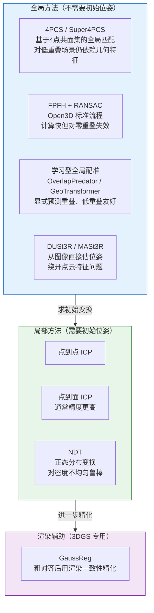
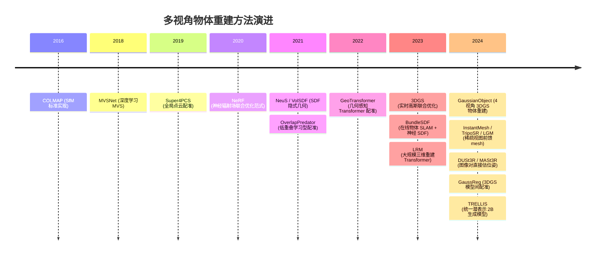

# 多视角物体三维重建：从联合优化到后验融合

> **一句话**：给定一个物体不同视角的若干张图片，如何重建出完整的三维表示？这个问题有四条根本不同的路线，区别不在于用哪个算法，而在于"融合"这一步发生在哪里——有的路线让融合消失在优化过程中，有的把它内化进神经网络权重，有的把它变成显式的后处理步骤。
>
> **适用读者**：了解 3DGS 基本原理，想系统梳理"多视角物体重建"这个问题全貌，或者正在面对正面+背面两批点云如何合并这类实际问题的读者。

## 相关阅读

- [3D Gaussian Splatting：用一堆椭球把真实场景搬进电脑](/前置知识/007a_前置知识_3D_Gaussian_Splatting三维场景重建) — 第二、三层路线的核心技术基础
- [NeuS：用符号距离场把"模糊密度"变成精确表面](/前置知识/013a_前置知识_NeuS_符号距离场隐式表面重建) — 联合优化路线的隐式几何代表
- [相机内外参标定](/前置知识/012a_前置知识_相机内外参标定) — 经典路线的前提，位姿从哪里来
- [Chamfer 距离：点云形状相似性度量](/前置知识/011b_前置知识_Chamfer距离_点云形状相似性度量) — 重建质量评估的标准工具
- [TRELLIS 深度解析（系列）](/系列/trellis_deep_dive) — 前馈大模型路线的完整深度解析
- [场景采集与重建：COLMAP + 3DGUT](/系列/nvidia_real2sim2real_deep_dive/02_场景重建_COLMAP与3DGUT) — 经典路线的工程实践指南

---

## 四条路线全景

"融合"这一步发生在哪里，决定了方法的整个结构。四条路线对"融合"的处理完全不同：经典路线把融合做成一个显式的深度图合并步骤；联合优化路线让融合消失在梯度下降里；前馈大模型路线把融合内化进注意力权重；后验融合路线是在两个已经训练好的模型之间事后求变换。

```mermaid
flowchart TD
    subgraph A["路线一：经典 SfM + MVS"]
        A1["多视角图像"] --> A2["COLMAP\n特征匹配 + BA\n求相机位姿"]
        A2 --> A3["MVS 深度估计\n(MVSNet / PatchmatchNet)"]
        A3 --> A4["深度图融合\n→ 稠密点云"]
        A4 --> A5["表面重建\n(泊松 / TSDF)"]
    end

    subgraph B["路线二：联合优化"]
        B1["多视角图像\n+ 位姿（已知）"] --> B2["联合梯度优化\n(NeRF / NeuS / 3DGS)"]
        B2 --> B3["隐式场 / 高斯集合\n直接输出"]
    end

    subgraph C["路线三：前馈大模型"]
        C1["少量图像\n（无需位姿）"] --> C2["Transformer\nCross-Attention\n多视角特征互校"]
        C2 --> C3["一次前向\n输出统一 3D 资产"]
    end

    subgraph D["路线四：后验融合"]
        D1["批次 A 图像"] --> D2["独立重建\n模型 A"]
        D3["批次 B 图像"] --> D4["独立重建\n模型 B"]
        D2 --> D5["配准\n求刚体变换 T"]
        D4 --> D5
        D5 --> D6["变换后合并"]
    end

    style A fill:#E3F2FD,stroke:#1565C0
    style B fill:#E8F5E9,stroke:#2E7D32
    style C fill:#F3E5F5,stroke:#6A1B9A
    style D fill:#FFF3E0,stroke:#E65100
```

> 四条路线的融合位置完全不同。路线二中，"融合"这个词根本不出现——多视角约束以渐变梯度的形式天然合并进优化目标里。路线三中，融合在 Transformer 的 cross-attention 里完成，对用户透明。只有路线一和路线四有用户可见的显式合并步骤。

| 路线 | 融合在哪一层 | 需要位姿 | 典型速度 | 几何质量 |
|------|------------|---------|---------|---------|
| 经典 SfM + MVS | 深度图融合（显式后处理） | 由 SfM 自动求 | 分钟级 | 高，可控 |
| 联合优化（3DGS / NeRF） | 不显式，梯度自然合并 | 需要（SfM 或 SLAM 求） | 数分钟到数小时 | 高 |
| 前馈大模型（LRM / TRELLIS） | 注意力内部 | **不需要** | 秒级 | 中（依赖生成先验） |
| 后验融合（GaussReg 等） | 外部配准步骤（显式） | 各自独立，**不共享** | 取决于配准方法 | 受配准误差限制 |

---

## 一、经典路线：SfM + MVS

这条路线把"多视角重建"分解成三个串行子问题：先求相机位姿，再估计每视角深度，最后把所有深度图融合成一个点云。每个子问题都是独立的、可替换的模块。

### 1.1 相机位姿从哪里来：SfM

Structure-from-Motion（SfM，运动恢复结构）从图像的特征点匹配出发，同时优化相机位姿和稀疏三维点云。其核心步骤是光束法平差（Bundle Adjustment，BA）——把"从某个位姿投影出来的三维点，在图像里应该落在哪里"这个约束写成残差，对所有图像同时最小化。

**COLMAP**（Schönberger & Frahm，CVPR 2016）是这条线最主流的开源实现，支持从完全无序的图像集合恢复位姿，也是 3DGS、NeRF 等联合优化方法获取初始位姿的标准前置步骤。在物体重建场景里，SfM 还会给出初始稀疏点云，作为后续高斯初始化的种子点。

SfM 的硬约束是：图像之间必须有足够的特征点重叠，才能建立匹配关系、把位姿连成一个连通图。这正是"正面 + 背面"这类极低重叠场景的致命弱点——两批图像之间没有共同视野，SfM 无法把它们的位姿连起来，整个经典路线从这一步就卡死了。

### 1.2 深度估计：MVS

有了位姿之后，多视角立体（Multi-View Stereo，MVS）对每张图像估计一张稠密深度图。经典方法（如 PatchMatch Stereo）在相邻视角之间做块匹配；学习型方法把它建模成一个代价体（cost volume）回归问题。

**MVSNet**（Yao et al.，ECCV 2018）是第一个端到端可微的深度学习 MVS 方法：把参考图与多张源图像的特征做可微的单应变换（homography warping），在不同深度假设下构建一个三维代价体，再用 3D 卷积回归出深度图。后续的 **RVSNet**、**CVP-MVSNet**、**PatchmatchNet** 等沿着"让代价体更稀疏、更高效"的方向持续改进。

### 1.3 深度图融合与表面重建

各视角的深度图在反投影到三维空间后会有重叠和噪声，需要一个融合步骤把它们合并成一致的稠密点云：对相邻深度图之间相互一致（在对方视角投影后残差在阈值内）的像素才保留，滤掉噪声点后反投影。

点云之后的表面重建有两条主流路：**泊松表面重建**（Kazhdan，2006）把带法向量的点云拟合成一个隐式指示函数再提取等值面，适合物体级封闭表面；**TSDF 融合**（KinectFusion，ISMAR 2011）把每张深度图积分进一个截断符号距离场（Truncated SDF），再用 marching cubes 提取 mesh，适合增量式在线扫描。

### 1.4 物体级经典 benchmark：DTU

DTU（Jensen et al.，CVPR 2014）是 MVS 领域最标准的物体重建 benchmark：固定物体、半球形多视角扫描、有 ground-truth 激光扫描点云。几乎所有 MVS 方法都在 DTU 上报告精度（Accuracy）和完整度（Completeness），是衡量这条路线几何质量的标准尺。

---

## 二、联合优化路线：NeRF / NeuS / 3DGS

这条路线换了一个根本不同的框架：不再先求位姿再求深度再融合，而是在已知位姿的前提下，把"从三维表示出发、渲染出来的图像应该和真实图像一致"这个约束写成损失函数，对所有视角**同时**做梯度下降。"融合"在这里不是一个独立的步骤——多视角信息以梯度的形式自然汇聚到同一个优化目标里。

### 2.1 NeRF：神经辐射场

**NeRF**（Mildenhall et al.，ECCV 2020）用一个多层感知机（MLP）隐式表示场景：输入三维坐标 $(x,y,z)$ 和观察方向，输出颜色和体密度。渲染时沿光线积分体密度得到 alpha 合成颜色，与真实像素比较计算 MSE 损失，对网络权重做梯度下降。

对多视角物体重建来说，NeRF 的贡献不是算法本身，而是它确立了"以渲染一致性为目标、从多视角图像直接优化三维表示"这个范式，后续所有联合优化方法都是这个范式的变体。

NeRF 的工程瓶颈是渲染慢（每张图需要对数百万条光线各自采样数百个点并查询 MLP），导致训练需要数小时，推理需要数秒每帧，对需要大量渲染的下游任务（比如 real2sim 里跑 RL 训练）几乎不可用。

### 2.2 NeuS：把密度换成符号距离场

**NeuS**（Wang et al.，NeurIPS 2021）保留 NeRF 的优化范式，但把体密度场替换成符号距离场（Signed Distance Field，SDF）：MLP 输出到表面的有符号距离，渲染时用一个专门设计的权重函数把 SDF 转换成 alpha 合成权重。

这个替换的关键好处是：SDF 的零等值面是一个数学上明确的连续表面，可以直接用 marching cubes 提取出高质量 mesh，而 NeRF 的密度场提取 mesh 会出现噪声和厚度问题。物体重建的几何精度要求比场景重建高得多，NeuS 系列（VolSDF、NeuS2 等）在这个场景里几何质量优于原始 NeRF。

### 2.3 3DGS：从隐式到显式，速度提升两个数量级

**3D Gaussian Splatting**（Kerbl et al.，SIGGRAPH 2023）把隐式 MLP 替换成几十万个显式三维高斯椭球：每个椭球有位置、协方差（形状）、颜色（球谐函数系数）、不透明度四类参数，渲染时直接把椭球投影到 2D 屏幕做 alpha 合成，不需要任何 MLP 前向传播。

速度上的提升来自这个替换：图形学的光栅化 pipeline 可以在 GPU 上高度并行，渲染一帧 3DGS 只需要几毫秒，比 NeRF 快 100× 以上，实现了实时渲染。训练通常只需要十几分钟。这个速度使得 3DGS 成为 real2sim 流程里的主流重建后端。

对多视角物体重建来说，3DGS 的标准流程是：先用 COLMAP 求位姿和稀疏点云，再以稀疏点云初始化高斯，对所有视角同时优化，自适应密度控制（分裂、克隆、剪枝）让高斯分布自动适应物体表面。

### 2.4 针对物体级稀疏视角的扩展

标准 3DGS 需要几十张以上密集视角才能覆盖物体全貌，视角稀疏时没有覆盖的区域会出现空洞。几个专门针对物体级稀疏视角的扩展值得关注：

**GaussianObject**（Yang et al.，ECCV 2024）只输入 4 张视角就能重建完整物体。核心思路是两步走：先用视觉外壳（visual hull）从图像轮廓粗略估计物体形状并初始化高斯，再用一个修复扩散模型（repair diffusion model）对没有覆盖的视角做幻觉补全——生成模型在这里充当了"先验"，填补了纯几何优化在稀疏视角下无法覆盖的区域。

**BundleSDF**（Wen et al.，CVPR 2023）面向手持物体边移动边扫描的场景：一个 SLAM 模块在线跟踪物体的 6DoF 位姿，同时把每帧的深度和颜色信息增量融合进神经 SDF 中，无需离线 SfM 预处理。这个设计对"用机器人抓持物体并转动扫描"这类场景特别自然。

---

## 三、前馈大模型路线：一次前向即完成重建

联合优化路线有一个无法绕过的前提：必须事先用 SfM 或 SLAM 求出所有图像的相机位姿。如果图像之间重叠不足（比如正面 + 背面这种极端情况），SfM 会直接失败，整条路线从起点就卡死。

前馈大模型路线彻底绕开这个问题：用大规模三维数据训练一个 Transformer，让它直接把若干张图像映射成三维资产，**不需要任何输入位姿**。"融合"在这里发生在注意力机制内部——多张图像同时进入 Transformer，cross-attention 让不同视角的特征互相校正，网络从训练数据中学到的三维先验帮助它在没有覆盖的区域做合理的补全。

### 3.1 LRM：第一个大规模三维重建 Transformer

**LRM**（Large Reconstruction Model，Hong et al.，ICLR 2024）建立了这条路线的基础架构：用一个约 500M 参数的 Transformer，输入一张或少量图像，直接输出一个三平面（triplane）NeRF 表示。训练数据来自 Objaverse 等大规模三维资产库，覆盖几十万个物体类别，使模型获得了强烈的三维先验——从一张图看到一把椅子的正面，模型能合理猜出椅背和椅腿的形状，即使输入图像里完全没有这些部分。

LRM 的架构选择值得理解：为什么用 triplane 而不是直接输出点云或 mesh？Triplane 是三个互相垂直的特征平面（XY、YZ、XZ），查询三维空间任意一点的特征时，把该点在三个平面上的投影双线性插值后拼接即得到该点的局部特征，再接小 MLP 解码出颜色和密度。Triplane 比体素稀疏（三个 $H \times W$ 平面 vs. $H \times W \times D$ 的体积），但比点云有规则的空间结构方便网络输出，是一个在表达能力和计算效率之间取得平衡的设计。

### 3.2 InstantMesh：从单张图到 mesh，10 秒内

**InstantMesh**（Xu et al.，arXiv 2024）把多视角扩散模型和稀疏视图 LRM 串联起来，形成一个完整的单图到 mesh 的 pipeline：

1. 给定一张输入图像，用多视角扩散模型（Zero123++ 或 MVDiffusion 等）生成固定的 6 个标准视角图像
2. 把这 6 张图输入稀疏视图 LRM，直接回归出 triplane NeRF
3. 用 FlexiCubes 从 triplane 提取可微分 mesh

整个过程约 10 秒，产出的 mesh 可以直接进入仿真或渲染流程。这条 pipeline 的关键洞察是：多视角扩散模型生成的图像已经在固定的相对位姿坐标系里（0°、60°、120°、180°、240°、300°），所以 LRM 根本不需要外部位姿估计——位姿已经被烘焙进生成图像的语义里了。

### 3.3 TRELLIS：统一潜表示，三种格式随选

**TRELLIS**（微软研究院，2024 年底）是目前这条路线规模最大、输出质量最高的公开模型，2B 参数，在 50 万个三维物体上训练。它的核心贡献是 SLAT（Structured LATent）表示：把三维结构和外观编码在同一个稀疏体素潜空间里，解码时接不同的解码头就能输出高斯、mesh 或辐射场，同一份 latent 三种格式随选。关于 TRELLIS 的完整原理，见系列文章 [TRELLIS 深度解析](/系列/trellis_deep_dive)。

对物体重建来说，TRELLIS 的实际限制是：它是**生成式**模型而非纯重建模型——对训练数据覆盖好的物体类别效果出色，对结构非常特异（比如细长的工业零件、拓扑复杂的机械臂关节）的物体容易出现形状失真。这是这条路线的共性问题：网络的三维先验填补了缺失视角，但填补的内容是"训练数据里长这样的概率最高"，不是"这个物体的几何真值"。

### 3.4 DUSt3R / MASt3R：不重建而是估位姿

**DUSt3R**（Wang et al.，CVPR 2024）是这一时期另一个值得单独提出的工作，它的目标和 LRM 不同：不是直接输出三维表示，而是从任意图像对直接回归两张图各自的点图（pointmap，即每个像素对应的三维坐标），再从多张图像的点图全局对齐出统一坐标系下的位姿和点云。

DUSt3R 的价值在于：它对**无重叠或极低重叠**的图像对也能给出合理的相对位姿估计，这正是 SfM 失败的那种场景。它的三维先验（从大规模数据训练来的几何理解）让它能在缺乏特征点匹配的情况下，从图像内容猜测出大致的空间关系。**MASt3R** 是其后续版本，进一步把匹配和重建统一进同一个网络，精度更高。

---

## 四、后验融合路线：两套已训练模型的配准

当两批图像因为任何原因无法共享坐标系——拍摄间物体被移动、不同传感器模态、零重叠视角、分布式采集——只能分别重建再事后合并，这就是后验融合路线。它是四条路线里出现最晚、工程挑战最大的一条。

### 4.1 问题结构：求刚体变换 T

两套模型各有自己的局部坐标系，后验融合的核心任务是找到一个刚体变换 $T$（旋转 + 平移）使得：把模型 B 的坐标系通过 $T$ 变换到模型 A 的坐标系后，两套模型在重叠区域（如果有的话）的几何一致，在非重叠区域各自描述物体的不同部分。

对 3DGS 模型来说，$T$ 作用的对象是每个高斯的均值（位置向量）和协方差矩阵（协方差矩阵需要用旋转矩阵做相合变换：$\Sigma' = R \Sigma R^\top$）。

### 4.2 经典点云配准：ICP 及其局限

**ICP**（Iterative Closest Point）是最经典的局部配准方法：交替执行"找最近点对"和"最小化点对距离"两步，收敛到局部最优。它需要一个好的初始位姿估计，对初始误差敏感——如果初始位姿差太多（比如正面和背面，初始误差接近 180°），ICP 几乎必然收敛到错误的局部极值。

**FPFH + RANSAC**（Open3D 的标准配准 pipeline）先给每个点计算快速点特征直方图（Fast Point Feature Histograms），在全局范围内用 RANSAC 找一组鲁棒点对应，再用 ICP 精调。对有一定重叠的两片点云，这个 pipeline 比纯 ICP 鲁棒得多；但对零重叠的正面 + 背面场景，FPFH 也难以找到可靠的跨批次对应。

### 4.3 学习型配准：显式预测重叠

近年学习型配准方法的核心进步是**让网络明确知道自己在哪里重叠**，而不是假设整体都重叠。

**OverlapPredator**（Huang et al.，CVPR 2021）在特征提取网络里加了一个重叠分数预测头：对每个点预测它落在对方点云重叠区域的概率，配准时只用高重叠分数的点做匹配。这个设计使它在低重叠（10%-30%）场景下显著优于 FPFH。

**GeoTransformer**（Qin et al.，CVPR 2022）用几何感知 Transformer 提取局部坐标系不变的特征，做粗粒度（patch 级）到细粒度（点级）的两阶段匹配。在 3DMatch 和 KITTI 等 benchmark 上，它以更少的匹配点达到了更高的配准精度。这两个方法是目前低重叠点云配准的最优选之一。

### 4.4 3DGS 专用配准：GaussReg

**GaussReg**（arXiv 2407.05254，2024 年 7 月）是针对"两个独立训练的 3DGS 模型之间求刚体变换"这个特定问题提出的 coarse-to-fine 框架：

1. **粗配准**：从两个 3DGS 模型各自提取点云（直接用高斯均值），在点云层面用传统配准方法（FPFH + RANSAC 或学习型方法）求一个初始变换
2. **细配准**：在粗变换的基础上，利用 3DGS 模型的可渲染特性，从对齐后的视角渲染两侧图像，在渲染图像之间做特征对齐来精化变换——这是纯点云方法做不到的，因为 3DGS 携带外观信息，颜色一致性提供了额外的约束

GaussReg 的实验场景主要是室内场景（两个有部分重叠的 splat 子图），对物体级零重叠场景的鲁棒性在论文里没有系统评估，实际使用时需要预期精度下降。

### 4.5 多子图融合：面向大规模场景

当场景是多次扫描（如多机器人分布式扫描）拼接的时候，问题变成"多个子地图的全局一致融合"，需要额外处理累积漂移和回环检测。

**Automated 3DGS Registration and Fusion via Skeleton Alignment**（arXiv 2507.20480）提出先提取场景骨架对齐多个子图，再在高斯层面做自适应特征融合，针对大规模多子图场景。

对物体级正面 + 背面的双子图问题，这类方法通常过于复杂；直接用 GaussReg 的两步框架更实际。

---

## 五、配准方法详解：正面 + 背面这类极低重叠场景

后验融合路线的核心瓶颈是配准。正面 + 背面是所有配准场景里最难的一类：理论重叠面积接近零（物体侧面是唯一可能的重叠区域），几何特征无法跨批次匹配，SfM 也无法提供相对位姿的初始估计。

### 5.1 配准方法谱系

> 标准配准 pipeline 是全局方法求初始变换、局部方法精化。对正面 + 背面这类场景，全局方法是瓶颈。DUSt3R 绕开了点云特征、直接从图像估位姿，是目前对极低重叠场景最可靠的全局方案。

### 5.2 正面 + 背面场景的推荐路径

按成功率从高到低排列：

**路径 A（最推荐）：补拍侧面，走联合重建。** 加若干张 45°–90° 的侧视角，让正面和背面都通过侧面建立重叠，用 COLMAP 把所有视角的位姿连进同一个坐标系，再跑 3DGS 联合优化。这样后验融合这个步骤直接消失。实践中这是稳定性最高的方案。

**路径 B（使用转台）：已知旋转角 + ICP 精调。** 如果拍摄时使用转台，正面和背面之间的旋转角度已知（比如精确 180°），直接把这个旋转作为初始变换，再用点到面 ICP 精调残余误差。这个方案的精度取决于转台的机械精度和 ICP 的收敛。

**路径 C：DUSt3R 估计相对位姿。** 给 DUSt3R 输入正面的若干张图和背面的若干张图，让它估计所有图像对的相对位姿，再全局优化对齐。DUSt3R 在无重叠图像对上有一定泛化能力，但精度比有重叠的情况低。

**路径 D：OverlapPredator / GeoTransformer + ICP。** 如果两批点云在侧面有少量重叠（哪怕只有 10%–20%），这两个学习型配准方法比 FPFH 可靠得多。对完全零重叠无效。

**路径 E（最后兜底）：前馈生成模型。** 如果物体是日常类别（椅子、杯子、工具等），用 TRELLIS 或 InstantMesh 从正面的几张图直接生成完整物体。模型会用训练先验"猜"背面，精度无法保证，但至少能给出一个合理的完整形状。

---

## 六、方法演进时间线

> 两条技术路线并行演进：左侧的经典路线（SfM → MVS → 点云配准）稳定成熟、几何可控；右侧的学习型路线（NeRF → 3DGS → 前馈大模型）不断消除对位姿和密集视角的依赖，以生成先验换取采集门槛的降低。两条路线的交汇点是 DUSt3R 和 GaussReg：它们把学习型方法引入位姿估计和配准，同时保留了经典路线"可解释、可控制"的特性。

---

## 七、各路线在常见场景下的选择矩阵

| 场景 | 推荐路线 | 理由 |
|------|---------|------|
| 转台扫描，正反两面，位姿已知 | 联合优化（3DGS） + 已知位姿初始化 | 有精确旋转作为初始值，ICP 精调后联合训练 |
| 手持绕拍，完整视角，无极端遮挡 | COLMAP + 3DGS | 标准 pipeline，视角覆盖足则几何质量最高 |
| 正面 + 背面，零重叠，位姿未知 | 补拍侧面（路径 A）或 DUSt3R（路径 C） | 零重叠场景配准本质困难，侧面桥接最可靠 |
| 物体是日常类别，只有 1–4 张图 | TRELLIS / InstantMesh（前馈路线） | 生成先验补全缺失视角，无需多视角采集 |
| 工业零件，需高精几何，允许密集扫描 | COLMAP + NeuS / 2DGS | 需要精确表面，3DGS 提取 mesh 质量略逊于 SDF 路线 |
| 两台机器人分别扫描同一物体 | GaussReg（后验融合） | 位姿坐标系物理上无法共享，只能分别重建再配准 |

---

## 延伸阅读

- [TRELLIS 深度解析：从一张图到三维资产的完整链路](/系列/trellis_deep_dive) — 前馈路线最完整的工程实现解析，7 章，含代码走读
- [TRELLIS.2 深度解析](/系列/trellis2_deep_dive) — TRELLIS 续作，O-Voxel 原生三维表示，9 章
- [场景采集与重建：COLMAP + 3DGUT](/系列/nvidia_real2sim2real_deep_dive/02_场景重建_COLMAP与3DGUT) — 经典路线的实际操作流程
- [2DGS：用平面盘片取代体积椭球，重建精确几何](/论文综述/152_2DGS_2D高斯泼溅精确几何重建) — 高斯路线的几何改进版本
- [SuGaR：让 3D 高斯"贴"上表面，快速提取可编辑网格](/论文综述/153_SuGaR_表面对齐高斯泼溅网格重建) — 从 3DGS 提取高质量 mesh 的专用方法
- [具身高斯与机器人世界模型：五条路线综述（S36）](/论文综述/S36_具身高斯_机器人世界模型综述) — 重建出的高斯场如何进一步赋予机器人碰撞感知、物理仿真和语义理解能力
