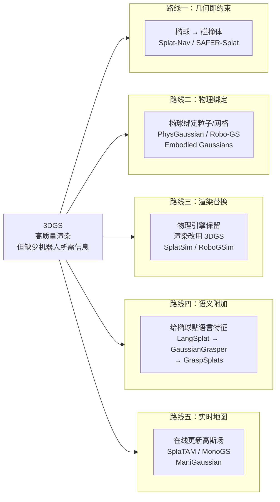
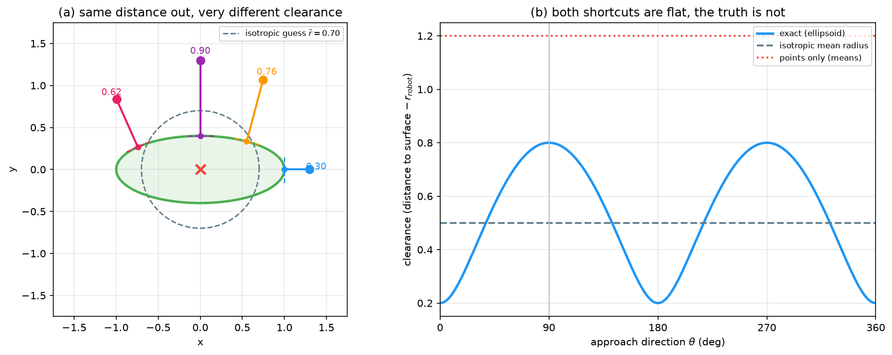
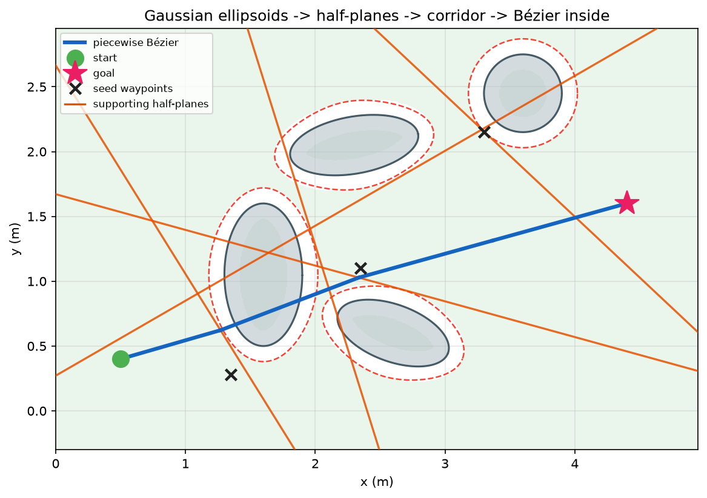
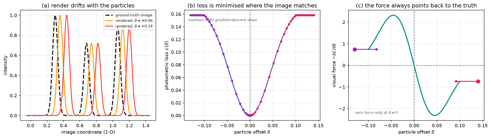
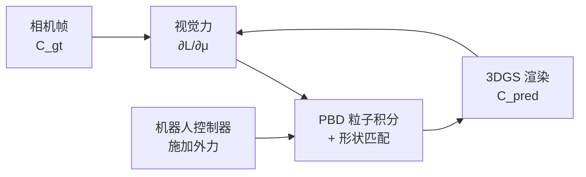
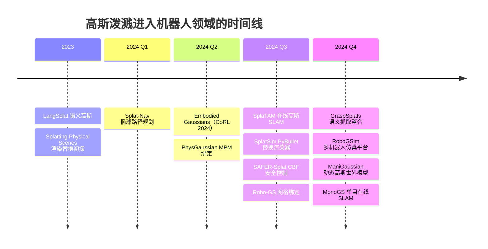
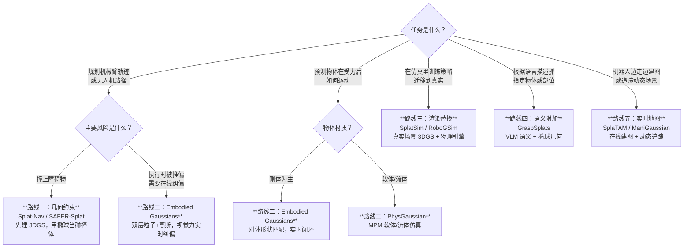

# 具身高斯与机器人世界模型：五条路线综述

> **一句话**：3D Gaussian Splatting 让场景渲染又快又好，但它对机器人一无所用——它不知道碰撞、不懂物理、看不见语义、追不上动态变化。五条研究路线各自在这张白纸上补写缺失的一栏，读完这篇综述，你会明白每条路线补的是什么、代价是什么、以及在真实任务里应该选哪条。
>
> **适用读者**：了解 3DGS 基本原理，想系统了解"高斯泼溅怎么为机器人所用"的读者；或者正在做机器人操作/导航/仿真，想知道能从 3DGS 借到什么工具的工程师。

## 相关阅读

- [3D Gaussian Splatting 基础](/前置知识/007a_前置知识_3D_Gaussian_Splatting三维场景重建) — 椭球参数、可微光栅化、优化流程
- [3DGS 协方差矩阵的几何含义](/前置知识/009c_前置知识_3DGS为什么使用协方差矩阵) — 椭球形状如何从协方差矩阵读出
- [Position-Based Dynamics：粒子弹性模拟基础](/前置知识/006f_前置知识_基于位置的动力学PBD) — 具身高斯粒子层的力学基础
- [MPM：连续介质力学的粒子数值方案](/前置知识/006n_前置知识_物质点法MPM基础_颗粒材料与网格粒子转换) — PhysGaussian 的仿真内核
- [控制屏障函数：给控制器装安全滤波](/前置知识/015d_前置知识_控制屏障函数CBF与安全滤波) — SAFER-Splat 的安全约束框架
- [形状匹配：刚体粒子仿真的刚性保持](/前置知识/015e_前置知识_形状匹配与刚体粒子仿真) — Embodied Gaussians 刚体约束的实现方式
- [DINOv2 视觉特征提取器](/前置知识/013b_前置知识_DINOv2视觉特征提取器) — 语义路线借助的空间敏感特征
- [碰撞近似类型](/前置知识/011a_前置知识_碰撞近似类型_原理精度与性能) — 各路线碰撞建模的横向对比
- [Splatting Physical Scenes（论文 140）](/论文综述/140_SplattingPhysicalScenes_端到端可微Real2Sim) — 渲染替换路线的早期工作
- [RoboGSim（论文 150）](/论文综述/150_RoboGSim_Real2Sim2Real高斯泼溅仿真器) — 仿真路线的代表之一

---

## 五条路线全景

3DGS 给了机器人一张高质量的"视觉白板"：它知道每个椭球在哪里、长什么形状、颜色如何，但它不知道哪个椭球是固体、哪个会动、哪个是杯子的把手、哪个挡住了机械臂的路。五条路线各自在白板上补写一栏：

> 五条路线不互斥——真实系统往往叠用多条。Embodied Gaussians 是路线二的代表，但它的视觉力机制也借了路线三"渲染即预测"的思路；GraspSplats 用路线四的语义选目标，再用路线一的椭球几何算抓取点。

---

## 一、路线一：几何即约束

这条路线的出发点是：3DGS 已经给了你每个椭球的精确几何参数（均值 $\mu$、协方差 $\Sigma$），为什么要把它们丢掉，然后再另外算一套碰撞表示？椭球本身就是障碍物的形状描述，直接用它构建安全约束，比点云或包围盒更精确。

### 为什么椭球比点云精确

椭球和点云的本质区别不在精度，在各向异性。从高斯中心出发，沿长轴方向往外走 1 米到达椭球表面；沿短轴方向只需走 0.4 米。如果把椭球简化成一个点或一个各向同性的球，沿不同方向的安全裕度就变成了同一个常数——在长轴方向上会严重高估安全间隙（见图 2）。

{.img-wide}

*图 2：同一个椭圆（A=1.0, B=0.4），探测点到椭圆表面的精确间隙（蓝线）在长轴方向只有 0.20 m，在短轴方向有 0.80 m。各向同性近似（灰虚线，以平均半径 0.70 m 计）在长轴方向高估安全间隙 0.30 m；点云近似（红点线）则完全忽略障碍物厚度，误差更大。*

### Splat-Nav：椭球到安全走廊

Splat-Nav（Chen et al., 2024，arXiv:2403.02751）把这个几何事实做成一套完整的路径规划流程：

1. 给每个椭球做机器人半径膨胀（Minkowski 膨胀），把"机器人球心的安全区域"等价成"零半径质点在膨胀椭球外的安全区域"
2. 从路径上的种子点出发，对附近每个椭球求支撑超平面——从种子点向椭球最近点连线，在最近点处的切平面就是这张超平面
3. 所有超平面的交集构成一段凸多面体走廊；相邻种子点的走廊叠在一起，形成贯穿起终点的安全走廊
4. 在走廊里用二次规划求解分段贝塞尔曲线的控制点：贝塞尔曲线有凸包性质——控制点在多面体内则整段曲线都在多面体内，安全保证在连续区间上成立，而非只在采样点上

图 3 展示了这个构造过程：

{.img-full}

*图 3：绿色填充区域是安全走廊（各段凸多面体的并），橙色线是支撑超平面，蓝色曲线是满足安全约束的分段贝塞尔路径，红虚线是各椭球的机器人半径膨胀边界。路径绕开四个障碍物，整条曲线始终位于走廊内。*

### SAFER-Splat：控制级的椭球安全滤波

Splat-Nav 在运动规划层工作——先规划再执行。SAFER-Splat（Li et al., 2024，arXiv:2409.01284）把安全约束下放到控制层：每个控制周期用控制屏障函数（CBF）实时修正末端执行器的速度指令。

对每个附近的高斯椭球 $i$，定义屏障函数：

$$
h_i(\mathbf{p}) = \phi_i(\hat{\mathbf{p}}) \cdot d_i(\hat{\mathbf{p}}) - (r + \varepsilon)^2
$$

**这个公式在做什么**：$h_i > 0$ 当且仅当机器人末端在椭球外且有足够安全裕度 $\varepsilon$；$h_i \leq 0$ 表示已经进入危险区。$\phi_i$ 是符号函数（在椭球外为正，内为负），$d_i$ 是到椭球表面的距离的某个单调函数。

::: details 📐 公式详解（点击展开）

| 子表达式 | 它是谁 | 它在干嘛 |
|---------|--------|---------|
| $\hat{\mathbf{p}}$ | 机器人末端在椭球坐标系下的归一化位置（输入） | 把一般椭球变换成单位球，便于计算 |
| $\phi_i = \text{sign}(\hat{\mathbf{p}}^\top \mathbf{S}^{-2} \hat{\mathbf{p}} - 1)$ | 符号函数（±1，状态） | +1 在椭球外，−1 在椭球内 |
| $d_i(\hat{\mathbf{p}})$ | 到椭球表面的距离（状态） | 衡量当前有多安全 |
| $(r + \varepsilon)^2$ | 安全裕度阈值（用户可调） | 在碰撞半径 $r$ 外再加一层 $\varepsilon$ 的缓冲 |

**用人话读**：末端执行器离椭球越近，$h_i$ 越小；进入危险半径后 $h_i$ 变负，触发 CBF 强制刹车。

**为什么用距离的平方而不是距离**：使得梯度（力）在靠近表面时平滑变化，避免在边界处出现梯度跳变，QP 更稳定。
:::

因为控制量（加速度）进入 $\ddot{h}$ 而不是 $\dot{h}$（相对度为 2），SAFER-Splat 用二阶 CBF 推导约束，然后放进最小代价 QP 里求解安全修正量：

$$
\mathbf{u}^* = \arg\min_\mathbf{u} \|\mathbf{u} - \bar{\mathbf{u}}\|^2 \quad \text{s.t.} \quad \text{2nd-order CBF constraints}
$$

**这个公式在做什么**：在所有不会违反安全约束的加速度里，找一个和名义控制器输出偏差最小的——最小代价安全修正。

::: details 📐 公式详解（点击展开）

| 子表达式 | 它是谁 | 它在干嘛 |
|---------|--------|---------|
| $\bar{\mathbf{u}}$ | 名义控制器输出（输入，来自任务控制器） | 只管完成任务，不考虑障碍物 |
| $\mathbf{u}^*$ | QP 最优解（输出，发给执行器） | 既安全又尽量保留任务意图 |
| 二阶 CBF 约束 | 展开后形如 $\mathbf{a}^\top \mathbf{u} \geq b$（线性不等式） | 确保每个附近椭球的 $\ddot{h} + (\alpha+\beta)\dot{h} + \alpha\beta h \geq 0$ |

**用人话读**：把名义指令微调到刚好不碰撞，调整幅度尽量小。

**为什么用 QP 而不是直接截断**：截断会造成不连续的"抖动"控制；QP 给出连续的最优修正，且单个约束时可以解析求解（$O(1)$ 时间），多约束时 OSQP 也能在毫秒内求解。
:::

实际性能：50 万个高斯里约 99.9% 在每步被剪枝，只有末端附近极少数约束进入 QP，控制频率达到 15 Hz。

---

## 二、路线二：物理绑定

路线一把椭球当碰撞体，但椭球本身不运动。路线二走得更深：让椭球参与物理仿真，物体受力后，椭球也跟着变形或移动，从而能预测"推一下杯子会怎样"。

这条路线有三个代表性的绑定方案，区别在于"椭球绑到谁上面"：

| 方案 | 绑定目标 | 物理方法 | 渲染方式 |
|------|---------|---------|---------|
| PhysGaussian | 椭球自身携带 MPM 物质点 | MPM 连续介质仿真 | 变形后直接渲染 |
| Robo-GS | 三角网格顶点 | 网格动力学 | 椭球跟随网格顶点移动 |
| Embodied Gaussians | 粒子层 + 闭环视觉力 | PBD + 形状匹配 | 粒子运动带动椭球 |

### PhysGaussian：MPM 驻留在椭球里

PhysGaussian（Xie et al., 2024）的思路是"你看到什么，就仿真什么"：不单独维护一套物理网格，直接把 MPM 物质点住进高斯椭球里，每个椭球既是渲染单元又是物理载体。

MPM 在每个时间步先把物质点的速度插值到背景网格（粒子到格，P2G），在网格上应用力和边界条件，再把网格速度插值回物质点（格到粒子，G2P），最后移动物质点的位置。PhysGaussian 在 G2P 之后，用物质点的变形梯度更新椭球的协方差矩阵——物体拉伸时椭球拉长，弯曲时椭球旋转，渲染结果和物理状态始终自洽。

优势：支持弹性、塑性、流体等多种材质，渲染即仿真，无需对齐两套数据结构。
代价：MPM 的背景网格分辨率直接制约仿真精度，细节几何（薄壳、细线）容易被低估。

### Robo-GS：高斯骑在网格上

Robo-GS（Shi et al., 2024，arXiv:2408.14873）保留了经典的物理网格，但把 3DGS 当渲染皮肤附着在网格表面。网格顶点运动，对应区域的椭球通过蒙皮权重（线性蒙皮或双四元数蒙皮）跟随移动，协方差矩阵通过线性变换更新。

这个绑定的好处在于：网格是物理引擎（MuJoCo、Isaac Gym）的原生格式，约束、铰接、碰撞检测全部沿用成熟工具；3DGS 只负责把网格的外观渲染得逼真。整个流程=标准物理仿真+外观替换，和路线三非常接近，区别在于网格真的参与物理，而不只是渲染背景。

代价：网格和高斯需要对齐，对于没有先验网格的任意刚体（比如随机摆放的杯子），需要先从 3DGS 重建出网格，这一步本身就有误差。

### Embodied Gaussians：粒子闭环世界模型

Embodied Gaussians（Abou-Chakra et al., 2024，arXiv:2406.10788）是这条路线里和机器人闭环控制结合最紧的方案，也是本综述的核心论文。

架构是双层结构：底层是一套**粒子层**，负责物理动力学；上层是**高斯层**，每个椭球绑定到某个粒子，粒子移动则椭球跟着移动。粒子层用 PBD（Position-Based Dynamics）做积分，刚体通过**形状匹配**约束维持刚性。

真正让这个系统成为"世界模型"而非离线仿真器的，是**视觉力**机制：

{.img-full}

*图 1：三个一维高斯（左图）在粒子整体偏移 δ 后，渲染图与真实图不再重合，光度损失 $\mathcal{L}(\delta)$ 升高（中图）；损失对位置的负梯度是一个"视觉力"（右图），始终指向 δ=0，即粒子实际位置。渐变下降点轨迹（彩色标记）在 50 步内收敛到零。*

视觉力的数学结构：用当前帧的粒子位置驱动椭球，渲染出预测图像；与同帧真实相机图像做光度差：

$$
\mathcal{L} = \sum_{\text{像素}} \lvert C_\text{pred} - C_\text{gt} \rvert
$$

**这个公式在做什么**：逐像素比较预测颜色和真实颜色，差越大损失越高。每帧如果粒子位置偏了，渲染颜色就偏了，损失就有梯度，梯度反传到粒子坐标上，就形成一个指向真实位置的修正力。

::: details 📐 公式详解（点击展开）

| 子表达式 | 它是谁 | 它在干嘛 |
|---------|--------|---------|
| $C_\text{pred}$ | 当前粒子位置驱动渲染出的预测像素颜色（状态） | 反映粒子当前在哪里 |
| $C_\text{gt}$ | 当前帧相机拍到的真实像素颜色（输入，来自摄像头） | 反映物体实际在哪里 |
| $\lvert \cdot \rvert$ | L1 距离 | L1 对大偏差不过分惩罚，比 L2 更鲁棒 |
| $\sum_{\text{像素}}$ | 对所有像素求和 | 累积全图信号，单像素误差小，全图误差显著 |

**用人话读**：如果粒子偏了，渲染图就偏色，损失就有方向，这个方向就是把粒子推回去的力。

**为什么这是"闭环"**：物理仿真在推进时会累积误差；视觉力每帧都从真实图像里拿到一个矫正信号，把误差压下去——不需要重新初始化，实时纠偏。
:::

闭环控制流程：

> 视觉力、物理力、控制力三类力共同作用在粒子上，每帧积分一步。视觉力保证仿真不漂移，物理力保证运动合理，控制力完成任务目标。

**形状匹配怎么接入**：每帧 PBD 积分后，用形状匹配算出"刚体当前应该在哪"——对所有粒子求质心，用极分解找最优旋转 $\mathbf{R}$，然后把每个粒子推向 $\mathbf{R} \mathbf{r}_i + \bar{\mathbf{x}}$（见前置知识 015e）。推力强度由刚度参数 $\alpha$ 控制，$\alpha=1$ 近似完全刚体，$\alpha<1$ 允许少量软变形。

**参考实现的局限**：论文开源代码目前只支持刚体（shape matching 部分），软体 PBD 约束和 MPM 未包含在公开代码里。柔性物体需要单独实现 PBD 距离约束或接入第三方物理引擎。

---

## 三、路线三：渲染替换

路线二把物理绑到高斯上。路线三思路相反：物理引擎原封不动，只把渲染器从传统光栅化换成 3DGS。机器人在仿真器里已经有完整的物理模拟，缺的是"仿真画面太假，到真实机器人上会迁移失败"——3DGS 提供的逼真渲染正好填补这个缺口。

### SplatSim：PyBullet + 高斯外皮

SplatSim（Qureshi et al., 2024，arXiv:2409.10161）在 PyBullet 物理引擎之上叠加了一层 3DGS 渲染：物理引擎给出每个刚体的位姿，3DGS 场景（从真实桌面录制）提供光照、纹理、和物体外观，把两者合成成一帧逼真图像喂给策略网络。

关键实验结果：用 SplatSim 生成数据训练的抓取策略，在**不接触真实机器人**的情况下，零样本迁移到真实场景达到 86.25% 成功率（真实机器人上采集数据训练为 97.5%）；而用传统渲染器（非逼真）训练的策略零样本成功率只有约 21%，差距在 65 个百分点以上。

这个数字说明：视觉逼真度对策略迁移的影响比通常预期的大得多。

代价：背景场景必须预先用 3DGS 重建好；物体运动时需要从物理引擎实时取位姿、更新椭球位置，当前实现对物体数量和复杂交互有限制；自遮挡、阴影等动态光照效果没有精确处理。

### RoboGSim：多机器人仿真平台

RoboGSim（Li et al., 2024，arXiv:2410.12601）的目标更宽：构建一个通用的机器人操作仿真平台，支持多台机器人、多种场景和数据集规模生成。它在 Isaac Gym 上接入 3DGS 场景，并提供了标准化的数据接口，可以直接对接 ACT、Diffusion Policy 等主流策略学习框架。

相对 SplatSim 的改进在于工程完整性：批量生成多样化轨迹、自动处理物体位姿变换、内置训练-评估分离的流程，是一个偏向"平台建设"而非单点创新的工作。

### Splatting Physical Scenes

早于以上两篇（Qureshi et al., 2023，见综述 140），这个工作验证了用 3DGS 替换仿真渲染器的可行性，奠定了这条路线的基础概念：物理仿真和视觉仿真解耦，各自选最好的工具。

---

## 四、路线四：语义附加

机器人不只需要知道障碍物在哪（路线一）或物体怎么运动（路线二），还需要知道"哪个是杯子的把手"——这是语义，不是几何。路线四把语言模型或视觉-语言模型的特征蒸馏到每个高斯椭球上，让椭球携带语义信息，从而支持自然语言驱动的操作任务。

### LangSplat：每个椭球存一个 CLIP 向量

LangSplat（Qin et al., 2023，见综述 143）是语义附加路线的开山之作。它在 3DGS 重建之后，对每个高斯额外优化一个语义特征向量，使得从任意视角渲染出的特征图，和 CLIP 文本编码器输出的语义特征对齐。给定文本查询"红色的杯子"，可以在三维场景里精确定位对应椭球群。

### GaussianGrasper：从语义到抓取点

GaussianGrasper（Zheng et al., 2024）在 LangSplat 的语义定位基础上，直接从椭球几何（位置 + 协方差）估计抓取位姿，避免了"先定位、再重建点云、再找抓取点"的多步骤流水线。在 PartNet-Mobility 基准上，部件级别的抓取成功率从 LangSplat 直接应用的约 62% 提升到 85.2%。

### GraspSplats：全链路整合

GraspSplats（Ji et al., 2024）把语义查询、椭球几何和抓取质量预测整合成一个端到端流程：

1. 用视觉-语言模型生成物体掩码
2. 把掩码内的高斯椭球聚合成候选抓取区域
3. 直接从椭球几何生成抓取姿态
4. 用椭球路线一的思路（见路线一）在线检查抓取轨迹是否无碰

物体级抓取成功率 96.3%，部件级 85.2%，仅比真实点云配准方案低约 3–5 个百分点，但推理速度快得多（不需要额外深度传感器或 SAM 分割网络）。

---

## 五、路线五：实时地图

前四条路线都假设场景是静态的、已经重建好的——机器人到场前已经拍了很多张图，3DGS 已经优化收敛。路线五处理动态、在线的场景：机器人边走边看，3DGS 实时更新，地图和任务同时进行。

### SplaTAM：可微跟踪与建图

SplaTAM（Keetha et al., 2024）把 3DGS 和 SLAM（Simultaneous Localization and Mapping）结合：每帧 RGB-D 图像同时优化相机位姿和高斯场，用 3DGS 的可微渲染反向传播到位姿参数，实现高质量在线建图。在 Replica、TUM-RGBD 等标准 SLAM 基准上，渲染质量（PSNR）大幅超越基于 NeRF 的 SLAM 方法，建图速度在 GPU 上接近实时。

### MonoGS：单目输入

SplaTAM 依赖 RGB-D 传感器提供深度。MonoGS（Matsuki et al., 2024）把输入换成单目 RGB 相机（更常见，成本更低），同时维护一个基于李群优化的相机位姿估计器，在无深度先验的情况下完成建图。代价是速度：当前实现约 3fps，还无法用于快速运动场景。

### ManiGaussian：动态高斯用于操作

ManiGaussian（Lu et al., 2024）针对桌面操作场景，让 3DGS 作为策略网络的"世界模型"，在每个决策步预测下一帧的场景高斯状态，然后把预测状态和当前观测的差异作为策略的输入特征。这是路线五和路线二的交叉点：高斯既是动态地图（路线五），又承载物体运动预测（路线二的方向）。

在 RLBench 10 个任务的评测上，ManiGaussian 相比无世界模型基线平均提升约 10.6 个成功率百分点，在长时序任务上提升更显著。

---

## 六、五条路线横向对比

| 维度 | 路线一：几何约束 | 路线二：物理绑定 | 路线三：渲染替换 | 路线四：语义附加 | 路线五：实时地图 |
|------|--------------|--------------|--------------|--------------|--------------|
| **补的缺口** | 碰撞/安全规划 | 物理预测与纠偏 | 仿真视觉真实性 | 语义理解与定位 | 在线建图与追踪 |
| **高斯的角色** | 障碍物几何 | 视觉+物理载体 | 纯渲染皮肤 | 语义存储单元 | 实时地图单元 |
| **是否需要预建场景** | 是 | 是 | 是（背景） | 是 | 否（在线构建） |
| **能否处理物体运动** | 否（静态） | 是（核心功能） | 部分（位姿跟随）| 否 | 有限（慢速） |
| **实时性** | 15 Hz（SAFER） | ~10 Hz | ~30 Hz | 取决于查询频率 | 3–10 fps |
| **代表论文** | Splat-Nav, SAFER-Splat | PhysGaussian, Robo-GS, Embodied Gaussians | SplatSim, RoboGSim | LangSplat, GraspSplats | SplaTAM, ManiGaussian |
| **最强前提** | 精确椭球几何 | 物理参数已知 | 物理引擎可用 | VLM/CLIP 对齐 | GPU 充足 |
| **迁移 Sim-to-Real** | 直接可用（场景重建后） | 需要标定物理参数 | 高（视觉真实度高）| 中（CLIP 对齐可迁移） | 中（建图需适配） |

---

## 七、方法演进时间线

---

## 八、选哪条路线：决策树

决策的核心是：**你的任务缺的是什么**——碰撞约束、物理预测、视觉真实度、语义理解，还是实时地图？

> 当任务同时涉及多个维度——比如"根据语言抓指定的杯子，同时避开桌上的障碍物"——路线四（语义定位目标）和路线一（碰撞约束）自然叠加，这正是 GraspSplats 的做法。

---

## 九、Embodied Gaussians 详解：设计动机与局限

值得单独展开，因为 Embodied Gaussians 是目前最接近"闭环机器人世界模型"的完整系统，把视觉、物理、控制三条线真正串起来。

### 9.1 为什么需要双层结构

如果直接把物理仿真写进高斯椭球（就像 PhysGaussian 的 MPM 方案），每个椭球就是一个物质点，优化时椭球位置和形状都会变化，渲染梯度和物理梯度会互相干扰。Embodied Gaussians 的解法是分层：粒子层只管物理，高斯层只管渲染，两层之间通过"椭球跟随粒子平移+旋转"传递运动，互不干扰。

视觉力也只作用在粒子上（通过椭球位置的梯度传回粒子），不修改椭球的形状参数（协方差），所以椭球在整个运行期间保持外观不变，只是被"推"到正确的位置。

### 9.2 形状匹配的边界

形状匹配只能保证刚体刚性，不能让粒子组成的形状变化。论文的参考场景是桌面刚体操作（水杯、积木、工具），这里的假设是合理的。如果机器人需要操作软布、面团、或者液体，需要换用 PBD 距离约束或 MPM——形状匹配就不适用了。

### 9.3 视觉力的收敛条件

视觉力是光度损失对粒子位置的梯度，其数学性质直接决定收敛速度：

- **损失函数要单峰**：如果场景里存在视觉上高度相似的物体（两个一样的杯子），粒子可能被吸引到错误的极小值——这是已知局限，目前靠物理约束（粒子不能穿过障碍物）和初始化质量来缓解。
- **梯度在远处很小**：粒子距离真实位置超过几个高斯宽度后，渲染差异不大，梯度接近零（高斯的指数衰减）。这要求仿真误差不能太大，通常靠物理约束限制。
- **多相机加速收敛**：单相机只能看到正面，视觉力的方向可能退化为沿光轴的分量主导；多相机提供更多方向的约束，收敛更快、更稳。

### 9.4 与 Sim-to-Real 的关系

Embodied Gaussians 的"世界模型"不是在仿真器里训练策略，而是在真实环境里实时纠偏——它比 Sim-to-Real 更激进：直接在真实场景上运行物理模型，用真实相机图像矫正仿真误差，不需要任何从仿真到真实的迁移步骤。代价是需要在机器人操作的同时维护在线渲染，计算开销更高，并且对标定（相机外参、粒子和高斯的对应关系）要求更严格。

---

## 知识链接

**基础**：[3DGS 基础（前置知识 007a）](/前置知识/007a_前置知识_3D_Gaussian_Splatting三维场景重建)、[协方差矩阵（009c）](/前置知识/009c_前置知识_3DGS为什么使用协方差矩阵)、[PBD（006f）](/前置知识/006f_前置知识_基于位置的动力学PBD)、[MPM（006n）](/前置知识/006n_前置知识_物质点法MPM基础_颗粒材料与网格粒子转换)、[CBF（015d）](/前置知识/015d_前置知识_控制屏障函数CBF与安全滤波)、[形状匹配（015e）](/前置知识/015e_前置知识_形状匹配与刚体粒子仿真)

**相关综述**：[多视角物体重建综述（S35）](/论文综述/S35_多视角物体重建与融合综述)、[Sim-to-Real 综述（S04）](/论文综述/S04_Sim_to_Real迁移综述)

**物理仿真路线**：[PhysGaussian 精读（165）](/论文综述/165_PhysGaussian_物理集成三维高斯动态仿真)——把高斯基元直接当 MPM 粒子；[Spring-Gauss 精读（167）](/论文综述/167_SpringGauss_弹簧质点高斯弹性物体重建与仿真)——质点弹簧挂在高层斯上的离散路线；[GIC 精读（166）](/论文综述/166_GIC_高斯告知连续体的材料属性辨识)——从视频辨识软体材料参数

**深度系列**：[COLMAP 系列](/系列/colmap_deep_dive)、[Real2Sim 评估系列](/系列/real2sim_eval_deep_dive)、[NVIDIA Real2Sim2Real 系列](/系列/nvidia_real2sim2real_deep_dive)
